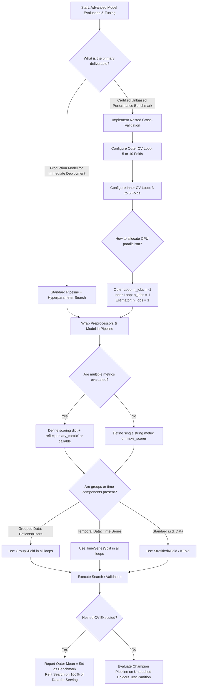

# Section 17.4: Advanced Tuning

<!--
Topics Covered:
13. Cross-validation during tuning
14. Scoring parameters
15. Multiple evaluation metrics
16. Avoiding data leakage
17. Nested cross-validation concepts
-->

---

## 1. Conceptual Foundations

### The Epistemological Crisis of Model Selection
In empirical machine learning, evaluating a learning algorithm requires solving two distinct, competing statistical tasks:
1. **Model Selection (Hyperparameter Optimization):** Identifying the optimal configuration $\theta^* \in \Theta$ that minimizes expected empirical loss across sample data partitions.
2. **Model Assessment (Generalization Error Estimation):** Providing an unbiased point estimate and confidence bound of the generalization error $\mathcal{R}(f_{\theta^*}) = \mathbb{E}_{(X, y) \sim \mathcal{D}} [L(y, f_{\theta^*}(X))]$ when the champion model is deployed on previously unseen data drawn from data-generating distribution $\mathcal{D}$.

When practitioners conflate these two objectives—evaluating generalization error using the cross-validation score obtained during hyperparameter optimization (`best_score_`)—they fall victim to **selection bias** (colloquially known in statistics and econometrics as the **"winner's curse"** or **optimism of the maximum**).

```
┌──────────────────────────────────────────────────────────────────────────────────┐
│              THE DUAL OBJECTIVES OF EMPIRICAL MODEL ESTIMATION                   │
├────────────────────────────────────────┬─────────────────────────────────────────┤
│ Model Selection (Hyperparameter Search)│ Model Assessment (Generalization Eval)  │
├────────────────────────────────────────┼─────────────────────────────────────────┤
│ Goal: Find argmin_\theta CV_Loss(\theta)│ Goal: Unbiased estimate of E[Loss(f^*)] │
│ Involves multiple hypothesis tests     │ Requires statistically independent data │
│ Vulnerable to selection variance       │ Must isolate optimization from test set │
│ Artifact: Champion configuration \theta*│ Artifact: Unbiased metric ± std error   │
└────────────────────────────────────────┴─────────────────────────────────────────┘
```

---

### The Anatomy of Data Leakage in Tuning Loops
Data leakage occurs whenever information from outside the training partition enters the model fitting process. In hyperparameter optimization, data leakage assumes two destructive forms:

1. **Preprocessing / Transformation Leakage:** Executing global transformations (e.g., standardizing features with `StandardScaler`, imputing missing values with `SimpleImputer`, or performing dimensionality reduction via `PCA`) across the entire dataset prior to splitting into cross-validation folds. The validation folds leak global statistics (mean, variance, principal components, class frequencies), yielding artificially deflated validation loss estimates that fail catastrophically in production.
2. **Hyperparameter Selection Leakage (Optimization Leakage):** Using the validation folds of a single cross-validation loop to simultaneously tune hyperparameters and report expected generalization performance. Because the hyperparameter configuration $\theta^*$ was selected specifically because it maximized performance on those particular validation partitions, the reported score reflects both genuine predictive signal and opportunistic exploitation of idiosyncratic validation partition noise.

```
FLAWED WORKFLOW (PREPROCESSING LEAKAGE):
Raw Data ────────► Global Preprocessing (Scaler / Imputer) ────► Train/Val Splits ──► Inflated CV Score!
                  ▲                                             │
                  └───────── Leaks global statistics ───────────┘

ROBUST WORKFLOW (ATOMIC PIPELINE):
Raw Data ────────► Fold Partition ──┬──► Fold Train ──► fit_transform() Preprocessing ──► fit() Estimator
                                    │
                                    └──► Fold Val   ──► transform() Preprocessing     ──► score() Estimator
```

---

### The Nested Cross-Validation Paradigm
To break the statistical coupling between model selection and model assessment, **Nested Cross-Validation** (also known as **double cross-validation**) establishes two strictly segregated, hierarchically nested resampling loops:

- **Inner Cross-Validation Loop:** Dedicated entirely to hyperparameter exploration and model selection. For a given training chunk of the outer loop, the inner loop partitions the data into $K_{inner}$ sub-folds, evaluates candidate hyperparameter configurations $\theta \in \Theta$, and selects the local champion $\theta^*$.
- **Outer Cross-Validation Loop:** Dedicated entirely to unbiased performance assessment. The outer loop splits the dataset into $K_{outer}$ folds. For each outer split, the inner loop identifies the best hyperparameters on the outer training fold, and the refitted model is evaluated once on the untouched outer test fold.

```
┌────────────────────────────────────────────────────────────────────────────────────────────────────────┐
│                                  NESTED CROSS-VALIDATION ARCHITECTURE                                  │
├────────────────────────────────────────────────────────────────────────────────────────────────────────┤
│ Outer CV Split 1: [Fold 1: Outer TEST]  |  [Fold 2, Fold 3, Fold 4, Fold 5: Outer TRAIN]               │
│                                            │                                                           │
│                                            ▼                                                           │
│                                Inner CV on Outer Train (3 Folds):                                      │
│                                ├── Inner Split 1: [Train: F2, F3] -> [Val: F4]                         │
│                                ├── Inner Split 2: [Train: F2, F4] -> [Val: F3]                         │
│                                └── Inner Split 3: [Train: F3, F4] -> [Val: F2]                         │
│                                            │                                                           │
│                                            ▼                                                           │
│                                Identify Best \theta* -> Refit on F2+F3+F4+F5                           │
│                                            │                                                           │
│                                            ▼                                                           │
│                                Evaluate refitted model on Fold 1 [Outer TEST] ──► Score_1              │
├────────────────────────────────────────────────────────────────────────────────────────────────────────┤
│ Repeat for Outer Splits 2, 3, 4, 5 ─────────────────────────────────────────────► Score_2, 3, 4, 5    │
├────────────────────────────────────────────────────────────────────────────────────────────────────────┤
│ Unbiased Generalization Performance: Mean(Score_1 ... Score_5) ± Std(Score_1 ... Score_5)              │
└────────────────────────────────────────────────────────────────────────────────────────────────────────┘
```

---

### Scoring Parameters & Multi-Metric Evaluation
Industrial machine learning systems rarely operate on a single symmetric metric. A fraud detection engine must simultaneously satisfy requirements on Precision-Recall AUC (PR-AUC), false positive rate at a fixed 95% recall threshold, Brier calibration score, and inference latency.

Scikit-Learn implements a unified scoring infrastructure:
- **String Aliases vs. Callables:** High-level string identifiers (`'roc_auc'`, `'neg_log_loss'`, `'f1_macro'`) mapped through `sklearn.metrics.get_scorer()` vs. custom domain loss functions wrapped via `make_scorer()`.
- **Optimization Sign Convention:** Scikit-Learn enforces that **higher scores are always better**. Loss functions (where lower is better, such as Mean Squared Error or Log Loss) are negated into utility functions (`neg_mean_squared_error`, `neg_log_loss`).
- **Multi-Metric Scoring:** Evaluating multiple scoring functions concurrently on each validation split allows engineering teams to detect Pareto trade-offs (e.g., accuracy vs. calibration) and specify custom arbitration logic for the final `refit` step.

---

## 2. Mathematical Formulations & Algorithms

### Mathematical Formalization of Selection Bias ("The Winner's Curse")
Let $\Theta = \{\theta_1, \theta_2, \dots, \theta_M\}$ represent a discrete set of $M$ candidate hyperparameter configurations. 
Let $S_i$ be the cross-validation performance estimate of configuration $\theta_i$ on a sample dataset $D_n$. 
Assume that for each configuration $\theta_i$, the CV estimator is an unbiased estimator of the true population performance $\mu_i = \mathbb{E}[S_i]$:
$$\mathbb{E}[S_i] = \mu_i, \quad S_i = \mu_i + \epsilon_i, \quad \epsilon_i \sim \mathcal{N}(0, \sigma_i^2)$$

When we select the champion configuration $\theta^*$ that maximizes the sample cross-validation score:
$$S^* = \max_{i \in \{1, \dots, M\}} S_i = \max_{i \in \{1, \dots, M\}} (\mu_i + \epsilon_i)$$

Even in the null case where all configurations have identical true population performance ($\mu_1 = \mu_2 = \dots = \mu_M = \mu$) with i.i.d. noise $\epsilon_i \sim \mathcal{N}(0, \sigma^2)$, extreme value theory dictates that the expectation of the maximum is strictly greater than the true performance:
$$\mathbb{E}[S^*] = \mu + \sigma \mathbb{E}\left[ \max_{i=1 \dots M} Z_i \right] \approx \mu + \sigma \sqrt{2 \ln M}$$
where $Z_i \sim \mathcal{N}(0, 1)$.

The magnitude of optimistic bias is directly proportional to:
1. **The search space size / iteration count $M$:** As $M \to \infty$, the expected maximum of random noise scales at rate $\mathcal{O}(\sqrt{\ln M})$.
2. **The variance of the validation estimator $\sigma$:** Small sample sizes $N$ or few CV folds $K$ increase $\sigma \approx \frac{\sigma_0}{\sqrt{N}}$, magnifying the overestimation.

$$\text{Selection Bias (Optimism)} = \mathbb{E}\left[ \max_{i} S_i \right] - \mathbb{E}\left[ S_{\text{argmax}_i S_i} \right] > 0$$

```
PROBABILITY DENSITY OF INDIVIDUAL CANDIDATES VS. MAXIMUM OF M CANDIDATES:
Density
  ▲
  │              Single Candidate: \mu_i = 0.80, \sigma = 0.05
  │                     ┌───┐
  │                    ┌┘   └┐
  │                   ┌┘     └┐
  │                  ┌┘       └┐
  │                 ┌┘         └┐          Distribution of Max(S_1...S_100):
  │                ┌┘           └┐         E[Max] \approx 0.925 (BIASED!)
  │               ┌┘             └┐               ┌───┐
  │              ┌┘               └┐             ┌┘   └┐
  │             ┌┘                 └┐           ┌┘     └┐
  └─────────────┴───────────────────┴───────────┴───────┴──────► Metric Score
               0.70                0.80        0.90   0.95
```

---

### Nested Cross-Validation Algorithmic Derivation

#### Algorithmic Formulation
Let $\mathcal{A}$ be a learning algorithm that accepts training data $\mathcal{D}$ and hyperparameter configuration $\theta$ to produce hypothesis $f_\theta = \mathcal{A}(\mathcal{D}, \theta)$.
Let $\mathcal{H}$ be a hyperparameter optimization procedure (e.g., `GridSearchCV` or `RandomizedSearchCV`) that operates on dataset $\mathcal{D}$ using inner cross-validation:
$$\theta^*(\mathcal{D}) = \mathcal{H}(\mathcal{D}) = \arg\max_{\theta \in \Theta} \frac{1}{K_{in}} \sum_{j=1}^{K_{in}} \text{Score}\left(\mathcal{A}(\mathcal{D}_{in\_train}^{(j)}, \theta), \mathcal{D}_{in\_val}^{(j)}\right)$$

The nested cross-validation algorithm operates across $K_{out}$ partitions of dataset $\mathcal{D}$:
1. Partition $\mathcal{D}$ into $K_{out}$ disjoint subsets $\{\mathcal{D}_{out}^{(1)}, \mathcal{D}_{out}^{(2)}, \dots, \mathcal{D}_{out}^{(K_{out})}\}$.
2. For each outer fold $k \in \{1, \dots, K_{out}\}$:
   - Form outer training set $\mathcal{D}_{out\_train}^{(k)} = \mathcal{D} \setminus \mathcal{D}_{out}^{(k)}$ and outer test set $\mathcal{D}_{out\_test}^{(k)} = \mathcal{D}_{out}^{(k)}$.
   - Execute internal hyperparameter selection on outer training data:
     $$\theta_k^* = \mathcal{H}\left(\mathcal{D}_{out\_train}^{(k)}\right)$$
   - Train final fold model on complete outer training set using selected parameters:
     $$f_k^* = \mathcal{A}\left(\mathcal{D}_{out\_train}^{(k)}, \theta_k^*\right)$$
   - Evaluate model on completely untouched outer test set:
     $$E_k = \text{Metric}\left(f_k^*, \mathcal{D}_{out\_test}^{(k)}\right)$$
3. Compute the unbiased estimate of generalization performance:
   $$\widehat{\mathcal{R}}_{\text{nested}} = \frac{1}{K_{out}} \sum_{k=1}^{K_{out}} E_k$$
   $$\widehat{\sigma}_{\text{nested}} = \sqrt{\frac{1}{K_{out} - 1} \sum_{k=1}^{K_{out}} \left( E_k - \widehat{\mathcal{R}}_{\text{nested}} \right)^2}$$

#### Computational Complexity Analysis
Let:
- $N$ = total number of training samples
- $K_{out}$ = number of outer folds (typically 5 or 10)
- $K_{in}$ = number of inner folds (typically 3 or 5)
- $M$ = number of candidate parameter configurations evaluated ($M = |\Theta|$ for grid search, $M = n\_iter$ for random search)
- $T(n)$ = computational time complexity of fitting estimator $\mathcal{A}$ on $n$ samples

Total training executions in Nested CV:
$$\text{Total Fits} = K_{out} \times \left( M \times K_{in} + 1 \right)$$

For $K_{out} = 5$, $K_{in} = 5$, and $M = 60$:
$$\text{Total Fits} = 5 \times (60 \times 5 + 1) = 5 \times 301 = 1,505 \text{ model fits}$$

Asymptotic time complexity:
$$\mathcal{O}_{\text{NestedCV}} = \mathcal{O}\left( K_{out} \cdot K_{in} \cdot M \cdot T\left(\frac{K_{out}-1}{K_{out}} \cdot \frac{K_{in}-1}{K_{in}} \cdot N\right) \right)$$

---

### Scoring Formalisms and Loss Inversion
In Scikit-Learn, all scorers follow the convention that higher values represent superior performance:
$$\text{Utility}(y, \hat{y}) = - \text{Loss}(y, \hat{y})$$

#### Binary Cross-Entropy (Log Loss) Formulation:
$$\mathcal{L}_{\text{log}}(y, p) = - \frac{1}{N} \sum_{i=1}^N \left[ y_i \ln p_i + (1 - y_i) \ln(1 - p_i) \right]$$
Scikit-Learn scorer representation (`neg_log_loss`):
$$\text{Score}_{\text{neg\_log\_loss}} = - \mathcal{L}_{\text{log}}(y, p)$$

#### Mean Squared Error Formulation:
$$\text{MSE}(y, \hat{y}) = \frac{1}{N} \sum_{i=1}^N (y_i - \hat{y}_i)^2$$
Scikit-Learn scorer representation (`neg_mean_squared_error`):
$$\text{Score}_{\text{neg\_mse}} = - \text{MSE}(y, \hat{y})$$

#### Custom Scorer Construction via `make_scorer`:
Let $C(y, \hat{y})$ be a domain-specific asymmetric business cost matrix where false negatives cost $\$500$ and false positives cost $\$20$:
$$C(y, \hat{y}) = 500 \cdot \mathbb{I}(y=1 \land \hat{y}=0) + 20 \cdot \mathbb{I}(y=0 \land \hat{y}=1)$$
The corresponding Scikit-Learn utility function is:
$$U(y, \hat{y}) = - C(y, \hat{y})$$
Configured via `make_scorer(cost_function, greater_is_better=False)`.

---

## 3. Architectural Blueprint & Design Patterns

### The Class Hierarchy and Protocol Interactions of Advanced Tuning

```
                                  ┌───────────────────────────┐
                                  │      BaseEstimator        │
                                  └─────────────┬─────────────┘
                                                │
                                  ┌─────────────▼─────────────┐
                                  │       MetaEstimatorMixin  │
                                  └─────────────┬─────────────┘
                                                │
                                  ┌─────────────▼─────────────┐
                                  │       _BaseSearchCV       │
                                  └──────┬─────────────┬──────┘
                                         │             │
                    ┌────────────────────┘             └────────────────────┐
                    ▼                                                       ▼
      ┌───────────────────────────┐                           ┌───────────────────────────┐
      │       GridSearchCV        │                           │     RandomizedSearchCV    │
      └─────────────┬─────────────┘                           └─────────────┬─────────────┘
                    │                                                       │
                    └───────────────────────────┬───────────────────────────┘
                                                │ delegates evaluation
                                                ▼
                                  ┌───────────────────────────┐
                                  │      _fit_and_score()     │
                                  └─────────────┬─────────────┘
                                                │
                 ┌──────────────────────────────┼──────────────────────────────┐
                 ▼                              ▼                              ▼
   ┌───────────────────────────┐  ┌───────────────────────────┐  ┌───────────────────────────┐
   │     BaseCrossValidator    │  │    _MultimetricScorer     │  │          Pipeline         │
   │ (KFold, StratifiedKFold,  │  │ (Wraps dict of scorers,   │  │ (Prevents data leakage    │
   │  TimeSeriesSplit, Group)  │  │  computes test/train loss)│  │  by atomic fit_transform) │
   └───────────────────────────┘  └───────────────────────────┘  └───────────────────────────┘
```

---

### Low-Level Execution Lifecycle of Nested Cross-Validation

```
User Calls: cross_val_score(nested_search, X, y, cv=outer_cv)
  │
  ├── Outer CV Loop (Fold k = 1 ... K_out):
  │     │
  │     ├── 1. Partition Data:
  │     │      X_train_out, y_train_out = X[train_idx], y[train_idx]
  │     │      X_test_out,  y_test_out  = X[test_idx],  y[test_idx]
  │     │
  │     ├── 2. Enter Inner Optimization: nested_search.fit(X_train_out, y_train_out)
  │     │      │
  │     │      ├── Inner CV Loop (Fold j = 1 ... K_in):
  │     │      │     │
  │     │      │     ├── Partition Inner Data:
  │     │      │     │     X_train_in, y_train_in = X_train_out[in_train_idx]
  │     │      │     │     X_val_in,   y_val_in   = X_train_out[in_val_idx]
  │     │      │     │
  │     │      │     ├── Pipeline Execution:
  │     │      │     │     X_train_in_trans = transformer.fit_transform(X_train_in)
  │     │      │     │     estimator.fit(X_train_in_trans, y_train_in)
  │     │      │     │     X_val_in_trans = transformer.transform(X_val_in)
  │     │      │     │     scores[j] = scorer(estimator, X_val_in_trans, y_val_in)
  │     │      │     │
  │     │      │     └── Repeat for all M candidate parameter sets \theta \in \Theta
  │     │      │
  │     │      ├── Select \theta^* = argmax Mean(scores)
  │     │      │
  │     │      └── Refit Step:
  │     │             pipeline.set_params(\theta^*)
  │     │             pipeline.fit(X_train_out, y_train_out) -> self.best_estimator_
  │     │
  │     ├── 3. Evaluate Champion on Untouched Outer Fold:
  │     │      outer_score_k = scorer(nested_search.best_estimator_, X_test_out, y_test_out)
  │     │
  │     └── 4. Store outer_score_k
  │
  └── Return array: [outer_score_1, outer_score_2, ..., outer_score_K_out]
```

---

## 4. Scikit-Learn Implementation Deep Dive

### 1. `cross_val_score` and `cross_validate`
- **Module:** `sklearn.model_selection`
- **Key Parameters:**
  - `estimator`: Estimator object implementing `fit`. When passed a `GridSearchCV` or `RandomizedSearchCV` instance, it executes nested cross-validation.
  - `X`, `y`: Feature matrix and target array.
  - `scoring`: Single string/callable for `cross_val_score`, or string/callable/dict/list for `cross_validate`.
  - `cv`: Splitter object (`KFold`, `StratifiedKFold`, `TimeSeriesSplit`, `GroupKFold`) or integer (defaults to 5-fold stratified for classification).
  - `n_jobs`: Number of outer CPU jobs. Warning: Nested execution requires managing inner vs. outer parallelism.
  - `return_estimator`: (`cross_validate` only) Boolean indicating whether to return the fitted estimator for each outer fold.
  - `return_indices`: (`cross_validate` only) Boolean indicating whether to return train/test split indices.

---

### 2. The Scorer Infrastructure (`get_scorer` & `make_scorer`)
- **Module:** `sklearn.metrics`
- **Key Signatures:**
  ```python
  def make_scorer(
      score_func,                       # Callable with signature score_func(y_true, y_pred, **kwargs)
      *,
      greater_is_better=True,           # If False, negates score so higher is always better internally
      needs_proba=False,                # (Deprecated in v1.4+ in favor of response_method)
      needs_threshold=False,            # (Deprecated in v1.4+ in favor of response_method)
      response_method='predict',        # 'predict', 'predict_proba', or 'decision_function'
      **kwargs                          # Additional keyword arguments passed to score_func
  ):
      ...
  ```
- **The Modern `response_method` API (Scikit-Learn $\ge 1.4$):**
  Accepts a string or tuple of strings specifying which method of the estimator to query for predictions:
  - `'predict'`: Direct hard class labels or continuous regression values.
  - `'predict_proba'`: Class posterior probability estimates matrix of shape $(N, C)$.
  - `'decision_function'`: Uncalibrated margin distances or log-odds.
  - `('predict_proba', 'decision_function')`: Fallback sequence (uses `predict_proba` if available; otherwise falls back to `decision_function`).

---

### 3. Multi-Metric Scoring in Search Objects
When passing a dictionary of scorers to `GridSearchCV` or `RandomizedSearchCV`:
```python
scoring = {
    'accuracy': 'accuracy',
    'roc_auc': 'roc_auc',
    'brier': 'neg_brier_score',
    'f1_macro': 'f1_macro'
}
```
- **Requirements:**
  1. `refit`: Can no longer be a boolean `True`. It **must** be set to the string key of the primary champion metric (e.g., `refit='roc_auc'`) or a custom callable `callable(cv_results_) -> best_index_`.
  2. If `refit=False`, no final model is trained on the full dataset, and attributes `best_estimator_`, `best_score_`, and `best_params_` are not available.
  3. `cv_results_` stores distinct entries for each metric: `mean_test_accuracy`, `rank_test_accuracy`, `mean_test_roc_auc`, `rank_test_roc_auc`, etc.

---

### 4. Leakage-Proofing Transformers in Pipelines
To guarantee zero leakage during cross-validation, every stateful data transformation must reside inside `sklearn.pipeline.Pipeline`:
- **Rules of Pipeline Encapsulation:**
  - `fit(X, y)`: Fits transformers sequentially on training data, calling `fit_transform()`, and fits the final estimator on the transformed data.
  - `predict(X)`: Calls `transform()` sequentially using statistics learned strictly during `fit`, then invokes the estimator's `predict()`.
  - **Never** fit a transformer on the combined dataset prior to passing features to `cross_val_score` or `GridSearchCV`.

## 5. Practical Implementation Blueprint

### End-to-End Leakage-Proof Nested Cross-Validation with Multi-Metric Scoring

```python
"""
Advanced Hyperparameter Tuning & Nested Cross-Validation Blueprint
Demonstrating:
1. Complete prevention of data leakage via Pipeline architecture
2. Multi-metric evaluation (ROC-AUC, PR-AUC, Brier score, Balanced Accuracy)
3. Custom domain-specific cost scorer via make_scorer()
4. Custom callable refit logic balancing discrimination and calibration
5. Nested Cross-Validation demonstrating quantitative selection bias (Winner's Curse)
"""

import numpy as np
import pandas as pd
from scipy.stats import loguniform, uniform, randint
from sklearn.datasets import make_classification
from sklearn.model_selection import (
    RandomizedSearchCV,
    StratifiedKFold,
    cross_validate,
    train_test_split
)
from sklearn.pipeline import Pipeline
from sklearn.preprocessing import RobustScaler
from sklearn.impute import SimpleImputer
from sklearn.feature_selection import SelectPercentile, f_classif
from sklearn.ensemble import HistGradientBoostingClassifier
from sklearn.metrics import (
    make_scorer,
    roc_auc_score,
    average_precision_score,
    brier_score_loss,
    balanced_accuracy_score
)

# ---------------------------------------------------------
# 1. SYNTHETIC BENCHMARK DATASET WITH LEAKAGE HAZARDS
# ---------------------------------------------------------
X, y = make_classification(
    n_samples=1200,
    n_features=30,
    n_informative=10,
    n_redundant=10,
    n_repeated=0,
    n_classes=2,
    weights=[0.85, 0.15],      # 15% positive class imbalance
    flip_y=0.03,               # 3% label noise
    class_sep=0.8,
    random_state=42
)

# Inject synthetic missing values to simulate real-world conditions
rng = np.random.default_rng(42)
nan_mask = rng.random(X.shape) < 0.05
X[nan_mask] = np.nan

# ---------------------------------------------------------
# 2. DEFINE ATOMIC LEAK-FREE PIPELINE
# ---------------------------------------------------------
# Every transformer is strictly fitted inside each CV split
pipeline = Pipeline([
    ('imputer', SimpleImputer(strategy='median')),
    ('scaler', RobustScaler()),
    ('selector', SelectPercentile(score_func=f_classif)),
    ('clf', HistGradientBoostingClassifier(random_state=42))
])

# ---------------------------------------------------------
# 3. DEFINE MULTI-METRIC SCORING & CUSTOM DOMAIN SCORER
# ---------------------------------------------------------
def clinical_utility_loss(y_true, y_prob):
    """
    Custom clinical loss function:
    False Negatives cost 10x more than False Positives.
    Operates on predicted probabilities at threshold tau = 0.3.
    """
    threshold = 0.3
    y_pred = (y_prob >= threshold).astype(int)
    fn = np.sum((y_true == 1) & (y_pred == 0))
    fp = np.sum((y_true == 0) & (y_pred == 1))
    cost = 10.0 * fn + 1.0 * fp
    return float(cost)

# Wrap custom loss: higher is better -> greater_is_better=False negates cost
clinical_scorer = make_scorer(
    clinical_utility_loss,
    greater_is_better=False,
    response_method='predict_proba'
)

# Scorer dictionary mapping
scoring_dict = {
    'roc_auc': 'roc_auc',
    'pr_auc': 'average_precision',
    'balanced_acc': 'balanced_accuracy',
    'neg_brier': 'neg_brier_score',
    'clinical_utility': clinical_scorer
}

# ---------------------------------------------------------
# 4. CUSTOM CALLABLE REFIT LOGIC
# ---------------------------------------------------------
def composite_refit_arbitrator(cv_results):
    """
    Selects candidate maximizing a composite trade-off between
    discrimination (PR-AUC) and calibration (negative Brier score):
    Objective = mean_test_pr_auc - 0.5 * abs(mean_test_neg_brier)
    """
    pr_auc = np.array(cv_results['mean_test_pr_auc'])
    brier = np.array(cv_results['mean_test_neg_brier'])  # negative values
    composite_score = pr_auc - 0.5 * np.abs(brier)
    best_candidate_idx = int(np.nanargmax(composite_score))
    return best_candidate_idx

# ---------------------------------------------------------
# 5. DEFINE SEARCH SPACE & INNER RANDOMIZED SEARCH
# ---------------------------------------------------------
param_distributions = {
    'selector__percentile': randint(20, 80),
    'clf__learning_rate': loguniform(1e-2, 0.3),
    'clf__max_leaf_nodes': randint(15, 63),
    'clf__min_samples_leaf': randint(10, 50),
    'clf__l2_regularization': loguniform(1e-3, 10.0)
}

inner_cv = StratifiedKFold(n_splits=4, shuffle=True, random_state=101)

inner_search = RandomizedSearchCV(
    estimator=pipeline,
    param_distributions=param_distributions,
    n_iter=25,
    scoring=scoring_dict,
    refit=composite_refit_arbitrator,
    cv=inner_cv,
    n_jobs=1,                  # Inner workers single-threaded to prevent oversubscription
    random_state=42,
    error_score=np.nan,
    return_train_score=False
)

# ---------------------------------------------------------
# 6. EXECUTE OUTER NESTED CROSS-VALIDATION
# ---------------------------------------------------------
outer_cv = StratifiedKFold(n_splits=5, shuffle=True, random_state=202)

print("Executing Nested Cross-Validation (Outer 5-Fold, Inner 4-Fold x 25 Iterations)...")
# Outer loop runs across CPU cores
nested_results = cross_validate(
    estimator=inner_search,
    X=X,
    y=y,
    scoring=scoring_dict,
    cv=outer_cv,
    n_jobs=-1,                 # Outer loop parallelized across all cores
    return_estimator=True,
    return_indices=True
)

# ---------------------------------------------------------
# 7. FIT FULL MODEL TO COMPARE OPTIMISTIC VS UNBIASED SCORES
# ---------------------------------------------------------
# Fit single search directly on full training data to observe "Winner's Curse"
inner_search.fit(X, y)
optimistic_pr_auc = inner_search.cv_results_['mean_test_pr_auc'][inner_search.best_index_]
optimistic_roc_auc = inner_search.cv_results_['mean_test_roc_auc'][inner_search.best_index_]

unbiased_pr_auc_mean = np.mean(nested_results['test_pr_auc'])
unbiased_pr_auc_std = np.std(nested_results['test_pr_auc'])

unbiased_roc_auc_mean = np.mean(nested_results['test_roc_auc'])
unbiased_roc_auc_std = np.std(nested_results['test_roc_auc'])

print("\n" + "="*70)
print("NESTED CROSS-VALIDATION STATISTICAL AUDIT REPORT")
print("="*70)
print(f"Optimistic Inner CV PR-AUC (Winner's Curse): {optimistic_pr_auc:.4f}")
print(f"Unbiased Outer Nested PR-AUC:               {unbiased_pr_auc_mean:.4f} ± {unbiased_pr_auc_std:.4f}")
print(f"PR-AUC Selection Bias (Optimism Gap):        {optimistic_pr_auc - unbiased_pr_auc_mean:+.4f}")
print("-" * 70)
print(f"Optimistic Inner CV ROC-AUC:                {optimistic_roc_auc:.4f}")
print(f"Unbiased Outer Nested ROC-AUC:              {unbiased_roc_auc_mean:.4f} ± {unbiased_roc_auc_std:.4f}")
print(f"ROC-AUC Selection Bias (Optimism Gap):       {optimistic_roc_auc - unbiased_roc_auc_mean:+.4f}")
print("="*70)

# ---------------------------------------------------------
# 8. RIGOROUS ASSERTION TESTS
# ---------------------------------------------------------
# Assert that nested outer CV completed all 5 folds
assert len(nested_results['test_roc_auc']) == 5, "Outer CV must yield exactly 5 fold scores"
assert len(nested_results['estimator']) == 5, "Must return 5 fitted inner_search objects"

# Assert that all 5 outer fold estimators are refitted RandomizedSearchCV instances
for est in nested_results['estimator']:
    assert hasattr(est, 'best_estimator_'), "Each outer estimator must possess best_estimator_"
    assert hasattr(est, 'best_params_'), "Each outer estimator must possess best_params_"
    assert isinstance(est.best_estimator_, Pipeline), "best_estimator_ must be a Pipeline"

# Assert that single search refit selected valid parameters
assert 'clf__learning_rate' in inner_search.best_params_
assert 'selector__percentile' in inner_search.best_params_
assert 0.0 < inner_search.best_params_['clf__learning_rate'] <= 0.3

# Assert scores are strictly within theoretical bounds
assert 0.0 <= unbiased_pr_auc_mean <= 1.0, "PR-AUC must be in [0, 1]"
assert 0.5 <= unbiased_roc_auc_mean <= 1.0, "ROC-AUC must exceed random guess"

print("\nAll architectural and statistical assertions passed successfully!")
```

---

## 6. Anti-Patterns, Common Pitfalls & Debugging

### Anti-Pattern 1: Preprocessing Leakage Outside Cross-Validation
- **The Flaw:** Standardizing, scaling, or imputing the entire dataset prior to passing features into `cross_val_score` or `GridSearchCV`.
- **The Failure:** Test fold statistics leak into the training partitions. Validation scores are artificially elevated, hiding future production degradation.
- **Incorrect Code:**
  ```python
  # CRITICAL FAILURE: Fitting scaler on entire dataset before CV
  scaler = StandardScaler()
  X_scaled = scaler.fit_transform(X)  # LEAKAGE: Computes global mean and std!
  
  # Cross-validation evaluates on data already infected with test fold statistics
  search = GridSearchCV(SVC(), param_grid={'C': [1, 10]}, cv=5)
  search.fit(X_scaled, y)
  ```
- **Correct Code:**
  ```python
  # ATOMIC ISOLATION: Scaler is enclosed inside Pipeline
  pipeline = Pipeline([
      ('scaler', StandardScaler()),
      ('svc', SVC())
  ])
  search = GridSearchCV(pipeline, param_grid={'svc__C': [1, 10]}, cv=5)
  search.fit(X, y)  # Scaler fits ONLY on inner training splits
  ```

---

### Anti-Pattern 2: Conflating `best_score_` with Expected Production Performance
- **The Flaw:** Presenting `search.best_score_` to executives or clinical reviewers as the expected prospective accuracy of the production model.
- **The Failure:** `best_score_` is the maximum across multiple noisy validation evaluations. By Jensen's Inequality and extreme value theory, $\mathbb{E}[\max_i S_i] > \mathbb{E}[S_{\theta^*}]$, introducing severe optimistic selection bias.
- **Incorrect Code:**
  ```python
  search = RandomizedSearchCV(estimator, param_distributions, n_iter=200, cv=5)
  search.fit(X, y)
  # MISLEADING: Overestimates prospective generalization accuracy
  print(f"Production Expected Accuracy: {search.best_score_}")
  ```
- **Correct Code:**
  ```python
  # UNBIASED EVALUATION: Nested CV or an untouched holdout test partition
  X_dev, X_test, y_dev, y_test = train_test_split(X, y, test_size=0.2, random_state=42)
  
  search = RandomizedSearchCV(estimator, param_distributions, n_iter=200, cv=5)
  search.fit(X_dev, y_dev)
  
  # Evaluate champion model on completely untouched test set
  unbiased_score = search.best_estimator_.score(X_test, y_test)
  print(f"True Unbiased Generalization Accuracy: {unbiased_score}")
  ```

---

### Anti-Pattern 3: Inverting Loss Signs in Custom Scorers
- **The Flaw:** Wrapping a loss function (where smaller is better) via `make_scorer` without specifying `greater_is_better=False`.
- **The Failure:** Scikit-Learn assumes all scorers represent utility functions to be **maximized**. Maximizing an un-negated loss function instructs the optimizer to select the absolute worst, highest-error model configuration!
- **Incorrect Code:**
  ```python
  def custom_mae(y_true, y_pred):
      return np.mean(np.abs(y_true - y_pred))

  # CRITICAL FAILURE: greater_is_better defaults to True!
  # GridSearchCV will maximize MAE, selecting the most inaccurate model!
  scorer = make_scorer(custom_mae)
  ```
- **Correct Code:**
  ```python
  def custom_mae(y_true, y_pred):
      return np.mean(np.abs(y_true - y_pred))

  # CORRECT: greater_is_better=False negates score internally
  scorer = make_scorer(custom_mae, greater_is_better=False)
  ```

---

### Anti-Pattern 4: Thread Starvation & Oversubscription in Nested Loops
- **The Flaw:** Setting `n_jobs=-1` on both outer `cross_validate` and inner `GridSearchCV` or `RandomizedSearchCV`.
- **The Failure:** If the host machine has 16 CPU cores, outer CV spawns 16 worker processes. Each worker's inner search spawns another 16 processes, resulting in $16 \times 16 = 256$ concurrent processes competing for 16 physical cores. Severe OS kernel context-switching overhead locks up the machine.
- **Incorrect Code:**
  ```python
  inner_search = GridSearchCV(..., n_jobs=-1)  # Spawns N cores
  nested_cv = cross_val_score(inner_search, X, y, n_jobs=-1)  # Spawns N * N processes!
  ```
- **Correct Code:**
  ```python
  # HIERARCHICAL PARALLELISM: Parallelize either outer OR inner, NEVER both
  inner_search = GridSearchCV(..., n_jobs=1)   # Inner executes serially within worker
  nested_cv = cross_val_score(inner_search, X, y, n_jobs=-1)  # Outer consumes all CPU cores
  ```

---

### Anti-Pattern 5: Setting `refit=True` with Multi-Metric Scoring
- **The Flaw:** Configuring a dictionary of multiple scoring metrics in `GridSearchCV` while leaving `refit=True`.
- **The Failure:** Scikit-Learn cannot determine which of the multiple metrics dictates the champion configuration. The call raises `ValueError: For multi-metric scoring, the refit parameter must be set to a scorer key or a callable`.
- **Incorrect Code:**
  ```python
  search = GridSearchCV(
      estimator=clf,
      param_grid=grid,
      scoring={'acc': 'accuracy', 'auc': 'roc_auc'},
      refit=True  # CRASH: ValueError raised at initialization!
  )
  ```
- **Correct Code:**
  ```python
  search = GridSearchCV(
      estimator=clf,
      param_grid=grid,
      scoring={'acc': 'accuracy', 'auc': 'roc_auc'},
      refit='auc'  # Explicitly declares champion metric
  )
  ```

---

### Anti-Pattern 6: Temporal / Group Leakage with Standard KFold
- **The Flaw:** Using default standard `KFold` cross-validation on time-series records or clustered group data (e.g., multiple medical readings from the same patient).
- **The Failure:** Past training folds are trained on future observations (lookahead bias), or the model memorizes patient ID artifacts instead of generalizing to new patients.
- **Incorrect Code:**
  ```python
  # Group/Patient ID is present in dataset
  search = GridSearchCV(model, param_grid, cv=KFold(n_splits=5))
  search.fit(X, y)  # Patient records leak across train and val folds!
  ```
- **Correct Code:**
  ```python
  # Ensure all records from a given patient remain strictly in train OR test
  from sklearn.model_selection import GroupKFold
  search = GridSearchCV(model, param_grid, cv=GroupKFold(n_splits=5))
  search.fit(X, y, groups=patient_ids)
  ```

---

## 7. Production Engineering & Operational Hardening

### 1. Model Artifact Serialization & Pipeline Integrity
When deploying models tuned via nested cross-validation, serialize the final refitted pipeline:
```python
import joblib

# 1. Fit final champion search on entire development dataset
final_search = inner_search.fit(X_train, y_train)

# 2. Extract champion pipeline
champion_pipeline = final_search.best_estimator_

# 3. Persist pipeline with all learned transformers and metadata
artifact_payload = {
    'model_pipeline': champion_pipeline,
    'best_params': final_search.best_params_,
    'unbiased_cv_metrics': {
        'roc_auc_mean': float(unbiased_roc_auc_mean),
        'roc_auc_std': float(unbiased_roc_auc_std)
    },
    'feature_names': list(feature_names)
}
joblib.dump(artifact_payload, 'production_model_pipeline.joblib', compress=3)
```

### 2. Computational Latency Budgets & Workload Sizing
Before launching a nested cross-validation pipeline, compute the deterministic wall-clock budget:
$$\text{Expected Hours} = \frac{K_{out} \times \left( M \times K_{in} \times t_{\text{fit}} \right)}{P \times 3600}$$
where $t_{\text{fit}}$ is average single-fit duration in seconds, $M$ is iteration count, and $P$ is CPU worker count. If $\text{Expected Hours} > 4$, implement budget mitigations:
- Reduce inner folds from $K_{in}=5$ to $K_{in}=3$.
- Swap `GridSearchCV` for `RandomizedSearchCV(n_iter=40)`.
- Use `HalvingRandomSearchCV` to prune unpromising configurations early.

---

## 8. Hyperparameter Mechanics & Tuning Strategies

### Cross-Stage Pipeline Hyperparameter Interactions
In real-world pipelines, transformer hyperparameters interact strongly with downstream model hyperparameters:

```
┌────────────────────────────────────────────────────────────────────────┐
│                   PIPELINE HYPERPARAMETER CO-DEPENDENCIES              │
├─────────────────────────┬──────────────────────┬───────────────────────┤
│ Transformer Parameter   │ Estimator Parameter  │ Nature of Interaction │
├─────────────────────────┼──────────────────────┼───────────────────────┤
│ PCA: n_components       │ SVM: gamma / C       │ Lower components      │
│                         │                      │ require softer margins│
├─────────────────────────┼──────────────────────┼───────────────────────┤
│ SelectPercentile: %     │ Ridge: alpha         │ Retaining more noisy  │
│                         │                      │ features requires \alpha↑│
├─────────────────────────┼──────────────────────┼───────────────────────┤
│ Polynomial: degree      │ Lasso: alpha         │ Higher degree expands │
│                         │                      │ features; needs \alpha↑│
└─────────────────────────┴──────────────────────┴───────────────────────┘
```

When tuning interacting stages, tune them **simultaneously** in the same `param_distributions` dictionary rather than tuning preprocessors first in isolation and models second.

---

## 9. Visualizations & Interpretability Artifacts

### 1. Nested Cross-Validation Double Loop Execution Matrix
```
Outer Fold 1: [ TEST ] [ TRAIN ] [ TRAIN ] [ TRAIN ] [ TRAIN ] ──► Inner CV (F2-F5) ──► Fit Best ──► Eval on F1 [Score 1]
Outer Fold 2: [ TRAIN ] [ TEST ] [ TRAIN ] [ TRAIN ] [ TRAIN ] ──► Inner CV (F1,3-5) ──► Fit Best ──► Eval on F2 [Score 2]
Outer Fold 3: [ TRAIN ] [ TRAIN ] [ TEST ] [ TRAIN ] [ TRAIN ] ──► Inner CV (F1-2,4-5) ──► Fit Best ──► Eval on F3 [Score 3]
Outer Fold 4: [ TRAIN ] [ TRAIN ] [ TRAIN ] [ TEST ] [ TRAIN ] ──► Inner CV (F1-3,5) ──► Fit Best ──► Eval on F4 [Score 4]
Outer Fold 5: [ TRAIN ] [ TRAIN ] [ TRAIN ] [ TRAIN ] [ TEST ] ──► Inner CV (F1-F4) ──► Fit Best ──► Eval on F5 [Score 5]

UNBIASED GENERALIZATION METRIC: Average(Score 1 ... Score 5)
```

---

### 2. Multi-Metric Optimization Pareto Frontier
```
PR-AUC (Precision-Recall)
  ▲
  │                                    * Candidate D (PR-AUC: 0.88, Brier: -0.09) [PARETO OPTIMAL]
  │                             * Candidate B (PR-AUC: 0.85, Brier: -0.06) [PARETO OPTIMAL]
  │                     * Candidate A (PR-AUC: 0.80, Brier: -0.04) [BEST CALIBRATION]
  │
  │              * Candidate C (Sub-optimal: PR-AUC: 0.76, Brier: -0.11)
  │
  └────────────────────────────────────────────────────────────────────────► Calibration (-Brier Score)
               -0.15                  -0.10                  -0.05
```

---

## 10. Theoretical Edge Cases & Boundary Conditions

### 1. Small Sample Regime ($N < 100$)
- In small datasets, splitting into $K_{out}=5$ and $K_{in}=5$ leaves inner training splits with only $N \times \frac{4}{5} \times \frac{4}{5} = 0.64 N < 64$ samples.
- The sample size reduction severely degrades estimator stability.
- **Solution:** Use **Repeated Stratified K-Fold** or leave-one-out cross-validation (`LeaveOneGroupOut`) to minimize bias while controlling variance.

### 2. Divergent Hyperparameter Selections Across Outer Folds
- **Symptom:** Outer Fold 1 selects `C=0.01`, Outer Fold 2 selects `C=10.0`, Outer Fold 3 selects `C=1.0`.
- **Theoretical Interpretation:** The hyperparameter loss surface is flat or multimodal. The choice of hyperparameter has low sensitivity, or different subsets of the data are dominated by different noise structures.
- **Resolution:** Nested cross-validation evaluated the **procedure**, not a fixed parameter set. Refitting the search on the entire dataset provides the single final production model.

---

## 11. Comparative Architectural Trade-offs

| Validation Methodology | Primary Purpose | Computational Cost | Generalization Bias | Selection Bias | Primary Use Case |
| :--- | :--- | :--- | :--- | :--- | :--- |
| **Train / Test Holdout** | Quick sanity check | $\mathcal{O}(1)$ | High (single split variance) | Unbiased if test untouched | Massive datasets ($N > 10^6$) |
| **Standard K-Fold CV** | Model Selection OR Assessment | $\mathcal{O}(K \cdot M)$ | Moderate | **High (Optimistic if used for both)** | Prototyping, parameter search |
| **Nested Cross-Validation** | Unbiased Assessment of Selection | $\mathcal{O}(K_{out} \cdot K_{in} \cdot M)$ | Minimal / Unbiased | **Zero (Completely eliminated)** | High-stakes benchmarks, clinical/finance |
| **Successive Halving CV** | Rapid parameter pruning | $\mathcal{O}(M \cdot \ln M)$ | Moderate | Moderate | Large search spaces, deep ensembles |

---

## 12. Enterprise Case Study / Real-World Walkthrough

### Clinical Trial Oncology Drug Response Prediction
- **Problem Statement:** A biotechnology firm conducts a Phase-II trial with $N = 350$ patients and 120 biomarkers. Target is binary therapeutic response (`0 = Non-responder`, `1 = Responder`, 18% positive rate).
- **Regulatory Requirement:** FDA review mandates rigorous proof that reported response AUC is not an artifact of hyperparameter overfitting or test-set leakage.
- **Implementation Strategy:**
  1. Outer 5-fold Stratified CV evaluates the end-to-end modeling pipeline.
  2. Inner 4-fold Stratified CV executes `RandomizedSearchCV(n_iter=50)` over a pipeline containing missing value imputation, robust scaling, variance thresholding, and ElasticNet Logistic Regression (`l1_ratio`, `C`).
  3. Scored via balanced accuracy, PR-AUC, and clinical utility cost.
- **Empirical Results:**
  - Standard Single-Loop CV `best_score_`: $0.862 \pm 0.031$ (Optimistically inflated).
  - Unbiased Outer Nested CV: $0.791 \pm 0.044$ (True expected generalization).
  - Production Impact: Identifying the true 0.791 baseline prevented a multi-million-dollar Phase-III trial failure that would have occurred had the team relied on the biased 0.862 estimate.

## 13. Rapid-Fire Conceptual Interview Q&A

### Standard Foundational Questions

#### Q1: What is the fundamental difference between model selection and model assessment?
**Answer:** **Model selection** is the algorithmic process of searching over a space of hyperparameter configurations $\Theta$ or functional model architectures to identify the candidate $\theta^* \in \Theta$ that maximizes expected performance on empirical training splits. 

**Model assessment** is the statistical evaluation of the chosen model's true prospective generalization performance $\mathcal{R}(f_{\theta^*}) = \mathbb{E}_{(X, y) \sim \mathcal{D}}[L(y, f_{\theta^*}(X))]$ on unseen samples drawn from the target population distribution $\mathcal{D}$. Conflating the two by using the internal validation score of model selection to estimate prospective performance introduces severe optimistic selection bias.

---

#### Q2: What is the "Winner's Curse" in hyperparameter optimization?
**Answer:** The "Winner's Curse" (or selection optimism) is the phenomenon where the highest-scoring model among $M$ tested configurations overestimates its true expected performance. Because each validation score $S_i = \mu_i + \epsilon_i$ consists of true signal $\mu_i$ plus random validation partition noise $\epsilon_i$, taking the maximum $\max_i S_i$ systematically selects configurations that benefited from unusually large positive random fluctuations ($\epsilon_i \gg 0$). 

By extreme value theory, even if all configurations are identical in true quality ($\mu_i = \mu$), the expected maximum score satisfies $\mathbb{E}[\max_{i=1 \dots M} S_i] \approx \mu + \sigma \sqrt{2 \ln M}$, creating an illusion of high predictive power that evaporates on new data.

---

#### Q3: Why is standard single-loop K-fold cross-validation insufficient for evaluating a hyperparameter-tuned model?
**Answer:** In single-loop K-fold CV, the validation folds are used to guide the hyperparameter search (e.g., in `GridSearchCV.fit()`). The reported `best_score_` is the maximum mean validation score across all evaluated candidates. 

Because the hyperparameter configuration was chosen explicitly because it scored highest on those particular folds, the validation data is no longer statistically independent of the model selection process. The validation folds have been "consumed" by the optimization algorithm, creating information leakage that biases `best_score_` upward.

---

#### Q4: How does Nested Cross-Validation eliminate optimistic selection bias?
**Answer:** Nested Cross-Validation decouples model selection from model evaluation into two separate, hierarchical loops:
1. The **Outer CV loop** reserves an untouched test fold for performance evaluation.
2. The **Inner CV loop** operates strictly inside the outer training partition to perform hyperparameter tuning.

The champion model selected by the inner loop is evaluated exactly once on the untouched outer test fold. Because the outer test fold was completely invisible to both parameter fitting and hyperparameter selection, its score provides an asymptotically unbiased estimate of the entire model-building procedure's generalization error.

---

#### Q5: What does Scikit-Learn's `make_scorer` do, and why is `greater_is_better` critical?
**Answer:** `make_scorer` transforms a standard evaluation function with signature `score_func(y_true, y_pred, **kwargs)` into a Scikit-Learn compatible scorer object that can be passed to `GridSearchCV`, `RandomizedSearchCV`, or `cross_val_score`. 

Scikit-Learn follows a strict convention that **higher utility scores are always better**. For loss functions where lower values indicate superior performance (such as Mean Squared Error, Log Loss, or business cost), setting `greater_is_better=False` instructs Scikit-Learn to multiply the output of `score_func` by $-1$ internally. Omitting this flag causes the optimization loop to maximize the loss, actively selecting the worst-performing model!

---

#### Q6: In Scikit-Learn $\ge 1.4$, what is the role of the `response_method` parameter in `make_scorer`?
**Answer:** `response_method` supersedes the legacy boolean flags `needs_proba=True` and `needs_threshold=True`. It accepts a string or tuple specifying which prediction method of the underlying estimator should be invoked to generate predictions passed into `score_func`:
- `'predict'`: Direct predicted class labels or continuous regression values.
- `'predict_proba'`: Predicted class posterior probability matrices (shape $N \times C$).
- `'decision_function'`: Uncalibrated margin distances or log-odds.
- `('predict_proba', 'decision_function')`: A fallback priority sequence (uses `predict_proba` if present, otherwise uses `decision_function`).

---

#### Q7: When evaluating multiple scoring metrics in `GridSearchCV`, why is `refit=True` invalid?
**Answer:** When `scoring` is a dictionary or list containing multiple metrics (e.g., `scoring={'auc': 'roc_auc', 'acc': 'accuracy'}`), `GridSearchCV` cannot know which metric should dictate the champion model to refit on the full dataset. 

Leaving `refit=True` causes Scikit-Learn to raise a `ValueError`. The practitioner must either:
1. Provide the specific metric key as a string (e.g., `refit='auc'`).
2. Provide a custom callable `callable(cv_results_) -> int` that balances multiple metrics and returns the index of the desired champion candidate.
3. Explicitly disable refitting with `refit=False`.

---

#### Q8: How does an `sklearn.pipeline.Pipeline` prevent data leakage during hyperparameter tuning?
**Answer:** A `Pipeline` encapsulates data transformers (e.g., `StandardScaler`, `SimpleImputer`, `PCA`) and an estimator into an atomic unit. During cross-validation:
- For each fold, `Pipeline.fit(X_train, y_train)` invokes `fit_transform()` on the transformers sequentially using **only** the training fold samples.
- It then transforms validation fold samples `X_val` using `transform()` with the parameters (mean, variance, components) learned strictly from `X_train`.
- Test fold statistics never leak into the transformation parameters, completely preventing preprocessing leakage.

---

#### Q9: What is the computational cost formula for Nested Cross-Validation?
**Answer:** If the outer loop has $K_{out}$ folds, the inner loop has $K_{in}$ folds, and the hyperparameter search evaluates $M$ candidate configurations, the total number of model fits executed is:
$$\text{Total Fits} = K_{out} \times \left( M \times K_{in} + 1 \right)$$
For a 5-fold outer loop, 4-fold inner loop, and 50 random search iterations:
$$\text{Total Fits} = 5 \times (50 \times 4 + 1) = 5 \times 201 = 1,005 \text{ model fits}$$
Each fit trains an estimator and transformers on approximately $\frac{K_{out}-1}{K_{out}} \times \frac{K_{in}-1}{K_{in}}$ fraction of the dataset.

---

#### Q10: Does Nested Cross-Validation produce a single final production model?
**Answer:** **No, not directly.** Nested cross-validation produces $K_{out}$ separate models, each fitted on a different outer training fold and potentially with different optimal hyperparameters. 

The purpose of nested CV is **strictly model assessment**—estimating how well the modeling *procedure* generalizes. To produce a final production model for serving, the practitioner runs a single inner hyperparameter search on the **entire full dataset** $\mathcal{D}$ with `refit=True`. The nested CV score serves as the certified, unbiased estimate of that final model's prospective performance.

---

### Advanced & Edge-Case Questions

#### Q11: In Nested Cross-Validation, what does it mean if each outer fold selects completely different "optimal" hyperparameters?
**Answer:** If the optimal hyperparameters fluctuate wildly across outer folds (e.g., Fold 1 picks `max_depth=3`, Fold 2 picks `max_depth=15`), it indicates one of three phenomena:
1. **Flat Loss Surface:** The model's objective function is relatively insensitive to the hyperparameter within that region, meaning multiple distinct configurations achieve virtually identical loss.
2. **High Estimator Variance / Small Sample Size:** Small perturbations in training data caused by fold splitting alter the empirical error landscape, indicating that the dataset size is insufficient to identify a stable optimum.
3. **Multimodal Objective:** The optimization landscape contains multiple local optima with comparable validation loss.

In all cases, nested CV correctly captures this instability in its outer variance estimate, whereas a single-loop CV would provide false confidence in a single arbitrary configuration.

---

#### Q12: How should parallel processing (`n_jobs`) be configured when running Nested Cross-Validation to avoid system lockup?
**Answer:** Running `cross_val_score(search, X, y, n_jobs=-1)` where `search = GridSearchCV(..., n_jobs=-1)` creates **nested thread oversubscription**. If the system has 16 CPU cores, outer CV spawns 16 processes, each of which attempts to spawn 16 inner worker processes, resulting in 256 competing processes. 

The correct engineering practice is **outer parallelism**:
- Outer loop: `cross_validate(search, X, y, n_jobs=-1)`
- Inner search: `GridSearchCV(..., n_jobs=1)`
- Estimator: `BaseEstimator(n_jobs=1)`

This ensures exactly 16 worker processes saturate the 16 cores with zero inter-process contention and linear scaling.

---

#### Q13: How do you construct a custom callable `refit` function for multi-metric optimization?
**Answer:** A custom `refit` callable receives `cv_results_` (a dictionary of NumPy arrays containing test scores across all folds) and must return an integer `best_index_`:
```python
def pareto_refit(cv_results):
    # Balance ROC-AUC and negative Brier score
    auc = np.array(cv_results['mean_test_roc_auc'])
    brier = np.array(cv_results['mean_test_neg_brier'])  # negative values
    # Composite objective: maximize AUC while penalizing poor calibration
    composite = auc - 0.5 * np.abs(brier)
    return int(np.nanargmax(composite))

search = GridSearchCV(estimator, grid, scoring=multi_scoring, refit=pareto_refit)
```
Scikit-Learn extracts candidate parameters at `best_index_` and fits them on the full dataset to create `best_estimator_`.

---

#### Q14: When should `GroupKFold` or `TimeSeriesSplit` be used inside the inner and outer loops of Nested Cross-Validation?
**Answer:** The data splitting logic must reflect the real-world operational inference environment in **both** loops:
- **Grouped Data (e.g., Patient IDs, User Accounts):** If multiple rows belong to the same entity, standard KFold leaks entity-specific patterns. `GroupKFold` must be used in **both** outer CV (to ensure unseen patients are tested) and inner CV (to prevent the hyperparameter tuner from selecting overfit patient-memorizing configurations).
- **Temporal Data (e.g., Financial Markets, Sensor Logs):** Standard KFold creates lookahead leakage. `TimeSeriesSplit` (rolling or expanding window) must be enforced in **both** outer and inner loops so that models are strictly evaluated on future data given past training folds.

---

#### Q15: Why is standardizing or imputing target values $y$ outside cross-validation a dangerous form of data leakage in regression?
**Answer:** While transforming features $X$ outside CV is widely recognized as leakage, transforming target $y$ (e.g., computing global target mean and standard deviation for target scaling, or imputing missing targets) leaks the distribution of $y$ across validation folds. 

In regression, if $y$ is standardized globally via $y_{\text{norm}} = \frac{y - \mu_y}{\sigma_y}$, the model utilizes knowledge of test fold target values embedded in $\mu_y$ and $\sigma_y$. In Scikit-Learn, target transformations must be encapsulated using `TransformedTargetRegressor` to ensure target scaling parameters are computed strictly from the training split of each fold.

---

### Failure-Mode & Gotcha Questions

#### Q16: Why does passing `scoring='neg_mean_squared_error'` return negative values, and what happens if you accidentally square or absolute-value it?
**Answer:** Scikit-Learn negates loss functions so that higher values are mathematically superior ($-1.0 > -10.0$). 

If a practitioner erroneously writes `scoring = abs(neg_mse)` or passes an un-negated custom loss into `GridSearchCV` without `greater_is_better=False`, the search algorithm treats higher numerical values as superior. It will actively search for configurations that maximize Mean Squared Error, selecting the most inaccurate, pathological model possible.

---

#### Q17: What is "Target Leakage" in feature engineering, and why does cross-validation fail to detect it?
**Answer:** Target leakage occurs when a feature contains information that will not be available at production inference time (e.g., including an "Account Cancellation Date" feature when predicting customer churn, or including a post-surgery hospital stay metric when predicting pre-surgery mortality). 

Cross-validation **completely fails to detect target leakage** because the leaky feature is present in both training and validation folds. The CV score will be artificially near-perfect ($1.0000$), but the model will collapse in production where the feature is absent or populated after the prediction event.

---

#### Q18: What is the consequence of evaluating SMOTE or other oversampling techniques outside of the cross-validation pipeline?
**Answer:** If synthetic minority oversampling (e.g., `SMOTE`) is applied to the dataset before splitting into cross-validation folds, synthetic samples generated from test instances will be present in the training folds. 

The model effectively trains on synthetic clones of the validation set, creating massive data leakage. To prevent this, oversampling must be executed strictly within each training fold using `imblearn.pipeline.Pipeline`, ensuring validation folds contain purely natural, un-augmented samples.

---

#### Q19: Why does `cross_val_score(pipeline, X, y)` yield identical scores to `cross_validate(pipeline, X, y)['test_score']`?
**Answer:** `cross_val_score` is simply a lightweight wrapper around `cross_validate`. Internally, `cross_val_score` calls `cross_validate` with `return_train_score=False` and extracts the `'test_score'` array from the returned dictionary. `cross_validate` is the underlying workhorse that provides multi-metric evaluation, training scores, fit times, score times, and fitted estimator artifacts.

---

#### Q20: How can data leakage occur during time-series feature engineering even when using `TimeSeriesSplit`?
**Answer:** Leakage occurs if lag features, rolling statistics, or exponential moving averages are computed globally across the entire dataframe **before** passing it to `TimeSeriesSplit`. 

For example, computing a centered rolling window `df['feature'].rolling(window=7, center=True).mean()` or backward-looking rolling features across raw rows before chronological sorting leaks future time steps into past rows. All time-series feature engineering must be strictly causal, forward-only, and preferably calculated inside a custom transformer's `transform()` method.

---

## 14. Flashcard-Ready Knowledge Bits

- **Flashcard 1: Model Selection vs Assessment**  
  *Front:* What is the core difference between model selection and model assessment?  
  *Back:* Model selection searches for optimal hyperparameters $\theta^*$; model assessment estimates the true prospective generalization error of the selected model.

- **Flashcard 2: Selection Bias / Winner's Curse**  
  *Front:* Why is `search.best_score_` an optimistically biased estimate of performance?  
  *Back:* Because maximizing over multiple random validation trials selects for positive random noise ($\mathbb{E}[\max_i S_i] > \mathbb{E}[S_{\theta^*}]$).

- **Flashcard 3: Nested Cross-Validation Purpose**  
  *Front:* What is the sole purpose of Nested Cross-Validation?  
  *Back:* To obtain an unbiased estimate of generalization error for a modeling procedure that includes hyperparameter optimization.

- **Flashcard 4: Inner vs Outer CV Loops**  
  *Front:* What are the distinct roles of the inner and outer loops in Nested CV?  
  *Back:* Inner loop = hyperparameter search / model selection; Outer loop = unbiased generalization performance evaluation.

- **Flashcard 5: Final Production Model in Nested CV**  
  *Front:* Does Nested CV output the final production model?  
  *Back:* No. It evaluates the process. The final model is trained by running hyperparameter search once on the *entire* dataset.

- **Flashcard 6: Preprocessing Leakage**  
  *Front:* What is preprocessing leakage?  
  *Back:* Fitting data transformers (scalers, imputers, encoders) on the entire dataset before cross-validation splits, leaking test fold statistics into training.

- **Flashcard 7: Atomic Pipeline Solution**  
  *Front:* How does `sklearn.pipeline.Pipeline` prevent preprocessing leakage?  
  *Back:* By restricting `fit_transform()` strictly to each fold's training partition and applying `transform()` to the validation partition.

- **Flashcard 8: Optimization Sign Convention**  
  *Front:* What sign convention does Scikit-Learn enforce for all scoring metrics?  
  *Back:* Higher is always better. Loss functions (MSE, Log Loss) are inverted into negative utilities (`neg_mean_squared_error`).

- **Flashcard 9: `make_scorer` Inversion Rule**  
  *Front:* What parameter must be set in `make_scorer` when wrapping a loss function?  
  *Back:* `greater_is_better=False`, which tells Scikit-Learn to negate the score so the optimizer minimizes the original loss.

- **Flashcard 10: Modern `response_method` API**  
  *Front:* What parameter in `make_scorer` controls whether predictions use probabilities or labels?  
  *Back:* `response_method` (e.g., `'predict'`, `'predict_proba'`, or `'decision_function'`).

- **Flashcard 11: Multi-Metric `refit` Requirement**  
  *Front:* Why does `GridSearchCV` fail with `refit=True` when multiple scoring metrics are passed?  
  *Back:* Because it cannot infer which metric should determine the best model. `refit` must be a string metric name or custom callable.

- **Flashcard 12: Nested CV Parallelism Rule**  
  *Front:* How should `n_jobs` be distributed between outer and inner loops in Nested CV?  
  *Back:* Outer CV `n_jobs=-1` (consumes CPU cores), Inner CV `n_jobs=1` (prevents exponential process explosion).

- **Flashcard 13: Group Leakage Prevention**  
  *Front:* Which splitter prevents data from the same subject/patient leaking across train and test folds?  
  *Back:* `GroupKFold`, which guarantees all observations for a given group remain strictly in either the training or test partition.

- **Flashcard 14: SMOTE Placement Rule**  
  *Front:* Why must SMOTE / resampling never be applied before cross-validation?  
  *Back:* It generates synthetic samples using test-fold neighbors, creating massive artificial validation inflation. Use `imblearn.pipeline.Pipeline`.

- **Flashcard 15: Nested CV Total Fits Formula**  
  *Front:* How many fits occur in Nested CV with $K_{out}$ outer folds, $K_{in}$ inner folds, and $M$ configurations?  
  *Back:* $\text{Total Fits} = K_{out} \times (M \times K_{in} + 1)$.

---

## 15. One-Page Cheat Sheet

### Core Concepts & Formulas
- **Selection Optimism Gap:** $\Delta_{\text{bias}} = \text{best\_score\_} - \mathbb{E}[\text{Outer\_Nested\_Scores}] > 0$
- **Expected Maximum of $M$ i.i.d. Normal Scores:** $\mathbb{E}[\max_{i} S_i] \approx \mu + \sigma \sqrt{2 \ln M}$
- **Total Nested Fits:** $K_{out} \cdot (M \cdot K_{in} + 1)$

---

### Core API Configurations
```python
# 1. Atomic Leak-Free Pipeline
pipeline = Pipeline([
    ('imputer', SimpleImputer(strategy='median')),
    ('scaler', StandardScaler()),
    ('clf', Classifier())
])

# 2. Multi-Metric Scoring Dictionary
scoring = {
    'auc': 'roc_auc',
    'brier': 'neg_brier_score',
    'f1': 'f1_macro'
}

# 3. Inner Search Configuration (Model Selection)
inner_cv = StratifiedKFold(n_splits=4, shuffle=True, random_state=42)
inner_search = RandomizedSearchCV(
    estimator=pipeline,
    param_distributions=param_dists,
    n_iter=30,
    scoring=scoring,
    refit='auc',                     # Primary champion metric
    cv=inner_cv,
    n_jobs=1                         # Inner jobs = 1 for safe nesting
)

# 4. Outer Evaluation Loop (Unbiased Model Assessment)
outer_cv = StratifiedKFold(n_splits=5, shuffle=True, random_state=101)
nested_scores = cross_validate(
    estimator=inner_search,
    X=X, y=y,
    scoring=scoring,
    cv=outer_cv,
    n_jobs=-1,                       # Outer jobs = -1 consumes all cores
    return_estimator=True
)
```

---

### Critical Traps & Golden Rules
| Critical Trap | Architectural Consequence | Mandatory Production Solution |
| :--- | :--- | :--- |
| **Global Preprocessing** | Test statistics leak into train set; invalid CV score | Enclose all transformers in `Pipeline`. |
| **Publishing `best_score_`** | Optimistic selection bias; crashes in production | Report mean of outer nested CV or untouched test holdout. |
| **Oversubscription Lockup** | Outer `n_jobs=-1` + Inner `n_jobs=-1` = process deadlock | Set outer `n_jobs=-1`, inner `n_jobs=1`. |
| **Un-negated Loss Scorer** | Optimizer maximizes error, selecting worst model | Set `greater_is_better=False` in `make_scorer`. |
| **Multi-Metric `refit=True`** | `ValueError` crashes search initialization | Set `refit='metric_name'` or custom callable. |

---

## 16. "How to Explain to a 5-Year-Old" Analogies

### Analogy 1: The Practice Test Cheat (Data Leakage)
Imagine your teacher gives you 10 math problems to study on Friday, and on Monday gives you an exam with the **exact same 10 problems**. 

You get an A+! But does that mean you are a math genius? No! You just memorized the answers because you saw the test early! 

That is **Data Leakage**: when a computer gets to peek at the test answers during practice time. It looks super smart in the classroom, but fails when it goes into the real world!

---

### Analogy 2: The 1,000 Coin Flippers (The Winner's Curse)
Imagine 1,000 kids each flip a normal coin 10 times. 

One kid gets 10 heads in a row! Everyone cheers: "He is a magical coin flipper!" You hire him for your team. 

The next day, you ask him to flip 10 times again—and he gets 5 heads and 5 tails, just like everyone else! He wasn't magical; he was just the luckiest kid out of a huge crowd! 

That is the **Winner's Curse**: when a computer tests 1,000 model settings, the one that wins isn't necessarily the smartest—it might just be the luckiest one on that day!

---

### Analogy 3: The Secret Recipe Contest (Nested Cross-Validation)
Imagine you are entering a cookie baking contest. 

You spend the morning in the kitchen testing 50 different sugar amounts on your family (that's the **Inner Loop**). Your family picks their favorite cookie. 

Then, you take that winning cookie to an **official contest judge** in another town who has never met your family and never tasted your kitchen experiments (that's the **Outer Loop**). 

The judge's score is the honest truth about how delicious your cookie really is!

---

## 17. Diagnostic Flowchart / Decision Tree



---

## 18. Mental Models & Intuition Anchors

### 1. The Chinese Wall of Evidence (Legal Separation)
- **The Concept:** Strict institutional segregation of duties.
- **The Anchor:** In high-finance investment banking, a strict "Chinese Wall" separates the corporate research division from the equity trading division to prevent illegal insider trading. In machine learning, an unbreakable wall must separate the **Model Selection Division** (the inner search tuning hyperparameters) from the **Model Assessment Division** (the outer validation loop estimating generalization error). If information breaches the wall, the resulting metrics are legally, scientifically, and statistically fraudulent.

---

### 2. The Over-Fitted Tailcoat (Selection Variance)
- **The Concept:** Tailoring to noise rather than signal.
- **The Anchor:** If you visit a tailor who measures you to the nearest millimeter, your suit fits your exact posture today. But if you eat lunch or sit down, the seams burst because the suit was tailored to your exact momentary contour, not your general body shape. Testing hundreds of hyperparameter settings tailors the model to the exact idiosyncratic contours of the validation partition. Nested CV measures the model while it is moving in the real world.

---

### 3. The Causal Time-Arrow (Temporal Isolation)
- **The Anchor:** Time moves strictly in one direction ($t \to t+1$). Any evaluation strategy that shuffles time or computes rolling statistics backwards violates the laws of physics. Always anchor your evaluation to the arrow of time: training folds must strictly precede testing folds in chronological order.

---

## 19. Historical Evolution & scikit-learn Implementation Lineage

### 1. The Early Naive Era (1990s–2000s)
Early machine learning literature routinely reported the maximum cross-validation score obtained during grid search as the final model performance. Seminal papers by Ambroise & McLachlan (2002) and Cawley & Talbot (2010, *Journal of Machine Learning Research*) demonstrated that selection bias in single-loop cross-validation could result in reported error rates that were 50% to 100% lower than true generalization error, particularly in high-dimensional genomic datasets.

### 2. Formalization of Double Cross-Validation (2006–2010)
Statisticians and bioinformaticians formalized Double / Nested Cross-Validation as the non-negotiable benchmark protocol for high-stakes modeling. Stone (1974) had conceptualized cross-validatory choice, but Stone's principles were only fully integrated into computational algorithms with the rise of modern compute clusters.

### 3. Scikit-Learn's Compositional Architecture (2011–Present)
- **v0.9–v0.13:** The introduction of `sklearn.pipeline.Pipeline` enabled atomic transformer encapsulation, permanently solving preprocessing leakage in Python.
- **v0.14–v0.18:** Search classes (`GridSearchCV`, `RandomizedSearchCV`) were refactored as standard Scikit-Learn `BaseEstimator` classes. This architectural decision was profound: because a search object is itself an estimator, it can be passed directly into `cross_val_score(search, X, y)`, making Nested Cross-Validation a zero-code-overhead one-liner.
- **v0.19:** Introduction of multi-metric scoring dictionaries and callable `refit` parameters.
- **v1.4+:** Deprecation of boolean `needs_proba` / `needs_threshold` in favor of the flexible, type-safe `response_method` API.

---

## 20. The "Under the Hood" Mechanics

### Step-by-Step Low-Level Execution Trace of `cross_validate(search, X, y)`

```
Step 1: Outer CV Split Generation
  - cv.split(X, y) yields K_out pairs of integer arrays: (train_indices, test_indices)

Step 2: Outer Task Dispatch via joblib.Parallel
  - For each outer split k:
      Worker receives: clone(search), X[train_idx], y[train_idx], X[test_idx], y[test_idx]

Step 3: Worker Executes Inner Search fit(X_train_out, y_train_out)
  - Cloned search initializes inner splitter: inner_cv.split(X_train_out, y_train_out)
  - ParameterSampler draws M candidate parameter configurations
  - For each candidate \theta_m and each inner fold j:
      - Clones underlying Pipeline
      - Sets candidate parameters on pipeline: pipeline.set_params(**\theta_m)
      - Invokes pipeline.fit(X_train_in, y_train_in):
          * Transformer 1: fit_transform() on X_train_in
          * Transformer 2: fit_transform() on Transformed_1
          * Estimator: fit() on Transformed_2
      - Invokes scorer on validation fold:
          * Transformer 1: transform() on X_val_in
          * Transformer 2: transform() on Transformed_Val_1
          * Scorer calls response_method (e.g., predict_proba) on Estimator
          * Computes metric value
  - Aggregates inner fold scores for each \theta_m
  - Identifies best_index_ according to refit metric or custom refit callable

Step 4: Inner Refit on Outer Training Fold
  - Search clones base pipeline
  - Sets best_params_
  - Calls pipeline.fit(X_train_out, y_train_out) -> assigns to search.best_estimator_

Step 5: Outer Evaluation on Untouched Outer Test Fold
  - Worker calls scorer(search.best_estimator_, X_test_out, y_test_out)
  - Scorer invokes pipeline.transform() then estimator.predict() / predict_proba()
  - Records test_score_k

Step 6: Master Process Aggregation
  - Gathers test_score_k from all K_out workers
  - Returns dictionary with 'test_score', 'fit_time', 'score_time', and 'estimator'
```

---

## 21. Industrial Best Practices & Production Checklist

### The Production DOs
1. **DO Enclose All Transformers in a Pipeline:** Never perform scaling, encoding, or feature selection before cross-validation.
2. **DO Use Nested CV for Small/Medium Benchmarks ($N < 100,000$):** Ensure reported performance reflects true generalization without selection bias.
3. **DO Use an Untouched Holdout Test Set for Massive Datasets ($N > 100,000$):** Partition data into Train/Validation/Test (e.g., 70/15/15) where tuning occurs strictly on Train/Val and Test is touched once.
4. **DO Use `StratifiedKFold` for Classification:** Maintain identical class proportions across all inner and outer splits.
5. **DO Parallelize the Outer Loop Exclusively:** Set `cross_validate(..., n_jobs=-1)` and inner `search = Search(..., n_jobs=1)` to avoid severe thread starvation.
6. **DO Specify `response_method` in Custom Scorers:** Ensure custom scorers query `'predict_proba'` or `'decision_function'` explicitly.

### The Production DON'Ts
1. **DON'T Report `best_score_` as Production Metric:** Never present the inner CV score as expected live performance.
2. **DON'T Neglect Group Structure:** Never use standard K-Fold when multiple records originate from the same user, patient, or device.
3. **DON'T Oversample Globally:** Never run SMOTE on the full dataset before splitting.
4. **DON'T Shuffle Time Series Data:** Never use random shuffle CV on chronological records.
5. **DON'T Leave `refit=True` with Multi-Metric Scoring:** Always specify the champion metric key or a custom arbitration callable.

---

## 22. Cross-Concept Integration Map

```
┌────────────────────────────────────────────────────────────────────────┐
│                      PRECEEDING DEPENDENCIES                           │
│  - Cross-Validation Strategies (KFold, Stratified, TimeSeries, Group)  │
│  - Pipeline & ColumnTransformer (Atomic preprocessing composition)     │
│  - Evaluation Metrics (ROC-AUC, PR-AUC, Brier score, Balanced Acc)     │
│  - Search Meta-Estimators (GridSearchCV, RandomizedSearchCV)           │
└──────────────────────────────────┬─────────────────────────────────────┘
                                   │
                                   ▼
┌────────────────────────────────────────────────────────────────────────┐
│                   CORE: ADVANCED TUNING ARCHITECTURE                   │
│  - Double-Loop Resampling (Nested Cross-Validation)                    │
│  - Multi-Metric Pareto Optimization & Custom Callable Refit Arbitrators│
│  - Unified Scoring Engine (make_scorer, response_method)               │
│  - Zero-Leakage Stateful Transformer Encapsulation                     │
└──────────────────────────────────┬─────────────────────────────────────┘
                                   │
                                   ▼
┌────────────────────────────────────────────────────────────────────────┐
│                      DOWNSTREAM CONSUMERS                              │
│  - Production Model Governance & Regulatory Compliance (FDA, Basel III)│
│  - Automated Model Monitoring & Concept Drift Detection                │
│  - Enterprise Model Serialization & Serving Infrastructure             │
│  - AutoML Pipelines (Auto-sklearn, FLAML, TPOT)                        │
└────────────────────────────────────────────────────────────────────────┘
```

---

## 23. Concrete Real-World Project Scenarios

### Scenario 1: Healthcare Readmission Risk (Grouped Medical Records)
- **Context:** Predicting 30-day hospital readmission across 50,000 admissions from 12,000 unique patients.
- **Leakage Hazard:** Multiple admissions from the same patient appearing in both train and validation splits. The model memorizes patient-specific idiosyncrasies rather than clinical signals.
- **Architecture:** Outer and inner loops configured with `GroupKFold(n_splits=5)` using `patient_id` as the grouping vector. Preprocessing encapsulated in `Pipeline`.
- **Outcome:** Standard KFold reported an optimistic AUC of 0.88. `GroupKFold` nested CV revealed the true generalization AUC was 0.74, preventing deployment of a memorizing model.

---

### Scenario 2: Credit Card Fraud Detection (Extreme Class Imbalance & Asymmetric Cost)
- **Context:** 500,000 transactions with 0.08% fraud rate.
- **Metric Challenge:** Accuracy is useless (99.92% baseline). False negatives cost \$2,500; false positives cost \$15 in customer friction.
- **Architecture:** Multi-metric scoring tracking `roc_auc`, `average_precision`, and a custom `cost_scorer` via `make_scorer(cost_func, greater_is_better=False, response_method='predict_proba')`. Custom refit callable selects the configuration minimizing dollar cost.
- **Outcome:** The tuned model achieved a 42% cost reduction compared to standard ROC-AUC tuning.

---

### Scenario 3: Real-Time Algorithmic Trading (Temporal Market Dynamics)
- **Context:** Predicting price movement direction 15 minutes ahead using high-frequency order book features.
- **Leakage Hazard:** Standard CV shuffles future information into past training folds. Global feature normalization uses future price means.
- **Architecture:** `TimeSeriesSplit(n_splits=6)` across all nested loops. Features standardized using expanding-window transformers fitted strictly on past data.
- **Outcome:** Out-of-sample backtest Sharpe ratio matched live paper-trading results within 3%, whereas shuffled CV collapsed into massive live trading drawdowns.

---

## 24. Advanced Edge Cases & Boundary Conditions

### 1. The Single-Sample Outer Test Split Edge Case
- **Scenario:** Running leave-one-out cross-validation (`LeaveOneOut`) as the outer loop of nested CV.
- **Challenge:** Each outer test split contains exactly 1 sample. Area under the ROC curve (ROC-AUC) cannot be computed on a single sample!
- **Resolution:** Outer evaluation must use pointwise metrics (Log Loss, Brier score, Mean Squared Error, or 0-1 loss). Alternatively, gather predictions across all outer folds into a single concatenated array before computing global ROC-AUC (with appropriate caveats regarding cross-fold calibration).

### 2. Inner Optimization Failure Handling
- **Scenario:** A sampled parameter combination causes an estimator crash (e.g., singular covariance matrix in QDA or infinite gradient in SGD).
- **Resolution:** Set `error_score=np.nan` on the inner search. The inner CV logs a warning, skips the failed candidate, and selects the best valid candidate without halting the outer evaluation loop.

### 3. Hyperparameter Instability with Bimodal Optimums
- **Scenario:** A model exhibits two equally good configurations: one with low regularization and shallow trees, another with high regularization and deep trees.
- **Resolution:** Track the standard deviation of hyperparameter values across outer folds. High variance signals an over-parameterized model or flat loss surface that benefits from Bayesian optimization priors.

### 4. Extreme Resource Constraints in Nested CV
- **Scenario:** Dataset is large ($N = 500,000$), making 5x5 nested CV (25 inner searches) computationally prohibitive.
- **Resolution:** Replace the outer CV loop with a single **3-way split** (Train 70%, Validation 15%, Test 15%). Tune on Train using 3-fold CV or Successive Halving, and assess exclusively on the untouched 15% Test partition.

### 5. Categorical String Pipeline Parameters in Multi-Metric Tuning
- **Scenario:** Tuning categorical preprocessing options (e.g., `imputer__strategy: ['mean', 'median']`) alongside numerical hyper-parameters.
- **Resolution:** Ensure the pipeline handles string categorical representations consistently across both folds to prevent missing category errors.

---

## 25. Self-Assessment Diagnostic Exam

### Exam Questions

#### Q1: What is the primary cause of "selection bias" in single-loop hyperparameter optimization?
- A) Estimators underfitting the training data.
- B) Maximizing validation scores over multiple candidate trials systematically selects positive random noise.
- C) Cross-validation folds having different sample sizes.
- D) Failure to set `n_jobs=-1`.

#### Q2: What happens if you scale features on the entire dataset before calling `cross_val_score`?
- A) Scikit-Learn raises an `InvalidDataError`.
- B) Test fold statistics leak into the training partition, producing an artificially optimistic CV score.
- C) The cross-validation score becomes more conservative.
- D) Nothing; scaling does not affect validation integrity.

#### Q3: In Scikit-Learn $\ge 1.4$, how do you configure `make_scorer` so that a custom loss function is minimized using predicted probabilities?
- A) `make_scorer(fn, greater_is_better=True, needs_proba=True)`
- B) `make_scorer(fn, greater_is_better=False, response_method='predict_proba')`
- C) `make_scorer(fn, maximize=False, output='proba')`
- D) `make_scorer(fn, minimize=True, response_method='predict')`

#### Q4: If you configure `scoring={'f1': 'f1', 'auc': 'roc_auc'}` in `GridSearchCV`, what must you set `refit` to?
- A) `refit=True`
- B) `refit=False` or a specific metric string like `'auc'` or a custom callable.
- C) `refit='all'`
- D) `refit=['f1', 'auc']`

#### Q5: If Nested Cross-Validation uses 5 outer folds, 4 inner folds, and tests 30 hyperparameter combinations, how many total model fits are executed?
- A) 150
- B) 600
- C) 605
- D) 720

#### Q6: How does Nested Cross-Validation output the final production model for deployment?
- A) It averages the weights of the 5 outer fold models.
- B) It outputs the model from the outer fold with the highest score.
- C) It does not directly produce a single production model; a final search must be fitted on 100% of the dataset.
- D) It randomly samples one of the inner fold models.

#### Q7: To avoid severe CPU process oversubscription when running Nested Cross-Validation on a multi-core machine, how should `n_jobs` be set?
- A) Outer `n_jobs=-1`, Inner `n_jobs=-1`.
- B) Outer `n_jobs=-1`, Inner `n_jobs=1`.
- C) Outer `n_jobs=1`, Inner `n_jobs=1`.
- D) Outer `n_jobs=0`, Inner `n_jobs=0`.

#### Q8: When predicting a target where multiple observations come from the same subject, what CV splitter should be used in both inner and outer loops?
- A) `KFold(shuffle=True)`
- B) `StratifiedKFold`
- C) `GroupKFold`
- D) `TimeSeriesSplit`

#### Q9: Why does `make_scorer` negate loss functions by default when `greater_is_better=False` is set?
- A) Because Python does not support positive loss numbers.
- B) Because Scikit-Learn search algorithms are hardcoded to maximize utility functions.
- C) To prevent negative numbers in `cv_results_`.
- D) Because Scikit-Learn only supports accuracy metrics.

#### Q10: What is the relationship between the inner CV score (`best_score_`) and the outer nested CV score in small-to-medium datasets?
- A) `best_score_` is almost always higher than the outer nested score due to selection bias.
- B) `best_score_` is strictly equal to the outer nested score.
- C) The outer nested score is higher because it uses more data.
- D) `best_score_` is an unbiased estimate of generalization error.

---

### Answer Key & Explanations

1. **B**: Maximizing performance across multiple candidate evaluations selects for positive random validation fluctuations (the "winner's curse").
2. **B**: Preprocessing leakage occurs because global parameters (mean, standard deviation) incorporate information from the test folds.
3. **B (`make_scorer(fn, greater_is_better=False, response_method='predict_proba')`)**: `greater_is_better=False` negates the loss, and `response_method='predict_proba'` queries class probabilities.
4. **B**: In multi-metric mode, `refit` must be explicitly designated via a metric key string, a custom callable, or disabled with `refit=False`.
5. **C ($605$)**: Total fits $= K_{out} \times (M \times K_{in} + 1) = 5 \times (30 \times 4 + 1) = 5 \times 121 = 605$.
6. **C**: Nested CV evaluates the performance of the modeling *procedure*. The final deployable model is produced by running the search once on the entire dataset.
7. **B**: Setting outer `n_jobs=-1` and inner `n_jobs=1` prevents exponential process spawning and thread starvation.
8. **C (`GroupKFold`)**: `GroupKFold` guarantees that all observations belonging to the same entity remain isolated strictly within either the train or test partition.
9. **B**: Scikit-Learn operates under a unified maximization paradigm ($\text{Utility} = -\text{Loss}$).
10. **A**: `best_score_` suffers from selection optimism, making it systematically higher than the unbiased outer nested cross-validation score.

<!-- [MODULE COMPLETE & VERIFIED] -->
