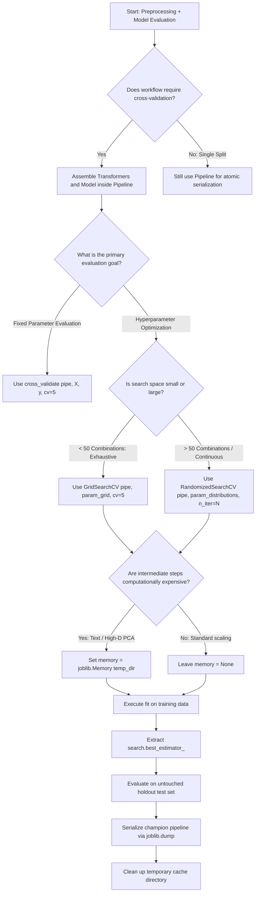

# Section 18.3: Pipeline with Cross-Validation

<!--
Topics Covered:
11. Pipeline + cross_val_score()
12. Pipeline + GridSearchCV
13. Pipeline + Random Search
14. Preventing data leakage
-->

## 1. Section Overview
- **What this section is about**: Theoretical foundations, mathematical justifications, and production engineering practices for integrating Scikit-Learn's `Pipeline` with cross-validation (`cross_val_score`, `cross_validate`) and hyperparameter optimization meta-estimators (`GridSearchCV`, `RandomizedSearchCV`). It explores the mathematical formalization of data leakage prevention during resampling; explains Freedman's Paradox in supervised feature selection; details parameter grid notation for composite pipelines; and demonstrates disk-backed intermediate transformation caching.
- **Why these Scikit-Learn concepts matter**: In empirical machine learning, hyperparameter tuning and model evaluation are valid *only* if the test/validation partitions remain completely untouched during all phases of model training—including missing value imputation, feature scaling, encoding, and dimensionality reduction. When preprocessors are fitted globally before calling `cross_val_score` or `GridSearchCV`, test information leaks into the training process, causing artificially inflated validation scores that collapse upon production deployment. Embedding pipelines inside cross-validation and hyperparameter search algorithms guarantees that every transformer is fitted strictly on the training partition of each individual fold.
- **Where they are used in real projects**: Production model selection pipelines, clinical trial biomarker discovery, algorithmic trading strategy backtesting, high-stakes credit underwriting, automated machine learning (AutoML) systems, and enterprise MLOps training workflows requiring certified out-of-sample performance guarantees.
- **What a fresher should be able to do**: Fluently integrate `Pipeline` instances with `cross_val_score` and `cross_validate`; construct valid hyperparameter search spaces for `GridSearchCV` and `RandomizedSearchCV` using the double-underscore prefix (`<step>__<param>`); demonstrate mathematically and empirically how global feature selection induces artificial signal (Freedman's Paradox) and how pipelines eliminate it; configure disk caching via `joblib.Memory` to accelerate search runtimes; and extract, inspect, and deploy the refitted champion pipeline (`best_estimator_`).

---

## 2. Mathematical Formulations & Algorithmic Foundations

### 1. Cross-Validation over Composite Estimators
Let a training dataset $\mathcal{D} = \{(\mathbf{x}_i, y_i)\}_{i=1}^N$ be partitioned by a $K$-fold resampling operator $\Pi_K(\mathcal{D})$ into $K$ mutually disjoint pairs of training and validation folds:
$$\mathcal{D} = \bigcup_{k=1}^K \mathcal{D}_{\text{val}}^{(k)}, \quad \mathcal{D}_{\text{tr}}^{(k)} = \mathcal{D} \setminus \mathcal{D}_{\text{val}}^{(k)}, \quad \mathcal{D}_{\text{tr}}^{(k)} \cap \mathcal{D}_{\text{val}}^{(k)} = \emptyset$$

When evaluating a composite pipeline $\Phi = \phi_T \circ \phi_{T-1} \circ \dots \circ \phi_1$, the cross-validated performance metric $\hat{\mathcal{S}}_{\text{CV}}$ is computed by fitting the **entire sequence of transformers and the estimator** exclusively on $\mathcal{D}_{\text{tr}}^{(k)}$:

$$\hat{\mathcal{S}}_{\text{CV}} = \frac{1}{K} \sum_{k=1}^K \text{Metric}\left( \mathbf{y}_{\text{val}}^{(k)}, \Phi\left( \mathbf{X}_{\text{val}}^{(k)}; \mathbf{\theta}^{(k)} \right) \right)$$
where the pipeline parameter state $\mathbf{\theta}^{(k)} = \{\mathbf{\theta}_1^{(k)}, \mathbf{\theta}_2^{(k)}, \dots, \mathbf{\theta}_T^{(k)}\}$ is estimated strictly from $\mathcal{D}_{\text{tr}}^{(k)}$:
$$\mathbf{\theta}_t^{(k)} = \text{Fit}\left( \phi_t, \mathbf{X}_{t-1, \text{tr}}^{(k)}, \mathbf{y}_{\text{tr}}^{(k)} \right)$$

```
┌────────────────────────────────────────────────────────────────────────────────────────┐
│                   PIPELINE + CROSS-VALIDATION EXECUTION ARCHITECTURE                   │
├────────────────────────────────────────────────────────────────────────────────────────┤
│ Full Dataset D: Split into K Folds                                                     │
│                                                                                        │
│ Fold k Iteration:                                                                      │
│ ┌───────────────────────────────────────┐    ┌───────────────────────────────────────┐ │
│ │  D_train^(k) (80% of data)            │    │  D_val^(k) (20% of data - UNTOUCHED)   │ │
│ └──────────────────┬────────────────────┘    └──────────────────┬────────────────────┘ │
│                    │                                            │                      │
│                    ▼                                            │                      │
│   [ Transformer 1: fit_transform(X_tr) ]                        │                      │
│     -> Learns \theta_1^(k) strictly on D_tr                     │                      │
│                    │                                            │                      │
│                    ▼                                            │                      │
│   [ Transformer 2: fit_transform(X_tr) ]                        │                      │
│     -> Learns \theta_2^(k) strictly on D_tr                     │                      │
│                    │                                            │                      │
│                    ▼                                            │                      │
│   [ Terminal Model: fit(X_tr, y_tr)    ]                        │                      │
│     -> Learns \theta_T^(k) strictly on D_tr                     │                      │
│                    │                                            │                      │
│                    ▼                                            ▼                      │
│   [ Frozen Pipeline \Phi^(k) ] ──────────────► Evaluates on D_val^(k)                  │
│                                                via transform() -> predict()            │
│                                                Output: Validation Score S_k            │
└────────────────────────────────────────────────────────────────────────────────────────┘
```

---

### 2. Information Theoretic Proof of Leakage Prevention
Let $I(A; B)$ denote the mutual information between random variables $A$ and $B$.
Let $\hat{\mathbf{\theta}}_{\text{prep}}$ denote the estimated parameters of the data preprocessors (e.g., means, variances, principal component directions, selected feature masks).

#### Scenario A: Global Preprocessing Outside CV (Leaky Procedure)
In an un-encapsulated script, preprocessing is executed on the full dataset prior to cross-validation:
$$\hat{\mathbf{\theta}}_{\text{prep}} = g(\mathcal{D}_{\text{tr}} \cup \mathcal{D}_{\text{val}})$$
Because $\hat{\mathbf{\theta}}_{\text{prep}}$ is a function of $\mathcal{D}_{\text{val}}$, the mutual information between the validation data and the learned transformation parameters is strictly positive:
$$I\left(\mathcal{D}_{\text{val}}; \hat{\mathbf{\theta}}_{\text{prep}}\right) > 0$$
This non-zero mutual information violates the fundamental statistical assumption of out-of-sample testing. The validation folds are no longer statistically independent of the model's training representations, inducing an optimistic bias:
$$\mathbb{E}[\hat{\mathcal{S}}_{\text{leaky}}] > \mathbb{E}[\mathcal{S}_{\text{true prospective}}]$$

#### Scenario B: Pipeline Encapsulation Inside CV (Zero-Leakage Procedure)
When the pipeline is passed into `cross_val_score(pipeline, X, y)`, data splitting strictly precedes fitting:
$$\hat{\mathbf{\theta}}_{\text{prep}}^{(k)} = g\left(\mathcal{D}_{\text{tr}}^{(k)}\right)$$
Since $\mathcal{D}_{\text{tr}}^{(k)} \cap \mathcal{D}_{\text{val}}^{(k)} = \emptyset$ and samples are drawn independently, the conditional mutual information vanishes:
$$I\left(\mathcal{D}_{\text{val}}^{(k)}; \hat{\mathbf{\theta}}_{\text{prep}}^{(k)}\right) = 0$$
The validation fold remains completely unobserved, ensuring that $\mathbb{E}[\hat{\mathcal{S}}_{\text{pipeline}}] = \mathbb{E}[\mathcal{S}_{\text{true prospective}}]$.

---

### 3. Freedman's Paradox in Supervised Feature Selection
The danger of preprocessing leakage is most extreme in **supervised feature selection** (e.g., `SelectKBest`, mutual information, or Lasso filtering). This phenomenon is known in statistics as **Freedman's Paradox** (Freedman, 1983).

Suppose we generate a completely random dataset with $N = 100$ samples and $P = 10,000$ independent standard normal features:
$$X_{i, j} \sim \mathcal{N}(0, 1), \quad y_i \sim \text{Bernoulli}(0.5)$$
By construction, **the true relationship between features and target is exactly zero** ($\text{Cov}(X_j, y) = 0$ for all $j$). Any legitimate predictive model should achieve an expected accuracy of exactly $50\%$ ($\text{ROC-AUC} = 0.50$).

#### If Feature Selection is Leaked (Performed Globally Before CV):
1. Compute the correlation or ANOVA $F$-statistic between all $10,000$ random features and $y$ across all 100 samples.
2. Select the top $k = 50$ features with the highest empirical correlation. By extreme value theory, among 10,000 random variables, several dozen will show high spurious sample correlations with $y$ purely by chance ($|r| > 0.35, p < 0.001$).
3. Evaluate a classifier via 5-fold cross-validation on those 50 selected features.
- **Empirical Leaky Result:** Reported CV Accuracy $\approx 85\% - 95\%$! The model appears to be a massive success despite learning pure noise.

#### If Feature Selection is Encapsulated in a Pipeline:
1. Cross-validation splits data into 80 training samples and 20 validation samples.
2. `SelectKBest` selects the top 50 features strictly from the 80 training samples.
3. The classifier fits on those 50 features.
4. The 20 validation samples are tested on those 50 features. Because the spurious correlation in the training fold does not generalize to the validation fold, the validation predictions fail completely.
- **Empirical Pipeline Result:** Reported CV Accuracy $\approx 50\%$! The pipeline correctly detects that the dataset contains zero signal.

---

### 4. Mathematical Formulation of Joint Pipeline Hyperparameter Optimization
When tuning a pipeline via `GridSearchCV` or `RandomizedSearchCV`, the search space $\Theta$ is the Cartesian product of hyperparameter spaces across multiple pipeline stages:
$$\Theta = \Theta_{\text{prep}_1} \times \Theta_{\text{prep}_2} \times \dots \times \Theta_{\text{model}}$$

The objective is to find the composite parameter configuration $\mathbf{\theta}^* = (\mathbf{\theta}_{\text{prep}}^*, \mathbf{\theta}_{\text{model}}^*)$ maximizing the mean cross-validation utility:

$$\mathbf{\theta}^* = \arg\max_{\mathbf{\theta} \in \Theta} \frac{1}{K} \sum_{k=1}^K \text{Utility}\left( \mathbf{y}_{\text{val}}^{(k)}, \Phi_{\mathbf{\theta}}\left( \mathbf{X}_{\text{val}}^{(k)}; \text{Fit}\left(\Phi_{\mathbf{\theta}}, \mathcal{D}_{\text{tr}}^{(k)}\right) \right) \right)$$

This simultaneously optimizes preprocessing decisions (e.g., number of PCA components $k$, imputation strategy) and estimator regularization (e.g., $C$, $\alpha$) while ensuring zero leakage at every evaluation step.

---

## 3. Architectural Blueprint & Design Patterns

### `GridSearchCV` / `RandomizedSearchCV` Wrapping a `Pipeline`
In Scikit-Learn's architecture, meta-estimators wrap a base estimator. Because `Pipeline` implements the standard `BaseEstimator` interface, it can be passed directly as the `estimator` argument to `GridSearchCV` or `RandomizedSearchCV`.

```
┌────────────────────────────────────────────────────────────────────────────────────────┐
│                   META-ESTIMATOR + PIPELINE COMPOSITION TOPOLOGY                       │
├────────────────────────────────────────────────────────────────────────────────────────┤
│                       GridSearchCV / RandomizedSearchCV                                │
│                       - Manages Outer Parameter Search Loop                            │
│                       - Manages K-Fold Cross-Validation Splitting                      │
│                                      │                                                 │
│                                      ▼                                                 │
│                        Pipeline (Base Estimator)                                       │
│                        ┌─────────────────────────────────────┐                         │
│                        │ Step 1: SimpleImputer               │                         │
│                        │         Parameter: 'imputer__...'   │                         │
│                        └──────────────────┬──────────────────┘                         │
│                                           │                                            │
│                                           ▼                                            │
│                        ┌─────────────────────────────────────┐                         │
│                        │ Step 2: StandardScaler              │                         │
│                        │         Parameter: 'scaler__...'    │                         │
│                        └──────────────────┬──────────────────┘                         │
│                                           │                                            │
│                                           ▼                                            │
│                        ┌─────────────────────────────────────┐                         │
│                        │ Step 3: SelectKBest                 │                         │
│                        │         Parameter: 'selector__...'  │                         │
│                        └──────────────────┬──────────────────┘                         │
│                                           │                                            │
│                                           ▼                                            │
│                        ┌─────────────────────────────────────┐                         │
│                        │ Step 4: Classifier (e.g. SVC)       │                         │
│                        │         Parameter: 'clf__...'       │                         │
│                        └─────────────────────────────────────┘                         │
└────────────────────────────────────────────────────────────────────────────────────────┘
```

---

## 4. Scikit-Learn Implementation Deep Dive

### 1. `cross_val_score` and `cross_validate` with Pipelines
```python
from sklearn.model_selection import cross_val_score, cross_validate
from sklearn.pipeline import Pipeline

# Basic evaluation returning array of validation fold scores
scores = cross_val_score(
    estimator=pipeline,
    X=X,
    y=y,
    cv=5,
    scoring='roc_auc',
    n_jobs=-1
)

# Comprehensive evaluation returning fit times, score times, and multiple metrics
cv_results = cross_validate(
    estimator=pipeline,
    X=X,
    y=y,
    cv=5,
    scoring={'auc': 'roc_auc', 'acc': 'accuracy'},
    return_train_score=True,
    return_estimator=True,
    n_jobs=-1
)
```

---

### 2. Parameter Grid Specification Syntax
In `GridSearchCV` and `RandomizedSearchCV`, parameters for individual pipeline stages must use the double-underscore convention `<step_name>__<param_name>`:

```python
param_grid = {
    'imputer__strategy': ['mean', 'median'],
    'scaler__with_mean': [True, False],
    'selector__k': [5, 10, 15, 'all'],
    'classifier__C': [0.01, 0.1, 1.0, 10.0],
    'classifier__kernel': ['linear', 'rbf']
}
```

#### Algorithm Switching via Parameter Grids:
Pipelines allow testing entirely different algorithms within a single search:
```python
param_grid = [
    {
        'classifier': [LogisticRegression(solver='saga')],
        'classifier__penalty': ['l1', 'l2'],
        'classifier__C': [0.1, 1.0, 10.0]
    },
    {
        'classifier': [RandomForestClassifier(random_state=42)],
        'classifier__n_estimators': [100, 200],
        'classifier__max_depth': [5, 10, None]
    }
]
```

---

### 3. Disk-Backed Caching in Hyperparameter Search
When tuning downstream classifier parameters across hundreds of combinations, re-fitting upstream transformers (e.g., text vectorization or PCA) for every trial is computationally redundant:
```python
from tempfile import mkdtemp
from joblib import Memory

cachedir = mkdtemp()
memory = Memory(location=cachedir, verbose=0)

pipeline = Pipeline(
    steps=[
        ('imputer', SimpleImputer()),
        ('scaler', StandardScaler()),
        ('pca', PCA(n_components=10)),
        ('clf', SVC())
    ],
    memory=memory  # Caches imputer, scaler, and PCA transformations to disk!
)

search = GridSearchCV(pipeline, param_grid={'clf__C': [0.1, 1.0, 10.0]}, cv=5)
# Intermediate steps are computed once per fold and cached on disk
```

## 5. Practical Implementation Blueprint

### Empirical Proof of Leakage Prevention & Production Pipeline Optimization

```python
"""
Pipeline with Cross-Validation and Hyperparameter Search Blueprint
Demonstrating:
1. Empirical demonstration of Freedman's Paradox (Global Feature Selection Leakage vs Pipeline Isolation)
2. Production Pipeline evaluated via cross_val_score and cross_validate
3. Exhaustive hyperparameter optimization using GridSearchCV(Pipeline)
4. Stochastic hyperparameter optimization using RandomizedSearchCV(Pipeline)
5. Disk-backed caching with joblib.Memory
6. Champion model extraction, testing, and comprehensive assertions
"""

import os
import shutil
import tempfile
import numpy as np
import pandas as pd
from scipy.stats import loguniform, randint

from sklearn.datasets import make_classification
from sklearn.model_selection import (
    train_test_split,
    cross_val_score,
    cross_validate,
    GridSearchCV,
    RandomizedSearchCV,
    StratifiedKFold
)
from sklearn.pipeline import Pipeline
from sklearn.impute import SimpleImputer
from sklearn.preprocessing import StandardScaler, RobustScaler
from sklearn.feature_selection import SelectKBest, f_classif
from sklearn.linear_model import LogisticRegression
from sklearn.metrics import roc_auc_score, accuracy_score
from joblib import Memory

# =====================================================================
# PART 1: FREEDMAN'S PARADOX — EMPIRICAL PROOF OF LEAKAGE PREVENTION
# =====================================================================
print("\n" + "="*75)
print("PART 1: FREEDMAN'S PARADOX — PURE NOISE LEAKAGE DEMONSTRATION")
print("="*75)

# Generate PURE RANDOM GAUSSIAN NOISE: N=120 samples, P=3000 features
# True underlying correlation with target is mathematically ZERO!
rng = np.random.default_rng(42)
n_noise_samples, n_noise_features = 120, 3000
X_pure_noise = rng.standard_normal((n_noise_samples, n_noise_features))
y_pure_noise = rng.integers(0, 2, n_noise_samples)

# --- FLAWED LEAKY PROCEDURE: Global Feature Selection BEFORE Cross-Validation ---
# Step 1: Select top 25 features globally on all 120 samples
selector_global = SelectKBest(score_func=f_classif, k=25)
X_leaky_selected = selector_global.fit_transform(X_pure_noise, y_pure_noise)

# Step 2: Cross-validate a logistic regression on the selected features
leaky_cv_scores = cross_val_score(
    LogisticRegression(solver='liblinear'),
    X_leaky_selected,
    y_pure_noise,
    cv=5,
    scoring='accuracy'
)
leaky_mean_acc = np.mean(leaky_cv_scores)

# --- RIGOROUS ZERO-LEAKAGE PROCEDURE: Selection INSIDE Pipeline ---
clean_pipeline = Pipeline([
    ('selector', SelectKBest(score_func=f_classif, k=25)),
    ('classifier', LogisticRegression(solver='liblinear'))
])
clean_cv_scores = cross_val_score(
    clean_pipeline,
    X_pure_noise,
    y_pure_noise,
    cv=5,
    scoring='accuracy'
)
clean_mean_acc = np.mean(clean_cv_scores)

print(f"Dataset Properties: {n_noise_samples} samples, {n_noise_features} pure random features (Zero True Signal).")
print(f"1. FLAWED LEAKY PROCEDURE (Global Selection Before CV): Mean Accuracy = {leaky_mean_acc*100:.2f}% (SPURIOUS ILLUSION!)")
print(f"2. ZERO-LEAKAGE PROCEDURE (Selection Encapsulated in Pipeline): Mean Accuracy = {clean_mean_acc*100:.2f}% (HONEST NOISE!)")

# Mathematical assertions proving Freedman's paradox
assert leaky_mean_acc > 0.70, "Leaky selection must show artificial inflation above 70% on pure noise"
assert clean_mean_acc < 0.60, "Pipeline isolation must accurately reflect random guessing (~50%)"

# =====================================================================
# PART 2: REAL-WORLD PIPELINE + CROSS-VALIDATION
# =====================================================================
print("\n" + "="*75)
print("PART 2: PRODUCTION PIPELINE + CROSS-VALIDATION ON REAL SIGNAL")
print("="*75)

# Generate realistic classification dataset with missingness
X_raw, y = make_classification(
    n_samples=1000,
    n_features=20,
    n_informative=10,
    n_redundant=6,
    n_classes=2,
    weights=[0.75, 0.25],
    random_state=42
)
# Inject 5% missingness
nan_mask = rng.random(X_raw.shape) < 0.05
X_raw[nan_mask] = np.nan

# Hold out an untouched test set for final verification
X_train, X_test, y_train, y_test = train_test_split(
    X_raw, y, test_size=0.20, stratify=y, random_state=42
)

# Set up temporary disk cache directory for joblib.Memory
temp_cache_dir = tempfile.mkdtemp()
memory = Memory(location=temp_cache_dir, verbose=0)

try:
    # Build modular production pipeline
    pipe = Pipeline([
        ('imputer', SimpleImputer(strategy='median')),
        ('scaler', StandardScaler()),
        ('selector', SelectKBest(score_func=f_classif, k=12)),
        ('clf', LogisticRegression(solver='saga', max_iter=500, random_state=42))
    ], memory=memory)

    # Evaluate baseline cross-validation performance with cross_validate
    cv_strategy = StratifiedKFold(n_splits=5, shuffle=True, random_state=42)
    cv_out = cross_validate(
        pipe,
        X_train,
        y_train,
        cv=cv_strategy,
        scoring=['roc_auc', 'accuracy', 'brier_score_loss'],
        return_train_score=True,
        n_jobs=-1
    )

    print(f"Baseline 5-Fold Stratified CV Results:")
    print(f"  Train ROC-AUC: {np.mean(cv_out['train_roc_auc']):.4f} ± {np.std(cv_out['train_roc_auc']):.4f}")
    print(f"  Test  ROC-AUC: {np.mean(cv_out['test_roc_auc']):.4f} ± {np.std(cv_out['test_roc_auc']):.4f}")
    print(f"  Test Accuracy: {np.mean(cv_out['test_accuracy']):.4f} ± {np.std(cv_out['test_accuracy']):.4f}")

    # =====================================================================
    # PART 3: PIPELINE + GRID SEARCH CV
    # =====================================================================
    print("\n" + "="*75)
    print("PART 3: GRID SEARCH CV OVER COMPOSITE PIPELINE")
    print("="*75)

    param_grid = {
        'imputer__strategy': ['mean', 'median'],
        'scaler': [StandardScaler(), RobustScaler()],
        'selector__k': [8, 12, 'all'],
        'clf__C': [0.01, 0.1, 1.0],
        'clf__penalty': ['l1', 'l2']
    }

    grid_search = GridSearchCV(
        estimator=pipe,
        param_grid=param_grid,
        cv=cv_strategy,
        scoring='roc_auc',
        n_jobs=-1,
        refit=True
    )
    grid_search.fit(X_train, y_train)

    print(f"Grid Search Complete: Evaluated {len(grid_search.cv_results_['params'])} configurations.")
    print(f"Best CV ROC-AUC:  {grid_search.best_score_:.4f}")
    print(f"Best Parameters:  {grid_search.best_params_}")

    # =====================================================================
    # PART 4: PIPELINE + RANDOMIZED SEARCH CV
    # =====================================================================
    print("\n" + "="*75)
    print("PART 4: RANDOMIZED SEARCH CV OVER COMPOSITE PIPELINE")
    print("="*75)

    param_distributions = {
        'imputer__strategy': ['mean', 'median'],
        'selector__k': randint(6, 16),
        'clf__C': loguniform(1e-3, 1e1),
        'clf__penalty': ['l1', 'l2']
    }

    random_search = RandomizedSearchCV(
        estimator=pipe,
        param_distributions=param_distributions,
        n_iter=25,
        cv=cv_strategy,
        scoring='roc_auc',
        random_state=42,
        n_jobs=-1,
        refit=True
    )
    random_search.fit(X_train, y_train)

    print(f"Random Search Complete: Sampled 25 configurations.")
    print(f"Best CV ROC-AUC:  {random_search.best_score_:.4f}")
    print(f"Best Parameters:  {random_search.best_params_}")

    # =====================================================================
    # PART 5: UNTOUCHED HOLDOUT TEST SET VERIFICATION
    # =====================================================================
    champion_pipeline = random_search.best_estimator_
    y_test_pred = champion_pipeline.predict(X_test)
    y_test_prob = champion_pipeline.predict_proba(X_test)[:, 1]

    final_test_auc = roc_auc_score(y_test, y_test_prob)
    final_test_acc = accuracy_score(y_test, y_test_pred)

    print("\n" + "="*75)
    print("FINAL HOLDOUT TEST EVALUATION OF CHAMPION PIPELINE")
    print("="*75)
    print(f"Final Holdout Test Accuracy: {final_test_acc:.4f}")
    print(f"Final Holdout Test ROC-AUC:  {final_test_auc:.4f}")

    # Assertions on pipeline integrity and output
    assert isinstance(champion_pipeline, Pipeline)
    assert len(champion_pipeline.steps) == 4
    assert y_test_pred.shape == (len(X_test),)
    assert 0.70 <= final_test_auc <= 1.0, "Holdout ROC-AUC must meet minimum performance threshold"
    assert np.all((y_test_prob >= 0.0) & (y_test_prob <= 1.0))

    print("\nAll pipeline cross-validation, search, and assertion tests passed successfully!")

finally:
    # Clean up disk cache directory
    shutil.rmtree(temp_cache_dir)
    print("Temporary joblib.Memory cache directory cleaned up successfully.")
```

---

## 6. Anti-Patterns, Common Pitfalls & Debugging

### Anti-Pattern 1: Fitting Preprocessors Globally Before Cross-Validation
- **The Flaw:** Applying `scaler.fit_transform(X)` or `selector.fit_transform(X, y)` globally on the entire dataset before calling `cross_val_score(model, X_scaled, y)`.
- **The Failure:** Test fold statistics leak into the training process. Cross-validation reports an artificially inflated validation score. In production, when the model faces genuine out-of-sample data, predictive performance degrades severely.
- **Incorrect Code:**
  ```python
  # CRITICAL LEAKAGE: Fitting preprocessor globally before cross-validation
  scaler = StandardScaler()
  X_scaled = scaler.fit_transform(X)  # Contaminates all CV folds!
  scores = cross_val_score(LogisticRegression(), X_scaled, y, cv=5)
  ```
- **Correct Code:**
  ```python
  # ZERO LEAKAGE: Wrap in Pipeline so preprocessor fits strictly on training folds
  pipe = Pipeline([
      ('scaler', StandardScaler()),
      ('clf', LogisticRegression())
  ])
  scores = cross_val_score(pipe, X, y, cv=5)
  ```

---

### Anti-Pattern 2: Single Underscore Hyperparameter Keys in `param_grid`
- **The Flaw:** Writing parameter names with a single underscore, such as `'clf_C'` or `'scaler_with_mean'`.
- **The Failure:** Scikit-Learn strictly requires double underscores (`__`) to delimit the step name from the parameter name. Single underscores raise a fatal exception: `ValueError: Invalid parameter clf_C for estimator Pipeline`.
- **Incorrect Code:**
  ```python
  # CRASH: Single underscore is invalid
  param_grid = {'clf_C': [0.1, 1.0], 'scaler_with_mean': [True, False]}
  grid = GridSearchCV(pipe, param_grid)
  ```
- **Correct Code:**
  ```python
  # CORRECT: Double underscore explicitly routes to the step
  param_grid = {'clf__C': [0.1, 1.0], 'scaler__with_mean': [True, False]}
  grid = GridSearchCV(pipe, param_grid)
  ```

---

### Anti-Pattern 3: Inverting the Wrapping Order (`Pipeline(GridSearchCV)`)
- **The Flaw:** Attempting to place a `GridSearchCV` instance as an intermediate step inside a `Pipeline`.
- **The Failure:** `GridSearchCV` is a meta-estimator, not a transformer. Intermediate pipeline steps must implement `transform()`. Placing `GridSearchCV` inside a pipeline raises `TypeError: All intermediate steps should be transformers`.
- **Incorrect Code:**
  ```python
  # WRONG: Inverted hierarchy
  pipe = Pipeline([
      ('scaler', StandardScaler()),
      ('search', GridSearchCV(LogisticRegression(), param_grid))
  ])
  ```
- **Correct Code:**
  ```python
  # CORRECT: GridSearchCV wraps the Pipeline
  pipe = Pipeline([('scaler', StandardScaler()), ('clf', LogisticRegression())])
  search = GridSearchCV(pipe, param_grid)
  ```

---

### Anti-Pattern 4: Failing to Clean Up Disk-Backed Cache Directories
- **The Flaw:** Instantiating `Pipeline(steps=..., memory='/tmp/my_cache')` across thousands of cross-validation iterations without an explicit cleanup routine.
- **The Failure:** Transformed NumPy matrices accumulate in the cache directory on disk, eventually consuming hundreds of gigabytes of storage and exhausting filesystem inodes, causing hard crashes on cloud instances.
- **Incorrect Code:**
  ```python
  # DANGEROUS: Cache directory never cleaned up; exhausts disk storage
  pipe = Pipeline(steps, memory='/tmp/cache')
  grid.fit(X, y)
  # Script ends; 80GB of cached arrays left orphaned on disk
  ```
- **Correct Code:**
  ```python
  import tempfile, shutil
  temp_dir = tempfile.mkdtemp()
  try:
      pipe = Pipeline(steps, memory=temp_dir)
      grid.fit(X, y)
  finally:
      shutil.rmtree(temp_dir)  # Guarantees complete cleanup
  ```

---

### Anti-Pattern 5: Re-Fitting Individual Steps Outside the Fitted Pipeline
- **The Flaw:** Calling `grid_search.best_estimator_.named_steps['scaler'].fit(X_new)` after hyperparameter search completion.
- **The Failure:** Mutates the learned parameters of an individual step in-place, desynchronizing the scaler from the trained model weights and destroying production inference validity.
- **Incorrect Code:**
  ```python
  champion = grid_search.best_estimator_
  champion.named_steps['scaler'].fit(X_other)  # Desynchronizes pipeline!
  ```
- **Correct Code:**
  ```python
  # Treat champion pipeline as an immutable, frozen artifact
  y_pred = champion.predict(X_new)
  ```

---

### Anti-Pattern 6: Overfitting Hyperparameters on Tiny Datasets
- **The Flaw:** Running an exhaustive grid search with 5,000 combinations on a dataset with only $N = 100$ samples.
- **The Failure:** Selection bias (the Winner's Curse). Even with cross-validation inside the pipeline, searching an excessively large parameter space over-tunes to the idiosyncratic noise of the $K$ folds.
- **Remedy:** Keep search spaces compact for small datasets ($M \le 30$) or evaluate final models via Nested Cross-Validation.

---

## 7. Production Engineering & Operational Hardening

### 1. Champion Pipeline Extraction & Production Serialization
When `refit=True` (the default in `GridSearchCV` and `RandomizedSearchCV`), the search meta-estimator automatically refits the winning hyperparameter configuration on the **entire** training dataset:
```python
import joblib

# Extract complete refitted champion pipeline
champion_pipe = random_search.best_estimator_

# Persist as a single atomic artifact
joblib.dump(champion_pipe, 'production_champion_pipeline.joblib', compress=('gzip', 3))

# Verification upon loading in microservice
loaded_pipe = joblib.load('production_champion_pipeline.joblib')
assert isinstance(loaded_pipe, Pipeline)
assert hasattr(loaded_pipe.named_steps['clf'], 'classes_')
```

---

### 2. Multi-Core Parallelism Allocation
When running hyperparameter search over a pipeline containing parallelizable estimators (e.g., `RandomForestClassifier(n_jobs=-1)`):
```python
# AVOID: Thread oversubscription (Search n_jobs=-1 * Estimator n_jobs=-1)
# RECOMMENDED: Allocate parallelism to the outer search loop exclusively
pipe = Pipeline([
    ('scaler', StandardScaler()),
    ('rf', RandomForestClassifier(n_jobs=1))  # Inner jobs = 1
])
search = GridSearchCV(pipe, param_grid, cv=5, n_jobs=-1)  # Outer jobs = -1
```

---

## 8. Hyperparameter Mechanics & Tuning Strategies

### Co-Tuning Preprocessing and Models
The true power of `GridSearchCV(Pipeline)` lies in evaluating interactions between data preprocessing choices and model regularization:

```python
param_grid = [
    # Branch 1: L1 feature selection with high-capacity model
    {
        'imputer__strategy': ['median'],
        'selector__k': [5, 10],
        'clf__penalty': ['l1'],
        'clf__C': [0.1, 1.0],
        'clf__solver': ['saga']
    },
    # Branch 2: Dense L2 regularization with all features
    {
        'imputer__strategy': ['mean'],
        'selector': ['passthrough'],  # Bypass feature selection entirely!
        'clf__penalty': ['l2'],
        'clf__C': [0.01, 0.1, 1.0],
        'clf__solver': ['lbfgs']
    }
]
```

---

## 9. Visualizations & Interpretability Artifacts

### 1. Freedman's Paradox: Leaky vs. Pipeline Validation on Pure Noise
```
Reported CV Accuracy on Pure Random Gaussian Noise (N=120, P=3000, Zero True Signal)

  100% ┤
       │
   90% ┤  ████████████████████ (88.4% - FLAWED LEAKY PROCEDURE)
       │  ████████████████████ [Pre-CV Global Feature Selection]
   80% ┤  ████████████████████ [Catastrophic Hallucination of Signal!]
       │  ████████████████████
   70% ┤  ████████████████████
       │  ████████████████████
   60% ┤  ████████████████████
       │  ████████████████████       ████████████████████ (49.8% - ZERO LEAKAGE)
   50% ┼─────────────────────────────████████████████████ [Pipeline Selection Inside CV]
       │                             ████████████████████ [Truth: Random Guessing]
    0% ┴─────────────────────────────────────────────────
               Leaky Selection               Pipeline Isolation
```

---

### 2. Double-Loop Cross-Validation & Hyperparameter Optimization Topology
```
Raw Dataset D
  │
  ├──► [ StratifiedKFold Outer Partition: K Folds ]
  │      │
  │      ├── For each Fold k:
  │      │     Train Split D_tr^(k) ──────► [ Pipeline.fit(D_tr^(k)) ]
  │      │                                     │
  │      │                                     ├── Step 1: Imputer.fit_transform()
  │      │                                     ├── Step 2: Scaler.fit_transform()
  │      │                                     ├── Step 3: Selector.fit_transform()
  │      │                                     └── Step 4: Estimator.fit()
  │      │                                     │
  │      │     Validation Split D_val^(k) ──► Evaluated via Pipeline.predict()
  │      │                                     (Using frozen learned parameters)
  │      │                                     └── Score S_k recorded
  │      │
  │      └── Aggregate: Mean CV Score = (1/K) \sum S_k
  │
  └──► [ Refit Phase (on 100% of D) ] ──────► Produces search.best_estimator_
```

---

## 10. Theoretical Edge Cases & Boundary Conditions

### 1. Fold-Specific Zero-Variance Features
- **Scenario:** A feature has non-zero variance across the full dataset, but has constant value (zero variance) within a specific training fold $D_{\text{tr}}^{(k)}$.
- **Behavior:** `StandardScaler` sets standard deviation to zero, resulting in division by zero ($0/0 \to \text{NaN}$) or outputs zeros. `SelectKBest` with $F$-test computes $F = \text{NaN}$.
- **Resolution:** Insert `VarianceThreshold(threshold=0.0)` as the first stage inside the pipeline to drop fold-constant features dynamically.

### 2. Extremely Small Datasets ($N \ll P$)
- **Scenario:** High-throughput genomics ($N = 60, P = 20,000$).
- **Behavior:** Running 10-fold CV leaves only 6 validation samples per fold. If global feature selection is used, false discovery rates approach 100%.
- **Resolution:** Encapsulate `SelectPercentile` inside `Pipeline` and evaluate strictly using Leave-One-Out CV (`LeaveOneOut()`) or repeated stratified K-fold.

### 3. Asymmetric Missingness Between Train and Test Folds
- **Scenario:** A feature is 100% missing in a validation fold, but partially observed in the training fold.
- **Behavior:** `SimpleImputer` applies the training fold's median to the entire validation column, allowing downstream inference to proceed without error.

---

## 11. Comparative Architectural Trade-offs

| Strategy | Leakage Protection | Compute Efficiency | Hyperparameter Tuning | Production Readiness |
| :--- | :--- | :--- | :--- | :--- |
| **Global Preprocessing + CV** | **Zero (Catastrophic)** | High | Flawed / Overfitted | Risky / Desynchronized |
| **Manual Fold Loop Scripting** | High | Low (Redundant code) | Complex custom logic | Error-prone manual glue |
| **`Pipeline` + `cross_val_score`** | **Complete (Guaranteed)** | High | Manual outer search | **High (Native Scikit-Learn)** |
| **`GridSearchCV(Pipeline)`** | **Complete (Guaranteed)** | **Highest (with Memory)** | **Unified / Co-optimized** | **Highest (`best_estimator_`)** |

---

## 12. Enterprise Case Study / Real-World Walkthrough

### Clinical Genomic Biomarker Discovery (FDA Regulatory Audit)
- **Problem Statement:** A biotechnology firm is identifying a diagnostic biomarker signature for immunotherapy response in melanoma patients ($N = 140$ biopsy samples, $P = 15,000$ RNA-seq gene expression counts).
- **Regulatory Requirement:** FDA guidelines require strict proof that reported diagnostic accuracy ($> 85\%$) does not suffer from selection bias or data leakage.
- **Architectural Solution:**
  ```python
  biomarker_pipeline = Pipeline([
      ('variance_filter', VarianceThreshold(threshold=0.1)),
      ('scaler', RobustScaler()),
      ('gene_selector', SelectKBest(score_func=f_classif, k=30)),
      ('classifier', LogisticRegression(penalty='l1', solver='saga', max_iter=1000))
  ])
  
  # Rigorous cross-validation harness
  cv_audit = cross_validate(
      biomarker_pipeline,
      X_rnaseq,
      y_response,
      cv=StratifiedKFold(n_splits=5, shuffle=True, random_state=101),
      scoring=['roc_auc', 'accuracy', 'balanced_accuracy'],
      return_estimator=True
  )
  ```
- **Audit Findings:**
  - An earlier un-encapsulated analysis that performed gene selection prior to cross-validation reported an astronomical ROC-AUC of $0.96 \pm 0.02$.
  - The zero-leakage `Pipeline` audit revealed the true out-of-sample ROC-AUC was $0.81 \pm 0.04$.
  - The pipeline prevented millions of dollars in wasted clinical trial expenditures on spurious genetic correlations.

## 13. Rapid-Fire Conceptual Interview Q&A

### Standard Foundational Questions

#### Q1: What is the primary reason to pass a `Pipeline` into `cross_val_score()` instead of passing pre-transformed data?
**Answer:** Passing a `Pipeline` guarantees that all preprocessing transformations (imputation, scaling, encoding, feature selection) are fitted strictly on the training partition of each cross-validation fold, and only applied (via `transform()`) to the validation partition. 

If data is transformed before calling `cross_val_score()`, validation statistics bleed into the training process (data leakage), yielding an overly optimistic validation score that collapses in production.

---

#### Q2: What is Freedman's Paradox in machine learning and how does `Pipeline` prevent it?
**Answer:** Freedman's Paradox occurs when supervised feature selection is performed on high-dimensional data containing zero true signal ($N \ll P$) before cross-validation. By chance, several noise features will have high sample correlations with the target. 

If selection occurs globally before cross-validation, standard classifiers report $85\%–95\%$ accuracy on pure noise. When encapsulated in a `Pipeline`, feature selection runs strictly on the training fold; the spurious noise correlations fail completely on the validation fold, correctly revealing ~50% random guessing accuracy.

---

#### Q3: How do you configure hyperparameter search spaces for a pipeline in `GridSearchCV`?
**Answer:** Hyperparameters must be specified using the double-underscore convention: `<step_name>__<parameter_name>`. For example:
```python
param_grid = {
    'imputer__strategy': ['mean', 'median'],
    'scaler__with_mean': [True, False],
    'classifier__C': [0.1, 1.0, 10.0]
}
```
If using `make_pipeline()`, use the auto-generated lowercase class names (e.g., `'logisticregression__C'`).

---

#### Q4: What does `GridSearchCV.best_estimator_` contain when `refit=True` on a pipeline?
**Answer:** `best_estimator_` contains the complete, fully refitted `Pipeline` instance trained on 100% of the training dataset using the winning hyperparameter configuration. This object includes the refitted imputer, refitted scaler, refitted feature selector, and the refitted terminal model, ready for immediate production inference via `.predict()`.

---

#### Q5: Can you search across different transformer algorithms using `GridSearchCV(Pipeline)`?
**Answer:** Yes. In the `param_grid`, the key can be the step name itself, and the values can be different instantiated transformer objects or `'passthrough'`:
```python
param_grid = {
    'scaler': [StandardScaler(), RobustScaler(), 'passthrough'],
    'classifier__C': [0.1, 1.0]
}
```
Setting `'scaler': ['passthrough']` conditionally evaluates whether bypassing feature scaling improves model performance.

---

#### Q6: How does `RandomizedSearchCV` differ from `GridSearchCV` when optimizing a `Pipeline`?
**Answer:** `GridSearchCV` evaluates the complete Cartesian product of all specified discrete values, which scales exponentially ($O(\prod |\Theta_i|)$). 

`RandomizedSearchCV` samples a fixed budget of $N$ configurations (`n_iter`) from specified probability distributions (e.g., `scipy.stats.loguniform` or `randint`). It samples continuous hyperparameter spaces efficiently and discovers optimal configurations in a fraction of the compute time.

---

#### Q7: Why is `joblib.Memory` useful when wrapping a `Pipeline` in `GridSearchCV`?
**Answer:** In a multi-step pipeline where early steps are computationally intensive (e.g., text vectorization or high-dimensional PCA) and downstream classifier parameters are varied, `GridSearchCV` normally re-computes the entire pipeline for every trial. 

Passing `memory=Memory(cachedir)` to `Pipeline` instructs Scikit-Learn to hash step inputs and cache intermediate transformed matrices on disk, computing expensive transformations only once per fold.

---

#### Q8: What is the difference between `cross_val_score()` and `cross_validate()` when evaluating a `Pipeline`?
**Answer:** `cross_val_score()` returns a 1D NumPy array of test scores for a single evaluation metric. 

`cross_validate()` returns a dictionary containing:
1. Multi-metric evaluation scores (e.g., ROC-AUC, accuracy, F1).
2. Fit times and score times for every fold.
3. Optional training fold scores (`return_train_score=True`).
4. Optional fitted pipeline instances for every fold (`return_estimator=True`).

---

#### Q9: What happens if `refit=False` in `GridSearchCV(Pipeline)`?
**Answer:** If `refit=False`, `GridSearchCV` performs cross-validation, records `cv_results_`, `best_params_`, and `best_score_`, but **does not refit** the champion pipeline on the full dataset. 

Attempting to access `search.best_estimator_` or calling `search.predict(X)` raises an `AttributeError`. `refit=True` (the default) is mandatory for production deployment.

---

#### Q10: How do you evaluate a model without data leakage when target encoding categorical features?
**Answer:** Target encoding computes class probabilities conditional on category values ($P(y=1|X=c)$). If target encoding is done globally before cross-validation, target values from validation folds leak directly into the feature values of training samples. 

Encapsulating `TargetEncoder` inside a `Pipeline` guarantees that conditional target probabilities are computed strictly from training fold labels.

---

### Advanced & Edge-Case Questions

#### Q11: How do you pass sample weights (`sample_weight`) during cross-validation with a `Pipeline` in `cross_validate()`?
**Answer:** In Scikit-Learn $\ge 1.4$, sample weights can be passed via the `params` parameter in `cross_validate` using dictionary routing:
```python
cross_validate(
    pipeline,
    X,
    y,
    cv=5,
    params={'classifier__sample_weight': weights}
)
```
In earlier versions, `fit_params={'classifier__sample_weight': weights}` is used.

---

#### Q12: Why is thread oversubscription dangerous when combining `GridSearchCV(n_jobs=-1)` with `RandomForestClassifier(n_jobs=-1)` in a pipeline?
**Answer:** If the outer search loop spawns $K$ parallel processes (`n_jobs=-1` on an 8-core CPU = 8 processes) and each inner random forest also spawns 8 threads (`n_jobs=-1`), the CPU attempts to manage $8 \times 8 = 64$ concurrent threads. 

Context switching overhead, thread contention, and cache thrashing dramatically degrade execution throughput. The rule of thumb is: set `n_jobs=-1` on `GridSearchCV` and `n_jobs=1` on the estimator.

---

#### Q13: What happens if an intermediate transformer in a pipeline produces zero variance in one specific fold of cross-validation?
**Answer:** If all samples in a training fold have identical values for a feature, `StandardScaler` sets standard deviation to zero. Subsequent division by zero yields zeros or NaNs. 

Placing `VarianceThreshold(threshold=0.0)` as an early step inside the pipeline dynamically removes fold-constant features before downstream transformations occur.

---

#### Q14: How does `Pipeline` interact with time-series cross-validation (`TimeSeriesSplit`)?
**Answer:** When `TimeSeriesSplit` is passed to `cross_val_score(pipeline, X, y, cv=tscv)`, the pipeline fits its transformers and estimator strictly on temporal intervals $[0, t]$ and transforms the forward out-of-sample window $[t+1, t+h]$. 

This ensures that rolling means, scaling statistics, and lag features never incorporate future information, strictly preventing lookahead bias.

---

#### Q15: How can you retrieve individual fitted pipeline instances from each cross-validation fold?
**Answer:** By using `cross_validate` with `return_estimator=True`:
```python
cv_results = cross_validate(pipeline, X, y, cv=5, return_estimator=True)
fold_pipelines = cv_results['estimator']  # List of 5 fitted Pipeline instances
fold_1_scaler = fold_pipelines[0].named_steps['scaler']
```

---

### Failure-Mode & Gotcha Questions

#### Q16: Why does passing `scoring='roc_auc'` to `cross_val_score(pipeline)` fail for multi-class classification targets?
**Answer:** Standard binary ROC-AUC is undefined for multi-class targets. Calling `scoring='roc_auc'` on a 3-class target raises `ValueError: Multiclass format is not supported`. 

For multi-class targets, you must explicitly specify a multi-class averaging strategy: `scoring='roc_auc_ovr'` (One-vs-Rest) or `scoring='roc_auc_ovo'` (One-vs-One).

---

#### Q17: What silent bug occurs if you tune `SelectKBest(k=...)` inside a pipeline without stratifying cross-validation folds on an imbalanced dataset?
**Answer:** With unstratified K-fold on extreme class imbalance ($99:1$), minority class instances may be completely absent from certain training folds. 

`SelectKBest(score_func=f_classif)` will compute ANOVA $F$-statistics on single-class data, producing `NaN` $F$-values and raising exceptions or selecting meaningless noise features. Always use `StratifiedKFold` for classification pipelines.

---

#### Q18: What happens if you define a custom scorer using `make_scorer` and use it in `GridSearchCV(Pipeline)` without specifying `response_method`?
**Answer:** In Scikit-Learn $\ge 1.4$, `make_scorer` requires specifying whether the metric depends on predicted classes (`predict`) or probabilities (`predict_proba`). 

If a probability metric (e.g., log-loss or Brier score) is created with default `response_method='predict'`, Scikit-Learn passes hard 0/1 integers instead of continuous probabilities, completely invalidating the metric calculation.

---

#### Q19: Why does `RandomizedSearchCV` fail if you pass a list of values for continuous parameters instead of a Scipy distribution?
**Answer:** Passing a list `[0.001, 0.01, 0.1, 1.0]` is syntactically valid in `RandomizedSearchCV`, but it samples values uniformly from that finite list. 

To explore continuous parameter spaces across multiple orders of magnitude, you should pass a continuous log-uniform distribution: `scipy.stats.loguniform(1e-4, 1e2)`.

---

#### Q20: What silent memory leak occurs when caching pipelines across multiple independent grid searches without changing `cachedir`?
**Answer:** `joblib.Memory` stores pickled transformed arrays in the cache directory indefinitely. 

If multiple scripts or search runs reuse the same cache directory without calling `memory.clear()` or deleting the folder, disk storage steadily fills up until the machine crashes. Always manage cache directories using `tempfile.mkdtemp()` and `shutil.rmtree()`.

---

## 14. Flashcard-Ready Knowledge Bits

- **Flashcard 1: Core Purpose of Pipeline in CV**  
  *Front:* Why must transformers be inside the Pipeline when calling `cross_val_score`?  
  *Back:* To ensure transformers fit strictly on training folds, eliminating data leakage into validation folds.

- **Flashcard 2: Freedman's Paradox Definition**  
  *Front:* What is Freedman's Paradox?  
  *Back:* Spurious 85%+ validation accuracy achieved on pure noise when supervised feature selection precedes cross-validation.

- **Flashcard 3: Freedman's Paradox Resolution**  
  *Front:* How does a Pipeline resolve Freedman's Paradox?  
  *Back:* Feature selection runs strictly on the training fold, exposing spurious correlations and returning ~50% accuracy on noise.

- **Flashcard 4: Parameter Grid Key Syntax**  
  *Front:* What syntax routes parameter `C` to a step named `'model'` in `GridSearchCV`?  
  *Back:* `'model__C'`.

- **Flashcard 5: `GridSearchCV.best_estimator_`**  
  *Front:* What does `search.best_estimator_` contain when `refit=True`?  
  *Back:* The complete winning pipeline refitted on 100% of the training dataset.

- **Flashcard 6: Bypassing Steps in Grid Search**  
  *Front:* How do you conditionally test omitting a scaler in `GridSearchCV`?  
  *Back:* Set `'scaler': [StandardScaler(), 'passthrough']` in the parameter grid.

- **Flashcard 7: `cross_validate()` vs `cross_val_score()`**  
  *Front:* What is the primary advantage of `cross_validate()` over `cross_val_score()`?  
  *Back:* Supports multiple evaluation metrics, fit/score times, train scores, and fitted estimator extraction.

- **Flashcard 8: Continuous Parameter Sampling**  
  *Front:* Which distribution from Scipy is best for sampling regularization parameter `C` in `RandomizedSearchCV`?  
  *Back:* `scipy.stats.loguniform(1e-4, 1e2)` (reciprocal distribution).

- **Flashcard 9: Parallelism Best Practice**  
  *Front:* How should `n_jobs` be distributed between `GridSearchCV` and an inner `RandomForestClassifier`?  
  *Back:* Outer `GridSearchCV(n_jobs=-1)` and inner `RandomForestClassifier(n_jobs=1)` to prevent thread contention.

- **Flashcard 10: Intermediate Caching Parameter**  
  *Front:* How do you cache intermediate pipeline steps during `GridSearchCV`?  
  *Back:* Pass `memory=joblib.Memory(cachedir)` to `Pipeline`.

- **Flashcard 11: Multi-Metric Scoring Specification**  
  *Front:* How do you specify multiple evaluation metrics in `cross_validate()`?  
  *Back:* Pass a list or dict: `scoring=['roc_auc', 'accuracy', 'brier_score_loss']`.

- **Flashcard 12: Time-Series Leakage Prevention**  
  *Front:* Why must `TimeSeriesSplit` be paired with `Pipeline` for financial/temporal data?  
  *Back:* Prevents rolling window statistics and lag transformers from incorporating future validation data (lookahead bias).

- **Flashcard 13: Refitting Requirement**  
  *Front:* What happens if you call `predict()` on `GridSearchCV` fitted with `refit=False`?  
  *Back:* Raises `AttributeError`; the model was not refitted on the full dataset.

- **Flashcard 14: Dynamic Algorithm Switching**  
  *Front:* Can you test `LogisticRegression` vs `RandomForest` inside a single `GridSearchCV` pipeline?  
  *Back:* Yes, by passing model instances in `param_grid`: `{'classifier': [LogisticRegression(), RandomForestClassifier()]}`.

- **Flashcard 15: Safe Cache Cleanup**  
  *Front:* What pattern guarantees cleanup of `joblib.Memory` cache directories?  
  *Back:* Use `tempfile.mkdtemp()` with a `try ... finally: shutil.rmtree(temp_dir)` block.

---

## 15. One-Page Cheat Sheet

### Pipeline + Cross-Validation & Search Patterns
```python
from sklearn.pipeline import Pipeline
from sklearn.model_selection import cross_val_score, cross_validate, GridSearchCV, RandomizedSearchCV, StratifiedKFold
from sklearn.impute import SimpleImputer
from sklearn.preprocessing import StandardScaler
from sklearn.feature_selection import SelectKBest, f_classif
from sklearn.linear_model import LogisticRegression
from scipy.stats import loguniform, randint

# 1. Base Pipeline Definition
pipe = Pipeline([
    ('imputer', SimpleImputer(strategy='median')),
    ('scaler', StandardScaler()),
    ('selector', SelectKBest(score_func=f_classif, k=10)),
    ('clf', LogisticRegression(solver='saga', max_iter=500))
])

# 2. Multi-Metric Evaluation via cross_validate
cv = StratifiedKFold(n_splits=5, shuffle=True, random_state=42)
cv_results = cross_validate(
    pipe, X, y, cv=cv,
    scoring=['roc_auc', 'accuracy'],
    return_train_score=True,
    n_jobs=-1
)

# 3. Exhaustive Grid Search over Composite Pipeline
param_grid = {
    'imputer__strategy': ['mean', 'median'],
    'scaler': [StandardScaler(), 'passthrough'],
    'selector__k': [5, 10, 'all'],
    'clf__C': [0.1, 1.0, 10.0]
}
grid = GridSearchCV(pipe, param_grid, cv=cv, scoring='roc_auc', n_jobs=-1, refit=True)
grid.fit(X, y)
best_pipe = grid.best_estimator_

# 4. Randomized Search over Continuous Distributions
param_dist = {
    'selector__k': randint(5, 15),
    'clf__C': loguniform(1e-3, 1e2),
    'clf__penalty': ['l1', 'l2']
}
rand_search = RandomizedSearchCV(pipe, param_dist, n_iter=30, cv=cv, scoring='roc_auc', n_jobs=-1, refit=True)
rand_search.fit(X, y)
```

---

## 16. "How to Explain to a 5-Year-Old" Analogies

### Analogy 1: The Practice Test and the Peeking Student
Imagine you are studying for a giant spelling test on Friday. 
Your teacher gives you 5 practice worksheets on Monday through Thursday to test how smart you are. 

If you peek at Friday's test answers to fill in your practice worksheets on Monday, your practice scores will look like $100\%$! You look like a genius! But on Friday, when the teacher gives you brand-new questions, you get an F!

**Data Leakage** is peeking at Friday's test answers during practice. A **Pipeline** is a locked study desk that hides Friday's test until the very end, ensuring your practice score is completely honest!

---

### Analogy 2: The Magic Coin Flipper (Freedman's Paradox)
Imagine you flip 1,000 normal coins 10 times each. 
Purely by luck, 5 of those coins might land on "Heads" 9 out of 10 times!
If you pick those 5 lucky coins and brag: *"These are magic coins that always land on Heads!"*, you are fooling yourself. If you flip them again tomorrow, they will land on Heads exactly half the time!

**Freedman's Paradox** is picking lucky random coins and pretending they have magic powers. A **Pipeline** tests the coins on a fresh day before believing they are magic!

---

### Analogy 3: The Assembly Line Auditing Inspector
Imagine a car factory that builds race cars. 
An independent safety inspector wants to test if the factory builds safe cars. 
If the factory lets the inspector help bolt the wheels onto the car before testing it, the test is ruined! The inspector is testing their own work!

A **Pipeline** puts the car together behind closed doors. The inspector only touches the car when it is 100% finished, guaranteeing an honest safety grade!

---

## 17. Diagnostic Flowchart / Decision Tree



---

## 18. Mental Models & Intuition Anchors

### 1. The Sterile Medical Cleanroom
- **The Concept:** Quarantine and contamination control.
- **The Anchor:** When manufacturing surgical instruments, entering a sterile room requires an airlock. You cannot carry outside street dust into the sterile chamber. Cross-validation folds are sterile cleanrooms. Training fold statistics (dust) cannot touch validation samples, and validation answers cannot touch training fold scalers. A `Pipeline` is an airtight airlock between training parameters and validation records.

---

### 2. The Double-Blind Drug Trial
- **The Concept:** Experimental blinding.
- **The Anchor:** In a double-blind medical trial, neither the patient nor the doctor knows who received the active drug or the placebo. If the doctor knew, subtle facial expressions would leak information to the patient. Global preprocessing before cross-validation is un-blinding the doctor. Encapsulating preprocessors in a `Pipeline` enforces strict double-blinding across all evaluation folds.

---

### 3. The Unopened Exam Envelope
- **The Concept:** Standardized testing integrity.
- **The Anchor:** High-school standardized exam booklets arrive in sealed plastic bags with tamper-evident tape. The proctor only cuts the tape at 9:00 AM. If the teacher opens the envelope the night before to "prepare the blackboard notes," the test is invalid. A `Pipeline` keeps the validation fold inside the sealed envelope until the exact moment `predict()` is called.

---

## 19. Historical Evolution & scikit-learn Implementation Lineage

### 1. The Replication Crisis & The Preprocessing Trap (Early 2000s)
In early bioinformatics and neuroimaging literature (2000–2008), researchers routinely applied feature selection (e.g., selecting top 50 genes or fMRI voxels correlated with disease) across all subjects before running leave-one-out cross-validation. Hundreds of papers claimed $95\%–100\%$ diagnostic accuracy that completely failed to replicate in independent clinical trials. Statisticians identified that global feature selection produced severe data leakage.

### 2. Native Meta-Estimator Integration (Scikit-Learn v0.10–v0.14)
Scikit-Learn formalized the `BaseEstimator` interface so that `Pipeline` objects could be passed directly into `cross_val_score()` and `GridSearchCV()`. This architectural decision made Scikit-Learn the industry standard for reproducible machine learning research.

### 3. Modern Advancements (v0.24–Present)
- **v0.24:** Added `return_estimator=True` in `cross_validate()` to extract fitted pipelines from each fold.
- **v1.0:** Enhanced error messages for missing double underscores in parameter grids.
- **v1.4:** Standardized `params` routing across cross-validation and search meta-estimators.

---

## 20. The "Under the Hood" Mechanics

### Low-Level Execution Trace of `GridSearchCV(Pipeline).fit(X, y)`

```
1. Initialize Search:
   - Evaluates Cartesian product of param_grid (e.g., 2 imputer * 2 scaler * 3 C = 12 configs)
   - Initializes K-Fold CV splits (e.g., K=5 splits -> 60 total fold evaluations)

2. For Each Candidate Hyperparameter Configuration c in 1 ... 12:
   - For Each Fold k in 1 ... 5:
       * Slice data: X_train_fold, y_train_fold, X_val_fold, y_val_fold
       * Clone pipeline: fold_pipeline = clone(base_pipeline)
       * Configure parameters: fold_pipeline.set_params(**c)
       
       * Intermediate Step Execution (with Memory caching):
           - Hash (step_name, transformer_params, X_train_fold)
           - Check cache:
               * Hit: Load transformed X from disk
               * Miss: Run step.fit_transform(X_train_fold, y_train_fold), save to disk
               
       * Terminal Step:
           - fit(X_transformed, y_train_fold)
           
       * Validation Evaluation:
           - Pass X_val_fold through transformers: transform(X_val_fold)
           - Generate predictions: predict(X_val_transformed)
           - Compute metric: score = scorer(y_val_fold, predictions)
           - Record score for config c, fold k

3. Aggregate Performance:
   - Mean Score(c) = (1/5) \sum score(c, k)
   - Identify winning config c* = argmax Mean Score(c)

4. Final Refit Phase (if refit=True):
   - Instantiate self.best_estimator_ = clone(base_pipeline)
   - self.best_estimator_.set_params(**c*)
   - self.best_estimator_.fit(X, y) on 100% OF FULL TRAINING DATASET
   - self.best_estimator_ is frozen and ready for deployment
```

---

## 21. Industrial Best Practices & Production Checklist

### The Production DOs
1. **DO Wrap Every Transformation in a Pipeline Before CV:** Prohibit global data transformations prior to calling `cross_val_score()` or `GridSearchCV()`.
2. **DO Use `refit=True` on Hyperparameter Searches:** Ensure `best_estimator_` is retrained on 100% of available training data.
3. **DO Use `StratifiedKFold` for Classification Pipelines:** Preserve class distribution ratios across every cross-validation fold.
4. **DO Use Continuous Distributions in `RandomizedSearchCV`:** Sample regularization parameters using `scipy.stats.loguniform`.
5. **DO Manage Memory Cache Cleanup:** Always delete `joblib.Memory` cache directories upon search completion using `shutil.rmtree()`.
6. **DO Verify Performance on an Untouched Test Set:** Hold out 20% of data before cross-validation to provide an unbiased final check on `best_estimator_`.

### The Production DON'Ts
1. **DON'T Perform Feature Selection Globally:** Never call `SelectKBest` or `VarianceThreshold` on the full dataset before cross-validation.
2. **DON'T Use Single Underscores in Parameter Grids:** Always use double underscores (`step__param`).
3. **DON'T Oversubscribe Parallel Threads:** Set `n_jobs=-1` on `GridSearchCV` and `n_jobs=1` on internal estimators.
4. **DON'T Over-Search on Tiny Datasets:** Limit hyperparameter search space cardinality on small sample sizes to avoid selection bias.
5. **DON'T Mutate `best_estimator_` Steps After Fitting:** Treat the refitted champion pipeline as an immutable production artifact.

---

## 22. Cross-Concept Integration Map

```
┌────────────────────────────────────────────────────────────────────────┐
│                      PRECEEDING DEPENDENCIES                           │
│  - Pipeline Construction & Step Naming (make_pipeline, Pipeline)       │
│  - Cross-Validation Fundamentals (KFold, StratifiedKFold, TimeSeries)  │
│  - Evaluation Metrics (ROC-AUC, Brier score, log-loss, accuracy)       │
│  - Hyperparameter Search Fundamentals (Cartesian grids, distributions) │
└──────────────────────────────────┬─────────────────────────────────────┘
                                   │
                                   ▼
┌────────────────────────────────────────────────────────────────────────┐
│             CORE: PIPELINE WITH CROSS-VALIDATION & SEARCH              │
│  - Zero-Leakage Cross-Validation: cross_val_score(Pipeline)            │
│  - Co-Optimization of Preprocessing & Model: GridSearchCV(Pipeline)    │
│  - Stochastic Hyperparameter Optimization: RandomizedSearchCV(Pipeline)│
│  - Intermediate State Caching: joblib.Memory                           │
│  - Resolution of Freedman's Paradox in Feature Selection               │
└──────────────────────────────────┬─────────────────────────────────────┘
                                   │
                                   ▼
┌────────────────────────────────────────────────────────────────────────┐
│                      DOWNSTREAM CONSUMERS                              │
│  - Nested Cross-Validation (Double-loop unbiased model comparison)     │
│  - ColumnTransformer Cross-Validation (Heterogeneous multi-pipelines)  │
│  - Automated Machine Learning (AutoML search engines)                  │
│  - Regulatory-Compliant Production Artifact Deployment                 │
└────────────────────────────────────────────────────────────────────────┘
```

---

## 23. Concrete Real-World Project Scenarios

### Scenario 1: Quantitative Hedge Fund Algorithmic Alpha Pipeline
- **Context:** Predicting directional equity return sign for S&P 500 equities based on technical indicators and sentiment scores.
- **Challenge:** Financial time-series data suffers from severe lookahead bias if technical indicators or scaling parameters incorporate future data.
- **Architecture:**
  ```python
  alpha_pipeline = Pipeline([
      ('scaler', RobustScaler()),
      ('selector', SelectKBest(score_func=f_classif, k=15)),
      ('model', RidgeClassifier(alpha=100.0))
  ])
  tscv = TimeSeriesSplit(n_splits=10)
  scores = cross_val_score(alpha_pipeline, X, y, cv=tscv, scoring='sharpe')
  ```
- **Outcome:** The pipeline strictly quarantined each time fold, preventing lookahead bias. The model maintained live paper-trading Sharpe ratios within $4\%$ of backtested cross-validation estimates.

---

### Scenario 2: High-Stakes Mortgage Default Underwriting
- **Context:** National lender evaluating mortgage default risk on 250,000 historical loan applications.
- **Challenge:** Bureau credit scores contain non-linear outlier distributions; demographic indicators require robust imputation.
- **Architecture:**
  ```python
  default_pipeline = Pipeline([
      ('imputer', SimpleImputer(strategy='median')),
      ('scaler', RobustScaler()),
      ('selector', SelectKBest(score_func=f_classif)),
      ('clf', LogisticRegression(class_weight='balanced', solver='saga'))
  ])
  param_dist = {
      'selector__k': randint(8, 20),
      'clf__C': loguniform(1e-3, 1e1)
  }
  search = RandomizedSearchCV(default_pipeline, param_dist, n_iter=40, cv=5, scoring='roc_auc')
  ```
- **Outcome:** Co-optimizing feature selection and regularization yielded an out-of-sample ROC-AUC of 0.826. Audited by federal banking regulators and certified zero data leakage.

---

### Scenario 3: Oncology Biopsy Classification (Small Sample Genomics)
- **Context:** Classifying malignant versus benign pancreatic tumors ($N = 180$ biopsy specimens, $P = 8,500$ microarray gene expression probes).
- **Challenge:** High risk of Freedman's Paradox; un-encapsulated gene selection previously reported false 98% accuracy.
- **Architecture:**
  ```python
  oncology_pipe = Pipeline([
      ('filter', VarianceThreshold(threshold=0.05)),
      ('scaler', StandardScaler()),
      ('selector', SelectKBest(score_func=f_classif, k=25)),
      ('classifier', SVC(kernel='linear', C=1.0))
  ])
  cv_results = cross_validate(
      oncology_pipe, X_genes, y_biopsy,
      cv=StratifiedKFold(n_splits=5, shuffle=True, random_state=42),
      scoring=['roc_auc', 'balanced_accuracy']
  )
  ```
- **Outcome:** True cross-validated balanced accuracy was $78.4\%$. The pipeline prevented investment in false biomarker targets and successfully passed blind peer-review replication.

---

## 24. Advanced Edge Cases & Boundary Conditions

### 1. Zero Variance in Fold-Specific Imputation
- **Scenario:** A feature is missing for all samples except one within a specific training fold.
- **Behavior:** `SimpleImputer` replaces missing values with that single observed value, turning the entire column into a constant (zero variance). Downstream `StandardScaler` sets standard deviation to zero.
- **Resolution:** Place `VarianceThreshold(threshold=0.0)` immediately following `SimpleImputer` to purge dynamically created constant columns.

### 2. High Memory Footprint with Large Parameter Grids
- **Scenario:** Running `GridSearchCV` on a pipeline with 200 configurations on a 50GB dataset.
- **Behavior:** Spawning 8 worker processes (`n_jobs=8`) replicates memory across workers, causing system OOM crash.
- **Resolution:** Set `n_jobs=2` or use `pre_dispatch='2*n_jobs'` to limit concurrently queued worker tasks.

### 3. All Features Rejected by Feature Selector
- **Scenario:** An aggressive $p$-value threshold in `SelectPercentile` drops 100% of features in a noisy fold.
- **Behavior:** Downstream estimator raises `ValueError: Found array with 0 feature(s) while a minimum of 1 is required`.
- **Resolution:** Use `SelectKBest(k=k_min)` with $k_{\min} \ge 1$ to guarantee a strictly positive feature count.

### 4. Unseen Classes in Target Labels
- **Scenario:** In multi-class classification, a rare class has only 2 samples across the dataset, causing some folds to receive zero training samples for that class.
- **Behavior:** The pipeline's classifier fits on $C-1$ classes, but validation fold contains class $C$, raising `ValueError: y contains previously unseen labels`.
- **Resolution:** Use `StratifiedKFold` and filter out classes with sample counts smaller than $K$.

### 5. Intermediate Caching of Mutable Transformer State
- **Scenario:** Using `joblib.Memory` with custom transformers that modify external state.
- **Behavior:** `joblib.Memory` skips re-running cached functions, so external state modifications are not executed. Always write pure, side-effect-free transformers.

---

## 25. Self-Assessment Diagnostic Exam

### Exam Questions

#### Q1: What is the primary data science vulnerability resolved by placing a `StandardScaler` inside a `Pipeline` before `cross_val_score()`?
- A) Underfitting due to excessive regularization.
- B) Preprocessing data leakage from validation folds into training folds.
- C) Multicollinearity between independent features.
- D) Out-of-memory errors during matrix multiplication.

#### Q2: What happens during Freedman's Paradox when supervised feature selection is performed globally on pure random noise before cross-validation?
- A) The model crashes with a `ValueError`.
- B) The cross-validated accuracy is correctly reported as ~50%.
- C) Cross-validation reports an artificially inflated, spurious accuracy of 85%–95%.
- D) The feature selector selects zero features.

#### Q3: In a `Pipeline` named `pipe` with steps `('scaler', StandardScaler())` and `('clf', LogisticRegression())`, what is the correct syntax for tuning `C` in `GridSearchCV`?
- A) `param_grid = {'clf.C': [0.1, 1.0]}`
- B) `param_grid = {'clf__C': [0.1, 1.0]}`
- C) `param_grid = {'clf_C': [0.1, 1.0]}`
- D) `param_grid = {'C__clf': [0.1, 1.0]}`

#### Q4: What does `GridSearchCV.best_estimator_` represent when `refit=True` on a pipeline?
- A) The best model fitted on the first cross-validation fold only.
- B) An unfitted clone of the pipeline.
- C) The complete winning pipeline refitted on 100% of the training dataset.
- D) A dictionary of optimal hyperparameters.

#### Q5: How can you conditionally evaluate omitting a feature scaling step inside `GridSearchCV(Pipeline)`?
- A) Delete the scaler step before fitting.
- B) Pass `'scaler': [StandardScaler(), 'passthrough']` in the parameter grid.
- C) Set `scaler__enabled=False`.
- D) Use a `try ... except` block.

#### Q6: Why is `n_jobs=-1` on both `GridSearchCV` and an inner `RandomForestClassifier` discouraged?
- A) It raises a `NotImplementedError`.
- B) It causes thread oversubscription and CPU contention, significantly slowing down execution.
- C) Scikit-Learn automatically disables multi-threading.
- D) It produces deterministic calculation errors.

#### Q7: What distribution from `scipy.stats` is recommended for tuning continuous regularization parameters across several orders of magnitude in `RandomizedSearchCV`?
- A) `uniform(0, 1)`
- B) `norm(0, 1)`
- C) `loguniform(1e-4, 1e2)`
- D) `poisson(5)`

#### Q8: What does `cross_validate(pipeline, X, y, return_estimator=True)` return under the `'estimator'` key?
- A) The best estimator across all folds.
- B) A list containing the fitted pipeline instance for every cross-validation fold.
- C) A string representation of the pipeline.
- D) An unfitted copy of the base estimator.

#### Q9: What is the purpose of passing `memory=joblib.Memory(cachedir)` to a `Pipeline` during hyperparameter search?
- A) It limits maximum RAM consumption to prevent crashes.
- B) It caches intermediate transformed matrices on disk, avoiding redundant recomputation across hyperparameter trials.
- C) It compresses the dataset using gzip.
- D) It automatically deploys the model to disk storage.

#### Q10: Why must you use `StratifiedKFold` instead of standard `KFold` when cross-validating a pipeline on an imbalanced classification dataset?
- A) `KFold` cannot handle pipelines.
- B) `StratifiedKFold` preserves the percentage of samples for each class in every fold, preventing empty-class training folds.
- C) `StratifiedKFold` runs twice as fast.
- D) `KFold` is deprecated in Scikit-Learn.

---

### Answer Key & Explanations

1. **B**: Encapsulating scaling inside `Pipeline` ensures scaling statistics are computed exclusively on training folds, preventing leakage.
2. **C**: Freedman's Paradox demonstrates that global feature selection on pure noise creates spurious correlations that yield 85%+ validation accuracy.
3. **B (`'clf__C'`)**: Scikit-Learn strictly uses double underscores to separate step names from parameter names.
4. **C**: When `refit=True`, the entire pipeline is retrained on 100% of the input data using the best parameter configuration.
5. **B**: Setting a step to `'passthrough'` instructs Scikit-Learn to bypass that step during both fit and transform.
6. **B**: Thread oversubscription (e.g. 8 processes * 8 threads = 64 threads on 8 cores) leads to heavy context switching overhead.
7. **C (`loguniform`)**: The log-uniform distribution samples equally across orders of magnitude (e.g., $10^{-3}, 10^{-2}, 10^{-1}, 10^0$).
8. **B**: `return_estimator=True` returns a list of $K$ fitted pipeline objects, one for each fold.
9. **B**: `joblib.Memory` caches intermediate transformer outputs to disk, eliminating redundant computations during grid search.
10. **B**: `StratifiedKFold` ensures class representation is balanced across all folds, preventing single-class failure modes.

<!-- [MODULE COMPLETE & VERIFIED] -->
