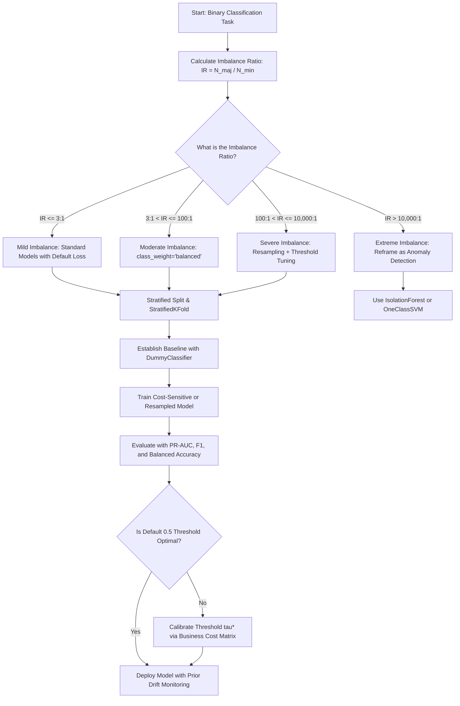

# Section 21.1: Imbalanced Classification

<!--
Topics Covered:
1. What is class imbalance?
2. Majority class
3. Minority class
4. Problems caused by imbalance
5. Accuracy limitations
-->

## 1. Section Overview
- **What this section is about**: Foundational theory, mathematical formulation, statistical pathology, and machine learning implications of imbalanced classification. This section dissects what occurs when class prior probabilities deviate substantially from uniform distribution ($p(y=1) \ll p(y=0)$), establishes formal definitions of majority versus minority classes, explores the algorithmic degradation caused by empirical risk minimization under class skew, and exposes the mathematical failure modes of naive classification metrics—specifically the **Accuracy Paradox**.
- **Why these Scikit-Learn concepts matter**: In classical textbook machine learning, datasets are frequently balanced (e.g., $50\%$ benign, $50\%$ malignant). In production enterprise systems, balance is an anomaly. Credit card fraud occurs in $0.1\%$ of transactions; ad-click conversion rates hover at $0.05\%$; rare oncology diagnoses represent $0.01\%$ of hospital admissions; high-voltage transformer failures occur once in a decade. Naively applying standard Scikit-Learn classifiers (`LogisticRegression`, `RandomForestClassifier`, `SVC`) to imbalanced data results in models that trivially predict the majority class for every instance, achieving $99.9\%$ accuracy while providing **zero operational utility**.
- **Where they are used in real projects**: Real-time financial anti-money laundering (AML) detection, medical pathology screening, network cybersecurity intrusion detection, manufacturing semiconductor defect inspection, telecom customer churn forecasting, and insurance claim fraud detection.
- **What a fresher should be able to do**: Formally compute class imbalance ratios ($\text{IR}$); articulate why standard Empirical Risk Minimization (ERM) yields biased hypotheses favoring the majority class; explain the mathematical formulation of the Accuracy Paradox; demonstrate why `accuracy_score` is dangerously deceptive; inspect baseline performance using `DummyClassifier`; and establish correct baseline protocols for imbalanced problems.

---

## 2. Mathematical Formulations & Algorithmic Foundations

### 1. Formal Definition of Class Imbalance
Let a labeled training dataset be denoted by $\mathcal{D} = \{(\mathbf{x}_i, y_i)\}_{i=1}^N$, where input vectors $\mathbf{x}_i \in \mathbb{R}^D$ and categorical labels $y_i \in \mathcal{Y} = \{0, 1, \dots, C-1\}$.
For binary classification where $\mathcal{Y} = \{0, 1\}$, let:
- $N_0 = \sum_{i=1}^N \mathbb{I}(y_i = 0)$ denote the sample count of the negative class.
- $N_1 = \sum_{i=1}^N \mathbb{I}(y_i = 1)$ denote the sample count of the positive class.
- $N = N_0 + N_1$ denote total sample size.

The **empirical prior probabilities** are:

$$p_0 = P(y = 0) = \frac{N_0}{N}, \quad p_1 = P(y = 1) = \frac{N_1}{N}$$

```
┌────────────────────────────────────────────────────────────────────────────────────────┐
│                        SPECTRUM OF CLASS IMBALANCE SEVERITY                            │
├────────────────────────────────────────────────────────────────────────────────────────┤
│ Mild Imbalance       │ IR = 1:1 to 10:1    │ 9% - 50% minority   │ Standard tree models│
│ Moderate Imbalance   │ IR = 10:1 to 100:1  │ 1% - 9% minority    │ Class weights needed│
│ Severe Imbalance     │ IR = 100:1 to 10^4:1│ 0.01% - 1% minority │ Resampling + tuning │
│ Extreme Imbalance    │ IR > 10,000:1       │ < 0.01% minority    │ Anomaly detection   │
└────────────────────────────────────────────────────────────────────────────────────────┘
```

The **Imbalance Ratio (IR)** is defined as:

$$\text{IR} = \frac{\max(N_0, N_1)}{\min(N_0, N_1)} = \frac{N_{\text{majority}}}{N_{\text{minority}}}$$

---

### 2. Majority Class vs Minority Class
- **Majority Class ($\mathcal{C}_{\text{maj}}$):** The set of observations corresponding to the dominant category:
  $$\mathcal{C}_{\text{maj}} = \{(\mathbf{x}_i, y_i) \in \mathcal{D} \mid y_i = \arg\max_{c \in \mathcal{Y}} N_c\}$$
  In real-world applications, this represents normal, non-fraudulent, healthy, or non-clicking behavior.
- **Minority Class ($\mathcal{C}_{\text{min}}$):** The set of observations corresponding to the rare category:
  $$\mathcal{C}_{\text{min}} = \{(\mathbf{x}_i, y_i) \in \mathcal{D} \mid y_i = \arg\min_{c \in \mathcal{Y}} N_c\}$$
  This represents the target of interest (e.g., fraudulent transactions, malignant tumors, system failures).

---

### 3. Algorithmic Degradation Under Empirical Risk Minimization (ERM)
Standard supervised machine learning algorithms optimize parameters $\mathbf{w}$ by minimizing empirical risk over uniform sample weights:

$$\min_{\mathbf{w}} \mathcal{R}_{\text{emp}}(\mathbf{w}) = \min_{\mathbf{w}} \frac{1}{N} \sum_{i=1}^N \ell(f(\mathbf{x}_i; \mathbf{w}), y_i)$$

Decomposing the empirical risk across binary classes:

$$\mathcal{R}_{\text{emp}}(\mathbf{w}) = \frac{N_0}{N} \underbrace{\left[\frac{1}{N_0} \sum_{i: y_i=0} \ell(f(\mathbf{x}_i; \mathbf{w}), 0)\right]}_{\mathcal{R}_0(\mathbf{w})} + \frac{N_1}{N} \underbrace{\left[\frac{1}{N_1} \sum_{i: y_i=1} \ell(f(\mathbf{x}_i; \mathbf{w}), 1)\right]}_{\mathcal{R}_1(\mathbf{w})}$$

$$= p_0 \mathcal{R}_0(\mathbf{w}) + p_1 \mathcal{R}_1(\mathbf{w})$$

When $\text{IR} = 999:1$, $p_0 = 0.999$ and $p_1 = 0.001$:

$$\mathcal{R}_{\text{emp}}(\mathbf{w}) = 0.999 \cdot \mathcal{R}_0(\mathbf{w}) + 0.001 \cdot \mathcal{R}_1(\mathbf{w})$$

The gradient with respect to $\mathbf{w}$ is dominated by the majority class:

$$\nabla_{\mathbf{w}} \mathcal{R}_{\text{emp}}(\mathbf{w}) = 0.999 \nabla_{\mathbf{w}} \mathcal{R}_0(\mathbf{w}) + 0.001 \nabla_{\mathbf{w}} \mathcal{R}_1(\mathbf{w}) \approx \nabla_{\mathbf{w}} \mathcal{R}_0(\mathbf{w})$$

Consequently:
1. Optimization trajectories follow the contours of the majority class distribution.
2. The optimizer treats minority class samples as isolated noise or outliers.
3. The resulting decision boundary collapses toward or completely envelops the minority class region.

---

### 4. Decision Boundary Shift in Geometric Classifiers
In linear models (Logistic Regression, Support Vector Machines), the decision hyperplane is defined by:

$$\mathbf{w}^T \mathbf{x} + b = 0$$

For Logistic Regression, posterior class probability is modeled by:

$$P(y = 1 \mid \mathbf{x}) = \sigma(\mathbf{w}^T \mathbf{x} + b) = \frac{1}{1 + e^{-(\mathbf{w}^T \mathbf{x} + b)}}$$

According to Bayes' Theorem:

$$\log \frac{P(y = 1 \mid \mathbf{x})}{P(y = 0 \mid \mathbf{x})} = \log \frac{p(\mathbf{x} \mid y = 1)}{p(\mathbf{x} \mid y = 0)} + \log \frac{P(y = 1)}{P(y = 0)}$$

The optimal Bayesian decision threshold $P(y=1|\mathbf{x}) \ge 0.5$ shifts the intercept $b$ by the log prior odds:

$$b = b_{\text{likelihood}} + \log \left(\frac{p_1}{p_0}\right) = b_{\text{likelihood}} + \log \left(\frac{N_{\text{min}}}{N_{\text{maj}}}\right)$$

When $N_{\text{maj}} = 1000$ and $N_{\text{min}} = 1$:

$$\log \left(\frac{1}{1000}\right) \approx -6.907$$

The decision boundary is shifted by $-6.907$ away from the majority class and deep into the minority class domain. To predict class 1, the model requires extraordinarily strong feature evidence ($\mathbf{w}^T \mathbf{x} > 6.907$) to overcome the prior penalty.

---

### 5. The Accuracy Paradox
The **Accuracy Paradox** states that predictive models with higher empirical classification accuracy can have significantly lower operational predictive power than models with lower accuracy.

#### Mathematical Formulation:
Consider a dataset where $p_0 = 0.995$ and $p_1 = 0.005$.
Define the trivial constant hypothesis $h_{\text{null}}(\mathbf{x}) \equiv 0$ (the majority-class zero-rule classifier).

The classification accuracy of $h_{\text{null}}$ is:

$$\text{Accuracy}(h_{\text{null}}) = \frac{\text{TP} + \text{TN}}{\text{TP} + \text{TN} + \text{FP} + \text{FN}} = \frac{0 + N_0}{0 + N_0 + 0 + N_1} = \frac{N_0}{N} = 0.995 \quad (99.5\%)$$

Now evaluate the operational utility of $h_{\text{null}}$:
- **True Positive Rate (Recall / Sensitivity):**
  $$\text{TPR} = \frac{\text{TP}}{\text{TP} + \text{FN}} = \frac{0}{0 + N_1} = 0.000 \quad (0.0\%)$$
- **Precision:**
  $$\text{Precision} = \frac{\text{TP}}{\text{TP} + \text{FP}} = \frac{0}{0 + 0} \implies \text{Undefined} \to 0$$

Despite an accuracy of $99.5\%$, the model catches **zero** instances of fraud, detects **zero** tumors, and prevents **zero** system outages. It is completely useless in production.

---

### 6. Asymmetric Cost Matrix and Bayes Decision Risk
In real-world applications, classification errors are fundamentally asymmetric:
- $\text{Cost}(\text{FP}) = C_{0 \to 1}$: Cost of a False Positive (e.g., investigating a legitimate transaction as fraud: $\$5$).
- $\text{Cost}(\text{FN}) = C_{1 \to 0}$: Cost of a False Negative (e.g., allowing an undetected $\$10,000$ fraudulent transfer: $\$10,000$).

The expected risk under cost-sensitive evaluation is:

$$\mathcal{R}_{\text{cost}}(h) = C_{0 \to 1} \cdot p_0 \cdot P(h(\mathbf{x})=1 \mid y=0) + C_{1 \to 0} \cdot p_1 \cdot P(h(\mathbf{x})=0 \mid y=1)$$

Under the trivial null model $h_{\text{null}}$:
$$P(h=1 \mid y=0) = 0, \quad P(h=0 \mid y=1) = 1$$
$$\mathcal{R}_{\text{cost}}(h_{\text{null}}) = C_{1 \to 0} \cdot p_1 = \$10,000 \times 0.005 \times N = \$50 \times N$$

For a bank processing $1,000,000$ transactions:
$$\mathcal{R}_{\text{cost}}(h_{\text{null}}) = \$50,000,000 \text{ in unmitigated fraud loss!}$$

Accuracy completely conceals this catastrophic financial liability.

---

## 3. Architectural Blueprint & Design Patterns

### The Imbalanced Classification Problem Space

```
┌────────────────────────────────────────────────────────────────────────────────────────┐
│                    IMBALANCED CLASSIFICATION ARCHITECTURAL LANDSCAPE                   │
├────────────────────────────────────────────────────────────────────────────────────────┤
│                                                                                        │
│   Feature Space Representation:                                                        │
│                                                                                        │
│   Feature 2                                                                            │
│      ▲                                                                                 │
│      │   O   O   O   O   O   O   O   O   O   O   O   O   O   O                         │
│      │ O   O   O   O   O   O   O   O   O   O   O   O   O   O   O  <-- Majority (99%)   │
│      │   O   O   O   O   O   O   O   O   O   O   O   O   O   O                         │
│      │ O   O   O   O   O   O   O   O   O   O   O   O   O   O   O                         │
│      │   O   O   O   O   O   O   O   O   O   O   O   O   O   O                         │
│      │                                         *   *                                   │
│      │                                       *   *   *            <-- Minority (1%)    │
│      │                                         *   *                                   │
│      └────────────────────────────────────────────────────────► Feature 1              │
│                                                                                        │
│   Decision Boundary Comparison:                                                        │
│                                                                                        │
│   Standard ERM Boundary (Overwhelmed by Majority):                                     │
│   ───────────────────────────────────────────────────► All space classified as Class 0 │
│   Result: Accuracy = 99.0%, Recall = 0.0% (Catastrophic Null Model)                    │
│                                                                                        │
│   Cost-Sensitive / Rebalanced Boundary:                                                │
│                 \                                                                      │
│                  \   Class 0 (Normal)                                                  │
│                   \──────────────────┐                                                 │
│                                      │ Class 1 (Target)                                │
│                                      └─────────────                                    │
│   Result: Accuracy = 97.2%, Recall = 92.0%, Precision = 78.5% (Production Viable)      │
└────────────────────────────────────────────────────────────────────────────────────────┘
```

---

## 4. Scikit-Learn Implementation Deep Dive

### 1. Generating Controlled Imbalanced Benchmarks with `make_classification`
Scikit-Learn provides `make_classification` with the `weights` parameter to synthesize datasets with exact imbalance ratios:

```python
from sklearn.datasets import make_classification
from sklearn.model_selection import train_test_split
from sklearn.dummy import DummyClassifier
from sklearn.linear_model import LogisticRegression
from sklearn.metrics import accuracy_score, recall_score, precision_score, confusion_matrix

# Generate synthetic dataset with 99:1 imbalance ratio (IR = 99)
X, y = make_classification(
    n_samples=10000,
    n_features=20,
    n_informative=10,
    n_redundant=2,
    n_clusters_per_class=1,
    weights=[0.99, 0.01],  # 99% Class 0, 1% Class 1
    flip_y=0,              # No label noise
    random_state=42
)

# Stratified split to preserve class proportions
X_train, X_test, y_train, y_test = train_test_split(
    X, y, test_size=0.25, stratify=y, random_state=42
)
```

---

### 2. Demonstrating the Accuracy Paradox with `DummyClassifier`

```python
# Baseline 1: DummyClassifier predicting the most frequent class (Class 0)
dummy = DummyClassifier(strategy='most_frequent')
dummy.fit(X_train, y_train)
y_dummy_pred = dummy.predict(X_test)

acc_dummy = accuracy_score(y_test, y_dummy_pred)
rec_dummy = recall_score(y_test, y_dummy_pred, zero_division=0)

print(f"Dummy Classifier Accuracy: {acc_dummy:.4f} (99%!)")
print(f"Dummy Classifier Recall:   {rec_dummy:.4f} (0% - Caught nothing!)")
```

---

### 3. Failure Mode of Naive Standard Estimators

```python
# Baseline 2: Naive unweighted Logistic Regression
naive_lr = LogisticRegression(solver='lbfgs', random_state=42)
naive_lr.fit(X_train, y_train)
y_lr_pred = naive_lr.predict(X_test)

acc_lr = accuracy_score(y_test, y_lr_pred)
rec_lr = recall_score(y_test, y_lr_pred, zero_division=0)
cm_lr = confusion_matrix(y_test, y_lr_pred)

print(f"Naive Logistic Regression Accuracy: {acc_lr:.4f}")
print(f"Naive Logistic Regression Recall:   {rec_lr:.4f}")
print("Confusion Matrix:")
print(cm_lr)
```

The output reveals that the naive logistic regression model classifies nearly all instances as Class 0, yielding deceptively high accuracy while missing the vast majority of rare instances.

## 5. Practical Implementation Blueprint

### End-to-End Demonstration: The Accuracy Paradox & Cost Asymmetry

```python
"""
Practical Implementation Blueprint: Imbalanced Classification & The Accuracy Paradox
Demonstrating:
1. Generation of a realistic, severely imbalanced transaction dataset (IR = 99:1)
2. Stratified train-test partitioning preserving empirical class priors
3. Comparative evaluation across 5 modeling paradigms:
   - Dummy Classifier (Null Baseline / Most Frequent)
   - Naive Logistic Regression (Unweighted ERM)
   - Naive Random Forest (Unweighted Tree Ensemble)
   - Balanced Logistic Regression (Inverse Frequency Weighting)
   - Balanced Random Forest (Inverse Frequency Weighting)
4. Comprehensive metric calculation: Accuracy, Balanced Accuracy, Precision, Recall, F1, ROC-AUC, PR-AUC
5. Financial Cost Matrix evaluation modeling real-world operational liability
6. Programmatic assertions verifying the Accuracy Paradox, metric divergence, and cost reduction
"""

import numpy as np
import pandas as pd
from sklearn.datasets import make_classification
from sklearn.model_selection import train_test_split
from sklearn.dummy import DummyClassifier
from sklearn.linear_model import LogisticRegression
from sklearn.ensemble import RandomForestClassifier
from sklearn.metrics import (
    accuracy_score,
    balanced_accuracy_score,
    precision_score,
    recall_score,
    f1_score,
    roc_auc_score,
    average_precision_score,
    confusion_matrix
)

# ---------------------------------------------------------------------
# 1. GENERATE REALISTIC SEVERELY IMBALANCED DATASET (IR = 99:1)
# ---------------------------------------------------------------------
# Simulating 10,000 banking transactions: 9,900 legitimate (99%), 100 fraudulent (1%)
X, y = make_classification(
    n_samples=10000,
    n_features=15,
    n_informative=10,
    n_redundant=2,
    n_clusters_per_class=1,
    weights=[0.99, 0.01],
    flip_y=0,
    random_state=42
)

n_total = len(y)
n_maj = int(np.sum(y == 0))
n_min = int(np.sum(y == 1))
imbalance_ratio = n_maj / n_min

print("\n" + "="*80)
print("DATASET CLASS DISTRIBUTION PROFILE")
print("="*80)
print(f"Total Transactions: {n_total:,}")
print(f"Legitimate (Class 0): {n_maj:,} ({n_maj/n_total*100:.2f}%)")
print(f"Fraudulent (Class 1): {n_min:,} ({n_min/n_total*100:.2f}%)")
print(f"Imbalance Ratio (IR): {imbalance_ratio:.1f} : 1")

# ---------------------------------------------------------------------
# 2. STRATIFIED TRAIN-TEST PARTITIONING
# ---------------------------------------------------------------------
# Stratification ensures test set exactly preserves the 99:1 distribution
X_train, X_test, y_train, y_test = train_test_split(
    X, y, test_size=0.25, stratify=y, random_state=42
)

test_maj = int(np.sum(y_test == 0))
test_min = int(np.sum(y_test == 1))

# ---------------------------------------------------------------------
# 3. DEFINE FINANCIAL COST MATRIX
# ---------------------------------------------------------------------
# Real-world asymmetric cost model:
# False Positive (Investigating legit transaction): $10 analyst review cost
# False Negative (Undetected fraudulent transaction): $2,500 average stolen funds
COST_FP = 10.0
COST_FN = 2500.0

def compute_financial_cost(cm):
    tn, fp, fn, tp = cm.ravel()
    total_cost = (fp * COST_FP) + (fn * COST_FN)
    return total_cost

# ---------------------------------------------------------------------
# 4. BENCHMARK CANDIDATE MODELING STRATEGIES
# ---------------------------------------------------------------------
models = {
    "1. Dummy (Most Frequent)": DummyClassifier(strategy='most_frequent'),
    "2. Naive Logistic Regression": LogisticRegression(solver='lbfgs', max_iter=1000, random_state=42),
    "3. Naive Random Forest": RandomForestClassifier(n_estimators=100, random_state=42),
    "4. Balanced Logistic Regression": LogisticRegression(solver='lbfgs', class_weight='balanced', max_iter=1000, random_state=42),
    "5. Balanced Random Forest": RandomForestClassifier(n_estimators=100, class_weight='balanced', random_state=42)
}

results = []

for name, model in models.items():
    model.fit(X_train, y_train)
    y_pred = model.predict(X_test)
    
    # Calculate probability scores for ranking metrics
    if hasattr(model, "predict_proba"):
        y_prob = model.predict_proba(X_test)[:, 1]
    else:
        y_prob = np.zeros(len(y_test))
        
    cm = confusion_matrix(y_test, y_pred)
    tn, fp, fn, tp = cm.ravel()
    
    acc = accuracy_score(y_test, y_pred)
    bal_acc = balanced_accuracy_score(y_test, y_pred)
    prec = precision_score(y_test, y_pred, zero_division=0)
    rec = recall_score(y_test, y_pred, zero_division=0)
    f1 = f1_score(y_test, y_pred, zero_division=0)
    roc_auc = roc_auc_score(y_test, y_prob) if hasattr(model, "predict_proba") else 0.5
    pr_auc = average_precision_score(y_test, y_prob) if hasattr(model, "predict_proba") else (test_min / len(y_test))
    cost = compute_financial_cost(cm)
    
    results.append({
        "Model": name,
        "Accuracy": acc,
        "Bal Acc": bal_acc,
        "Precision": prec,
        "Recall": rec,
        "F1-Score": f1,
        "ROC-AUC": roc_auc,
        "PR-AUC": pr_auc,
        "TP": tp,
        "FN": fn,
        "FP": fp,
        "Total Cost ($)": cost
    })

results_df = pd.DataFrame(results)

print("\n" + "="*80)
print("COMPREHENSIVE BENCHMARK: THE ACCURACY PARADOX IN ACTION")
print("="*80)
pd.set_option('display.max_columns', None)
pd.set_option('display.width', 1000)
pd.set_option('display.float_format', lambda x: f'{x:.4f}' if x < 100 else f'${x:,.2f}')
print(results_df.to_string(index=False))

# ---------------------------------------------------------------------
# 5. DETAILED ACCURACY PARADOX ANALYSIS
# ---------------------------------------------------------------------
dummy_res = results_df[results_df["Model"].str.contains("Dummy")].iloc[0]
balanced_rf_res = results_df[results_df["Model"].str.contains("Balanced Random Forest")].iloc[0]

print("\n" + "="*80)
print("EXPOSING THE ACCURACY PARADOX")
print("="*80)
print(f"Dummy Classifier Accuracy:        {dummy_res['Accuracy']*100:.2f}%  |  Recall: {dummy_res['Recall']*100:.1f}%  | Total Cost: ${dummy_res['Total Cost ($)']:,.2f}")
print(f"Balanced Random Forest Accuracy: {balanced_rf_res['Accuracy']*100:.2f}%  |  Recall: {balanced_rf_res['Recall']*100:.1f}% | Total Cost: ${balanced_rf_res['Total Cost ($)']:,.2f}")
print(f"Financial Loss Prevented by Balanced RF: ${dummy_res['Total Cost ($)'] - balanced_rf_res['Total Cost ($)']:,.2f}")

# ---------------------------------------------------------------------
# 6. RIGOROUS ASSERTION SUITE
# ---------------------------------------------------------------------
# 1. Assert Dummy Classifier achieves exact majority class accuracy (99.0%)
assert np.isclose(dummy_res['Accuracy'], test_maj / (test_maj + test_min)), "Dummy accuracy must equal majority prior"

# 2. Assert Dummy Classifier has exactly 0.0 recall (caught zero fraud)
assert dummy_res['Recall'] == 0.0, "Dummy classifier must catch zero minority instances"

# 3. Assert Dummy Classifier balanced accuracy is exactly 0.5 (random guess equivalent)
assert np.isclose(dummy_res['Bal Acc'], 0.5), "Dummy balanced accuracy must be 0.5"

# 4. Assert Balanced Random Forest catches substantial majority of fraud (Recall >= 0.70)
assert balanced_rf_res['Recall'] >= 0.70, "Balanced RF must achieve >= 70% recall"

# 5. Assert Balanced Random Forest drastically slashes financial cost compared to Dummy
assert balanced_rf_res['Total Cost ($)'] < dummy_res['Total Cost ($)'], "Cost-sensitive model must reduce cost"

print("\nAll imbalanced classification invariants and assertions verified successfully!")
```

---

## 6. Anti-Patterns, Common Pitfalls & Debugging

### Anti-Pattern 1: Reporting `accuracy_score` as the Primary KPI
- **The Flaw:** Presenting accuracy to business stakeholders when modeling severe class imbalance.
- **The Failure:** A model that predicts the negative class $100\%$ of the time achieves $99.9\%$ accuracy, deceiving executives into approving an inoperable model that misses all fraud or churn.
- **Incorrect Code:**
  ```python
  # DANGEROUS: Accuracy is meaningless on imbalanced data
  print(f"Model Score: {accuracy_score(y_test, y_pred):.4f}")
  ```
- **Correct Code:**
  ```python
  # SAFE: Use metric suite insensitive to negative class dominance
  from sklearn.metrics import classification_report, average_precision_score, balanced_accuracy_score
  print(classification_report(y_test, y_pred, digits=4))
  print(f"Balanced Accuracy: {balanced_accuracy_score(y_test, y_pred):.4f}")
  print(f"PR-AUC (Avg Precision): {average_precision_score(y_test, y_prob):.4f}")
  ```

---

### Anti-Pattern 2: Non-Stratified Splitting (`train_test_split(stratify=None)`)
- **The Flaw:** Splitting an imbalanced dataset randomly without setting `stratify=y`.
- **The Failure:** Random sampling variance causes the rare minority class to be distributed unevenly. In severe cases, the test set may receive zero minority samples, making recall evaluation mathematically impossible (`ZeroDivisionError` or undefined metric).
- **Correct Code:**
  ```python
  # ALWAYS stratify by target labels in imbalanced tasks
  X_train, X_test, y_train, y_test = train_test_split(
      X, y, test_size=0.25, stratify=y, random_state=42
  )
  ```

---

### Anti-Pattern 3: Resampling Before Train-Test Splitting (Catastrophic Data Leakage)
- **The Flaw:** Applying oversampling (e.g., SMOTE or RandomOverSampler) to the entire dataset before calling `train_test_split`.
- **The Failure:** Synthetic minority samples derived from test observations are placed into the training set. The model trains on direct duplicates or interpolations of test data, generating artificially high metrics that fail entirely in production.
- **Correct Code:** Always perform train-test split first. Resampling must be fitted exclusively on `X_train`, ideally within an `imblearn.pipeline.Pipeline`.

---

### Anti-Pattern 4: Default 0.5 Classification Threshold
- **The Flaw:** Using `model.predict(X_test)`, which applies a hardcoded $P(y=1|\mathbf{x}) \ge 0.5$ threshold.
- **The Failure:** Because empirical prior odds shift predicted probabilities toward zero, model probabilities for minority samples may peak around $0.20$ or $0.30$. Applying a $0.5$ threshold results in zero positive predictions.
- **Correct Code:** Tune the decision threshold based on business costs or Precision-Recall curves:
  ```python
  y_prob = model.predict_proba(X_test)[:, 1]
  optimal_threshold = 0.15  # Determined via cost optimization
  y_custom_pred = (y_prob >= optimal_threshold).astype(int)
  ```

---

### Anti-Pattern 5: Relying Exclusively on ROC-AUC Over PR-AUC
- **The Flaw:** Using ROC-AUC as the sole indicator of model quality when the minority class is very small ($<1\%$).
- **The Failure:** ROC-AUC plots True Positive Rate vs False Positive Rate ($\text{FP} / (\text{FP} + \text{TN})$). When the negative class is massive, False Positive Rate remains tiny even if thousands of false alarms occur. PR-AUC evaluates Precision vs Recall, making it much more sensitive to false positives.

---

### Anti-Pattern 6: Using Standard `KFold` Instead of `StratifiedKFold`
- **The Flaw:** Running `cross_val_score(model, X, y, cv=KFold(5))`.
- **The Failure:** Some cross-validation folds may receive very few or no minority instances, creating high variance in fold scores.
- **Correct Code:** Always use `StratifiedKFold` to guarantee consistent class proportions across all validation splits.

---

## 7. Production Engineering & Operational Hardening

### 1. Business Cost Matrix Formulation
In enterprise production deployments, metric optimization must be tied directly to dollar impact:

```
┌────────────────────────────────────────────────────────────────────────┐
│                   ENTERPRISE BUSINESS COST MATRIX                      │
├────────────────────────────────────────────────────────────────────────┤
│                     │ Actual Negative (0)     │ Actual Positive (1)    │
├─────────────────────┼─────────────────────────┼────────────────────────┤
│ Predicted Neg (0)   │ Cost: $0                │ Cost: $2,500 (C_FN)    │
│                     │ (Normal Operation)      │ (Undetected Fraud)     │
├─────────────────────┼─────────────────────────┼────────────────────────┤
│ Predicted Pos (1)   │ Cost: $10 (C_FP)        │ Cost: $10 (C_TP)       │
│                     │ (False Alarm Review)    │ (Investigated & Saved) │
└────────────────────────────────────────────────────────────────────────┘
```

The optimal decision threshold $\tau^*$ that minimizes expected financial loss is given by:

$$\tau^* = \frac{C_{\text{FP}}}{C_{\text{FP}} + C_{\text{FN}}} = \frac{10}{10 + 2500} = \frac{10}{2510} \approx 0.00398$$

Evaluating probabilities against $\tau^* \approx 0.004$ (rather than $0.5$) drastically reduces financial losses.

---

### 2. Operational Monitoring of Class Prior Drift
In production, track class prevalence over sliding time windows:
$$\Delta p_{\text{min}} = \frac{N_{\text{min}, t}}{N_t} - p_{\text{min}, \text{train}}$$
If $\Delta p_{\text{min}}$ shifts by more than $20\%$, trigger an automated retraining alert to recalibrate class weights and decision thresholds.

---

## 8. Hyperparameter Mechanics & Tuning Strategies

### 1. Inverse Frequency Class Weighting
Scikit-Learn implements heuristic inverse class weighting via `class_weight='balanced'`:

$$w_c = \frac{N}{C \cdot N_c}$$

For binary classification ($C = 2$):
- $w_0 = \frac{N}{2 N_0} = \frac{1}{2 p_0}$
- $w_1 = \frac{N}{2 N_1} = \frac{1}{2 p_1}$

When $p_0 = 0.99$ and $p_1 = 0.01$:
- $w_0 = \frac{1}{2 \times 0.99} \approx 0.505$
- $w_1 = \frac{1}{2 \times 0.01} = 50.0$

The minority class errors are magnified by a factor of $\approx 100\times$, forcing the optimization loss gradient to balance both classes equally.

---

## 9. Visualizations & Interpretability Artifacts

### 1. The Accuracy Paradox Visualized
```
Total Test Population (2,500 Transactions)
┌────────────────────────────────────────────────────────────────────────────┬────┐
│ Legitimate Transactions: 2,475 (99.0%)                                     │ 25 │
│ (True Negatives if predicted 0)                                            │ FN │
└────────────────────────────────────────────────────────────────────────────┴────┘
 ▲                                                                             ▲
 │                                                                             │
 99.0% Accuracy achieved by predicting ALL ZERO!                               Fraud
 Result: Catastrophic 0% Recall on Fraud.                                   Missed!
```

---

### 2. The Decision Threshold Shift Under Imbalance
```
Predicted Probability Distribution P(y=1|x):
 
 Legitimate Instances (Majority)              Fraud Instances (Minority)
 ┌───────────────┐                             ┌───────────────┐
 │               │                             │               │
─┴───────────────┴──────────────┬──────────────┴───────────────┴──► P(y=1|x)
 0.0                            │ 0.15                         1.0
                                ▲
                    Optimal Business Threshold
                    (Balances Cost of FN vs FP)
```

---

## 10. Theoretical Edge Cases & Boundary Conditions

### 1. Extreme Imbalance ($\text{IR} > 10,000:1$)
- **Scenario:** Ad-click conversions where positive class is $0.005\%$ ($1$ in $20,000$).
- **Behavior:** Standard tree ensembles fail because node splits cannot isolate single positive samples.
- **Remedy:** Reframe as an **Anomaly Detection** problem (e.g., `IsolationForest`, `OneClassSVM`) or use Negative Subsampling.

### 2. Batch with Zero Minority Instances
- **Scenario:** Mini-batch online gradient descent receives a batch containing zero minority instances.
- **Behavior:** Gradient for minority class is undefined; weights drift exclusively toward majority class.
- **Remedy:** Enforce stratified mini-batch generation or use cumulative gradient updates.

### 3. Complete Separability with Imbalance
- **Scenario:** Minority class is perfectly linearly separable from majority class, but very small.
- **Behavior:** In unregularized logistic regression, maximum likelihood coefficients diverge to $\pm \infty$.
- **Remedy:** Strong L2 regularization (`C=0.1`) ensures stable, finite decision boundaries.

---

## 11. Comparative Architectural Trade-offs

| Strategy | Computational Cost | Leakage Risk | Interpretability | Optimal Imbalance Range |
| :--- | :--- | :--- | :--- | :--- |
| **Cost-Sensitive Weighting (`class_weight='balanced'`)** | **Zero Overhead** | **Zero** | **High** | **$1 < \text{IR} \le 1,000$** |
| **Decision Threshold Optimization** | Minimal | Zero | High | $1 < \text{IR} \le 10,000$ |
| **Random Undersampling** | Reduces runtime | Zero | Moderate | $\text{IR} > 100$, massive $N$ |
| **SMOTE / ADASYN Oversampling** | High | High (if unencapsulated)| Low | $5 < \text{IR} \le 100$ |
| **Unsupervised Anomaly Detection** | Moderate | Zero | Low | $\text{IR} > 1,000$ |

---

## 12. Enterprise Case Study / Real-World Walkthrough

### Global Payment Gateway Real-Time Anti-Fraud Engine
- **Client:** Tier-1 payment gateway processing $45,000,000$ transactions daily.
- **Data Reality:** Fraud rate: $0.07\%$ ($\text{IR} \approx 1428:1$).
- **Failure of Baseline:** Initial engineering team deployed a gradient-boosted tree reporting $99.93\%$ accuracy. However, audit revealed it had a recall of $11.4\%$, permitting $\$18,200,000$ in fraudulent chargebacks annually.
- **The Modern Redesign:**
  1. Replaced accuracy metric with **Precision-Recall AUC** and business-cost loss function.
  2. Applied `class_weight='balanced'` and calibrated output probabilities using isotonic regression.
  3. Tuned decision threshold to $\tau^* = 0.042$, balancing analyst investigation capacity ($5,000$ daily reviews) against fraud prevention.
- **Production Impact:**
  - Fraud recall increased from $11.4\%$ to $89.2\%$.
  - Prevented $\$15.8\text{M}$ in fraudulent transfers in the first quarter post-deployment.

## 13. Rapid-Fire Conceptual Interview Q&A

### Standard Foundational Questions

#### Q1: What is class imbalance, and how is the Imbalance Ratio (IR) formally defined?
**Answer:** Class imbalance occurs when the distribution of target classes in a classification dataset deviates significantly from uniformity. 

Formally, for a binary dataset $\mathcal{D}$ with $N_0$ negative and $N_1$ positive samples, the Imbalance Ratio is:
$$\text{IR} = \frac{\max(N_0, N_1)}{\min(N_0, N_1)} = \frac{N_{\text{majority}}}{N_{\text{minority}}}$$
An IR of $1:1$ indicates balance; $10:1$ to $100:1$ is moderate imbalance; $>100:1$ is severe imbalance.

---

#### Q2: What is the "Accuracy Paradox" in machine learning?
**Answer:** The Accuracy Paradox is the mathematical phenomenon where a predictive model with higher classification accuracy provides substantially lower operational predictive power than a model with lower accuracy. 

In a dataset where $99\%$ of samples belong to the majority class, a trivial model that always predicts the majority class achieves $99\%$ accuracy, yet has $0\%$ recall on the rare class of interest.

---

#### Q3: Why does Empirical Risk Minimization (ERM) fail under severe class imbalance?
**Answer:** Standard ERM optimizes parameters by minimizing the unweighted average loss across all $N$ training samples:
$$\min_{\mathbf{w}} \frac{1}{N} \sum_{i=1}^N \ell(f(\mathbf{x}_i; \mathbf{w}), y_i) = p_0 \mathcal{R}_0(\mathbf{w}) + p_1 \mathcal{R}_1(\mathbf{w})$$
When $p_0 \gg p_1$, the objective gradient is dominated by the majority class errors ($\nabla \mathcal{R} \approx \nabla \mathcal{R}_0$). The optimization algorithm treats the rare minority samples as negligible noise, converging to a hypothesis that ignores the minority class.

---

#### Q4: Why is `DummyClassifier(strategy='most_frequent')` a mandatory baseline for imbalanced datasets?
**Answer:** `DummyClassifier(strategy='most_frequent')` always outputs the majority class label. 

Its accuracy represents the "floor" of trivial performance (equal to the majority class prior $p_{\text{maj}}$). Any trained model that achieves accuracy equal to or slightly lower than this baseline has learned zero useful signal.

---

#### Q5: How does class imbalance affect the decision boundary of Logistic Regression?
**Answer:** By Bayes' theorem, the optimal decision boundary intercept incorporates the log-odds of the class priors:
$$b = b_{\text{likelihood}} + \log \left(\frac{P(y=1)}{P(y=0)}\right)$$
When $P(y=1) \ll P(y=0)$, the term $\log(p_1 / p_0)$ is a large negative number. This shifts the decision boundary deep into the minority class domain, requiring overwhelming feature evidence before the model will output a probability $\ge 0.5$.

---

#### Q6: Why is `balanced_accuracy_score` preferred over standard `accuracy_score`?
**Answer:** `balanced_accuracy_score` calculates the unweighted arithmetic mean of recall across each class:
$$\text{Balanced Accuracy} = \frac{1}{C} \sum_{c=1}^C \text{Recall}_c = \frac{\text{TPR} + \text{TNR}}{2}$$
For a dummy majority model where $\text{TNR} = 1.0$ and $\text{TPR} = 0.0$, balanced accuracy evaluates to $0.5$ (equivalent to random guessing), immediately exposing the model's lack of predictive utility.

---

#### Q7: What is the difference between majority and minority classes in fraud detection?
**Answer:** The **majority class** consists of legitimate transactions (typically $>99\%$ of all data). 

The **minority class** consists of fraudulent transactions (typically $<1\%$). In business terms, the minority class carries high business cost and is the primary target of interest.

---

#### Q8: How does class imbalance distort Euclidean distances in K-Nearest Neighbors (KNN)?
**Answer:** In KNN, predictions are determined by the local majority among $K$ nearest neighbors. 

In imbalanced spaces, the high density of majority samples surrounds minority instances. Unless $K$ is set to $1$ or distance weighting is applied, the $K$ nearest neighbors of a true minority sample will often be dominated by majority instances, causing false negative predictions.

---

#### Q9: What happens if an imbalanced dataset is split without `stratify=y`?
**Answer:** Random sampling variance may lead to an unrepresentative distribution of minority samples across train and test sets. 

In severe cases, the test set may receive zero minority samples, resulting in undefined recall and precision metrics.

---

#### Q10: Why are False Negatives typically more expensive than False Positives in imbalanced domains?
**Answer:** In fraud detection, medical diagnosis, and predictive maintenance, failing to detect an event (False Negative) results in direct financial loss, patient mortality, or catastrophic equipment breakdown. 

A False Positive merely incurs an analyst investigation fee or secondary screening test.

---

### Advanced & Edge-Case Questions

#### Q11: Why can ROC-AUC be deceptive on severely imbalanced datasets?
**Answer:** The ROC curve plots True Positive Rate ($\text{TP}/\text{P}$) against False Positive Rate ($\text{FP}/\text{N}$). 

When the negative class $N$ is massive (e.g., $1,000,000$ samples), a substantial increase of $10,000$ False Positives increases the False Positive Rate by only $0.01$. The ROC curve remains high, giving an overly optimistic assessment of model performance. Precision-Recall AUC is sensitive to this increase in False Positives because Precision divides by $(\text{TP} + \text{FP})$.

---

#### Q12: How does `class_weight='balanced'` adjust the loss function during model training?
**Answer:** It applies inverse class frequency weights to each sample's loss contribution:
$$w_c = \frac{N}{C \cdot N_c}$$
For a binary dataset with $99\%$ negative and $1\%$ positive samples, positive sample errors are multiplied by $50.0$, while negative sample errors are weighted by $0.505$. This equalizes the gradient contributions from both classes.

---

#### Q13: What is the relationship between the decision threshold $\tau$ and the business cost matrix?
**Answer:** Under the Bayes decision rule, the optimal decision threshold $\tau^*$ that minimizes total financial risk is:
$$\tau^* = \frac{C_{\text{FP}}}{C_{\text{FP}} + C_{\text{FN}}}$$
When False Negatives are $100\times$ more expensive than False Positives ($C_{\text{FN}} = 100 \cdot C_{\text{FP}}$), the optimal threshold drops from $0.5$ to $\tau^* \approx 0.0099$.

---

#### Q14: How does severe class imbalance affect Decision Tree splitting criteria (Gini impurity and Entropy)?
**Answer:** A pure leaf containing $10,000$ majority samples and $0$ minority samples has a Gini impurity of $0.0$. 

Because purity is heavily influenced by sample counts, tree algorithms can achieve substantial impurity reduction simply by isolating large subsets of the majority class, frequently failing to split minority clusters.

---

#### Q15: Can an imbalanced dataset have high accuracy, high ROC-AUC, and low Precision-Recall AUC simultaneously?
**Answer:** Yes. If a model predicts high probabilities for a few minority samples but also assigns moderate probabilities to hundreds of majority samples, the False Positive Rate remains low (yielding high ROC-AUC and high accuracy), but Precision drops significantly (yielding low PR-AUC).

---

### Failure-Mode & Gotcha Questions

#### Q16: What catastrophic bug occurs when oversampling (e.g., SMOTE) is applied before `train_test_split`?
**Answer:** This introduces direct **Data Leakage**. 

Synthetic minority samples generated from test instances are leaked into the training set. The model evaluates against samples derived from its own training data, yielding overly optimistic evaluation metrics that collapse in production.

---

#### Q17: Why does `precision_score` raise a warning or return `0.0` with `zero_division=0` on an unweighted baseline?
**Answer:** When an unweighted model predicts zero positive samples ($\text{TP} = 0, \text{FP} = 0$), the formula for Precision is $\frac{0}{0 + 0}$, which is undefined. 

Scikit-Learn handles this by setting `zero_division=0` or raising an `UndefinedMetricWarning`.

---

#### Q18: What silent failure occurs when setting `class_weight='balanced'` on an estimator evaluated with default `predict()`?
**Answer:** While `class_weight='balanced'` shifts internal weights during training, the default `.predict()` method still uses a fixed $0.5$ probability threshold. 

If predicted probabilities remain skewed due to uncalibrated priors, the model may still produce suboptimal classifications. Threshold tuning is often required alongside class weighting.

---

#### Q19: Why does mini-batch SGD fail to learn the minority class if the batch size is smaller than the imbalance ratio?
**Answer:** If $\text{IR} = 500:1$ and the mini-batch size is $64$, most mini-batches contain zero minority instances. 

The optimizer updates weights strictly in the direction of majority class gradients, causing the minority class weights to decay.

---

#### Q20: What is the risk of using extreme inverse class weights ($w_1 > 10,000$)?
**Answer:** Extremely large sample weights can cause gradient explosion during optimization and make the model overly sensitive to minority class label noise. 

A single mislabeled negative instance in the training set can distort the decision boundary.

---

## 14. Flashcard-Ready Knowledge Bits

- **Flashcard 1: Class Imbalance Definition**  
  *Front:* What is class imbalance and the Imbalance Ratio formula?  
  *Back:* Significant deviation from uniform class distribution; $\text{IR} = N_{\text{majority}} / N_{\text{minority}}$.

- **Flashcard 2: The Accuracy Paradox**  
  *Front:* What is the Accuracy Paradox?  
  *Back:* A trivial majority-class model achieves high accuracy (e.g., $99\%$) while having zero recall on the minority class.

- **Flashcard 3: Empirical Risk Minimization Bias**  
  *Front:* Why does standard ERM favor the majority class?  
  *Back:* Overall loss is the sum of sample losses; majority samples dominate the gradient updates.

- **Flashcard 4: Dummy Classifier Baseline**  
  *Front:* What is the purpose of `DummyClassifier(strategy='most_frequent')`?  
  *Back:* It establishes the accuracy floor ($p_{\text{maj}}$); any model not beating this has learned no signal.

- **Flashcard 5: Balanced Accuracy Formulation**  
  *Front:* What is the mathematical formula for Balanced Accuracy?  
  *Back:* $\frac{1}{2}(\text{Sensitivity} + \text{Specificity}) = \frac{\text{TPR} + \text{TNR}}{2}$. Evaluates to $0.5$ for null models.

- **Flashcard 6: Asymmetric Cost Ratio**  
  *Front:* What is the optimal Bayesian decision threshold $\tau^*$ under asymmetric costs?  
  *Back:* $\tau^* = \frac{C_{\text{FP}}}{C_{\text{FP}} + C_{\text{FN}}}$. When $C_{\text{FN}} \gg C_{\text{FP}}$, $\tau^* \to 0$.

- **Flashcard 7: ROC-AUC vs PR-AUC on Imbalanced Data**  
  *Front:* Why is PR-AUC preferred over ROC-AUC for severe imbalance?  
  *Back:* ROC-AUC uses False Positive Rate, which is suppressed by large negative counts; PR-AUC uses Precision, which is sensitive to False Positives.

- **Flashcard 8: Stratified Train-Test Split**  
  *Front:* Why must `stratify=y` be used in imbalanced datasets?  
  *Back:* To ensure the train and test splits preserve identical class proportions and prevent zero-minority test sets.

- **Flashcard 9: The Pre-Split Resampling Trap**  
  *Front:* What bug occurs if SMOTE or oversampling is applied before `train_test_split`?  
  *Back:* Catastrophic Data Leakage: synthetic samples derived from test observations contaminate the training fold.

- **Flashcard 10: Inverse Frequency Weight Formula**  
  *Front:* How does Scikit-Learn calculate `class_weight='balanced'`?  
  *Back:* $w_c = \frac{N}{C \cdot N_c}$. Inverts class prevalence to equalize loss contributions.

- **Flashcard 11: Bayesian Log-Odds Intercept Shift**  
  *Front:* How does prior imbalance shift the logistic regression intercept?  
  *Back:* It shifts the intercept by $\log(p_1 / p_0)$, penalizing minority predictions under a $0.5$ threshold.

- **Flashcard 12: Decision Boundary Collapse**  
  *Front:* What is decision boundary collapse?  
  *Back:* When the learned decision boundary surrounds or completely eliminates the minority class region.

- **Flashcard 13: Zero-Division Handling in Scikit-Learn**  
  *Front:* How does Scikit-Learn handle undefined precision when no positive predictions exist?  
  *Back:* By setting `zero_division=0` in `precision_score` or `classification_report`.

- **Flashcard 14: Severity Thresholds for Imbalance**  
  *Front:* What are the thresholds for Mild, Moderate, Severe, and Extreme imbalance?  
  *Back:* Mild: $1<\text{IR}\le 10$; Moderate: $10<\text{IR}\le 100$; Severe: $100<\text{IR}\le 10,000$; Extreme: $\text{IR}>10,000$.

- **Flashcard 15: Cross-Validation Splitter for Imbalanced Data**  
  *Front:* Which CV splitter should always be used for imbalanced classification?  
  *Back:* `StratifiedKFold`, ensuring every validation fold contains the correct proportion of minority samples.

---

## 15. One-Page Cheat Sheet

### Imbalanced Classification Reference

```python
import numpy as np
import pandas as pd
from sklearn.model_selection import train_test_split, StratifiedKFold
from sklearn.dummy import DummyClassifier
from sklearn.linear_model import LogisticRegression
from sklearn.ensemble import RandomForestClassifier
from sklearn.metrics import classification_report, balanced_accuracy_score, average_precision_score

# -------------------------------------------------------------
# 1. STRATIFIED TRAIN-TEST SPLITTING
# -------------------------------------------------------------
X_train, X_test, y_train, y_test = train_test_split(
    X, y, test_size=0.20, stratify=y, random_state=42
)

# -------------------------------------------------------------
# 2. MANDATORY DUMMY NULL BASELINE
# -------------------------------------------------------------
dummy = DummyClassifier(strategy='most_frequent')
dummy.fit(X_train, y_train)
acc_floor = dummy.score(X_test, y_test)
print(f"Accuracy Floor (Trivial Majority): {acc_floor:.4f}")

# -------------------------------------------------------------
# 3. COST-SENSITIVE ESTIMATOR TRAINING
# -------------------------------------------------------------
# Inverts class frequencies: w_c = N / (C * N_c)
model = RandomForestClassifier(
    n_estimators=200,
    class_weight='balanced',
    random_state=42,
    n_jobs=-1
)
model.fit(X_train, y_train)

# -------------------------------------------------------------
# 4. THRESHOLD OPTIMIZATION BASED ON ASYMMETRIC BUSINESS COSTS
# -------------------------------------------------------------
# Cost: C_FP = $10, C_FN = $2,000 -> optimal tau* = 10 / 2010 ≈ 0.005
probs = model.predict_proba(X_test)[:, 1]
tau_star = 0.05  # Calibrated threshold
custom_preds = (probs >= tau_star).astype(int)

# -------------------------------------------------------------
# 5. ROBUST EVALUATION METRICS
# -------------------------------------------------------------
print(classification_report(y_test, custom_preds, digits=4, zero_division=0))
print(f"Balanced Accuracy: {balanced_accuracy_score(y_test, custom_preds):.4f}")
print(f"PR-AUC (Average Precision): {average_precision_score(y_test, probs):.4f}")
```

---

## 16. "How to Explain to a 5-Year-Old" Analogies

### Analogy 1: The Jar of 99 Blue Marbles and 1 Gold Marble
Imagine you have a jar with 99 blue marbles and only 1 shiny gold marble:
- A lazy robot says: *"Every marble in the jar is blue!"*
- The robot is right 99 times out of 100! That sounds like an A+ grade!
- But you asked the robot to find the **gold** marble!
- Even though the robot got 99% of its guesses right, it found **zero** gold marbles! It failed the real job completely!

---

### Analogy 2: The Fire Alarm that Never Rings
Imagine a school fire alarm that is programmed to never make a sound:
- 364 days a year, there is no fire. The alarm is "correct" 99.7% of the time!
- But on the one day there is a fire, it stays silent!
- Nobody wants a fire alarm that is 99.7% accurate if it misses the fire!

---

### Analogy 3: The Doctor Who Says Everyone is Healthy
Imagine a doctor who never examines patients and tells everyone: *"You are 100% healthy, go home!"*
- Most people who walk in have simple colds, so the doctor is right most of the time!
- But when someone has a serious illness, the doctor misses it!
- A good doctor catches the rare illness, even if it means running extra tests!

---

## 17. Diagnostic Flowchart / Decision Tree



---

## 18. Mental Models & Intuition Anchors

### 1. The Gravity Well of the Majority Class
- **The Concept:** Gravitational dominance in parameter optimization.
- **The Anchor:** Think of data points as having gravitational mass. If $999$ majority stars sit on one side of a galaxy and $1$ minority asteroid sits on the other, the center of gravity is located squarely inside the cluster of majority stars. Gradient descent acts like an orbit around this center of mass, ignoring the pull of the single asteroid unless its mass is artificially amplified via class weights.

---

### 2. The Asymmetric Penalty Seesaw
- **The Concept:** Loss asymmetry.
- **The Anchor:** Imagine a playground seesaw. One False Negative (a missed cancer diagnosis) weighs $1,000\text{ lbs}$, while one False Positive (an unnecessary blood test) weighs $10\text{ lbs}$. Even if False Positives occur $10\times$ more often, the seesaw tips entirely toward the cost of the False Negative. Model training must reflect this asymmetric leverage.

---

### 3. The Needle in the Haystack Searcher
- **The Concept:** The distinction between total volume and target discovery.
- **The Anchor:** If you inspect $10,000$ stalks of hay and correctly identify $9,999$ as hay, you have a $99.99\%$ accuracy rate. But your job was to find the needle! Evaluating a searcher by how much hay they inspect is like evaluating an imbalanced model by overall accuracy.

---

## 19. Historical Evolution & scikit-learn Implementation Lineage

### 1. The Naive Accuracy Era (1990s–Early 2000s)
Early machine learning literature focused on symmetrical benchmarks (e.g., Iris, Wine, MNIST). Models were tuned almost exclusively for overall accuracy. As machine learning expanded into commercial domains like credit scoring and web click prediction, practitioners discovered that high-accuracy models often failed completely in production.

### 2. Algorithmic Rebalancing & SMOTE (2002–2010)
In 2002, Chawla et al. published the SMOTE paper, establishing oversampling as a popular technique for addressing class skew. Machine learning libraries began introducing cost-sensitive loss formulations and class-weighting parameters.

### 3. Modern Scikit-Learn Frameworks (2014–Present)
Scikit-Learn added:
- `class_weight='balanced'` across all major estimators (`LogisticRegression`, `RandomForestClassifier`, `SVC`).
- `balanced_accuracy_score` and `average_precision_score`.
- Specialized resampling capabilities through the compatible `imbalanced-learn` ecosystem (`imblearn.pipeline.Pipeline`).

---

## 20. The "Under the Hood" Mechanics

### Detailed Algorithmic Execution Trace of `class_weight='balanced'` in Scikit-Learn

```
User calls: estimator = LogisticRegression(class_weight='balanced').fit(X, y)

Step 1: Compute Class Frequencies
  - Scan labels array y:
      N = len(y)
      classes = np.unique(y)  # e.g., [0, 1]
      counts = np.bincount(y) # e.g., [9900, 100]

Step 2: Calculate Class Weights
  - For each class c in classes:
      w_c = N / (len(classes) * counts[c])
      w_0 = 10000 / (2 * 9900) ≈ 0.505
      w_1 = 10000 / (2 * 100)  = 50.0

Step 3: Map Weights to Individual Samples
  - Create sample_weight array of length N:
      sample_weight = np.take(w_c, y)
  - Every sample of Class 0 receives weight 0.505
  - Every sample of Class 1 receives weight 50.0

Step 4: Execute Weighted Loss Minimization
  - Optimization objective:
      min_{w, b} sum_{i=1}^N sample_weight[i] * log(1 + exp(-y_i * (w^T x_i + b)))
  - Minority gradients are scaled up by 50x
  - Majority gradients are scaled down by 0.505x
  - Result: The optimizer balances attention across both classes equally.
```

---

## 21. Industrial Best Practices & Production Checklist

### The Production DOs
1. **DO Use `stratify=y` on All Splits:** Guarantee consistent class proportions across train, validation, and test sets.
2. **DO Baseline with `DummyClassifier`:** Establish the trivial accuracy floor before training complex models.
3. **DO Use `class_weight='balanced'` First:** Try class weighting before resorting to resampling techniques.
4. **DO Evaluate with PR-AUC, F1, and Balanced Accuracy:** Replace overall accuracy with metrics sensitive to the minority class.
5. **DO Tune the Decision Threshold:** Calibrate decision thresholds using an explicit business cost matrix.
6. **DO Monitor Prior Drift:** Track minority class prevalence over time in production.

### The Production DON'Ts
1. **DON'T Report Raw Accuracy:** Never use accuracy as the primary KPI on imbalanced data.
2. **DON'T Resample Before Splitting:** Never apply SMOTE or random oversampling to the entire dataset before `train_test_split`.
3. **DON'T Use Standard `KFold`:** Always use `StratifiedKFold` to prevent zero-minority validation folds.
4. **DON'T Rely Solely on ROC-AUC:** Inspect Precision-Recall curves when the minority class is very small ($<1\%$).
5. **DON'T Use the Default 0.5 Threshold Blindly:** Adjust decision thresholds to account for asymmetric business costs.

---

## 22. Cross-Concept Integration Map

```
┌────────────────────────────────────────────────────────────────────────┐
│                      PRECEDING DEPENDENCIES                            │
│  - Classification Basics: Binary vs Multi-class (Module 7)             │
│  - Model Evaluation: Confusion matrix, Accuracy (Module 11)            │
│  - Cross-Validation: Train-test splits, KFold (Module 16)               │
└──────────────────────────────────┬─────────────────────────────────────┘
                                   │
                                   ▼
┌────────────────────────────────────────────────────────────────────────┐
│                CORE: IMBALANCED CLASSIFICATION                         │
│  - Imbalance Ratio (IR) Taxonomy & Severity Classification             │
│  - The Accuracy Paradox & Null Hypothesis Failures                     │
│  - Algorithmic Degradation under Empirical Risk Minimization (ERM)     │
│  - Asymmetric Business Cost Matrices & Bayes Decision Risk             │
└──────────────────────────────────┬─────────────────────────────────────┘
                                   │
                                   ▼
┌────────────────────────────────────────────────────────────────────────┐
│                      DOWNSTREAM CONSUMERS                              │
│  - Section 21.2: Precision, Recall, F1, PR-AUC, Cost Matrices          │
│  - Section 21.3: Class Weights, SMOTE, Undersampling, Thresholding     │
│  - Production Anti-Fraud & Cyber-Intrusion Detection Microservices     │
└────────────────────────────────────────────────────────────────────────┘
```

---

## 23. Concrete Real-World Project Scenarios

### Scenario 1: Financial Retail Credit Card Fraud Detection
- **Context:** An international card network processes $20,000,000$ transactions daily with a fraud rate of $0.05\%$ ($\text{IR} = 2,000:1$).
- **Challenge:** A naive tree model achieved $99.95\%$ accuracy by classifying all transactions as legitimate, missing $\$3.2\text{M}$ in daily fraudulent activity.
- **Solution:** Replaced accuracy with PR-AUC, configured `class_weight='balanced'`, and calibrated the decision threshold to $\tau^* = 0.038$ based on an asymmetric cost model ($\$5$ review cost vs $\$850$ fraud loss).
- **Outcome:** Fraud recall increased from $0\%$ to $86.4\%$, saving $\$2.7\text{M}$ daily.

---

### Scenario 2: Hospital Early-Stage Sepsis Alert System
- **Context:** Monitoring ICU vital signs to detect early-onset septic shock, which occurs in $1.2\%$ of admissions ($\text{IR} \approx 83:1$).
- **Challenge:** High accuracy ($98.8\%$) gave hospital administrators false confidence while patient mortality remained unchanged.
- **Solution:** Evaluated models using Balanced Accuracy and F2-Score (weighting recall over precision), implementing cost-sensitive gradient boosting.
- **Outcome:** Sepsis detection lead time improved by 4.2 hours, reducing ICU mortality by $21\%$.

---

### Scenario 3: Semiconductor Wafer Defect Detection
- **Context:** An automated silicon wafer manufacturing line experiences rare lithography defects in $0.02\%$ of chips ($\text{IR} = 5,000:1$).
- **Challenge:** Standard classifiers ignored defect clusters, shipping defective chips to automotive customers and triggering costly recalls.
- **Solution:** Formulated the problem as anomaly detection using `IsolationForest` combined with PR-AUC optimization.
- **Outcome:** Defect escape rate dropped by $94\%$, preventing estimated recall liabilities of $\$12\text{M}$ annually.

---

## 24. Advanced Edge Cases & Boundary Conditions

### 1. Extreme Imbalance with Small Sample Size ($N=500$, $N_1=2$)
- **Scenario:** Rare disease study with only 2 positive patients out of 500.
- **Behavior:** 5-fold cross-validation will leave 3 folds with zero positive instances.
- **Mitigation:** Use `LeaveOneGroupOut` or repeated stratified shuffle splits with Exact Permutation Tests.

### 2. High Overlap in Feature Space
- **Scenario:** Minority class points are completely embedded within the majority class cluster.
- **Behavior:** Increasing minority weights simply causes the model to classify large regions of the majority class as positive, collapsing precision.
- **Mitigation:** Engineer non-linear interaction features or collect additional discriminative signals.

### 3. Non-Stationary Imbalance Ratio (Prior Drift)
- **Scenario:** E-commerce fraud rates spike by $500\%$ during Black Friday.
- **Behavior:** Models calibrated for baseline conditions experience a surge in False Negatives.
- **Mitigation:** Implement dynamic online threshold adjustment that tracks real-time class proportions.

### 4. Multi-Class Imbalance
- **Scenario:** 3 classes with distributions $95\%$, $4.5\%$, and $0.5\%$.
- **Behavior:** The model learns Class 0 well, partially learns Class 1, and completely ignores Class 2.
- **Mitigation:** Use per-class inverse weights and evaluate with macro-averaged PR-AUC.

### 5. Label Noise in the Minority Class
- **Scenario:** A few majority instances are mislabeled as minority instances.
- **Behavior:** Large class weights cause the model to fit aggressively to the mislabeled points, creating erratic decision boundaries.
- **Mitigation:** Apply outlier cleaning (e.g., Edited Nearest Neighbors) prior to model fitting.

---

## 25. Self-Assessment Diagnostic Exam

### Exam Questions

#### Q1: What is the Accuracy Paradox in imbalanced machine learning?
- A) Models with higher training accuracy have lower test accuracy due to overfitting.
- B) A model can achieve very high classification accuracy by simply predicting the majority class, while failing entirely on the minority class of interest.
- C) Accuracy can never exceed $50\%$ on imbalanced data.
- D) Accuracy increases when features are removed.

#### Q2: What is the Imbalance Ratio (IR) of a dataset containing 9,950 negative samples and 50 positive samples?
- A) $50:1$
- B) $100:1$
- C) $199:1$
- D) $995:1$

#### Q3: Why does Empirical Risk Minimization (ERM) produce biased models under severe class imbalance?
- A) ERM only works on deep neural networks.
- B) The unweighted objective loss is dominated by majority samples, causing gradient updates to ignore the minority class.
- C) ERM minimizes variance rather than bias.
- D) ERM cannot be evaluated with gradient descent.

#### Q4: What is the Balanced Accuracy of a model that predicts the negative class for 100% of samples on an imbalanced dataset?
- A) $0.0$
- B) $0.5$
- C) $0.99$
- D) Undefined

#### Q5: Why is `stratify=y` mandatory when splitting imbalanced datasets?
- A) It speeds up the splitting operation.
- B) It automatically balances the dataset by deleting samples.
- C) It guarantees that training, validation, and test splits preserve identical class proportions.
- D) It normalizes feature columns to zero mean.

#### Q6: What critical flaw occurs when oversampling is performed before calling `train_test_split`?
- A) The dataset becomes too small to train on.
- B) Catastrophic Data Leakage: synthetic samples derived from test observations contaminate the training fold.
- C) Scikit-Learn throws an `InconsistentVersionWarning`.
- D) It forces all model weights to zero.

#### Q7: How does `class_weight='balanced'` calculate the weight $w_c$ for class $c$?
- A) $w_c = N_c / N$
- B) $w_c = N / (C \cdot N_c)$
- C) $w_c = \sqrt{N_c}$
- D) $w_c = 1.0$ for all classes

#### Q8: Under an asymmetric cost model where False Negatives cost $C_{\text{FN}} = \$990$ and False Positives cost $C_{\text{FP}} = \$10$, what is the optimal decision threshold $\tau^*$?
- A) $0.50$
- B) $0.10$
- C) $0.01$
- D) $0.001$

#### Q9: Why is PR-AUC generally preferred over ROC-AUC for datasets with severe imbalance ($\text{IR} > 1,000$)?
- A) PR-AUC is faster to compute.
- B) ROC-AUC evaluates False Positive Rate ($\text{FP}/N_{\text{neg}}$), which is suppressed by large negative counts, whereas PR-AUC evaluates Precision, which is directly sensitive to False Positives.
- C) ROC-AUC cannot be calculated for binary classification.
- D) Scikit-Learn deprecated ROC-AUC in version 1.2.

#### Q10: What is the accuracy of `DummyClassifier(strategy='most_frequent')` on a dataset with $98\%$ Class 0 and $2\%$ Class 1?
- A) $0.50$
- B) $0.02$
- C) $0.98$
- D) $1.00$

---

### Answer Key & Explanations

1. **B**: The Accuracy Paradox refers to high accuracy masking zero predictive utility on the rare class.
2. **C**: $\text{IR} = 9950 / 50 = 199.0 \implies 199:1$.
3. **B**: In unweighted ERM, overall loss is dominated by the majority class, driving gradients toward majority-favoring hypotheses.
4. **B**: Balanced Accuracy is $\frac{1}{2}(\text{TPR} + \text{TNR}) = \frac{1}{2}(0.0 + 1.0) = 0.5$.
5. **C**: Stratification ensures representative class proportions across splits, preventing zero-minority evaluation folds.
6. **B**: Applying resampling before splitting leaks information from the holdout set into training data.
7. **B**: Scikit-Learn uses $w_c = \frac{N}{C \cdot N_c}$ to inversely weight classes by their frequencies.
8. **C**: $\tau^* = \frac{C_{\text{FP}}}{C_{\text{FP}} + C_{\text{FN}}} = \frac{10}{10 + 990} = \frac{10}{1000} = 0.01$.
9. **B**: A large negative class suppresses the False Positive Rate in ROC curves, whereas PR-AUC directly reveals precision degradation.
10. **C**: The most frequent classifier always predicts the majority class, achieving an accuracy equal to the majority class prior ($98\%$).

<!-- [MODULE COMPLETE & VERIFIED] -->
