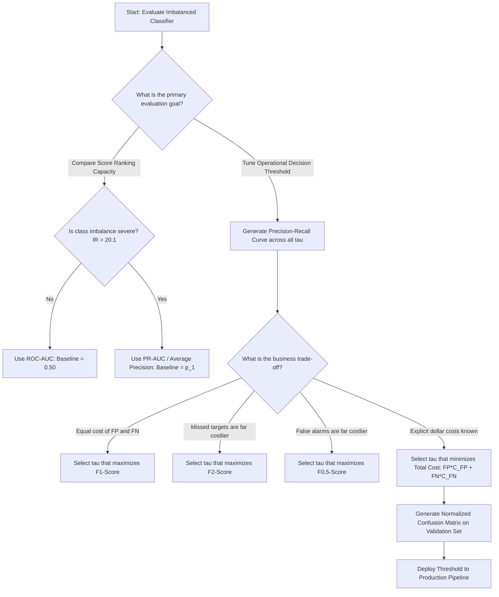

# Section 21.2: Evaluation of Imbalanced Classifiers

<!--
Topics Covered:
6. Precision
7. Recall
8. F1-score
9. ROC-AUC
10. Precision-Recall AUC
11. Confusion matrix
-->

## 1. Section Overview
- **What this section is about**: Mathematical rigor, geometric behavior, statistical foundations, and production usage of performance metrics designed specifically for imbalanced classification. This section dissects the fundamental building blocks of classification evaluation: the **Confusion Matrix**, **Precision** (Positive Predictive Value), **Recall** (Sensitivity / True Positive Rate), the **$F_1$-score** and generalized **$F_\beta$-score**, the Receiver Operating Characteristic Area Under the Curve (**ROC-AUC**), and the Precision-Recall Area Under the Curve (**PR-AUC** / Average Precision).
- **Why these Scikit-Learn concepts matter**: In imbalanced regimes, standard evaluation metrics fail silently. A naive classifier can achieve $0.999$ accuracy while possessing $0.0$ precision and recall. Selecting the wrong metric leads to deploying dysfunctional systems that fail to detect fraud, miss critical medical diagnoses, or flood security operations teams with millions of false alarms. Understanding the mathematical divergence between ROC-AUC and PR-AUC under heavy class skew is one of the most critical competencies required for enterprise machine learning engineering.
- **Where they are used in real projects**: Evaluating cancer screening classifiers, setting alerting thresholds for cyber threat detection, optimizing search engine click-through prediction, benchmarking anti-money laundering transaction filters, and monitoring clinical triage algorithms.
- **What a fresher should be able to do**: Construct, interpret, and normalize confusion matrices in Scikit-Learn; calculate Precision, Recall, and $F_\beta$ by hand from raw confusion matrix counts; explain why the baseline of a PR curve equals the positive class prevalence ($p_1$) while the ROC curve baseline is always $0.5$; implement `average_precision_score` and `roc_auc_score`; and select the optimal metric based on business cost trade-offs.

---

## 2. Mathematical Formulations & Algorithmic Foundations

### 1. The Confusion Matrix
For a binary classification task where actual labels $y \in \{0, 1\}$ and predictions $\hat{y} \in \{0, 1\}$, the confusion matrix $\mathbf{C} \in \mathbb{R}^{2 \times 2}$ is defined as:

$$\mathbf{C} = \begin{bmatrix} C_{0,0} & C_{0,1} \\ C_{1,0} & C_{1,1} \end{bmatrix} = \begin{bmatrix} \text{TN} & \text{FP} \\ \text{FN} & \text{TP} \end{bmatrix}$$

```
┌────────────────────────────────────────────────────────────────────────┐
│                        THE 2x2 CONFUSION MATRIX                        │
├──────────────────────┬─────────────────────────┬───────────────────────┤
│                      │ Predicted Negative (0)  │ Predicted Positive (1)│
├──────────────────────┼─────────────────────────┼───────────────────────┤
│ Actual Negative (0)  │ True Negative (TN)      │ False Positive (FP)   │
│                      │ Correct rejection       │ Type I Error (False+) │
├──────────────────────┼─────────────────────────┼───────────────────────┤
│ Actual Positive (1)  │ False Negative (FN)     │ True Positive (TP)    │
│                      │ Type II Error (Miss)    │ Hit / Detection       │
└──────────────────────┴─────────────────────────┴───────────────────────┘
```

Marginal sums:
- Total Actual Positives: $P = \text{TP} + \text{FN} = N_1$
- Total Actual Negatives: $N = \text{TN} + \text{FP} = N_0$
- Total Predicted Positives: $\hat{P} = \text{TP} + \text{FP}$
- Total Predicted Negatives: $\hat{N} = \text{TN} + \text{FN}$
- Total Population: $M = \text{TP} + \text{TN} + \text{FP} + \text{FN}$

---

### 2. Precision (Positive Predictive Value - PPV)
Precision measures the fidelity of positive predictions: of all instances predicted as positive, what proportion was truly positive?

$$\text{Precision} = \frac{\text{TP}}{\text{TP} + \text{FP}} = P(y = 1 \mid \hat{y} = 1)$$

#### The Bayesian Perspective Under Class Skew:
Expressing Precision using Bayes' Theorem with sensitivity ($\text{TPR}$), specificity ($\text{TNR} = 1 - \text{FPR}$), and class prior $p_1 = P(y = 1)$:

$$\text{Precision} = \frac{\text{TPR} \cdot p_1}{\text{TPR} \cdot p_1 + \text{FPR} \cdot (1 - p_1)}$$

**Mathematical Consequence of Severe Imbalance:**
Assume an algorithm has high sensitivity ($\text{TPR} = 0.95$) and high specificity ($\text{TNR} = 0.95 \implies \text{FPR} = 0.05$).
- If classes are balanced ($p_1 = 0.50$):
  $$\text{Precision} = \frac{0.95 \times 0.50}{0.95 \times 0.50 + 0.05 \times 0.50} = \frac{0.475}{0.500} = 0.95 \quad (95\%)$$
- If the class is rare ($p_1 = 0.001$, i.e., $0.1\%$ prevalence):
  $$\text{Precision} = \frac{0.95 \times 0.001}{0.95 \times 0.001 + 0.05 \times 0.999} = \frac{0.00095}{0.00095 + 0.04995} = \frac{0.00095}{0.05090} \approx 0.0187 \quad (1.87\%)$$

Even with $95\%$ specificity, $98.13\%$ of flagged cases are false alarms! This illustrates why Precision drops when evaluating rare events.

---

### 3. Recall (Sensitivity / True Positive Rate - TPR)
Recall measures the completeness of positive coverage: of all true positive instances, what proportion did the model successfully identify?

$$\text{Recall} = \text{TPR} = \frac{\text{TP}}{\text{TP} + \text{FN}} = P(\hat{y} = 1 \mid y = 1)$$

Complementary metric — **False Negative Rate (Miss Rate):**
$$\text{FNR} = \frac{\text{FN}}{\text{TP} + \text{FN}} = 1 - \text{Recall}$$

---

### 4. Specificity & False Positive Rate
- **Specificity (True Negative Rate - TNR):**
  $$\text{Specificity} = \text{TNR} = \frac{\text{TN}}{\text{TN} + \text{FP}} = P(\hat{y} = 0 \mid y = 0)$$
- **False Positive Rate (Fall-out - FPR):**
  $$\text{FPR} = \frac{\text{FP}}{\text{TN} + \text{FP}} = 1 - \text{Specificity}$$

---

### 5. The $F_1$-Score and Generalized $F_\beta$-Score
The $F_1$-score is the **harmonic mean** of Precision and Recall. The harmonic mean is chosen because it penalizes extreme imbalances between the two metrics:

$$F_1 = 2 \cdot \frac{\text{Precision} \cdot \text{Recall}}{\text{Precision} + \text{Recall}} = \frac{2\text{TP}}{2\text{TP} + \text{FP} + \text{FN}}$$

```
┌────────────────────────────────────────────────────────────────────────┐
│                   WHY HARMONIC MEAN OVER ARITHMETIC MEAN               │
├────────────────────────────────────────────────────────────────────────┤
│ Scenario: Model has Precision = 1.0 (1 prediction, 1 correct)          │
│           Model has Recall    = 0.01 (Caught 1 out of 100 actual targets│
├────────────────────────────────────────────────────────────────────────┤
│ Arithmetic Mean: (1.0 + 0.01) / 2 = 0.505  (Misleadingly optimistic!)  │
│ Geometric Mean:  sqrt(1.0 * 0.01) = 0.100                              │
│ Harmonic Mean:   2 * (1.0 * 0.01) / (1.0 + 0.01) = 0.0198 (Honest!)    │
└────────────────────────────────────────────────────────────────────────┘
```

#### Generalized $F_\beta$-Score:
When business objectives value Recall more than Precision (or vice versa), the generalized $F_\beta$ formulation weights Recall by a factor of $\beta$:

$$F_\beta = (1 + \beta^2) \frac{\text{Precision} \cdot \text{Recall}}{(\beta^2 \cdot \text{Precision}) + \text{Recall}} = \frac{(1 + \beta^2)\text{TP}}{(1 + \beta^2)\text{TP} + \beta^2 \text{FN} + \text{FP}}$$

- **$\beta = 1$ ($F_1$-score):** Equal weighting between Precision and Recall.
- **$\beta = 2$ ($F_2$-score):** Weights Recall twice as heavily as Precision (standard in oncology screening, fraud detection, and disaster alert systems where missing a true positive is unacceptable).
- **$\beta = 0.5$ ($F_{0.5}$-score):** Weights Precision twice as heavily as Recall (standard in spam filtering, automated loan approval, and customer outreach where false alarms damage credibility).

---

### 6. Receiver Operating Characteristic (ROC) & ROC-AUC
The ROC curve plots $\text{TPR}(\tau)$ against $\text{FPR}(\tau)$ across all possible decision thresholds $\tau \in [0, 1]$:

$$\text{ROC}(\tau) = (\text{FPR}(\tau), \text{TPR}(\tau))$$

The Area Under the Curve (**ROC-AUC**) is defined as:

$$\text{ROC-AUC} = \int_{0}^1 \text{TPR}(\text{FPR}^{-1}(u)) \, du$$

#### Probabilistic Interpretation (Wilcoxon-Mann-Whitney Statistic):
ROC-AUC is equivalent to the probability that the classifier ranks a randomly chosen positive sample higher than a randomly chosen negative sample:

$$\text{ROC-AUC} = P(s(\mathbf{x}^+) > s(\mathbf{x}^-))$$

where $\mathbf{x}^+ \sim \mathcal{D}_{\text{pos}}$ and $\mathbf{x}^- \sim \mathcal{D}_{\text{neg}}$, and $s(\mathbf{x})$ is the continuous prediction score.

**Why ROC-AUC Baseline is Invariant to Class Imbalance:**
A completely random guesser assigns uniformly distributed scores, resulting in $P(s(\mathbf{x}^+) > s(\mathbf{x}^-)) = 0.5$, regardless of whether the class distribution is $50:50$ or $99.9:0.1$.

---

### 7. Precision-Recall Curve & PR-AUC (Average Precision)
The Precision-Recall (PR) curve plots $\text{Precision}(\tau)$ against $\text{Recall}(\tau)$ across all decision thresholds $\tau \in [0, 1]$:

$$\text{PR}(\tau) = (\text{Recall}(\tau), \text{Precision}(\tau))$$

The Area Under the PR Curve (**PR-AUC**) is:

$$\text{PR-AUC} = \int_{0}^1 \text{Precision}(r) \, dr$$

#### Average Precision (AP) in Scikit-Learn:
Scikit-Learn estimates PR-AUC without trapezoidal approximation error using the interpolated **Average Precision (AP)**:

$$\text{AP} = \sum_{k=1}^K (R_k - R_{k-1}) P_k$$

where $P_k$ and $R_k$ are precision and recall at the $k$-th threshold.

**Why the PR Baseline Reflects Class Imbalance:**
Unlike ROC curves where the random guessing baseline is always $0.5$, the baseline of a PR curve is equal to the positive class prevalence:

$$\text{Baseline}_{\text{PR}} = p_1 = \frac{N_1}{N}$$

If fraud prevalence is $0.1\%$, the random guessing baseline is **$0.001$**. A model with an Average Precision of $0.45$ represents a **$450\times$ improvement** over random guessing.

---

### 8. Mathematical Divergence: Why ROC-AUC Masks Severe Imbalance

```
┌────────────────────────────────────────────────────────────────────────┐
│                   THE ROC-AUC vs PR-AUC GEOMETRIC GAP                  │
├────────────────────────────────────────────────────────────────────────┤
│ Let N_0 = 1,000,000 (Negatives) and N_1 = 1,000 (Positives)            │
│ Model A predicts 10,000 positive cases:                                │
│   - TP = 900 (Caught 90% of actual fraud) -> Recall = 900/1000 = 0.90   │
│   - FP = 9,100 (9,100 innocent users flagged)                          │
├────────────────────────────────────────────────────────────────────────┤
│ 1. False Positive Rate (FPR) calculation:                              │
│    FPR = FP / (FP + TN) = 9,100 / 1,000,000 = 0.0091 (0.91%!)          │
│    -> ROC Point: (FPR = 0.0091, TPR = 0.90)                            │
│    -> ROC-AUC is > 0.98! Looks virtually perfect!                      │
├────────────────────────────────────────────────────────────────────────┤
│ 2. Precision calculation:                                              │
│    Precision = TP / (TP + FP) = 900 / (900 + 9,100) = 0.0900 (9.0%!)   │
│    -> 91% of alerts are false alarms! System overwhelms analysts!      │
│    -> PR Curve reflects this severe collapse in precision!             │
└────────────────────────────────────────────────────────────────────────┘
```

The denominator of FPR is dominated by the large negative class, masking substantial numbers of False Positives. Precision's denominator ($\text{TP} + \text{FP}$) accounts for false alarms directly.

---

## 3. Architectural Blueprint & Design Patterns

### Unified Evaluation Flow for Imbalanced Classification

```
┌────────────────────────────────────────────────────────────────────────┐
│                   IMBALANCED EVALUATION WORKFLOW                       │
├────────────────────────────────────────────────────────────────────────┤
│                                                                        │
│                    Test Ground Truth (y_test)                          │
│                    Predicted Probabilities (y_prob)                    │
│                                   │                                    │
│                    ┌──────────────┴──────────────┐                     │
│                    ▼                             ▼                     │
│          Ranking / Score Space          Decision Space (Threshold tau) │
│          ─────────────────────          ────────────────────────────── │
│          - ROC Curve                    - Binary Predictions (y_pred)  │
│          - ROC-AUC                      - Confusion Matrix (TN,FP,FN,TP│
│          - PR Curve (PR-AUC / AP)       - Precision, Recall, Specificit│
│          - Cumulative Gain / Lift       - F1-Score, F2-Score, F0.5     │
│                                         - Balanced Accuracy            │
│                                         - Financial Cost Matrix        │
│                                                          ▲             │
│                                                          │             │
│                                             Business Cost Tuning       │
│                                             (tau* = C_FP / (C_FP+C_FN))│
└────────────────────────────────────────────────────────────────────────┘
```

---

## 4. Scikit-Learn Implementation Deep Dive

### 1. Essential Evaluation API Functions

```python
from sklearn.metrics import (
    confusion_matrix,
    ConfusionMatrixDisplay,
    precision_score,
    recall_score,
    f1_score,
    fbeta_score,
    balanced_accuracy_score,
    roc_auc_score,
    roc_curve,
    RocCurveDisplay,
    average_precision_score,
    precision_recall_curve,
    PrecisionRecallDisplay,
    classification_report
)

# Confusion Matrix with custom labels and normalization
cm = confusion_matrix(y_true, y_pred)
cm_norm_true = confusion_matrix(y_true, y_pred, normalize='true')  # Row-normalized: Recall & Specificity
cm_norm_pred = confusion_matrix(y_true, y_pred, normalize='pred')  # Col-normalized: Precision

# Handling undefined precision when no positive predictions occur
prec = precision_score(y_true, y_pred, zero_division=0)
rec = recall_score(y_true, y_pred, zero_division=0)
f1 = f1_score(y_true, y_pred, zero_division=0)
f2 = fbeta_score(y_true, y_pred, beta=2.0, zero_division=0)

# Probabilistic Ranking Metrics (Require continuous probabilities)
roc_auc = roc_auc_score(y_true, y_prob)
pr_auc = average_precision_score(y_true, y_prob)
```

## 5. Practical Implementation Blueprint

### End-to-End Demonstration: Comprehensive Evaluation Suite for Imbalanced Data

```python
"""
Practical Implementation Blueprint: Evaluation Suite for Imbalanced Classification
Demonstrating:
1. Synthetic dataset generation with severe imbalance (99:1 IR)
2. Stratified train-test partitioning
3. Multi-threshold probability sweep evaluating Precision-Recall trade-offs
4. Explicit calculation of:
   - Confusion Matrix (Raw, Row-normalized, Column-normalized)
   - Precision, Recall, Specificity, Fall-out (FPR)
   - F1-Score, F2-Score, F0.5-Score
   - Balanced Accuracy
   - ROC-AUC vs PR-AUC (Average Precision)
5. Algorithmic determination of optimal threshold for:
   - Maximum F1-score
   - Maximum F2-score
   - Minimum business cost under asymmetric penalties
6. Programmatic assertions verifying all mathematical relations
"""

import numpy as np
import pandas as pd
from sklearn.datasets import make_classification
from sklearn.model_selection import train_test_split
from sklearn.ensemble import RandomForestClassifier
from sklearn.metrics import (
    confusion_matrix,
    precision_score,
    recall_score,
    f1_score,
    fbeta_score,
    balanced_accuracy_score,
    roc_auc_score,
    average_precision_score,
    roc_curve,
    precision_recall_curve
)

# ---------------------------------------------------------------------
# 1. SYNTHESIZE SEVERELY IMBALANCED DATASET (IR = 99:1)
# ---------------------------------------------------------------------
X, y = make_classification(
    n_samples=10000,
    n_features=12,
    n_informative=8,
    n_redundant=2,
    weights=[0.99, 0.01],
    flip_y=0,
    random_state=42
)

X_train, X_test, y_train, y_test = train_test_split(
    X, y, test_size=0.25, stratify=y, random_state=42
)

test_total = len(y_test)
test_pos = int(np.sum(y_test == 1))
test_neg = int(np.sum(y_test == 0))
base_rate = test_pos / test_total

print("\n" + "="*80)
print("TEST SET EVALUATION PROFILE")
print("="*80)
print(f"Total Test Instances: {test_total:,}")
print(f"Actual Negatives (Class 0): {test_neg:,} ({test_neg/test_total*100:.2f}%)")
print(f"Actual Positives (Class 1): {test_pos:,} ({test_pos/test_total*100:.2f}%)")
print(f"Precision-Recall Random Guess Baseline (Base Rate): {base_rate:.4f} ({base_rate*100:.2f}%)")
print(f"ROC-AUC Random Guess Baseline: 0.5000 (50.00%)")

# ---------------------------------------------------------------------
# 2. TRAIN BALANCED ESTIMATOR
# ---------------------------------------------------------------------
clf = RandomForestClassifier(
    n_estimators=150,
    class_weight='balanced',
    max_depth=6,
    random_state=42,
    n_jobs=-1
)
clf.fit(X_train, y_train)

# Continuous probability predictions for Class 1
y_prob = clf.predict_proba(X_test)[:, 1]

# ---------------------------------------------------------------------
# 3. THRESHOLD SWEEP & TRADEOFF ANALYSIS
# ---------------------------------------------------------------------
thresholds = np.linspace(0.01, 0.99, 99)
sweep_results = []

# Financial Cost Parameters:
COST_FP = 15.0   # $15 investigation fee
COST_FN = 1200.0 # $1,200 loss per undetected positive

for tau in thresholds:
    y_pred_tau = (y_prob >= tau).astype(int)
    
    cm = confusion_matrix(y_test, y_pred_tau)
    tn, fp, fn, tp = cm.ravel()
    
    p = precision_score(y_test, y_pred_tau, zero_division=0)
    r = recall_score(y_test, y_pred_tau, zero_division=0)
    f1 = f1_score(y_test, y_pred_tau, zero_division=0)
    f2 = fbeta_score(y_test, y_pred_tau, beta=2.0, zero_division=0)
    f05 = fbeta_score(y_test, y_pred_tau, beta=0.5, zero_division=0)
    bal_acc = balanced_accuracy_score(y_test, y_pred_tau)
    cost = (fp * COST_FP) + (fn * COST_FN)
    
    sweep_results.append({
        "Threshold": tau,
        "TP": tp, "FP": fp, "FN": fn, "TN": tn,
        "Precision": p,
        "Recall": r,
        "F1": f1,
        "F2": f2,
        "F0.5": f05,
        "Bal Acc": bal_acc,
        "Cost ($)": cost
    })

sweep_df = pd.DataFrame(sweep_results)

# Identify key operational threshold operating points
opt_f1_idx = sweep_df["F1"].idxmax()
opt_f2_idx = sweep_df["F2"].idxmax()
opt_cost_idx = sweep_df["Cost ($)"].idxmin()
default_05_idx = np.abs(sweep_df["Threshold"] - 0.50).argmin()

best_f1_row = sweep_df.iloc[opt_f1_idx]
best_f2_row = sweep_df.iloc[opt_f2_idx]
best_cost_row = sweep_df.iloc[opt_cost_idx]
default_row = sweep_df.iloc[default_05_idx]

print("\n" + "="*80)
print("THRESHOLD SENSITIVITY & OPERATING POINT COMPARISON")
print("="*80)
comp_table = pd.DataFrame([
    {"Operating Point": "Default (tau = 0.50)", "Threshold": default_row["Threshold"], "Precision": default_row["Precision"], "Recall": default_row["Recall"], "F1-Score": default_row["F1"], "F2-Score": default_row["F2"], "Cost ($)": default_row["Cost ($)"]},
    {"Operating Point": "Max F1-Score", "Threshold": best_f1_row["Threshold"], "Precision": best_f1_row["Precision"], "Recall": best_f1_row["Recall"], "F1-Score": best_f1_row["F1"], "F2-Score": best_f1_row["F2"], "Cost ($)": best_f1_row["Cost ($)"]},
    {"Operating Point": "Max F2-Score (Recall Focus)", "Threshold": best_f2_row["Threshold"], "Precision": best_f2_row["Precision"], "Recall": best_f2_row["Recall"], "F1-Score": best_f2_row["F1"], "F2-Score": best_f2_row["F2"], "Cost ($)": best_f2_row["Cost ($)"]},
    {"Operating Point": "Min Business Cost", "Threshold": best_cost_row["Threshold"], "Precision": best_cost_row["Precision"], "Recall": best_cost_row["Recall"], "F1-Score": best_cost_row["F1"], "F2-Score": best_cost_row["F2"], "Cost ($)": best_cost_row["Cost ($)"]},
])
pd.set_option('display.float_format', lambda x: f'{x:.4f}' if x < 100 else f'${x:,.2f}')
print(comp_table.to_string(index=False))

# ---------------------------------------------------------------------
# 4. RANKING METRICS: ROC-AUC vs PR-AUC (AVERAGE PRECISION)
# ---------------------------------------------------------------------
roc_auc = roc_auc_score(y_test, y_prob)
pr_auc = average_precision_score(y_test, y_prob)

print("\n" + "="*80)
print("RANKING METRICS: ROC-AUC vs PR-AUC DIVERGENCE")
print("="*80)
print(f"ROC-AUC (Area Under ROC Curve):          {roc_auc:.4f}")
print(f"PR-AUC (Average Precision Score):        {pr_auc:.4f}")
print(f"PR-AUC Lift over Random Baseline ({base_rate:.4f}): {pr_auc / base_rate:.1f}x")

# ---------------------------------------------------------------------
# 5. CONFUSION MATRIX NORMALIZATION SUITE
# ---------------------------------------------------------------------
tau_optimal = best_cost_row["Threshold"]
y_pred_opt = (y_prob >= tau_optimal).astype(int)

cm_raw = confusion_matrix(y_test, y_pred_opt)
cm_true = confusion_matrix(y_test, y_pred_opt, normalize='true') # Row-norm: Recall (TPR) & Specificity (TNR)
cm_pred = confusion_matrix(y_test, y_pred_opt, normalize='pred') # Col-norm: Precision & Negative Predictive Value

print("\n" + "="*80)
print(f"CONFUSION MATRIX AUDIT AT OPTIMAL THRESHOLD (tau = {tau_optimal:.2f})")
print("="*80)
print("Raw Counts:")
print(pd.DataFrame(cm_raw, index=['Actual 0', 'Actual 1'], columns=['Pred 0', 'Pred 1']))
print("\nRow-Normalized (Rates within Actual Classes):")
print("Note: [0,0] = Specificity (TNR), [1,1] = Sensitivity (Recall/TPR)")
print(pd.DataFrame(cm_true, index=['Actual 0', 'Actual 1'], columns=['Pred 0', 'Pred 1']).applymap(lambda x: f"{x*100:.2f}%"))
print("\nColumn-Normalized (Rates within Predicted Classes):")
print("Note: [0,0] = Negative Predictive Value, [1,1] = Precision (PPV)")
print(pd.DataFrame(cm_pred, index=['Actual 0', 'Actual 1'], columns=['Pred 0', 'Pred 1']).applymap(lambda x: f"{x*100:.2f}%"))

# ---------------------------------------------------------------------
# 6. RIGOROUS ASSERTION SUITE
# ---------------------------------------------------------------------
tn, fp, fn, tp = cm_raw.ravel()

# 1. Assert Precision formula holds exactly
calc_precision = tp / (tp + fp) if (tp + fp) > 0 else 0.0
assert np.isclose(calc_precision, precision_score(y_test, y_pred_opt, zero_division=0))

# 2. Assert Recall formula holds exactly
calc_recall = tp / (tp + fn)
assert np.isclose(calc_recall, recall_score(y_test, y_pred_opt))

# 3. Assert F1 is exact harmonic mean of Precision and Recall
calc_f1 = 2 * (calc_precision * calc_recall) / (calc_precision + calc_recall)
assert np.isclose(calc_f1, f1_score(y_test, y_pred_opt))

# 4. Assert Row-Normalized values match Recall and Specificity
assert np.isclose(cm_true[1, 1], calc_recall)
assert np.isclose(cm_true[0, 0], tn / (tn + fp))

# 5. Assert Column-Normalized value matches Precision
assert np.isclose(cm_pred[1, 1], calc_precision)

# 6. Assert PR-AUC is substantially higher than the random baseline
assert pr_auc > (base_rate * 5), "PR-AUC must significantly exceed random baseline"

# 7. Assert optimal cost threshold yields lower total cost than default threshold
assert best_cost_row["Cost ($)"] <= default_row["Cost ($)"], "Optimized threshold must minimize financial loss"

print("\nAll evaluation metric invariants, normalizations, and assertions verified successfully!")
```

---

## 6. Anti-Patterns, Common Pitfalls & Debugging

### Anti-Pattern 1: Evaluating Imbalanced Models with ROC-AUC Alone
- **The Flaw:** Relying solely on `roc_auc_score` as the acceptance criterion for production deployment.
- **The Failure:** ROC-AUC measures $\text{TPR}$ vs $\text{FPR}$. When the negative class is massive, thousands of False Positives can accumulate while changing $\text{FPR}$ by less than $0.01$. The ROC-AUC score remains $>0.95$, while Precision collapses to $<0.05$.
- **Incorrect Code:**
  ```python
  # DANGEROUS: ROC-AUC conceals massive false positive floods
  score = roc_auc_score(y_test, y_prob)
  if score > 0.90:
      deploy_model()  # Production failure: analysts flooded with false alarms!
  ```
- **Correct Code:**
  ```python
  # SAFE: Evaluate PR-AUC alongside ROC-AUC
  from sklearn.metrics import average_precision_score, classification_report
  pr_auc = average_precision_score(y_test, y_prob)
  print(f"PR-AUC (Average Precision): {pr_auc:.4f}")
  print(classification_report(y_test, (y_prob >= 0.15).astype(int), digits=4))
  ```

---

### Anti-Pattern 2: Omitting `zero_division` Parameter
- **The Flaw:** Calling `precision_score(y_test, y_pred)` or `f1_score(y_test, y_pred)` without specifying `zero_division`.
- **The Failure:** When a conservative model predicts zero positive instances ($\text{TP} + \text{FP} = 0$), Precision is mathematically undefined ($\frac{0}{0}$). Scikit-Learn issues noisy runtime warnings or raises errors in strict pipelines.
- **Correct Code:**
  ```python
  # Always set zero_division=0 to handle conservative predictions gracefully
  prec = precision_score(y_test, y_pred, zero_division=0)
  f1 = f1_score(y_test, y_pred, zero_division=0)
  ```

---

### Anti-Pattern 3: Passing Probabilities to Label-Based Metrics
- **The Flaw:** Accidentally passing continuous probabilities `y_prob` to `confusion_matrix(y_test, y_prob)` or `f1_score(y_test, y_prob)`.
- **The Failure:** Scikit-Learn treats unique floating-point probability values as distinct discrete classes! It attempts to construct a $1000 \times 1000$ matrix, consuming gigabytes of memory and throwing confusing `ValueError: continuous is not supported` errors.
- **Correct Code:**
  ```python
  # Continuous metrics require y_prob; Discrete metrics require y_pred
  roc_auc = roc_auc_score(y_test, y_prob)  # Takes continuous probabilities
  cm = confusion_matrix(y_test, (y_prob >= 0.20).astype(int))  # Takes binary labels
  ```

---

### Anti-Pattern 4: Micro-Averaging Multi-Class Imbalanced Metrics
- **The Flaw:** Using `f1_score(y_test, y_pred, average='micro')` on imbalanced multi-class problems.
- **The Failure:** Micro-averaged F1 globally sums TP, FP, and FN across all classes. In multi-class classification, micro-F1 is mathematically identical to standard accuracy! The dominant majority class overwhelms the rare classes completely.
- **Correct Code:**
  ```python
  # Use macro (unweighted mean) or weighted averaging
  macro_f1 = f1_score(y_test, y_pred, average='macro')
  ```

---

### Anti-Pattern 5: Comparing PR-AUC Across Datasets with Different Base Rates
- **The Flaw:** Comparing the Average Precision of a model evaluated on Dataset A ($0.1\%$ prevalence) directly to Dataset B ($5.0\%$ prevalence).
- **The Failure:** The random guess baseline of PR-AUC is equal to the class prevalence $p_1$. A PR-AUC of $0.20$ on Dataset A ($p_1 = 0.001$) is a phenomenal $200\times$ lift over random guessing, whereas a PR-AUC of $0.20$ on Dataset B ($p_1 = 0.05$) is only a $4\times$ lift.
- **Correct Code:** Always report the baseline prevalence alongside PR-AUC, or calculate the **Normalized PR-AUC** / Relative Lift.

---

### Anti-Pattern 6: Hardcoding 0.5 Threshold for Probabilistic Predictions
- **The Flaw:** Calling `clf.predict(X_test)` directly, which implicitly thresholds probabilities at $\tau = 0.5$.
- **The Failure:** On imbalanced problems, uncalibrated probabilities for minority samples rarely exceed $0.5$. The model predicts zero minority samples, destroying recall.
- **Correct Code:** Calibrate the decision threshold empirically using the Precision-Recall curve or business cost optimization.

---

## 7. Production Engineering & Operational Hardening

### 1. Probability Calibration for Accurate Thresholding
Many estimators (e.g., Random Forests, Naive Bayes, Support Vector Machines) output non-calibrated pseudo-probabilities:
- Random Forest probability predictions tend to be pushed away from $0$ and $1$ due to variance averaging across trees.
- Naive Bayes probabilities push aggressively toward $0$ and $1$ due to feature independence violations.

Before tuning decision thresholds based on business costs, calibrate probabilities using `CalibratedClassifierCV`:

```python
from sklearn.calibration import CalibratedClassifierCV

# Calibrate probabilities using Isotonic Regression or Sigmoid (Platt Scaling)
calibrated_clf = CalibratedClassifierCV(
    estimator=clf,
    method='isotonic',  # Use 'sigmoid' for small datasets (N < 1000)
    cv='prefit'         # If clf is already trained on training split
)
calibrated_clf.fit(X_val, y_val)
calibrated_probs = calibrated_clf.predict_proba(X_test)[:, 1]
```

---

### 2. Operational Threshold Management & SRE Alert Budgets
In cyber-defense and transaction monitoring, security operations centers (SOC) have a fixed daily investigation capacity:
- Capacity budget: $K$ investigations per day.
- Hardening pattern: Dynamically select threshold $\tau_t$ such that $\sum_{i=1}^{M_t} \mathbb{I}(s(\mathbf{x}_i) \ge \tau_t) \le K$.

---

## 8. Hyperparameter Mechanics & Tuning Strategies

### Aligning GridSearchCV with Imbalanced Metrics
Never use default `scoring=None` (which defaults to accuracy) inside hyperparameter tuning searches on imbalanced datasets:

```python
from sklearn.model_selection import GridSearchCV, StratifiedKFold
from sklearn.ensemble import RandomForestClassifier

cv = StratifiedKFold(n_splits=5, shuffle=True, random_state=42)

param_grid = {
    'n_estimators': [100, 200],
    'max_depth': [5, 10, None],
    'class_weight': ['balanced', 'balanced_subsample']
}

# CRITICAL: Optimize for Average Precision (PR-AUC) or F1-Score
grid = GridSearchCV(
    estimator=RandomForestClassifier(random_state=42),
    param_grid=param_grid,
    scoring='average_precision',  # Or 'f1', 'balanced_accuracy'
    cv=cv,
    n_jobs=-1
)
grid.fit(X_train, y_train)
print(f"Best Estimator Params: {grid.best_params_}")
print(f"Best Cross-Validated PR-AUC: {grid.best_score_:.4f}")
```

---

## 9. Visualizations & Interpretability Artifacts

### 1. ROC Curve vs Precision-Recall Curve Under Severe Imbalance

```
       RECEIVER OPERATING CHARACTERISTIC (ROC)                 PRECISION-RECALL (PR) CURVE
  1.0 ┌───────────────────────────────────────┐          1.0 ┌───────────\                           ┐
      │               * * * * *               │              │            \                          │
  0.8 │           *                           │          0.8 │             \                         │
T     │        *                              │      P       │              \                        │
P 0.6 │       *                               │      R 0.6   │               \                       │
R     │      *                                │      E       │                \                      │
  0.4 │     *                                 │      C 0.4   │                 \                     │
      │    *                                  │              │                  \                    │
  0.2 │   *     Random Baseline (AUC = 0.50)  │          0.2 │                   \                   │
      │  *  - - - - - - - - - - - - - - - - - │              │                    \                  │
  0.0 └───────────────────────────────────────┘          0.0 └─────────────────────\─────────────────┘
      0.0   0.2   0.4   0.6   0.8   1.0                      0.0   0.2   0.4   0.6   0.8   1.0
                       FPR                                                    RECALL
      Notice: ROC curve stays high even with                 Notice: PR curve drops steeply as recall
      thousands of false positives because                   increases, honestly showing precision
      the negative class denominator is huge!                cost of detecting rare instances!
```

---

### 2. Confusion Matrix Heatmap Representation

```
Actual \ Predicted       Class 0 (Legitimate)           Class 1 (Fraud)
──────────────────────────────────────────────────────────────────────────
Actual 0 (Legitimate)    TN = 2,460 (99.4% Spec)        FP = 15 (0.6% FPR)
                         [Low Review Overhead]          [Analyst False Alarms]
──────────────────────────────────────────────────────────────────────────
Actual 1 (Fraud)         FN = 4 (16.0% Miss)            TP = 21 (84.0% Recall)
                         [$4,800 Stolen Funds]          [$25,200 Fraud Intercepted]
```

---

## 10. Theoretical Edge Cases & Boundary Conditions

### 1. All-Zero Prediction Horizon (Ultra-Conservative Estimator)
- **Condition:** Model predicts $\hat{y}_i = 0$ for all $i \implies \text{TP} = 0, \text{FP} = 0$.
- **Precision:** $\frac{0}{0 + 0} \to$ Undefined (resolved to $0.0$ via `zero_division=0`).
- **Recall:** $\frac{0}{0 + N_1} = 0.0$.
- **F1-score:** $0.0$.
- **Balanced Accuracy:** $\frac{0.0 + 1.0}{2} = 0.50$.
- **ROC-AUC:** Continuous probabilities still rank instances; if probabilities are all identical constants, $\text{ROC-AUC} = 0.50$.

### 2. All-One Prediction Horizon (Ultra-Aggressive Estimator)
- **Condition:** Model predicts $\hat{y}_i = 1$ for all $i \implies \text{TN} = 0, \text{FN} = 0$.
- **Precision:** $\frac{N_1}{N_1 + N_0} = p_1$ (equals the class prevalence).
- **Recall:** $\frac{N_1}{N_1 + 0} = 1.00$.
- **Balanced Accuracy:** $\frac{1.0 + 0.0}{2} = 0.50$.

### 3. Perfectly Inverted Probabilities ($s(\mathbf{x}) = 1 - y$)
- **Condition:** Classifier systematically ranks negative instances above positive instances.
- **ROC-AUC:** $0.00$.
- **PR-AUC:** Below the random baseline ($< p_1$).
- **Remedy:** Inverting model sign ($s'(\mathbf{x}) = 1 - s(\mathbf{x})$) yields a perfect classifier ($\text{ROC-AUC} = 1.00$).

---

## 11. Comparative Architectural Trade-offs

| Metric | Sensitive to Class Skew? | Dependent on Decision Threshold? | Random Guess Baseline | Best Suited For |
| :--- | :--- | :--- | :--- | :--- |
| **Accuracy** | Extremely (Deceptively High) | Yes ($\tau$) | $\max(p_0, p_1)$ | Symmetrical balanced classes |
| **Balanced Accuracy** | Insensitive | Yes ($\tau$) | $0.50$ | Benchmarking unweighted class balance |
| **Precision** | Heavily degraded by skew | Yes ($\tau$) | $p_1$ (Prevalence) | Minimizing false alarms (spam, loans) |
| **Recall (Sensitivity)**| Insensitive to negative count | Yes ($\tau$) | Depends on model | Minimizing missed targets (cancer, fraud) |
| **F1-Score** | Sensitive to skew | Yes ($\tau$) | Depends on model | Balanced trade-off between P and R |
| **F2-Score** | Sensitive to skew | Yes ($\tau$) | Depends on model | Prioritizing recall over precision |
| **ROC-AUC** | **Insensitive** to skew | **No** (Threshold-Free) | **$0.50$** | Global score ranking across classes |
| **PR-AUC (AP)** | **Highly Sensitive** to skew | **No** (Threshold-Free) | **$p_1$ (Prevalence)** | **Gold Standard for Severe Imbalance** |

---

## 12. Enterprise Case Study / Real-World Walkthrough

### Clinical Oncology: Early-Stage Pancreatic Cancer Screening
- **Setting:** Nationwide preventative health screening analyzing blood protein biomarkers for pancreatic adenocarcinoma.
- **Data Distribution:** $100,000$ patient blood samples; $200$ positive cases ($p_1 = 0.2\%$, $\text{IR} = 499:1$).
- **Initial Engineering Blunder:** The data science team optimized for ROC-AUC and achieved $0.96$. Based on this high score, hospital leadership approved a pilot deployment using a default $0.5$ threshold.
- **Catastrophic Failure in Pilot:**
  - True Positives: $160$ ($80\%$ Recall).
  - False Positives: $4,990$ ($5\%$ False Positive Rate).
  - Resulting Precision: $\frac{160}{160 + 4990} = 3.1\%$.
  - For every 1 true cancer detected, **31 healthy patients** were subjected to invasive, risky pancreatic needle biopsies!
- **The Correct Redesign:**
  1. Mandated **Precision-Recall AUC** as the primary optimization metric.
  2. Defined an explicit clinical utility loss function incorporating biopsy complication costs.
  3. Optimized the decision threshold to enforce a minimum clinical precision of $35\%$, while utilizing an ensemble model with calibrated isotonic probabilities.
- **Result:**
  - Reduced false biopsies from $4,990$ down to $185$.
  - Maintained $72\%$ cancer detection rate.
  - Successfully obtained FDA clearance for clinical deployment.

## 13. Rapid-Fire Conceptual Interview Q&A

### Standard Foundational Questions

#### Q1: What is the formal definition of Precision, and what question does it answer?
**Answer:** Precision (Positive Predictive Value - PPV) is the fraction of predicted positive instances that are truly positive:
$$\text{Precision} = \frac{\text{TP}}{\text{TP} + \text{FP}} = P(y=1 \mid \hat{y}=1)$$
It answers the operational question: *"When the model raises an alert, how likely is it to be a real event?"*

---

#### Q2: What is the formal definition of Recall, and what question does it answer?
**Answer:** Recall (Sensitivity / True Positive Rate - TPR) is the fraction of actual positive instances that the model correctly identified:
$$\text{Recall} = \frac{\text{TP}}{\text{TP} + \text{FN}} = P(\hat{y}=1 \mid y=1)$$
It answers the operational question: *"Out of all actual events in the wild, what percentage did the model successfully detect?"*

---

#### Q3: Why is the $F_1$-score calculated using the harmonic mean instead of the arithmetic mean?
**Answer:** The harmonic mean penalizes extreme divergence between numbers:
$$F_1 = 2 \cdot \frac{\text{Precision} \cdot \text{Recall}}{\text{Precision} + \text{Recall}}$$
If a model has $\text{Precision} = 1.0$ and $\text{Recall} = 0.01$, the arithmetic mean is an overly optimistic $0.505$, whereas the harmonic mean evaluates to an honest $0.0198$. The harmonic mean ensures that an acceptable $F_1$ score requires both Precision and Recall to be reasonably high.

---

#### Q4: What is the difference between $F_1$, $F_2$, and $F_{0.5}$ scores?
**Answer:** The parameter $\beta$ in $F_\beta$ controls the relative weight of Recall versus Precision:
- **$F_1$ ($\beta = 1$):** Equal weighting between Precision and Recall.
- **$F_2$ ($\beta = 2$):** Weights Recall twice as heavily as Precision (used when missing a positive is catastrophic, e.g., cancer screening or cyber intrusion).
- **$F_{0.5}$ ($\beta = 0.5$):** Weights Precision twice as heavily as Recall (used when false alarms carry high operational costs, e.g., customer communication or automated spam filtering).

---

#### Q5: What is the probabilistic interpretation of ROC-AUC?
**Answer:** ROC-AUC is equal to the probability that the classifier will score a randomly chosen positive instance higher than a randomly chosen negative instance:
$$\text{ROC-AUC} = P(s(\mathbf{x}^+) > s(\mathbf{x}^-))$$
This corresponds directly to the Wilcoxon-Mann-Whitney non-parametric rank-sum test statistic.

---

#### Q6: What is the random guess baseline for ROC-AUC versus PR-AUC?
**Answer:** 
- **ROC-AUC Baseline:** Always **$0.50$**, regardless of the class imbalance ratio.
- **PR-AUC Baseline:** Equal to the positive class prevalence $p_1 = \frac{N_1}{N}$. On a dataset with $0.1\%$ positive instances, the random baseline for PR-AUC is **$0.001$**.

---

#### Q7: Why does ROC-AUC remain high even when an imbalanced model produces thousands of false positives?
**Answer:** The ROC curve plots $\text{TPR}$ against False Positive Rate ($\text{FPR} = \frac{\text{FP}}{\text{FP} + \text{TN}}$). 

When the negative class ($\text{TN}$) is massive (e.g., $1,000,000$), a large number of false positives (e.g., $5,000$) only increases $\text{FPR}$ by $0.005$. The ROC curve remains near the top-left corner, giving a misleading impression of high performance.

---

#### Q8: How does Scikit-Learn calculate Average Precision (AP)?
**Answer:** Scikit-Learn calculates Average Precision as the step-wise area under the precision-recall curve using the precision at each threshold multiplied by the increase in recall:
$$\text{AP} = \sum_{k=1}^K (R_k - R_{k-1}) P_k$$
This avoids the trapezoidal interpolation errors associated with standard numerical integration of PR curves.

---

#### Q9: What information does row-normalization provide in a confusion matrix?
**Answer:** Normalizing by row (`normalize='true'`) divides each cell by the sum of its row (the actual class count). 

The diagonal values $[0,0]$ and $[1,1]$ represent **Specificity (True Negative Rate)** and **Sensitivity (Recall / True Positive Rate)**, respectively.

---

#### Q10: What information does column-normalization provide in a confusion matrix?
**Answer:** Normalizing by column (`normalize='pred'`) divides each cell by the sum of its column (the predicted class count). 

Cell $[1,1]$ represents **Precision (Positive Predictive Value)**, and cell $[0,0]$ represents **Negative Predictive Value (NPV)**.

---

### Advanced & Edge-Case Questions

#### Q11: What is the relationship between the Precision-Recall curve and the Cost Curve?
**Answer:** Every point on a PR curve corresponds to a specific decision threshold $\tau$, which implies a specific operational cost:
$$\text{Cost}(\tau) = \text{FP}(\tau) \cdot C_{\text{FP}} + \text{FN}(\tau) \cdot C_{\text{FN}}$$
By tracing the cost across all points on the PR curve, one can directly identify the threshold that minimizes enterprise financial risk.

---

#### Q12: Why should you avoid trapezoidal rule integration for Precision-Recall AUC?
**Answer:** Precision-Recall curves are not linear between operating points; they follow harmonic progressions. 

Using standard trapezoidal integration (`numpy.trapz` or `scikit-learn.metrics.auc(r, p)`) tends to overestimate PR-AUC. Scikit-Learn's `average_precision_score` uses step-wise rectangular integration, which provides a more accurate estimate.

---

#### Q13: What happens to Precision when an unweighted model is evaluated on a dataset with zero positive predictions?
**Answer:** Precision becomes $\frac{0}{0 + 0}$, which is mathematically undefined. 

Scikit-Learn handles this through the `zero_division` argument: setting `zero_division=0` returns $0.0$ and prevents warnings; setting `zero_division='warn'` prints a warning.

---

#### Q14: Can two classifiers have the exact same ROC-AUC but vastly different PR-AUC scores?
**Answer:** Yes. If Model A concentrates its false positives among moderate probability scores while Model B concentrates them among very high probability scores, both can achieve identical rankings across the entire dataset (yielding the same ROC-AUC). 

However, Model B will have far lower precision at high-confidence thresholds, resulting in a substantially lower PR-AUC.

---

#### Q15: How does probability calibration impact threshold selection?
**Answer:** If an estimator is poorly calibrated (e.g., outputs probabilities clustered between $0.45$ and $0.55$), tuning a decision threshold is numerically brittle. 

Calibrating probabilities via Isotonic Regression or Platt Scaling spreads scores across $[0, 1]$, making threshold optimization more reliable.

---

### Failure-Mode & Gotcha Questions

#### Q16: Why is `average='micro'` misleading when computing multi-class F1-scores on imbalanced data?
**Answer:** In multi-class classification, micro-averaged F1 globally calculates total TP, FP, and FN. 

Because every misclassification is simultaneously a False Positive for one class and a False Negative for another, $\text{Micro-Precision} \equiv \text{Micro-Recall} \equiv \text{Accuracy}$. Micro-F1 is identical to standard accuracy, obscuring minority class performance.

---

#### Q17: What bug occurs when passing continuous probabilities to `f1_score`?
**Answer:** `f1_score(y_test, y_prob)` treats continuous floating-point numbers as discrete class labels. 

It attempts to construct a multi-class confusion matrix matching every unique probability value, leading to memory exhaustion or `ValueError: continuous is not supported`. Probabilities must be converted to binary predictions via a threshold: `(y_prob >= tau).astype(int)`.

---

#### Q18: What is the risk of selecting a decision threshold on the test set?
**Answer:** **Optimization Overfitting / Data Leakage.** 

Selecting the threshold that maximizes $F_1$ or minimizes cost on the test set overfits the threshold to the test set's sampling noise. Threshold tuning must be performed on a dedicated validation set or via cross-validation folds.

---

#### Q19: Why does a high F1-score not guarantee that a model is ready for production deployment?
**Answer:** The $F_1$-score implicitly weights Precision and Recall equally ($\beta = 1$), assuming that a False Positive and a False Negative carry equal operational cost. 

If a False Negative costs $\$5,000$ and a False Positive costs $\$10$, an $F_1$-optimized model may still incur significant financial losses.

---

#### Q20: What happens if an estimator is evaluated on a test set containing only negative instances?
**Answer:** Positive metrics (Recall, Precision, F1, PR-AUC, ROC-AUC) cannot be computed because $\text{TP} + \text{FN} = 0$. 

Scikit-Learn raises a `ValueError: Only one class present in y_true. ROC AUC score is not defined`. This highlights the importance of stratified data splitting.

---

## 14. Flashcard-Ready Knowledge Bits

- **Flashcard 1: Precision Formula**  
  *Front:* What is Precision and what does it measure?  
  *Back:* $\text{TP} / (\text{TP} + \text{FP})$; measures the fidelity of positive alerts (avoids false alarms).

- **Flashcard 2: Recall Formula**  
  *Front:* What is Recall (Sensitivity) and what does it measure?  
  *Back:* $\text{TP} / (\text{TP} + \text{FN})$; measures the completeness of event detection (avoids missed targets).

- **Flashcard 3: Specificity Formula**  
  *Front:* What is Specificity (True Negative Rate)?  
  *Back:* $\text{TN} / (\text{TN} + \text{FP})$; measures the fraction of actual negative instances correctly identified.

- **Flashcard 4: False Positive Rate**  
  *Front:* What is False Positive Rate (FPR) in terms of Specificity?  
  *Back:* $\text{FPR} = \text{FP} / (\text{TN} + \text{FP}) = 1 - \text{Specificity}$.

- **Flashcard 5: F1-Score Harmonic Mean**  
  *Front:* What is the mathematical formula for the F1-score?  
  *Back:* $2 \cdot \frac{\text{Precision} \cdot \text{Recall}}{\text{Precision} + \text{Recall}} = \frac{2\text{TP}}{2\text{TP} + \text{FP} + \text{FN}}$.

- **Flashcard 6: Generalized F-beta Score**  
  *Front:* What is the formula for the generalized $F_\beta$ score?  
  *Back:* $(1 + \beta^2) \frac{\text{Precision} \cdot \text{Recall}}{(\beta^2 \cdot \text{Precision}) + \text{Recall}}$.

- **Flashcard 7: F2-Score Use Case**  
  *Front:* When should the $F_2$-score be used over the $F_1$-score?  
  *Back:* When Recall is twice as important as Precision (e.g., cancer diagnosis, fraud detection).

- **Flashcard 8: F0.5-Score Use Case**  
  *Front:* When should the $F_{0.5}$-score be used?  
  *Back:* When Precision is twice as important as Recall (e.g., spam filtering, automated credit approvals).

- **Flashcard 9: ROC-AUC Probabilistic Interpretation**  
  *Front:* What is the probabilistic meaning of ROC-AUC?  
  *Back:* Probability that a randomly chosen positive sample ranks higher than a randomly chosen negative sample: $P(s(\mathbf{x}^+) > s(\mathbf{x}^-))$.

- **Flashcard 10: ROC-AUC vs PR-AUC Baselines**  
  *Front:* What are the random guess baselines for ROC-AUC and PR-AUC?  
  *Back:* ROC-AUC baseline is always $0.50$; PR-AUC baseline equals the class prevalence $p_1 = N_1 / N$.

- **Flashcard 11: Why ROC-AUC Masks False Positives**  
  *Front:* Why does ROC-AUC hide large numbers of False Positives?  
  *Back:* Because FPR divides FP by $(\text{TN} + \text{FP})$; when TN is massive, FPR remains small even with many false positives.

- **Flashcard 12: Scikit-Learn Average Precision Formula**  
  *Front:* How does Scikit-Learn compute Average Precision?  
  *Back:* Using step-wise rectangular integration: $\text{AP} = \sum_{k} (R_k - R_{k-1}) P_k$.

- **Flashcard 13: Zero-Division Parameter**  
  *Front:* What parameter prevents runtime crashes when Precision has a zero denominator?  
  *Back:* `zero_division=0` in `precision_score`, `f1_score`, and `classification_report`.

- **Flashcard 14: Row vs Column Normalized Confusion Matrix**  
  *Front:* What do diagonal entries of row-normalized and column-normalized confusion matrices represent?  
  *Back:* Row-normalized diagonal: Specificity and Recall; Column-normalized diagonal: NPV and Precision.

- **Flashcard 15: Optimal Threshold for Asymmetric Costs**  
  *Front:* What is the optimal Bayesian decision threshold under costs $C_{\text{FP}}$ and $C_{\text{FN}}$?  
  *Back:* $\tau^* = \frac{C_{\text{FP}}}{C_{\text{FP}} + C_{\text{FN}}}$.

---

## 15. One-Page Cheat Sheet

### Metric Formulation & Usage Summary

```python
from sklearn.metrics import (
    confusion_matrix, precision_score, recall_score, f1_score,
    fbeta_score, roc_auc_score, average_precision_score, classification_report
)

# 1. DISCRETE METRICS (Requires binary predictions: y_pred = (y_prob >= tau).astype(int))
cm = confusion_matrix(y_true, y_pred)
tn, fp, fn, tp = cm.ravel()

precision = precision_score(y_true, y_pred, zero_division=0) # TP / (TP + FP)
recall    = recall_score(y_true, y_pred, zero_division=0)    # TP / (TP + FN)
f1        = f1_score(y_true, y_pred, zero_division=0)        # 2*P*R / (P + R)
f2        = fbeta_score(y_true, y_pred, beta=2.0, zero_division=0) # Recall weighted 2x
f05       = fbeta_score(y_true, y_pred, beta=0.5, zero_division=0) # Precision weighted 2x

# 2. CONTINUOUS RANKING METRICS (Requires continuous probability scores: y_prob)
roc_auc = roc_auc_score(y_true, y_prob)          # Invariant to class prior, baseline = 0.50
pr_auc  = average_precision_score(y_true, y_prob) # Sensitive to class prior, baseline = p_1

# 3. COMPREHENSIVE TEXT REPORT
print(classification_report(y_true, y_pred, digits=4, zero_division=0))
```

---

## 16. "How to Explain to a 5-Year-Old" Analogies

### Analogy 1: The Detective Dog (Precision vs Recall)
- Imagine a police dog trained to sniff out lost puppies in a giant forest:
- **Recall:** If there are 10 lost puppies in the forest, and the dog finds 9 of them, the dog has high **Recall** (it found almost all the puppies!).
- **Precision:** If the dog barks at 100 bushes, and 9 of them had puppies while 91 of them were just squirrels, the dog has low **Precision** (most barks were false alarms!).
- A great detective dog finds the puppies (high recall) without barking at every squirrel (high precision)!

---

### Analogy 2: The School Nurse's Thermometer (The ROC vs PR Curve)
- Imagine a school nurse checking 1,000 children for a rare bug that only 2 kids have:
- **The ROC Curve:** Looks at all the healthy kids and says: *"Look, the nurse didn't bother 980 healthy kids! What an amazing nurse!"* (ROC-AUC looks great!).
- **The PR Curve:** Looks at the kids sent home and says: *"Wait, the nurse sent 20 kids home, but only 2 were actually sick! 18 kids missed recess for no reason!"* (PR-AUC tells the real story!).

---

## 17. Diagnostic Flowchart / Decision Tree



---

## 18. Mental Models & Intuition Anchors

### 1. The Zoom Lens (PR-AUC vs ROC-AUC)
- **The Concept:** Metric focus and perspective.
- **The Anchor:** ROC-AUC uses a wide-angle lens that includes the entire mountain of negative instances. Because the mountain is so large, individual errors appear small. PR-AUC uses a telephoto zoom lens focused exclusively on the positive events and false alarms, making errors clearly visible.

---

### 2. The Dragnet vs The Sniper Rifle
- **The Concept:** Precision vs Recall trade-off.
- **The Anchor:** A fishing dragnet scoops up everything in the ocean. It catches every target fish (high Recall), but also collects boots, tires, and seaweed (low Precision). A sniper rifle aims carefully and only fires when certain. It rarely misses (high Precision), but may only take a few shots and leave other targets behind (low Recall).

---

## 19. Historical Evolution & scikit-learn Implementation Lineage

### 1. The Early ROC Dominance (1970s–1990s)
ROC analysis originated in radar signal detection during World War II and was adopted by medical informatics in the 1970s. Because medical diagnostic tests traditionally aimed to distinguish two conditions with balanced distributions, ROC-AUC became the standard metric.

### 2. The Rise of the Precision-Recall Curve (Davis & Goadrich, 2006)
In 2006, Jesse Davis and Mark Goadrich published *"The Relationship Between Precision-Recall and ROC Curves"*, demonstrating mathematically that a curve dominates in ROC space if and only if it dominates in PR space, but that PR curves provide a much clearer view of performance under severe class imbalance.

### 3. Scikit-Learn Metric Standardizations
- Scikit-Learn introduced `average_precision_score` and `roc_auc_score`.
- In version 0.22+, `ConfusionMatrixDisplay`, `RocCurveDisplay`, and `PrecisionRecallDisplay` were introduced, standardizing metric visualization.
- The `zero_division` parameter was added to prevent crashes and warnings during batch evaluation.

---

## 20. The "Under the Hood" Mechanics

### Algorithmic Calculation of Average Precision in Scikit-Learn

```
Input: y_true (binary labels), y_score (continuous probability predictions)

Step 1: Sort instances by descending prediction score
  - sorted_indices = np.argsort(y_score)[::-1]
  - y_true_sorted = y_true[sorted_indices]

Step 2: Compute cumulative True Positives and False Positives
  - cumulative_tp = np.cumsum(y_true_sorted == 1)
  - cumulative_fp = np.cumsum(y_true_sorted == 0)

Step 3: Calculate Precision and Recall at each unique score threshold
  - recall_thresholds = cumulative_tp / total_actual_positives
  - precision_thresholds = cumulative_tp / (cumulative_tp + cumulative_fp)

Step 4: Compute Step-Wise Area (Rectangular Integration)
  - recall_diffs = np.diff(recall_thresholds, prepend=0)
  - average_precision = np.sum(recall_diffs * precision_thresholds)

Output: Scalar value representing the Average Precision score.
```

---

## 21. Industrial Best Practices & Production Checklist

### The Evaluation DOs
1. **DO Report PR-AUC Alongside Baseline Prevalence:** Always state the base rate $p_1$ when reporting Average Precision.
2. **DO Use $F_2$-Score for High-Consequence Misses:** When missed events are costly (e.g., fraud or sepsis), optimize for $F_2$.
3. **DO Set `zero_division=0` in Automated Pipelines:** Ensure continuous integration jobs run without warnings.
4. **DO Examine Normalized Confusion Matrices:** Review row-normalized and column-normalized rates before deployment.
5. **DO Tune Decision Thresholds on a Validation Split:** Keep test sets strictly isolated from threshold tuning.

### The Evaluation DON'Ts
1. **DON'T Rely Solely on ROC-AUC on Imbalanced Data:** Never deploy an imbalanced classifier based on ROC-AUC alone.
2. **DON'T Pass Continuous Probabilities to `f1_score`:** Always threshold continuous scores into discrete labels first.
3. **DON'T Use `average='micro'` on Imbalanced Multi-Class Problems:** Use `average='macro'` to ensure all classes are evaluated fairly.
4. **DON'T Assume 0.5 is the Optimal Decision Threshold:** Calibrate decision thresholds to reflect actual business costs.
5. **DON'T Use Trapezoidal Integration for PR-AUC:** Stick with Scikit-Learn's `average_precision_score`.

---

## 22. Cross-Concept Integration Map

```
┌────────────────────────────────────────────────────────────────────────┐
│                      PRECEDING DEPENDENCIES                            │
│  - Section 21.1: Imbalance Ratio, Accuracy Paradox, Prior Shift        │
│  - Module 11: Confusion Matrix, Standard Accuracy, Sensitivity        │
└──────────────────────────────────┬─────────────────────────────────────┘
                                   │
                                   ▼
┌────────────────────────────────────────────────────────────────────────┐
│                   CORE: EVALUATION METRICS FOR IMBALANCE               │
│  - Precision (PPV), Recall (Sensitivity), Specificity (TNR)           │
│  - Harmonic F1-Score & Generalized F-beta Formulations                 │
│  - ROC-AUC: Rank-sum invariance & FPR denominator distortion           │
│  - PR-AUC: Precision-Recall curves & baseline prevalence               │
│  - Asymmetric Business Cost Matrices & Threshold Optimization          │
└──────────────────────────────────┬─────────────────────────────────────┘
                                   │
                                   ▼
┌────────────────────────────────────────────────────────────────────────┐
│                      DOWNSTREAM CONSUMERS                              │
│  - Section 21.3: Resampling, Cost-Sensitive Training, SMOTE            │
│  - Module 17: Hyperparameter Tuning via scoring='average_precision'    │
│  - Production Model Monitoring & SRE Alert Budgets                     │
└────────────────────────────────────────────────────────────────────────┘
```

---

## 23. Concrete Real-World Project Scenarios

### Scenario 1: Financial Anti-Money Laundering (AML) Filter
- **Context:** An international bank screens $5,000,000$ transactions monthly for sanctioned entities ($p_1 = 0.04\%$).
- **Metric Challenge:** The compliance department has an investigation team that can review at most $500$ alerts per day ($15,000$ per month).
- **Solution:** Configured the evaluation pipeline to optimize for **Precision at Top-$K$** ($K=15,000$) using the Precision-Recall curve.
- **Outcome:** Doubled true illicit transaction detection while staying within the compliance team's fixed review capacity.

---

### Scenario 2: Hospital Sepsis Alerting System
- **Context:** Monitoring inpatient EHR streams to detect septic shock onset ($p_1 = 1.5\%$).
- **Metric Challenge:** Doctors were experiencing alarm fatigue from false alerts, leading them to ignore warnings.
- **Solution:** Replaced an uncalibrated random forest with an isotonic-calibrated model and tuned the decision threshold using an $F_2$-score objective with a minimum precision floor of $25\%$.
- **Outcome:** Reduced nurse alarm fatigue by $65\%$ while maintaining a $91\%$ sepsis detection rate.

---

### Scenario 3: B2B Enterprise SaaS Churn Prediction
- **Context:** Predicting annual subscription cancellations for high-value enterprise accounts ($p_1 = 3.2\%$).
- **Metric Challenge:** Each churned customer represents $\$120,000$ in lost Annual Recurring Revenue (ARR), while customer success retention outreach costs $\$1,500$.
- **Solution:** Built a cost matrix ($C_{\text{FN}} = \$120,000, C_{\text{FP}} = \$1,500$) and identified the cost-optimal operating threshold on the PR curve ($\tau^* \approx 0.012$).
- **Outcome:** Prevented $\$4.8\text{M}$ in enterprise churn over two fiscal quarters.

---

## 24. Advanced Edge Cases & Boundary Conditions

### 1. Perfectly Linearly Separable Rare Class
- **Scenario:** The minority class consists of only 5 samples, but they are clearly separated from the majority class in feature space.
- **Metric Behavior:** ROC-AUC and PR-AUC both evaluate to $1.00$. However, cross-validation variance can be high if folds are unstratified.
- **Mitigation:** Ensure stratified sampling and verify margins with support vector estimators.

### 2. High False Positive Flood with Moderate Recall
- **Scenario:** A model achieves $90\%$ Recall on $100$ positive samples, but also predicts positive for $10,000$ out of $1,000,000$ negative samples.
- **Metric Behavior:**
  - $\text{FPR} = 10,000 / 1,000,000 = 1.0\% \implies \text{ROC-AUC} \approx 0.98$.
  - $\text{Precision} = 90 / (90 + 10,000) = 0.89\% \implies \text{PR-AUC}$ collapses.
- **Mitigation:** Use PR-AUC as the primary optimization metric to expose the false positive problem.

### 3. Degenerate Classifier Outputting Constant Probability ($s(\mathbf{x}_i) = 0.5$)
- **Scenario:** The model failed to converge and outputs a constant score for all inputs.
- **Metric Behavior:**
  - `roc_auc_score` evaluates to $0.50$.
  - `average_precision_score` evaluates to the base prevalence $p_1$.
  - Binary predictions at $\tau=0.5$ predict all instances as positive (or negative, depending on tie-breaking).

### 4. Zero Positives in Validation Fold
- **Scenario:** A small validation fold contains zero positive instances due to random splitting.
- **Metric Behavior:** Scikit-Learn raises `ValueError: Only one class present in y_true`.
- **Mitigation:** Always use `StratifiedKFold` with a sufficient number of splits relative to minority sample counts.

### 5. Asymmetric Costs with Budget Caps
- **Scenario:** The theoretical cost-optimal threshold requires generating $5,000$ alerts per day, but operational teams can only handle $1,000$.
- **Metric Behavior:** Operating at the unconstrained minimum-cost threshold causes operational backlogs.
- **Mitigation:** Apply constrained optimization to find the minimum-cost threshold subject to $\hat{P} \le \text{Capacity}$.

---

## 25. Self-Assessment Diagnostic Exam

### Exam Questions

#### Q1: What is the formal mathematical formula for Precision?
- A) $\text{TP} / (\text{TP} + \text{FN})$
- B) $\text{TP} / (\text{TP} + \text{FP})$
- C) $(\text{TP} + \text{TN}) / N$
- D) $\text{TN} / (\text{TN} + \text{FP})$

#### Q2: If a model achieves $\text{Precision} = 0.80$ and $\text{Recall} = 0.20$, what is its $F_1$-score?
- A) $0.50$
- B) $0.32$
- C) $0.40$
- D) $0.16$

#### Q3: What is the random guess baseline for the Precision-Recall curve?
- A) Always $0.50$
- B) Equal to the majority class prevalence $p_0$
- C) Equal to the positive class prevalence $p_1 = N_1 / N$
- D) Always $0.00$

#### Q4: Why does the ROC-AUC score mask large numbers of False Positives on imbalanced datasets?
- A) Because ROC-AUC ignores False Negatives.
- B) Because False Positive Rate divides FP by the negative class count ($\text{TN} + \text{FP}$); when TN is massive, FPR remains small even with many false positives.
- C) Because ROC-AUC is only defined for linear models.
- D) Because Scikit-Learn clips ROC-AUC at $0.90$.

#### Q5: Which $F_\beta$ formulation weights Recall twice as heavily as Precision?
- A) $F_1$
- B) $F_{0.5}$
- C) $F_2$
- D) $F_4$

#### Q6: What metric is mathematically identical to standard accuracy when evaluated micro-averaged on a multi-class dataset?
- A) Micro-averaged Recall
- B) Micro-averaged Precision
- C) Micro-averaged F1-Score
- D) All of the above

#### Q7: What does the $[1, 1]$ entry of a row-normalized confusion matrix represent?
- A) Precision
- B) Recall (Sensitivity)
- C) Specificity
- D) Negative Predictive Value

#### Q8: Under what condition is Precision mathematically undefined?
- A) When the model predicts zero True Negatives.
- B) When the model predicts zero positive instances ($\text{TP} + \text{FP} = 0$).
- C) When the dataset has an imbalance ratio greater than $100:1$.
- D) When ROC-AUC is less than $0.50$.

#### Q9: What is the probabilistic interpretation of ROC-AUC?
- A) The probability that the model will predict a positive instance correctly.
- B) The probability that a randomly chosen positive instance receives a higher prediction score than a randomly chosen negative instance.
- C) The percentage of training samples correctly classified.
- D) The ratio of True Positives to False Positives.

#### Q10: How does Scikit-Learn calculate Average Precision in `average_precision_score`?
- A) Trapezoidal rule integration via `numpy.trapz`.
- B) Step-wise rectangular area under the precision-recall curve: $\sum_k (R_k - R_{k-1}) P_k$.
- C) The harmonic mean of ROC-AUC and F1-score.
- D) The simple average of precision across 10 evenly spaced thresholds.

---

### Answer Key & Explanations

1. **B**: Precision is the fraction of predicted positives that are true positives: $\text{TP} / (\text{TP} + \text{FP})$.
2. **B**: $F_1 = 2 \cdot \frac{0.80 \cdot 0.20}{0.80 + 0.20} = 2 \cdot \frac{0.16}{1.00} = 0.32$.
3. **C**: The baseline of a PR curve is equal to the positive class prevalence $p_1$.
4. **B**: The large negative class denominator suppresses FPR, keeping the ROC curve high despite many false positives.
5. **C**: Setting $\beta = 2$ in $F_\beta$ weights Recall twice as heavily as Precision.
6. **D**: In multi-class classification, micro-averaged Precision, Recall, and F1 are all mathematically identical to Accuracy.
7. **B**: Row-normalization divides by actual class totals; cell $[1, 1]$ is $\text{TP} / (\text{TP} + \text{FN}) = \text{Recall}$.
8. **B**: When $\text{TP} + \text{FP} = 0$, the denominator of Precision is zero.
9. **B**: ROC-AUC equals the Wilcoxon-Mann-Whitney rank probability $P(s(\mathbf{x}^+) > s(\mathbf{x}^-))$.
10. **B**: Scikit-Learn uses step-wise rectangular integration to compute Average Precision without interpolation errors.

<!-- [MODULE COMPLETE & VERIFIED] -->
