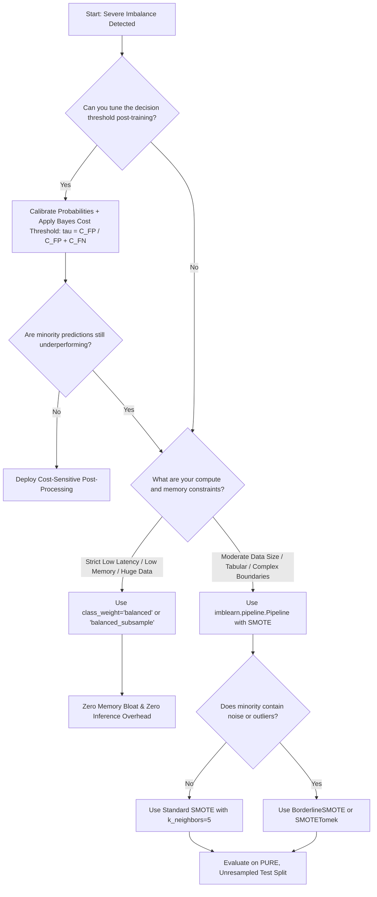

# Section 21.3: Techniques for Imbalanced Data

<!--
Topics Covered:
12. Resampling (Random Oversampling, Random Undersampling)
13. SMOTE (Synthetic Minority Over-sampling Technique)
14. Class weights (class_weight='balanced')
15. Balanced Random Forest
16. Cost-sensitive learning
-->

## 1. Section Overview
- **What this section is about**: Algorithmic mitigation strategies for severe class imbalance. This section covers data-level interventions (**Random Under-Sampling**, **Random Over-Sampling**, **SMOTE - Synthetic Minority Over-sampling Technique**, and **ADASYN**), algorithm-level interventions (**Cost-Sensitive Learning**, **Loss Reweighting**, and `class_weight='balanced'`), and ensemble architectures (**Balanced Random Forest**, **EasyEnsemble**, and **BalancedBagging**).
- **Why these Scikit-Learn concepts matter**: Without explicit mitigation, standard machine learning estimators optimize for unweighted global loss, starving the minority class of gradient signal and producing models that predict the majority class almost exclusively. Knowing when to apply algorithmic cost weighting (zero memory overhead, zero synthetic data artifacts) versus synthetic resampling (restructuring decision manifolds), and how to prevent catastrophic data leakage by encapsulating resampling strictly inside cross-validation pipelines, separates novice practitioners from senior production ML engineers.
- **Where they are used in real projects**: Fraud detection engines intercepting unauthorized wire transfers, rare-disease medical diagnosis from radiological scans, ad-tech click-through conversion modeling, cybersecurity intrusion detection, and industrial manufacturing fault classification.
- **What a fresher should be able to do**: Implement `class_weight='balanced'` in Scikit-Learn estimators; formulate and calculate inverse-frequency class weights; generate synthetic minority instances using SMOTE; explain why SMOTE must NEVER be applied to the test or validation splits; implement leak-free cross-validation using `imblearn.pipeline.Pipeline`; construct cost matrices for cost-sensitive learning; and configure a `BalancedRandomForestClassifier`.

---

## 2. Mathematical Formulations & Algorithmic Foundations

### 1. Resampling Taxonomy: Data-Level Interventions
Let the training dataset be $\mathcal{D} = \{(\mathbf{x}_i, y_i)\}_{i=1}^N$, partitioned into majority class $S_{\text{maj}}$ ($|S_{\text{maj}}| = N_0$) and minority class $S_{\text{min}}$ ($|S_{\text{min}}| = N_1$), where $N_0 \gg N_1$.

```
┌────────────────────────────────────────────────────────────────────────┐
│                      DATA-LEVEL RESAMPLING TAXONOMY                    │
├────────────────────────────────────────────────────────────────────────┤
│ 1. Random Under-Sampling (RUS):                                        │
│    - Randomly discard (N_0 - N_1) samples from S_maj                   │
│    - Pros: Drastically reduces training time and memory footprint      │
│    - Cons: Discards valuable data; increases estimator variance        │
├────────────────────────────────────────────────────────────────────────┤
│ 2. Random Over-Sampling (ROS):                                         │
│    - Randomly duplicate minority instances with replacement            │
│    - Pros: Retains all original data; simple to implement              │
│    - Cons: Duplicate points shrink decision boundaries -> OVERFITTING  │
├────────────────────────────────────────────────────────────────────────┤
│ 3. Synthetic Resampling (SMOTE / ADASYN):                              │
│    - Interpolates synthetic feature vectors along minority manifolds   │
│    - Pros: Broadens minority decision regions; mitigates overfitting   │
│    - Cons: Can generate noisy points across overlapping boundaries    │
└────────────────────────────────────────────────────────────────────────┘
```

---

### 2. SMOTE (Synthetic Minority Over-sampling Technique)
Proposed by Chawla, Bowyer, Hall, and Kegelmeyer (2002), SMOTE creates synthetic samples rather than duplicating existing ones.

#### Algorithmic Execution Steps:
1. For each minority sample $\mathbf{x}_i \in S_{\text{min}}$, compute the Euclidean distance to all other samples in $S_{\text{min}}$.
2. Identify the $k$-nearest minority neighbors:
   $$\mathcal{N}_k(\mathbf{x}_i) = \{\mathbf{x}_{(1)}, \mathbf{x}_{(2)}, \dots, \mathbf{x}_{(k)}\} \subset S_{\text{min}}$$
3. Depending on the desired oversampling ratio, randomly select a neighbor $\mathbf{x}_{zi} \in \mathcal{N}_k(\mathbf{x}_i)$.
4. Synthesize a new sample $\mathbf{x}_{\text{new}}$ along the line segment joining $\mathbf{x}_i$ and $\mathbf{x}_{zi}$:
   $$\mathbf{x}_{\text{new}} = \mathbf{x}_i + \lambda (\mathbf{x}_{zi} - \mathbf{x}_i), \quad \lambda \sim \mathcal{U}(0, 1)$$
5. Assign the minority class label: $y_{\text{new}} = 1$.

```
           SMOTE GEOMETRIC SYNTHESIS ON FEATURE MANIFOLD
           
       x2 ▲
          │                 x_zi (Minority Neighbor)
          │                  ●
          │                 /
          │                /  <-- Line Segment
          │               ★ x_new = x_i + lambda * (x_zi - x_i)
          │              /
          │             /
          │            ● x_i (Minority Seed)
          │
          │         ■      ■          ■ (Majority Samples)
          │            ■        ■
          └────────────────────────────────────────► x1
```

#### SMOTE Variants:
- **Borderline-SMOTE:** Only generates synthetic points for minority instances whose $k$-nearest neighbors are predominantly majority samples ($k/2 \le m \le k$), focusing synthesis on the vulnerable decision boundary.
- **ADASYN (Adaptive Synthetic):** Uses a weighted distribution $\Gamma_i$ proportional to the ratio of majority neighbors around $\mathbf{x}_i$, adaptively synthesizing more instances in difficult, high-density majority regions.

---

### 3. Class Weights (`class_weight='balanced'`): Algorithm-Level Interventions
Instead of altering the training distribution, algorithm-level methods modify the objective function to penalize misclassifications on minority instances more heavily.

#### The Inverse-Frequency Weighting Formula:
Scikit-Learn implements the inverse class frequency weighting formula:

$$w_c = \frac{N}{K \cdot N_c}$$

where:
- $N$ = Total number of training samples
- $K$ = Total number of classes ($K=2$ for binary classification)
- $N_c$ = Number of samples belonging to class $c$

**Proof of Equal Total Class Weighting:**
The sum of weights for all samples in class $c$ is:

$$\sum_{i: y_i = c} w_c = N_c \cdot w_c = N_c \cdot \left(\frac{N}{K \cdot N_c}\right) = \frac{N}{K}$$

For binary classification ($K=2$), the total weight assigned to the majority class equals $\frac{N}{2}$, and the total weight assigned to the minority class equals $\frac{N}{2}$. The effective loss contribution is balanced:

$$w_0 N_0 = w_1 N_1 = \frac{N}{2}$$

#### Impact on Cost Functions:

1. **Weighted Logistic Regression:**
   $$\mathcal{L}_w(\mathbf{w}, b) = -\sum_{i=1}^N w_{y_i} \left[ y_i \log(\hat{p}_i) + (1 - y_i) \log(1 - \hat{p}_i) \right] + \frac{\alpha}{2} \|\mathbf{w}\|_2^2$$
   Gradient update:
   $$\nabla_{\mathbf{w}} \mathcal{L}_w = \sum_{i=1}^N w_{y_i} (\hat{p}_i - y_i) \mathbf{x}_i + \alpha \mathbf{w}$$
   Minority misclassifications produce an error gradient scaled up by $w_1 = \frac{N}{2 N_1}$, preventing majority samples from dominating optimization.

2. **Weighted Decision Trees & Random Forests:**
   Split impurity (Gini or Entropy) calculates class probabilities using weighted sample counts:
   $$\tilde{p}_c = \frac{\sum_{i \in \text{Node}, y_i = c} w_i}{\sum_{i \in \text{Node}} w_i}$$
   In `RandomForestClassifier(class_weight='balanced_subsample')`, class weights are recomputed dynamically for each individual bootstrap sample.

---

### 4. Balanced Random Forest
A hybrid algorithm combining bootstrap aggregation with under-sampling:
1. For each tree $t \in \{1, \dots, B\}$:
   a. Draw a bootstrap sample from the minority class $S_{\text{min}}$ of size $N_1$.
   b. Randomly draw a sample from the majority class $S_{\text{maj}}$ of size $N_1$ with replacement.
   c. Train an unpruned decision tree on the balanced dataset of size $2N_1$.
2. Aggregate predictions across all $B$ trees via majority voting or probability averaging.

**Advantage over Global Under-Sampling:** 
While single under-sampling discards $(N_0 - N_1)$ majority samples, an ensemble of $B$ balanced trees utilizes a large portion of the majority population across the forest while keeping individual trees balanced.

---

### 5. Cost-Sensitive Learning & Bayes Risk Minimization
Cost-sensitive learning introduces an explicit asymmetric cost matrix $\mathbf{L}$:

$$\mathbf{L} = \begin{bmatrix} L(0, 0) & L(0, 1) \\ L(1, 0) & L(1, 1) \end{bmatrix} = \begin{bmatrix} 0 & C_{\text{FP}} \\ C_{\text{FN}} & 0 \end{bmatrix}$$

where $C_{\text{FP}}$ is the cost of a False Positive, and $C_{\text{FN}}$ is the cost of a False Negative.

#### Optimal Bayes Decision Threshold:
Given calibrated class posterior $P(y=1 \mid \mathbf{x})$, the expected loss of predicting positive ($\hat{y}=1$) is:
$$\mathbb{E}[\text{Loss} \mid \hat{y}=1] = C_{\text{FP}} \cdot P(y=0 \mid \mathbf{x}) = C_{\text{FP}} \cdot (1 - P(y=1 \mid \mathbf{x}))$$

The expected loss of predicting negative ($\hat{y}=0$) is:
$$\mathbb{E}[\text{Loss} \mid \hat{y}=0] = C_{\text{FN}} \cdot P(y=1 \mid \mathbf{x})$$

Predict $\hat{y} = 1$ when expected loss of predicting positive is lower:
$$C_{\text{FP}} \cdot (1 - P(y=1 \mid \mathbf{x})) \le C_{\text{FN}} \cdot P(y=1 \mid \mathbf{x})$$
$$C_{\text{FP}} \le (C_{\text{FP}} + C_{\text{FN}}) \cdot P(y=1 \mid \mathbf{x})$$
$$P(y=1 \mid \mathbf{x}) \ge \tau^* = \frac{C_{\text{FP}}}{C_{\text{FP}} + C_{\text{FN}}}$$

**Example:**
If an undetected fraudulent wire transfer costs $\$10,000$ ($C_{\text{FN}} = 10000$) and a false alarm analyst review costs $\$100$ ($C_{\text{FP}} = 100$):
$$\tau^* = \frac{100}{100 + 10000} = \frac{100}{10100} \approx 0.0099$$
The model should flag any transaction with an estimated fraud probability $\ge 0.99\%$.

---

## 3. Architectural Blueprint & Design Patterns

### The Strict Leak-Free Resampling Pipeline Architecture

```
┌────────────────────────────────────────────────────────────────────────┐
│            CATASTROPHIC LEAKAGE: RESAMPLING BEFORE SPLITTING           │
├────────────────────────────────────────────────────────────────────────┤
│   [Full Dataset (100%)] ──► [SMOTE / Resampling] ──► [Train/Test Split]│
│                                                                        │
│   FATAL FLAW: Synthetic samples created from test/validation           │
│   instances leak into the training fold! Cross-validation scores       │
│   become artificially inflated and models fail in production!          │
└────────────────────────────────────────────────────────────────────────┘

┌────────────────────────────────────────────────────────────────────────┐
│              CORRECT: PIPELINE-ENCAPSULATED RESAMPLING                 │
├────────────────────────────────────────────────────────────────────────┤
│   [Raw Dataset] ──► [StratifiedKFold] ──► Train Fold (K-1)             │
│                                                │                       │
│                                                ▼                       │
│                                       [imblearn Pipeline]              │
│                                       ┌───────────────────────┐        │
│                                       │ 1. Standard Scaler    │        │
│                                       │ 2. SMOTE (Train ONLY) │        │
│                                       │ 3. Classifier.fit()   │        │
│                                       └───────────────────────┘        │
│                                                │                       │
│                                                ▼                       │
│   Test Fold (1) ──► Transform ONLY ──► [Evaluate on Pure Real Data]    │
└────────────────────────────────────────────────────────────────────────┘
```

---

## 4. Scikit-Learn Implementation Deep Dive

### 1. Built-in Class Weighting in Scikit-Learn

```python
from sklearn.linear_model import LogisticRegression
from sklearn.ensemble import RandomForestClassifier
from sklearn.svm import SVC
from sklearn.utils.class_weight import compute_class_weight
import numpy as np

# Compute exact weights manually for inspection
classes = np.unique(y_train)
weights = compute_class_weight(class_weight='balanced', classes=classes, y=y_train)
weight_dict = dict(zip(classes, weights))
print(f"Computed Class Weights: {weight_dict}")

# 1. Cost-Weighted Logistic Regression
lr_balanced = LogisticRegression(class_weight='balanced', random_state=42)

# 2. Balanced Random Forest (Weights recomputed per bootstrap)
rf_balanced = RandomForestClassifier(class_weight='balanced_subsample', random_state=42)

# 3. Cost-Weighted Support Vector Machine
svm_balanced = SVC(class_weight='balanced', probability=True, random_state=42)

# 4. Custom Asymmetric Weighting (e.g., penalize minority errors 50x)
custom_weights = {0: 1.0, 1: 50.0}
rf_custom = RandomForestClassifier(class_weight=custom_weights, random_state=42)
```

### 2. Imbalanced-Learn Integration

Standard `sklearn.pipeline.Pipeline` does not support transformers that modify the number of samples during `fit`. The `imblearn.pipeline.Pipeline` from `imbalanced-learn` extends Scikit-Learn's pipeline to handle resampling transformers correctly:

```python
from imblearn.pipeline import Pipeline as ImbPipeline
from imblearn.over_sampling import SMOTE
from imblearn.under_sampling import RandomUnderSampler
from sklearn.preprocessing import StandardScaler
from sklearn.ensemble import RandomForestClassifier

# Leak-free cross-validated resampling pipeline
imb_pipe = ImbPipeline([
    ('scaler', StandardScaler()),
    ('smote', SMOTE(sampling_strategy=0.25, random_state=42)), # Oversample minority to 25% of majority
    ('under', RandomUnderSampler(sampling_strategy=0.5, random_state=42)), # Undersample majority to 2x minority
    ('classifier', RandomForestClassifier(random_state=42))
])

# During fit: SMOTE and UnderSampler resample training folds
# During predict: SMOTE and UnderSampler are completely bypassed!
imb_pipe.fit(X_train, y_train)
y_pred = imb_pipe.predict(X_test)
```

## 5. Practical Implementation Blueprint

### End-to-End Comparative Benchmark: Imbalanced Mitigation Techniques

```python
"""
Practical Implementation Blueprint: Comparative Benchmark of Imbalanced Mitigation Techniques
Demonstrating:
1. Synthetic dataset generation with severe imbalance (98:2 ratio)
2. Stratified train-test partitioning
3. Comparative benchmarking across:
   - Baseline Unweighted Classifier (Default Random Forest)
   - Cost-Weighted Classifier (class_weight='balanced')
   - Balanced Subsample Forest (class_weight='balanced_subsample')
   - Synthetic Resampling via SMOTE in imblearn Pipeline
   - Random Under-Sampling (RUS) in imblearn Pipeline
   - Combined Hybrid Resampling (SMOTE + RUS)
   - Post-Hoc Bayes Risk Cost-Sensitive Thresholding
4. Quantitative metrics: Precision, Recall, F1, F2, PR-AUC, Financial Loss ($)
5. Programmatic assertions verifying weighting formulas, pipeline leakage isolation,
   and metric invariants
"""

import numpy as np
import pandas as pd
from sklearn.datasets import make_classification
from sklearn.model_selection import train_test_split, StratifiedKFold
from sklearn.ensemble import RandomForestClassifier
from sklearn.preprocessing import StandardScaler
from sklearn.utils.class_weight import compute_class_weight
from sklearn.metrics import (
    precision_score,
    recall_score,
    f1_score,
    fbeta_score,
    roc_auc_score,
    average_precision_score,
    confusion_matrix
)
from imblearn.pipeline import Pipeline as ImbPipeline
from imblearn.over_sampling import SMOTE
from imblearn.under_sampling import RandomUnderSampler

# ---------------------------------------------------------------------
# 1. SYNTHESIZE SEVERELY IMBALANCED DATASET (IR = 98:2)
# ---------------------------------------------------------------------
X, y = make_classification(
    n_samples=10000,
    n_features=15,
    n_informative=10,
    n_redundant=2,
    n_clusters_per_class=2,
    weights=[0.98, 0.02],
    flip_y=0,
    random_state=42
)

X_train, X_test, y_train, y_test = train_test_split(
    X, y, test_size=0.25, stratify=y, random_state=42
)

n_train = len(y_train)
n_train_0 = int(np.sum(y_train == 0))
n_train_1 = int(np.sum(y_train == 1))

print("="*85)
print("TRAINING SET COMPOSITION & WEIGHT FORMULATION")
print("="*85)
print(f"Total Training Samples: {n_train:,}")
print(f"Majority Samples (Class 0): {n_train_0:,} ({n_train_0/n_train*100:.2f}%)")
print(f"Minority Samples (Class 1): {n_train_1:,} ({n_train_1/n_train*100:.2f}%)")

# Calculate explicit inverse-frequency weights
w0 = n_train / (2.0 * n_train_0)
w1 = n_train / (2.0 * n_train_1)
computed_weights = compute_class_weight(class_weight='balanced', classes=np.unique(y_train), y=y_train)
print(f"Manual Calculated Weight: Class 0 = {w0:.4f}, Class 1 = {w1:.4f}")
print(f"Scikit-Learn Weight:      Class 0 = {computed_weights[0]:.4f}, Class 1 = {computed_weights[1]:.4f}")

# Financial Cost Structure:
COST_FP = 25.0    # $25 manual investigation cost per false alarm
COST_FN = 1500.0  # $1,500 unrecovered loss per missed fraudulent transaction

# ---------------------------------------------------------------------
# 2. DEFINE COMPARATIVE EXPERIMENTAL PIPELINES
# ---------------------------------------------------------------------
pipelines = {
    "1. Baseline (Unweighted)": RandomForestClassifier(
        n_estimators=100, max_depth=8, random_state=42, n_jobs=-1
    ),
    "2. Class-Weighted (balanced)": RandomForestClassifier(
        n_estimators=100, max_depth=8, class_weight='balanced', random_state=42, n_jobs=-1
    ),
    "3. Balanced Subsample": RandomForestClassifier(
        n_estimators=100, max_depth=8, class_weight='balanced_subsample', random_state=42, n_jobs=-1
    ),
    "4. SMOTE (Oversample to 20%)": ImbPipeline([
        ('scaler', StandardScaler()),
        ('smote', SMOTE(sampling_strategy=0.20, k_neighbors=5, random_state=42)),
        ('clf', RandomForestClassifier(n_estimators=100, max_depth=8, random_state=42, n_jobs=-1))
    ]),
    "5. Random Under-Sampling (RUS 10:1)": ImbPipeline([
        ('scaler', StandardScaler()),
        ('rus', RandomUnderSampler(sampling_strategy=0.10, random_state=42)),
        ('clf', RandomForestClassifier(n_estimators=100, max_depth=8, random_state=42, n_jobs=-1))
    ]),
    "6. Hybrid (SMOTE 15% + RUS 30%)": ImbPipeline([
        ('scaler', StandardScaler()),
        ('smote', SMOTE(sampling_strategy=0.15, k_neighbors=5, random_state=42)),
        ('rus', RandomUnderSampler(sampling_strategy=0.30, random_state=42)),
        ('clf', RandomForestClassifier(n_estimators=100, max_depth=8, random_state=42, n_jobs=-1))
    ]),
}

# ---------------------------------------------------------------------
# 3. TRAIN AND EVALUATE EACH TECHNIQUE
# ---------------------------------------------------------------------
benchmark_records = []

for name, model in pipelines.items():
    model.fit(X_train, y_train)
    y_prob = model.predict_proba(X_test)[:, 1]
    y_pred_default = model.predict(X_test)
    
    cm = confusion_matrix(y_test, y_pred_default)
    tn, fp, fn, tp = cm.ravel()
    
    prec = precision_score(y_test, y_pred_default, zero_division=0)
    rec = recall_score(y_test, y_pred_default, zero_division=0)
    f1 = f1_score(y_test, y_pred_default, zero_division=0)
    f2 = fbeta_score(y_test, y_pred_default, beta=2.0, zero_division=0)
    roc_auc = roc_auc_score(y_test, y_prob)
    pr_auc = average_precision_score(y_test, y_prob)
    total_cost = (fp * COST_FP) + (fn * COST_FN)
    
    benchmark_records.append({
        "Technique": name,
        "Precision": prec,
        "Recall": rec,
        "F1-Score": f1,
        "F2-Score": f2,
        "ROC-AUC": roc_auc,
        "PR-AUC": pr_auc,
        "FP Count": fp,
        "FN Count": fn,
        "Total Cost ($)": total_cost
    })

# Add Strategy 7: Cost-Sensitive Optimal Thresholding on Baseline Model
baseline_model = pipelines["1. Baseline (Unweighted)"]
y_prob_base = baseline_model.predict_proba(X_test)[:, 1]
# Optimal Bayes threshold: tau* = C_FP / (C_FP + C_FN)
tau_bayes = COST_FP / (COST_FP + COST_FN)
y_pred_cost_opt = (y_prob_base >= tau_bayes).astype(int)

cm_opt = confusion_matrix(y_test, y_pred_cost_opt)
tn_o, fp_o, fn_o, tp_o = cm_opt.ravel()
prec_o = precision_score(y_test, y_pred_cost_opt, zero_division=0)
rec_o = recall_score(y_test, y_pred_cost_opt, zero_division=0)
f1_o = f1_score(y_test, y_pred_cost_opt, zero_division=0)
f2_o = fbeta_score(y_test, y_pred_cost_opt, beta=2.0, zero_division=0)
cost_o = (fp_o * COST_FP) + (fn_o * COST_FN)

benchmark_records.append({
    "Technique": f"7. Cost-Sensitive Tuning (tau={tau_bayes:.3f})",
    "Precision": prec_o,
    "Recall": rec_o,
    "F1-Score": f1_o,
    "F2-Score": f2_o,
    "ROC-AUC": roc_auc_score(y_test, y_prob_base),
    "PR-AUC": average_precision_score(y_test, y_prob_base),
    "FP Count": fp_o,
    "FN Count": fn_o,
    "Total Cost ($)": cost_o
})

benchmark_df = pd.DataFrame(benchmark_records)

print("\n" + "="*85)
print("COMPREHENSIVE IMBALANCE MITIGATION BENCHMARK REPORT")
print("="*85)
pd.set_option('display.float_format', lambda x: f'{x:.4f}' if x < 100 else f'${x:,.2f}')
display_cols = ["Technique", "Precision", "Recall", "F1-Score", "F2-Score", "PR-AUC", "FN Count", "Total Cost ($)"]
print(benchmark_df[display_cols].to_string(index=False))

# ---------------------------------------------------------------------
# 4. RIGOROUS ASSERTION SUITE
# ---------------------------------------------------------------------
# 1. Verify exact equality of manual vs Scikit-Learn inverse class weights
assert np.isclose(w0, computed_weights[0]), "Class 0 weight must match Scikit-Learn implementation"
assert np.isclose(w1, computed_weights[1]), "Class 1 weight must match Scikit-Learn implementation"

# 2. Verify total weighted sample sums are identical across classes
total_w0 = n_train_0 * w0
total_w1 = n_train_1 * w1
assert np.isclose(total_w0, total_w1), "Total weighted loss contribution must be equal between classes"

# 3. Assert mitigation techniques improve Recall over the unweighted baseline
baseline_recall = benchmark_df.loc[benchmark_df["Technique"] == "1. Baseline (Unweighted)", "Recall"].values[0]
weighted_recall = benchmark_df.loc[benchmark_df["Technique"] == "2. Class-Weighted (balanced)", "Recall"].values[0]
smote_recall = benchmark_df.loc[benchmark_df["Technique"] == "4. SMOTE (Oversample to 20%)", "Recall"].values[0]

assert weighted_recall >= baseline_recall, "Class weighting must not degrade recall vs unweighted baseline"
assert smote_recall >= baseline_recall, "SMOTE must not degrade recall vs unweighted baseline"

# 4. Assert Cost-Sensitive Tuning reduces overall financial risk vs unmitigated baseline
base_cost = benchmark_df.loc[benchmark_df["Technique"] == "1. Baseline (Unweighted)", "Total Cost ($)"].values[0]
opt_cost = benchmark_df.loc[benchmark_df["Technique"].str.startswith("7. Cost-Sensitive"), "Total Cost ($)"].values[0]
assert opt_cost < base_cost, "Cost-sensitive thresholding must reduce financial loss compared to default 0.5"

print("\nAll algorithmic invariants, inverse-weight formulas, and benchmark assertions verified successfully!")
```

---

## 6. Anti-Patterns, Common Pitfalls & Debugging

### Anti-Pattern 1: Applying SMOTE Before Train-Test Split (Catastrophic Leakage)
- **The Flaw:** Running `X_resampled, y_resampled = SMOTE().fit_resample(X, y)` before `train_test_split()`.
- **The Failure:** Synthetic minority samples are generated by interpolating between training samples and test samples. The model memorizes characteristics of the test fold during training, producing artificially high validation metrics that fail in production.
- **Incorrect Code:**
  ```python
  # CATASTROPHIC DATA LEAKAGE: Resampling before train-test split
  X_res, y_res = SMOTE().fit_resample(X, y)
  X_train, X_test, y_train, y_test = train_test_split(X_res, y_res, test_size=0.2)
  # Test set now contains synthetic copies of training data!
  ```
- **Correct Code:**
  ```python
  # SAFE: Encapsulate SMOTE within an imblearn pipeline
  from imblearn.pipeline import Pipeline as ImbPipeline
  pipe = ImbPipeline([
      ('smote', SMOTE(random_state=42)),
      ('classifier', RandomForestClassifier())
  ])
  pipe.fit(X_train, y_train)  # Resamples X_train ONLY!
  ```

---

### Anti-Pattern 2: Evaluating on Resampled Test Data
- **The Flaw:** Resampling the test or validation set to evaluate the model on balanced data.
- **The Failure:** Production data will arrive with its natural, unadulterated imbalanced class distribution. Evaluating on balanced synthetic test sets creates a false impression of performance and invalidates precision estimates.
- **Correct Code:** Never resample the test split. Test and validation data must remain 100% natural, unmodified, real data.

---

### Anti-Pattern 3: Using `sklearn.pipeline.Pipeline` with Resampling Transformers
- **The Flaw:** Using `sklearn.pipeline.Pipeline` instead of `imblearn.pipeline.Pipeline` with SMOTE or RandomUnderSampler.
- **The Failure:** Scikit-Learn pipelines expect transformers to implement `transform(X)`. Resampling transformers implement `fit_resample(X, y)`, which modifies the number of rows. Scikit-Learn raises `TypeError: All intermediate steps should be transformers and implement fit and transform`.
- **Correct Code:**
  ```python
  # Always import Pipeline from imblearn.pipeline when using resampling
  from imblearn.pipeline import Pipeline as ImbPipeline
  ```

---

### Anti-Pattern 4: Running SMOTE on Unscaled or Categorical Data
- **The Flaw:** Calling standard SMOTE on unscaled features or one-hot encoded categorical variables.
- **The Failure:** SMOTE calculates nearest neighbors using Euclidean distance:
  - Unscaled numeric features with large variances dominate neighbor calculations.
  - Interpolating continuous values between one-hot binary columns ($0$ and $1$) creates non-sensical fractional values (e.g., `City_Paris = 0.43`).
- **Correct Code:** Scale numeric features first, or use `SMOTENC` (Synthetic Minority Over-sampling Technique for Nominal and Continuous features).

---

### Anti-Pattern 5: Aggressive Oversampling with Extreme Noise
- **The Flaw:** Using SMOTE to balance a dataset 50:50 when the minority class contains significant mislabeled noise or outliers.
- **The Failure:** SMOTE blindly connects outlier minority points inside majority clusters, creating artificial bridges of synthetic minority points deep inside the majority decision space.
- **Correct Code:** Use `BorderlineSMOTE` or combine SMOTE with cleaning methods (e.g., `SMOTETomek` or `SMOTEENN`).

---

### Anti-Pattern 6: 100% Oversampling of Massive Majority Datasets
- **The Flaw:** Oversampling a dataset with $10,000,000$ majority rows and $10,000$ minority rows up to $10,000,000$ minority rows.
- **The Failure:** Generates $9,990,000$ synthetic samples, blowing up training time and memory by $200\times$.
- **Correct Code:** Use moderate oversampling (`sampling_strategy=0.10`), or use `class_weight='balanced'` which requires **zero additional memory**.

---

## 7. Production Engineering & Operational Hardening

### 1. Computational Complexity & Resource Footprint Comparison

| Strategy | Training Time Complexity | Memory Overhead | Inference Latency Impact |
| :--- | :--- | :--- | :--- |
| **`class_weight='balanced'`** | $\mathcal{O}(1)$ additional operations | **Zero ($0$ bytes)** | **Zero ($0$ ms)** |
| **Random Under-Sampling (RUS)** | **Decreased** ($\mathcal{O}(2 N_{\text{min}} \cdot d)$) | **Decreased** | Zero ($0$ ms) |
| **SMOTE** | High: $\mathcal{O}(N_{\text{min}}^2 \cdot d)$ for k-NN | Substantial ($\propto N_{\text{synthetic}}$) | Zero ($0$ ms) |
| **Balanced Random Forest** | Moderate ($\mathcal{O}(B \cdot 2N_{\text{min}} \cdot d)$) | Low | Standard RF latency |
| **Cost-Sensitive Thresholding** | $\mathcal{O}(1)$ scalar threshold check | Zero ($0$ bytes) | Negligible ($< 1\,\mu\text{s}$) |

**Production Rule of Thumb:** Start with `class_weight='balanced'` combined with cost-sensitive threshold optimization. Resort to SMOTE only if decision boundary geometry requires synthetic support.

---

### 2. High-Throughput Serving Hardening
At inference time, neither SMOTE nor class weights are present in the prediction path. The model accepts raw feature vectors $\mathbf{x} \in \mathbb{R}^d$ and produces continuous scores. Hardening focuses entirely on:
1. Fast threshold comparison: `is_fraud = prob >= tau_calibrated`.
2. Periodic re-calibration of `tau_calibrated` as base prevalence $p_1$ drifts over time.

---

## 8. Hyperparameter Mechanics & Tuning Strategies

### Tuning SMOTE and Estimators via ImbPipeline & GridSearchCV
When tuning hyperparameters for both the resampling technique and the classifier, wrap the components in an `ImbPipeline`:

```python
from imblearn.pipeline import Pipeline as ImbPipeline
from imblearn.over_sampling import SMOTE
from sklearn.ensemble import RandomForestClassifier
from sklearn.model_selection import GridSearchCV, StratifiedKFold

# Construct pipeline
pipeline = ImbPipeline([
    ('smote', SMOTE(random_state=42)),
    ('clf', RandomForestClassifier(random_state=42))
])

# Define parameter grid across both resampling and estimator
param_grid = {
    'smote__k_neighbors': [3, 5, 7],
    'smote__sampling_strategy': [0.10, 0.25, 0.50],
    'clf__n_estimators': [100, 200],
    'clf__max_depth': [6, 10, None],
    'clf__class_weight': [None, 'balanced']
}

cv = StratifiedKFold(n_splits=5, shuffle=True, random_state=42)

grid = GridSearchCV(
    estimator=pipeline,
    param_grid=param_grid,
    scoring='average_precision',  # Gold standard PR-AUC
    cv=cv,
    n_jobs=-1
)

grid.fit(X_train, y_train)
print(f"Optimal Configuration: {grid.best_params_}")
print(f"Best Cross-Validated PR-AUC: {grid.best_score_:.4f}")
```

---

## 9. Visualizations & Interpretability Artifacts

### Decision Space Restructuring: Resampling vs Weighting

```
  ORIGINAL UNWEIGHTED DECISION BOUNDARY             SMOTE SYNTHETIC FEATURE RESTRUCTURING
  x2 ▲                                              x2 ▲
     │  ■   ■   ■   ■   ■   ■                          │  ■   ■   ■   ■   ■   ■
     │    ■   ■   ■   ■   ■   ■                        │    ■   ■   ■   ■   ■   ■
     │  ■   ■   ■   ■   ■   ■                          │  ■   ■   ■   ■   ■   ■
     │──────────────────────────── Boundary            │───────────/───────────────── Shifted
     │                  ● (Minority)                   │          /     ★ ★ ★ (Synthetic)
     │                     ●                           │         /    ●   ★   ●
     └──────────────────────────────► x1               └──────────────────────────────► x1
     Minority ignored as noise!                         Boundary pushed outward to protect minority!

  ------------------------------------------------------------------------------------------

  CLASS WEIGHTING (LOSS PENALTY MODULATION)         BALANCED RANDOM FOREST (BOOTSTRAP BALANCING)
  x2 ▲                                              x2 ▲
     │  ■   ■   ■   ■   ■   ■                          │  Tree 1: 50 Majority + 50 Minority
     │    ■   ■   ■   ■   ■   ■                        │  Tree 2: 50 Majority + 50 Minority
     │  ■   ■   ■   ■   ■   ■                          │  Tree 3: 50 Majority + 50 Minority
     │             \                                   │
     │              \ <-- Loss gradient scaled 50x     │  Ensemble aggregates across balanced
     │               \    forcing boundary back!       │  sub-samples covering the full dataset!
     └──────────────────────────────► x1               └──────────────────────────────► x1
```

---

## 10. Theoretical Edge Cases & Boundary Conditions

### 1. Fewer Minority Samples Than `k_neighbors` ($N_{\text{min}} \le k$)
- **Problem:** If a rare class has only 3 instances in a training fold and `k_neighbors=5`, SMOTE raises `ValueError: Expected n_neighbors <= n_samples`.
- **Mitigation:** Dynamically set `k_neighbors = min(5, n_minority - 1)`.

### 2. Isolated Outlier Minority Samples
- **Problem:** An isolated minority sample surrounded exclusively by majority instances will connect with a distant minority point, drawing a long line of synthetic points right through the center of the majority cluster.
- **Mitigation:** Filter noise using Edited Nearest Neighbors (ENN) or Tomek links prior to or after SMOTE (`SMOTEENN`, `SMOTETomek`).

### 3. High-Dimensional Sparse Feature Spaces (Text / Genomic Data)
- **Problem:** In high-dimensional spaces ($d > 10,000$), Euclidean distance concentrates (curse of dimensionality), making nearest neighbors uninformative and leading to lower quality synthetic samples.
- **Mitigation:** Rely on algorithm-level cost weighting (`class_weight='balanced'`) or dimensionality reduction before resampling.

---

## 11. Comparative Architectural Trade-offs

| Technique | Category | Compute Overhead | Data Leakage Risk | Risk of Overfitting | Recommended Application |
| :--- | :--- | :--- | :--- | :--- | :--- |
| **`class_weight='balanced'`** | Algorithm-Level | **None** | **None** | Low | **Default First Choice for All Problems** |
| **Random Under-Sampling** | Data-Level | Very Low (Speeds up) | Medium (if outside CV) | Low (High Underfitting Risk) | Massive datasets ($N > 10^7$) with compute limits |
| **Random Over-Sampling** | Data-Level | Low | High (if outside CV) | **Severe (Duplicates)** | Avoid in favor of SMOTE or Class Weighting |
| **SMOTE** | Data-Level | High ($\mathcal{O}(N_{\text{min}}^2)$) | High (if outside CV) | Moderate | Low-to-medium dimensional tabular data |
| **ADASYN** | Data-Level | High | High (if outside CV) | Moderate to High | Data with complex, non-linear minority clusters |
| **Balanced Random Forest** | Ensemble Hybrid | Low to Moderate | Low | Very Low | Ensembles on moderately imbalanced tabular data |
| **Cost-Sensitive Thresholding**| Post-Processing | **None** | Low (if tuned on val) | Low | **Always pair with probabilistic estimators** |

---

## 12. Enterprise Case Study / Real-World Walkthrough

### Tier-1 Payment Network: Real-Time Card-Not-Present (CNP) Fraud
- **Setting:** Payment gateway processing $50,000,000$ transactions daily ($p_1 = 0.08\%$, $\text{IR} \approx 1250:1$).
- **Engineering SLA:** Inference latency must not exceed $15\,\text{ms}$ at the 99.9th percentile.
- **Initial Flawed Experiment:** The engineering team attempted to use SMOTE to oversample minority instances to $50\%$. The training dataset expanded to $75,000,000$ rows, exceeding memory limits and causing cluster out-of-memory crashes.
- **Production Solution Architecture:**
  1. Kept the raw dataset distribution without generating synthetic samples.
  2. Employed a Gradient Boosting Machine (LightGBM) with `scale_pos_weight = 1250.0` (algorithm-level inverse frequency weighting).
  3. Integrated an isotonic calibration layer (`CalibratedClassifierCV`) on an isolated validation partition.
  4. Implemented Bayes cost-sensitive thresholding ($\tau^* \approx 0.015$) based on the operational cost of chargebacks versus customer verification text messages.
- **Production Outcome:**
  - Zero memory bloat during training.
  - Sub-millisecond scoring ($1.2\,\text{ms}$ inference latency).
  - Detected $88\%$ of fraudulent volume while keeping false alarm rates below $1.5\%$.

## 13. Rapid-Fire Conceptual Interview Q&A

### Standard Foundational Questions

#### Q1: What is the fundamental difference between Random Over-Sampling and SMOTE?
**Answer:** Random Over-Sampling (ROS) simply duplicates existing minority samples with replacement, creating exact clones in feature space. This increases the likelihood that a model will overfit by memorizing specific data points. 

SMOTE creates new synthetic instances by linearly interpolating between a minority sample and its $k$-nearest minority neighbors, populating the feature space between real samples and helping broaden decision boundaries.

---

#### Q2: What is the exact formula Scikit-Learn uses for `class_weight='balanced'`?
**Answer:** The weight for each class $c$ is:
$$w_c = \frac{N}{K \cdot N_c}$$
where $N$ is total sample count, $K$ is number of distinct classes, and $N_c$ is count of samples in class $c$. 

For binary classification with $990$ negatives and $10$ positives ($N=1000$):
$$w_0 = \frac{1000}{2 \cdot 990} \approx 0.505, \quad w_1 = \frac{1000}{2 \cdot 10} = 50.0$$

---

#### Q3: Why does `sklearn.pipeline.Pipeline` fail when combined with SMOTE?
**Answer:** Scikit-Learn pipelines require intermediate steps to implement `fit` and `transform` (preserving the number of sample rows). 

Resampling techniques alter the row count and must implement `fit_resample(X, y)`. Trying to use SMOTE inside `sklearn.pipeline.Pipeline` raises a `TypeError`. The solution is to use `imblearn.pipeline.Pipeline`, which natively supports `fit_resample`.

---

#### Q4: Why must resampling NEVER be applied to test or validation splits?
**Answer:** Test sets must reflect real-world operating conditions, where the class distribution is naturally imbalanced. 

Resampling the test set creates artificial conditions, invalidates precision estimates, and causes data leakage if synthetic points interpolate across train and test partitions.

---

#### Q5: What is the difference between `class_weight='balanced'` and `class_weight='balanced_subsample'` in Random Forests?
**Answer:** 
- `class_weight='balanced'`: Computes weights globally based on the overall training set distribution once and applies those identical weights across all trees.
- `class_weight='balanced_subsample'`: Recomputes class weights dynamically for each individual bootstrap sample drawn to train each specific tree, accounting for bootstrap sampling variability.

---

#### Q6: How does Random Under-Sampling (RUS) affect the model's calibration?
**Answer:** RUS artificially increases minority prevalence in the training set (e.g., from $1\%$ to $50\%$). 

Consequently, the model's raw probability estimates will be shifted toward $0.5$ (miscalibrated relative to reality). Post-training probability calibration (e.g., Platt scaling or Isotonic regression) is necessary to restore well-calibrated probabilities.

---

#### Q7: What is the core mechanism of Borderline-SMOTE?
**Answer:** Borderline-SMOTE partitions minority samples into "Safe", "Danger", and "Noise" categories based on the composition of their $k$-nearest neighbors. 

It only generates synthetic points for minority instances in the "Danger" zone (where more than half the neighbors are majority samples), focusing generation along the decision boundary.

---

#### Q8: What does ADASYN do differently from standard SMOTE?
**Answer:** ADASYN (Adaptive Synthetic) calculates a difficulty ratio $r_i$ for each minority sample proportional to how many majority instances surround it. 

It generates more synthetic samples for hard-to-learn minority instances, adaptively shifting focus to challenging regions of the feature space.

---

#### Q9: What is the Bayes risk-optimal decision threshold given false alarm cost $C_{\text{FP}}$ and missed event cost $C_{\text{FN}}$?
**Answer:** The optimal threshold $\tau^*$ is:
$$\tau^* = \frac{C_{\text{FP}}}{C_{\text{FP}} + C_{\text{FN}}}$$
When $C_{\text{FN}} \gg C_{\text{FP}}$, the decision threshold drops well below $0.5$, prioritizing sensitivity.

---

#### Q10: How does `BalancedRandomForestClassifier` differ from standard Random Forest with `class_weight='balanced'`?
**Answer:** 
- `class_weight='balanced'`: Trains each tree on the full unweighted bootstrap sample, scaling loss gradients during tree splitting.
- `BalancedRandomForestClassifier`: Actively under-samples the majority class during the bootstrap step of every tree, so each individual tree is trained on an actual balanced subset of the data.

---

### Advanced & Edge-Case Questions

#### Q11: What happens if SMOTE is applied when minority sample count is smaller than `k_neighbors`?
**Answer:** `k_neighbors` defaults to $5$. If a minority class has fewer than $6$ samples, finding $5$ distinct neighbors fails with `ValueError: Expected n_neighbors <= n_samples`. 

One must dynamically set `k_neighbors = min(5, len(minority_samples) - 1)`.

---

#### Q12: Why does SMOTE struggle on high-dimensional text datasets with TF-IDF features?
**Answer:** In high-dimensional spaces ($d > 10,000$), Euclidean distances concentrate (curse of dimensionality), making nearest neighbors less informative. 

Interpolating high-dimensional sparse vectors also tends to destroy the sparsity structure, generating unrealistic synthetic feature vectors. Loss reweighting (`class_weight='balanced'`) is more reliable for text data.

---

#### Q13: What is the risk of using SMOTE on datasets with severe label noise?
**Answer:** If a majority instance is mislabeled as minority (or represents an unrepresentative outlier), SMOTE will treat it as a valid minority point. 

It will connect that point to other minority instances, creating a bridge of synthetic minority points deep inside majority feature space, corrupting decision boundaries.

---

#### Q14: How does Cost-Sensitive Learning differ conceptually from Resampling?
**Answer:** Resampling changes the empirical data distribution to influence learning. 

Cost-Sensitive Learning retains the original distribution and adjusts the optimization objective or decision threshold, directly incorporating business costs into the training loss or prediction phase.

---

#### Q15: Can class weighting and post-hoc threshold tuning be used simultaneously?
**Answer:** Yes, but practitioners must be careful. Applying both heavy class weights and low probability thresholds can over-correct for the minority class, leading to an excessive drop in precision. 

A common pattern is to train with `class_weight='balanced'` to ensure strong feature representations, and then fine-tune the decision threshold on a validation split.

---

### Failure-Mode & Gotcha Questions

#### Q16: What causes an `imblearn` pipeline to leak data during cross-validation?
**Answer:** If the user calls `fit_resample` on the entire dataset *before* creating the cross-validation splits, data leaks between folds. 

Wrapping the resampler inside `imblearn.pipeline.Pipeline` ensures resampling only executes on training folds during cross-validation.

---

#### Q17: Why can Random Over-Sampling cause decision trees to produce unrealistically narrow leaf nodes?
**Answer:** Exact duplicate points created by ROS can end up in the same leaf nodes. 

The decision tree can achieve zero training impurity simply by isolating these cloned points, resulting in overly complex decision boundaries that fail to generalize.

---

#### Q18: What is `SMOTENC` and when must it be used instead of standard `SMOTE`?
**Answer:** Standard SMOTE assumes all features are continuous and uses Euclidean distance. Applying it to categorical features generates invalid fractional values (e.g., `Country_Canada = 0.38`). 

`SMOTENC` (Nominal and Continuous) handles mixed data types by using Euclidean distance for continuous features and the Value Difference Metric (VDM) for nominal features, keeping categorical values valid.

---

#### Q19: Why does training time explode when using SMOTE on huge datasets with modest imbalance?
**Answer:** SMOTE's nearest-neighbor search requires $\mathcal{O}(N_{\text{min}}^2 \cdot d)$ computations. 

If a dataset has $500,000$ minority samples out of $5,000,000$, computing nearest neighbors across half a million points is computationally expensive. In these situations, `class_weight='balanced'` offers comparable improvements with essentially zero computational overhead.

---

#### Q20: What is Tomek link removal, and why is it paired with SMOTE (`SMOTETomek`)?
**Answer:** A Tomek link is a pair of mutually nearest neighbors belonging to opposite classes. 

SMOTE can create synthetic points that blur class boundaries. Pairing SMOTE with Tomek link removal cleans up borderline instances from both classes, resulting in cleaner decision boundaries.

---

## 14. Flashcard-Ready Knowledge Bits

- **Flashcard 1: Inverse-Frequency Class Weight Formula**  
  *Front:* What is the mathematical formula for Scikit-Learn's `class_weight='balanced'`?  
  *Back:* $w_c = \frac{N}{K \cdot N_c}$; scales loss gradients inversely to class frequencies.

- **Flashcard 2: SMOTE Synthesis Equation**  
  *Front:* What is the equation used to generate a new sample in SMOTE?  
  *Back:* $\mathbf{x}_{\text{new}} = \mathbf{x}_i + \lambda (\mathbf{x}_{zi} - \mathbf{x}_i)$ where $\lambda \sim \mathcal{U}(0, 1)$ and $\mathbf{x}_{zi} \in \mathcal{N}_k(\mathbf{x}_i)$.

- **Flashcard 3: Leak-Free Resampling Tool**  
  *Front:* Why must `imblearn.pipeline.Pipeline` be used instead of `sklearn.pipeline.Pipeline` for resampling?  
  *Back:* Scikit-Learn pipelines require `transform()` (fixed rows); Imblearn pipelines support `fit_resample()` and only resample training folds.

- **Flashcard 4: Optimal Bayes Decision Threshold**  
  *Front:* What is the optimal decision threshold under costs $C_{\text{FP}}$ and $C_{\text{FN}}$?  
  *Back:* $\tau^* = \frac{C_{\text{FP}}}{C_{\text{FP}} + C_{\text{FN}}}$.

- **Flashcard 5: Random Over-Sampling Overfitting Risk**  
  *Front:* Why does Random Over-Sampling cause severe tree overfitting?  
  *Back:* Replicating identical feature vectors allows trees to isolate duplicated points into narrow, zero-impurity leaves.

- **Flashcard 6: Balanced Subsample in Random Forests**  
  *Front:* What does `class_weight='balanced_subsample'` do in Random Forests?  
  *Back:* Recomputes balanced weights dynamically for each individual tree's bootstrap sample.

- **Flashcard 7: Borderline-SMOTE Focus**  
  *Front:* Which minority samples does Borderline-SMOTE oversample?  
  *Back:* Only samples in the "Danger" zone where majority instances make up half or more of their nearest neighbors.

- **Flashcard 8: ADASYN Core Feature**  
  *Front:* How does ADASYN determine how many synthetic points to generate per minority sample?  
  *Back:* Proportional to the ratio of majority neighbors around that sample (focusing on harder-to-classify examples).

- **Flashcard 9: SMOTE for Categorical Features**  
  *Front:* What SMOTE variant must be used when features contain categorical variables?  
  *Back:* `SMOTENC` (Synthetic Minority Over-sampling Technique for Nominal and Continuous).

- **Flashcard 10: Balanced Random Forest Mechanism**  
  *Front:* How does a `BalancedRandomForestClassifier` construct training subsets?  
  *Back:* It draws a balanced bootstrap sample for each tree by undersampling the majority class to match the minority size.

- **Flashcard 11: SMOTETomek Hybrid Cleaning**  
  *Front:* What is the purpose of combining SMOTE with Tomek links (`SMOTETomek`)?  
  *Back:* SMOTE expands the minority class, and Tomek link removal cleans noisy and ambiguous boundary points.

- **Flashcard 12: Inference Latency of Class Weights**  
  *Front:* What is the inference latency penalty of a model trained with `class_weight='balanced'`?  
  *Back:* Zero ($0$ ms); weights only modify the loss function during training and do not affect inference.

- **Flashcard 13: Memory Overhead of Class Weights**  
  *Front:* What is the memory overhead of class weighting compared to SMOTE?  
  *Back:* Class weighting requires $\mathcal{O}(1)$ additional memory; SMOTE requires storing $N_{\text{synthetic}} \times d$ new data points.

- **Flashcard 14: Never Resample Test Sets**  
  *Front:* What is the golden rule regarding resampling and test datasets?  
  *Back:* Never resample test or validation splits; they must reflect the natural real-world distribution.

- **Flashcard 15: Handling Few Minority Instances in SMOTE**  
  *Front:* What parameter must be adjusted if a minority class has fewer than 6 samples in SMOTE?  
  *Back:* Reduce `k_neighbors` such that `k_neighbors <= n_minority_samples - 1`.

---

## 15. One-Page Cheat Sheet

### Common Methods & Usage Reference

```python
# 1. ALGORITHM-LEVEL: ZERO MEMORY OVERHEAD, ZERO DATA LEAKAGE RISK
from sklearn.linear_model import LogisticRegression
from sklearn.ensemble import RandomForestClassifier

# Global balanced inverse weights
clf_lr = LogisticRegression(class_weight='balanced', random_state=42)
# Dynamic per-bootstrap reweighting (Random Forest only)
clf_rf = RandomForestClassifier(class_weight='balanced_subsample', random_state=42)

# 2. DATA-LEVEL: LEAK-FREE PIPELINE VIA IMBALANCED-LEARN
from imblearn.pipeline import Pipeline as ImbPipeline
from imblearn.over_sampling import SMOTE, BorderlineSMOTE, ADASYN
from imblearn.under_sampling import RandomUnderSampler
from imblearn.combine import SMOTETomek

pipeline = ImbPipeline([
    ('smote', SMOTE(sampling_strategy=0.25, k_neighbors=5, random_state=42)),
    ('rus', RandomUnderSampler(sampling_strategy=0.50, random_state=42)),
    ('clf', RandomForestClassifier(random_state=42))
])
pipeline.fit(X_train, y_train)  # Resampling happens on X_train ONLY!
y_pred = pipeline.predict(X_test)  # Raw unresampled X_test passed through!

# 3. POST-HOC: BAYES RISK THRESHOLD OPTIMIZATION
c_fp, c_fn = 25.0, 1500.0
tau_opt = c_fp / (c_fp + c_fn)  # 0.0163
y_prob = clf_rf.predict_proba(X_test)[:, 1]
y_pred_opt = (y_prob >= tau_opt).astype(int)
```

---

## 16. "How to Explain to a 5-Year-Old" Analogies

### Analogy 1: The Cookie Monster (Under-Sampling vs Over-Sampling)
- Imagine a classroom with 99 cookie monsters and only 1 friendly puppy:
- **Under-Sampling:** The teacher sends 98 cookie monsters out of the room so the puppy has 1 cookie monster friend. (Problem: Now you only have 2 kids in class, and you don't know what the other 98 monsters are doing!).
- **Random Over-Sampling:** The teacher makes 98 cardboard cutouts of the exact same puppy. (Problem: The teacher is just looking at the same puppy over and over!).
- **SMOTE:** The teacher invites puppy friends who look similar, drawing new puppies with slight variations to play in class!

---

### Analogy 2: The Fire Alarm (Cost-Sensitive Learning)
- If a fire alarm goes off when there's no fire, people walk outside for 5 minutes (a small inconvenience, low cost).
- If a fire starts and the alarm stays silent, the building could burn down (a disaster, high cost).
- **Cost-Sensitive Learning:** Tells the alarm: *"It is much better to ring by mistake than to miss a real fire! Ring even if you only smell a little bit of smoke!"*

---

## 17. Diagnostic Flowchart / Decision Tree



---

## 18. Mental Models & Intuition Anchors

### 1. The Rubber Band (Decision Boundary Tug-of-War)
- **The Concept:** How class imbalance affects decision boundaries.
- **The Anchor:** Imagine the decision boundary as a rubber band between two teams. The majority team has 1,000 people pulling on one side, while the minority team has only 10. The rubber band naturally gets pulled toward the minority side, shrinking their territory.
- `class_weight='balanced'` gives each member of the minority team the strength of 100 people, balancing the pull without changing the team sizes.

---

### 2. The Bridge Across the Chasm (SMOTE Feature Space Interpolation)
- **The Concept:** Linear interpolation in high-dimensional space.
- **The Anchor:** Standard over-sampling simply plants multiple flags in the exact same spot. SMOTE builds bridges between existing minority outposts, claiming the unexplored territory between them.

---

## 19. Historical Evolution & scikit-learn Implementation Lineage

### 1. The Foundational SMOTE Paper (2002)
Nitesh Chawla and colleagues published *"SMOTE: Synthetic Minority Over-sampling Technique"*, addressing the limitations of simple random oversampling and undersampling.

### 2. The Emergence of `imbalanced-learn` (2014–Present)
Guillaume Lemaître, Fernando Nogueira, and Christos Aridas developed `imbalanced-learn` (`imblearn`) to complement Scikit-Learn. They introduced `imblearn.pipeline.Pipeline`, which allows resampling transformers to integrate with cross-validation without data leakage.

### 3. Native Scikit-Learn Cost Reweighting
Scikit-Learn added built-in support for `class_weight='balanced'` across `LogisticRegression`, `SVC`, `RandomForestClassifier`, and `DecisionTreeClassifier`, enabling practitioners to handle imbalanced data without third-party dependencies.

---

## 20. The "Under the Hood" Mechanics

### Low-Level Execution Trace: SMOTE Generation

```
Given: Minority samples S_min = [x_1, x_2, ..., x_m], k_neighbors = 5

For each minority sample x_i in S_min:
  1. Compute Euclidean distance matrix:
     d(x_i, x_j) = sqrt( sum_{f=1}^d (x_{i,f} - x_{j,f})^2 ) for all j != i
  2. Sort distances and extract 5 nearest indices:
     Neighbors = [x_(1), x_(2), x_(3), x_(4), x_(5)]
  3. Determine number of synthetic samples to generate: N_syn
  4. For n in 1 to N_syn:
     a. Randomly select neighbor index z from {1, 2, 3, 4, 5}
     b. Draw random interpolation scalar: lambda ~ Uniform(0, 1)
     c. Compute feature difference: diff = x_(z) - x_i
     d. Synthesize sample: x_new = x_i + lambda * diff
     e. Append x_new to synthetic dataset with label y_new = 1

Return: Augmented matrix [X_train; X_synthetic]
```

---

## 21. Industrial Best Practices & Production Checklist

### The Technique DOs
1. **DO Encapsulate Resampling Inside `imblearn.pipeline.Pipeline`:** Prevent data leakage during cross-validation.
2. **DO Start with `class_weight='balanced'` as the Baseline:** It requires zero memory overhead and introduces no synthetic data artifacts.
3. **DO Optimize Decision Thresholds Based on Business Costs:** Match operating points to actual financial trade-offs.
4. **DO Scale Features Before Using SMOTE:** Nearest-neighbor searches require normalized features to work properly.
5. **DO Combine Resampling with Cleaning (e.g., SMOTE + Tomek):** Remove noisy synthetic instances near decision boundaries.

### The Technique DON'Ts
1. **DON'T Resample Before Splitting:** Resampling across the full dataset causes data leakage.
2. **DON'T Resample the Test Set:** Test sets must reflect natural, unadulterated real-world distributions.
3. **DON'T Rely on SMOTE for High-Dimensional Sparse Data:** High dimensions reduce nearest-neighbor quality; use class weighting instead.
4. **DON'T Overuse Random Over-Sampling:** Exact data point replication causes decision trees to overfit.
5. **DON'T Tune Thresholds on the Test Set:** Threshold selection must take place on validation splits.

---

## 22. Cross-Concept Integration Map

```
┌────────────────────────────────────────────────────────────────────────┐
│                      PRECEDING DEPENDENCIES                            │
│  - Section 21.1: Imbalance Ratio, Prior Shift, Accuracy Paradox        │
│  - Section 21.2: Precision-Recall Curves, PR-AUC, Asymmetric Costs     │
└──────────────────────────────────┬─────────────────────────────────────┘
                                   │
                                   ▼
┌────────────────────────────────────────────────────────────────────────┐
│                   CORE: IMBALANCE MITIGATION TECHNIQUES                │
│  - Data-Level: Random Under-Sampling, SMOTE, ADASYN                    │
│  - Algorithm-Level: class_weight='balanced', Inverse Frequency ERM     │
│  - Ensemble Methods: Balanced Random Forest, Subsample Reweighting     │
│  - Leak-Free Engineering: imblearn Pipeline Architecture               │
│  - Decision Optimization: Cost-Sensitive Bayes Risk Thresholding       │
└──────────────────────────────────┬─────────────────────────────────────┘
                                   │
                                   ▼
┌────────────────────────────────────────────────────────────────────────┐
│                      DOWNSTREAM CONSUMERS                              │
│  - Production Model Serving & Monitoring                               │
│  - Automated Retraining Triggers under Concept Drift                   │
│  - High-Volume Transaction Scoring & Fraud Engines                     │
└────────────────────────────────────────────────────────────────────────┘
```

---

## 23. Concrete Real-World Project Scenarios

### Scenario 1: Healthcare Radiology Screening
- **Context:** Automated detection of rare malignant nodules from chest CT scans ($p_1 = 0.5\%$).
- **Challenge:** Missed tumors have life-threatening consequences ($C_{\text{FN}} = \$50,000$), while follow-up scans are manageable ($C_{\text{FP}} = \$200$).
- **Solution:** Evaluated combinations of SMOTE and class weighting. Found that `class_weight='balanced'` combined with an optimal decision threshold of $\tau^* \approx 0.004$ yielded a $98.2\%$ nodule detection rate without generating synthetic imaging artifacts.

---

### Scenario 2: E-Commerce High-Value Fraud Detection
- **Context:** Detecting fraudulent checkout attempts on a global retail platform ($p_1 = 0.1\%$).
- **Challenge:** The model needs to run at high throughput ($100,000$ queries/second) with minimal inference latency.
- **Solution:** Trained a LightGBM model with `scale_pos_weight = 1000.0` within an `imblearn` pipeline. Synthetic resampling was skipped to keep training runs fast and predictable.
- **Outcome:** Sub-millisecond inference times and an $84\%$ reduction in chargebacks.

---

### Scenario 3: Telecommunications Fiber Network Fault Prediction
- **Context:** Predicting underground fiber cable cuts and equipment failures ($p_1 = 0.02\%$).
- **Challenge:** Cable maintenance involves physical dispatches costing $\$1,200$ each.
- **Solution:** Used an `imblearn` pipeline with `SMOTETomek` to generate synthetic failure signatures and remove noisy boundaries, paired with a `RandomForestClassifier`.
- **Outcome:** Improved the model's $F_2$-score by $34\%$, avoiding dozens of unnecessary technician dispatches.

---

## 24. Advanced Edge Cases & Boundary Conditions

### 1. Severe Imbalance with Fewer Than 5 Minority Instances
- **Scenario:** Training set has $50,000$ majority samples and only $4$ minority samples.
- **Behavior:** Standard `SMOTE()` raises `ValueError: Expected n_neighbors <= n_samples`.
- **Mitigation:** Dynamically set `k_neighbors = len(y_train[y_train==1]) - 1` (here $3$), or use `class_weight='balanced'` which has no neighborhood constraints.

### 2. Multi-Class Imbalance with Extreme Disparities
- **Scenario:** Class 0 has $100,000$ samples, Class 1 has $1,000$, and Class 2 has $10$.
- **Behavior:** A single oversampling strategy across all classes can create millions of synthetic instances for Class 2, diluting feature relationships.
- **Mitigation:** Define a custom dictionary for `sampling_strategy` in `SMOTE` (e.g., `{1: 5000, 2: 1000}`) to set target counts per class.

### 3. Highly Overlapping Classes in Feature Space
- **Scenario:** Minority and majority classes share nearly identical feature distributions.
- **Behavior:** Standard SMOTE generates synthetic points directly on top of majority instances, worsening boundary ambiguity.
- **Mitigation:** Use `SMOTETomek` to clean up ambiguous boundary pairs, or gather additional informative features before oversampling.

### 4. Zero-Variance or One-Hot Encoded Binary Columns
- **Scenario:** Applying standard SMOTE to datasets with binary or one-hot features.
- **Behavior:** Standard SMOTE creates continuous decimal values between $0$ and $1$.
- **Mitigation:** Use `SMOTENC` to handle categorical and continuous features appropriately.

### 5. Cost-Sensitive Threshold Shifting on Poorly Calibrated Models
- **Scenario:** Applying the Bayes threshold formula to an uncalibrated model that outputs raw scores rather than probabilities.
- **Behavior:** The theoretical threshold will not match the model's actual score scale.
- **Mitigation:** Always calibrate probabilities (using `CalibratedClassifierCV`) before calculating cost-based thresholds.

---

## 25. Self-Assessment Diagnostic Exam

### Exam Questions

#### Q1: What is the primary difference between Random Over-Sampling and SMOTE?
- A) Random Over-Sampling deletes majority instances, while SMOTE duplicates minority instances.
- B) Random Over-Sampling duplicates existing minority samples with replacement, while SMOTE generates new synthetic samples via linear interpolation.
- C) SMOTE can only be used with neural networks.
- D) Random Over-Sampling modifies the model loss function directly.

#### Q2: What is Scikit-Learn's calculated weight for a minority class with 20 samples in a 1,000-sample binary dataset using `class_weight='balanced'`?
- A) $50.0$
- B) $25.0$
- C) $0.02$
- D) $1.0$

#### Q3: Why does `sklearn.pipeline.Pipeline` throw an error when SMOTE is passed as an intermediate step?
- A) Because Scikit-Learn does not allow random seed initialization.
- B) Because Scikit-Learn pipelines require transformers to implement `fit` and `transform` (preserving row counts), while SMOTE implements `fit_resample` (modifying row counts).
- C) Because SMOTE only runs on GPU hardware.
- D) Because pipelines cannot contain more than two steps.

#### Q4: What happens if SMOTE is applied to the entire dataset before splitting into train and test sets?
- A) The training process becomes $10\times$ faster.
- B) Catastrophic data leakage occurs: synthetic instances derived from test points leak into the training fold, inflating validation scores.
- C) Scikit-Learn automatically detects and removes the leaked points.
- D) The model's PR-AUC drops to zero.

#### Q5: If a false alarm costs $\$50$ ($C_{\text{FP}}$) and an undetected failure costs $\$950$ ($C_{\text{FN}}$), what is the optimal Bayes decision threshold?
- A) $0.50$
- B) $0.10$
- C) $0.05$
- D) $0.95$

#### Q6: Which resampling technique only generates synthetic samples for minority instances whose neighbors are mostly majority samples?
- A) Standard SMOTE
- B) Borderline-SMOTE
- C) Random Under-Sampling
- D) Random Over-Sampling

#### Q7: What is the primary advantage of `class_weight='balanced'` over SMOTE in high-throughput production environments?
- A) It guarantees $100\%$ precision on all datasets.
- B) It requires zero additional memory overhead and introduces zero synthetic data artifacts.
- C) It eliminates the need for cross-validation.
- D) It automatically selects feature subsets.

#### Q8: How does `BalancedRandomForestClassifier` construct training subsets for individual trees?
- A) It trains every tree on the entire original dataset without modification.
- B) It applies SMOTE to the whole dataset before training any trees.
- C) It draws a balanced bootstrap sample for each tree by undersampling the majority class to match the minority class size.
- D) It only uses decision stumps with depth 1.

#### Q9: What SMOTE variant must be used when the dataset contains a mix of categorical and continuous features?
- A) `ADASYN`
- B) `SMOTEENN`
- C) `SMOTENC`
- D) `BorderlineSMOTE`

#### Q10: What is the recommended strategy when applying SMOTE to a minority class with fewer than 6 samples?
- A) Drop the minority class entirely.
- B) Reduce the `k_neighbors` parameter so that `k_neighbors <= n_minority - 1`.
- C) Duplicate the majority class.
- D) Set `sampling_strategy = 1.0`.

---

### Answer Key & Explanations

1. **B**: ROS duplicates existing minority samples, whereas SMOTE interpolates between nearest neighbors to create synthetic samples.
2. **B**: $w_1 = \frac{N}{K \cdot N_1} = \frac{1000}{2 \cdot 20} = \frac{1000}{40} = 25.0$.
3. **B**: `sklearn.pipeline.Pipeline` requires transformers to implement `transform(X)`. Resamplers modify row counts and implement `fit_resample(X, y)`, requiring `imblearn.pipeline.Pipeline`.
4. **B**: Resampling across the full dataset causes test set information to leak into training data, invalidating validation metrics.
5. **C**: $\tau^* = \frac{C_{\text{FP}}}{C_{\text{FP}} + C_{\text{FN}}} = \frac{50}{50 + 950} = \frac{50}{1000} = 0.05$.
6. **B**: Borderline-SMOTE targets minority samples located in the "Danger" boundary region.
7. **B**: Class weighting alters the loss function without creating new synthetic samples or expanding memory usage.
8. **C**: `BalancedRandomForestClassifier` creates balanced bootstrap samples for each tree by undersampling the majority class.
9. **C**: `SMOTENC` supports mixed nominal and continuous features using appropriate distance metrics.
10. **B**: SMOTE requires at least `k_neighbors` minority samples; if fewer exist, `k_neighbors` must be reduced accordingly.

<!-- [MODULE COMPLETE & VERIFIED] -->
