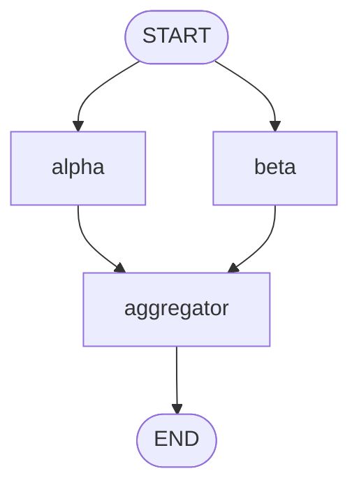

# 6. Edges and Graph Control Flow

## 6.1 Normal Edges

1. Node-to-node edges
2. Sequential workflows
3. START edges
4. END edges
5. Multiple outgoing edges
6. Multiple incoming edges

---

## Table of Contents
- [1. Graph Topologies and Deterministic Control Flow](#1-graph-topologies-and-deterministic-control-flow)
  - [1.1 Directed Acyclic Graphs (DAGs) vs Cyclic Directed Graphs](#11-directed-acyclic-graphs-dags-vs-cyclic-directed-graphs)
  - [1.2 Static Edge Compilation in the Pregel State Machine](#12-static-edge-compilation-in-the-pregel-state-machine)
  - [1.3 Transition Adjacency Matrices and Channel Ingestion Triggering](#13-transition-adjacency-matrices-and-channel-ingestion-triggering)
  - [1.4 The Separation of Control Flow from Data Flow](#14-the-separation-of-control-flow-from-data-flow)
- [2. Topic 1: Node-to-Node Edges](#2-topic-1-node-to-node-edges)
  - [2.1 Syntax and Semantics: builder.add_edge(source, target)](#21-syntax-and-semantics-builderadd_edgesource-target)
  - [2.2 The Deterministic Hand-Off Protocol](#22-the-deterministic-hand-off-protocol)
  - [2.3 Superstep Advancement and Zero-Latency Transitions](#23-superstep-advancement-and-zero-latency-transitions)
  - [2.4 Complete Node-to-Node Implementation](#24-complete-node-to-node-implementation)
- [3. Topic 2: Sequential Workflows](#3-topic-2-sequential-workflows)
  - [3.1 The Linear Pipeline Pattern in Enterprise LLM Systems](#31-the-linear-pipeline-pattern-in-enterprise-llm-systems)
  - [3.2 Stage Gating and Cumulative State Progression](#32-stage-gating-and-cumulative-state-progression)
  - [3.3 Error Propagation in Sequential Topologies](#33-error-propagation-in-sequential-topologies)
  - [3.4 Complete Sequential Workflow Implementation](#34-complete-sequential-workflow-implementation)
- [4. Topic 3: START Edges](#4-topic-3-start-edges)
  - [4.1 The Virtual Origin Constant: START](#41-the-virtual-origin-constant-start)
  - [4.2 Superstep 0 Ingress and Channel Initialization](#42-superstep-0-ingress-and-channel-initialization)
  - [4.3 Defining Graph Entry Points](#43-defining-graph-entry-points)
  - [4.4 Multiple Entry Points from START (Simultaneous Ingress Fan-Out)](#44-multiple-entry-points-from-start-simultaneous-ingress-fan-out)
  - [4.5 Complete START Edge Implementation](#45-complete-start-edge-implementation)
- [5. Topic 4: END Edges](#5-topic-4-end-edges)
  - [5.1 The Virtual Terminal Sink: END](#51-the-virtual-terminal-sink-end)
  - [5.2 Graph Halting Criteria and Task Queue Depletion](#52-graph-halting-criteria-and-task-queue-depletion)
  - [5.3 Automatic Output State Projection at END](#53-automatic-output-state-projection-at-end)
  - [5.4 Multi-Terminal Exit Paths and Early Termination](#54-multi-terminal-exit-paths-and-early-termination)
  - [5.5 Complete END Edge Implementation](#55-complete-end-edge-implementation)
- [6. Topic 5: Multiple Outgoing Edges](#6-topic-5-multiple-outgoing-edges)
- [7. Topic 6: Multiple Incoming Edges](#7-topic-6-multiple-incoming-edges)
- [8. Compilation, Validation, and Visualization](#8-compilation-validation-and-visualization)
- [9. Advanced Architectural Patterns](#9-advanced-architectural-patterns)
- [10. Exhaustive Production Labs](#10-exhaustive-production-labs)
- [11. Production Failure Modes, Anti-Patterns & Troubleshooting](#11-production-failure-modes-anti-patterns--troubleshooting)
- [12. Enterprise Best Practices & Performance Optimization Guide](#12-enterprise-best-practices--performance-optimization-guide)
- [13. Comprehensive Senior/Staff Interview Questions & Detailed Technical Answers](#13-comprehensive-seniorstaff-interview-questions--detailed-technical-answers)
- [14. Master Study Checklist & Key Takeaways](#14-master-study-checklist--key-takeaways)

---

# 1. Graph Topologies and Deterministic Control Flow

In LangGraph, **Edges** define the computational topology and scheduling rules that govern how execution moves between nodes. While state schemas define *what data exists* and nodes define *how data is transformed*, edges dictate *when, in what order, and under what concurrency rules* nodes are invoked.

```
+--------------------------------------------------------------------------------------------------+
|                                    LANGGRAPH STATIC EDGE TOPOLOGY                                |
+--------------------------------------------------------------------------------------------------+
|                                                                                                  |
|   SEQUENTIAL HAND-OFF (Normal 1-to-1 Edge)                                                       |
|   +-----------+          add_edge("A", "B")          +-----------+                               |
|   |  Node A   | -----------------------------------> |  Node B   |                               |
|   +-----------+                                      +-----------+                               |
|                                                                                                  |
|   PARALLEL FAN-OUT (Multiple Outgoing Edges)                                                     |
|                          +-------------------------> +-----------+                               |
|   +-----------+          | add_edge("A", "B")        |  Node B   |                               |
|   |  Node A   | ---------+                           +-----------+                               |
|   +-----------+          | add_edge("A", "C")        +-----------+                               |
|                          +-------------------------> |  Node C   |                               |
|                                                      +-----------+                               |
|                                                                                                  |
|   BARRIER JOIN FAN-IN (Multiple Incoming Edges)                                                  |
|   +-----------+                                                                                  |
|   |  Node B   | ---------+                                                                       |
|   +-----------+          | add_edge("B", "D")        +-----------+                               |
|                          +-------------------------> |  Node D   | (Superstep Barrier Join)      |
|   +-----------+          | add_edge("C", "D")        +-----------+                               |
|   |  Node C   | ---------+                                                                       |
|   +-----------+                                                                                  |
|                                                                                                  |
+--------------------------------------------------------------------------------------------------+
```

## 1.1 Directed Acyclic Graphs (DAGs) vs Cyclic Directed Graphs

Traditional workflow orchestrators (such as Apache Airflow, Prefect, and AWS Step Functions) enforce a strict Directed Acyclic Graph (DAG) constraint: cycles, recursive loops, and backward jumps are forbidden.

LangGraph is fundamentally different:
- It supports **Arbitrary Cyclic Directed Graphs**.
- Nodes can loop back to previous steps for self-correction, debate, multi-turn tool calling, or progressive refinement.
- Normal edges establish static, deterministic transitions between nodes without requiring condition evaluation.

## 1.2 Static Edge Compilation in the Pregel State Machine

When you call `builder.compile()`, the Pregel compiler converts your edge declarations into a compiled transition graph:
1. It builds an internal adjacency map $\mathcal{A}: \mathcal{V} 	o \mathcal{P}(\mathcal{V})$, mapping each node to a set of downstream target nodes.
2. It validates structural invariants (e.g., verifying that all referenced node names exist in the graph dictionary).
3. It binds triggers to channel subscribers: when Node A emits a delta in Superstep $S$, all outgoing edges from Node A schedule their targets for execution in Superstep $S+1$.

## 1.3 Transition Adjacency Matrices and Channel Ingestion Triggering

In graph theory, an adjacency matrix $A$ where $A_{ij} = 1$ indicates a directed edge from node $i$ to node $j$. In the Pregel engine, this matrix determines which task queues are populated at the superstep boundary:

$$\mathcal{T}_{S+1} = igcup_{u \in \mathcal{E}_S} 	ext{Targets}(u)$$

Where $\mathcal{E}_S$ is the set of nodes that completed execution in Superstep $S$.

## 1.4 The Separation of Control Flow from Data Flow

A core architectural principle in LangGraph is the **Decoupling of Edge Topology from Data State**:
- Edges define control flow (which node runs next).
- Channels define data flow (what variables are read and written).
- A normal edge does not inspect the contents of state; it guarantees that once the source node finishes, the target node will unconditionally execute in the next superstep.

---

# 2. Topic 1: Node-to-Node Edges

A **Node-to-Node Edge** is a fixed, unconditional directed connection between an upstream node and a downstream node.

## 2.1 Syntax and Semantics: builder.add_edge(source, target)

The foundational API for establishing static transitions is:

```python
builder.add_edge("source_node_name", "target_node_name")
```

- `source_node_name`: A string identifier of an existing node in the graph, or the constant `START`.
- `target_node_name`: A string identifier of an existing node, or the constant `END`.

Both source and target must be registered via `builder.add_node()` prior to calling `compile()`, or the compiler will raise `ValueError: Node 'target' not found`.

## 2.2 The Deterministic Hand-Off Protocol

When `add_edge("node_a", "node_b")` is executed:
1. Node A executes in Superstep $S$.
2. Node A returns its state delta `{"status": "CLEANSED"}`.
3. The Pregel barrier commits Node A's delta to the shared state channels.
4. The edge triggers: Node B is automatically scheduled to run in Superstep $S+1$.
5. Node B receives the newly updated state snapshot containing `"status": "CLEANSED"`.

## 2.3 Superstep Advancement and Zero-Latency Transitions

In LangGraph's in-memory execution:
- Normal edges introduce zero network serialization overhead between in-process nodes.
- Advancing from Superstep $S$ to $S+1$ takes less than 10 microseconds of CPython dispatch time.

## 2.4 Complete Node-to-Node Implementation

```python
from typing import TypedDict
from langgraph.graph import StateGraph, START, END

class PipelineState(TypedDict):
    text: str
    stage: str

def ingest_node(state: PipelineState) -> dict:
    return {"text": state["text"].strip(), "stage": "INGESTED"}

def transform_node(state: PipelineState) -> dict:
    return {"text": state["text"].upper(), "stage": "TRANSFORMED"}

builder = StateGraph(PipelineState)
builder.add_node("ingest", ingest_node)
builder.add_node("transform", transform_node)

# Unconditional static node-to-node edge
builder.add_edge(START, "ingest")
builder.add_edge("ingest", "transform")
builder.add_edge("transform", END)

app = builder.compile()

result = app.invoke({"text": "  hello world  ", "stage": "INIT"})
print("Final Text:", result["text"])
print("Final Stage:", result["stage"])
assert result["text"] == "HELLO WORLD"
assert result["stage"] == "TRANSFORMED"
```

---

# 3. Topic 2: Sequential Workflows

A **Sequential Workflow** is a linear pipeline of nodes executed in strict, unbranching order:

$$	ext{START} \longrightarrow N_1 \longrightarrow N_2 \longrightarrow N_3 \longrightarrow \dots \longrightarrow N_k \longrightarrow 	ext{END}$$

## 3.1 The Linear Pipeline Pattern in Enterprise LLM Systems

Common enterprise use cases for sequential workflows include:
1. **Document Ingestion**: Extract PDF -> Clean Whitespace -> Generate Embeddings -> Insert into Vector DB.
2. **Deterministic Triage**: Ingest Webhook -> Verify HMAC Signature -> Redact PII -> Enrich Customer Metadata.
3. **Draft-Review-Publish**: Draft Content -> Review Legal Compliance -> Add Citations -> Finalize.

## 3.2 Stage Gating and Cumulative State Progression

In a sequential workflow, each node acts as a **Stage Gate**:
- Node 1 produces `raw_tokens`.
- Node 2 consumes `raw_tokens` and produces `entities`.
- Node 3 consumes `entities` and produces `graph_connections`.

Because state accumulates across channels, Node 3 has access to both `raw_tokens` and `entities` without requiring explicit parameter passing.

## 3.3 Error Propagation in Sequential Topologies

If any node in a sequential pipeline raises an unhandled exception:
- Downstream nodes are never scheduled.
- The pipeline aborts immediately, and the checkpointer preserves the state snapshot from the last successful superstep.

## 3.4 Complete Sequential Workflow Implementation

```python
from typing import TypedDict, Annotated
import operator
from langgraph.graph import StateGraph, START, END

class SequentialReportState(TypedDict):
    raw_query: str
    sanitized_query: str
    sql_statement: str
    query_results: list[dict]
    final_report: str
    audit_trail: Annotated[list[str], operator.add]

def sanitize_stage(state: SequentialReportState) -> dict:
    cleaned = state["raw_query"].replace(";", "").strip()
    return {
        "sanitized_query": cleaned,
        "audit_trail": ["Stage 1: Query sanitized."]
    }

def sql_generation_stage(state: SequentialReportState) -> dict:
    sql = f"SELECT * FROM accounts WHERE name = '{state['sanitized_query']}'"
    return {
        "sql_statement": sql,
        "audit_trail": ["Stage 2: SQL generated."]
    }

def execution_stage(state: SequentialReportState) -> dict:
    mock_records = [{"id": 1, "balance": 5400.0}]
    return {
        "query_results": mock_records,
        "audit_trail": ["Stage 3: Database executed."]
    }

def report_stage(state: SequentialReportState) -> dict:
    bal = state["query_results"][0]["balance"]
    return {
        "final_report": f"Account balance for {state['sanitized_query']} is ${bal:,.2f}.",
        "audit_trail": ["Stage 4: Executive report formatted."]
    }

builder = StateGraph(SequentialReportState)
builder.add_node("sanitize", sanitize_stage)
builder.add_node("generate_sql", sql_generation_stage)
builder.add_node("execute_sql", execution_stage)
builder.add_node("format_report", report_stage)

# Strict linear chain
builder.add_edge(START, "sanitize")
builder.add_edge("sanitize", "generate_sql")
builder.add_edge("generate_sql", "execute_sql")
builder.add_edge("execute_sql", "format_report")
builder.add_edge("format_report", END)

app = builder.compile()

res = app.invoke({
    "raw_query": "Acme Corp;",
    "sanitized_query": "",
    "sql_statement": "",
    "query_results": [],
    "final_report": "",
    "audit_trail": []
})

print("Report:", res["final_report"])
print("Audit Stages:")
for log in res["audit_trail"]:
    print(" -", log)
assert len(res["audit_trail"]) == 4
assert res["sanitized_query"] == "Acme Corp"
```

---

# 4. Topic 3: START Edges

A **START Edge** connects the virtual graph origin `START` to one or more initial nodes, establishing the entry point(s) of the graph.

## 4.1 The Virtual Origin Constant: START

In `langgraph.graph`:
```python
from langgraph.graph import START
```
`START` is an exported constant string (`"__start__"`). It serves as a pseudo-node that the Pregel engine executes implicitly in Superstep 0 to ingest input payloads.

## 4.2 Superstep 0 Ingress and Channel Initialization

When a user calls `app.invoke(inputs)`:
1. Superstep 0 initializes state channels with the values provided in `inputs`.
2. Channels with default factories or missing optional keys are initialized.
3. The Pregel dispatcher inspects all edges originating from `START`.
4. All target nodes connected to `START` are enqueued for execution in Superstep 1.

## 4.3 Defining Graph Entry Points

A graph must have at least one edge originating from `START`. Failing to connect `START` raises a compilation error:
`ValueError: Graph has no entry point. Add an edge from START.`

```python
# Standard single entry point:
builder.add_edge(START, "ingress_gateway")
```

## 4.4 Multiple Entry Points from START (Simultaneous Ingress Fan-Out)

LangGraph supports declaring **multiple edges from `START`**:

```python
# Simultaneous Parallel Fan-Out from START:
builder.add_edge(START, "validate_auth")
builder.add_edge(START, "fetch_user_profile")
builder.add_edge(START, "audit_request_logger")
```

In this configuration, Superstep 1 executes all three nodes concurrently in parallel.

## 4.5 Complete START Edge Implementation

```python
from typing import TypedDict, Annotated
import operator
from langgraph.graph import StateGraph, START, END

class IngressFanoutState(TypedDict):
    user_id: str
    auth_verified: bool
    profile_loaded: bool
    audit_history: Annotated[list[str], operator.add]

def auth_checker(state: IngressFanoutState) -> dict:
    return {
        "auth_verified": True,
        "audit_history": [f"Auth verified for {state['user_id']}."]
    }

def profile_loader(state: IngressFanoutState) -> dict:
    return {
        "profile_loaded": True,
        "audit_history": [f"Profile loaded for {state['user_id']}."]
    }

builder = StateGraph(IngressFanoutState)
builder.add_node("auth_node", auth_checker)
builder.add_node("profile_node", profile_loader)

# Multiple Outgoing Edges from START!
builder.add_edge(START, "auth_node")
builder.add_edge(START, "profile_node")

# Terminal edges to END
builder.add_edge("auth_node", END)
builder.add_edge("profile_node", END)

app = builder.compile()

result = app.invoke({
    "user_id": "USR-7701",
    "auth_verified": False,
    "profile_loaded": False,
    "audit_history": []
})

print("Auth Verified:", result["auth_verified"])
print("Profile Loaded:", result["profile_loaded"])
print("Audit History:", result["audit_history"])
assert result["auth_verified"] is True
assert result["profile_loaded"] is True
assert len(result["audit_history"]) == 2
```

---

# 5. Topic 4: END Edges

An **END Edge** connects an executing node to the virtual termination sink `END`.

## 5.1 The Virtual Terminal Sink: END

```python
from langgraph.graph import END
```
`END` is a constant string (`"__end__"`). It signals to the Pregel state machine that an execution branch has reached completion.

## 5.2 Graph Halting Criteria and Task Queue Depletion

A LangGraph execution halts when:
1. **All Active Tasks reach `END`**: The task scheduling queue becomes empty.
2. **An Interrupt is Triggered**: Execution pauses for human intervention.
3. **Recursion Limit is Reached**: The graph exceeds `recursion_limit` (default: 25 supersteps).

## 5.3 Automatic Output State Projection at END

When the last active node completes and transitions to `END`:
- The Pregel engine finalizes the latest checkpoint.
- If an `output` schema was configured (`StateGraph(state_schema, output=OutputSchema)`), the state is filtered, dropping internal scratchpads before returning to the caller.

## 5.4 Multi-Terminal Exit Paths and Early Termination

A graph can have multiple nodes that connect to `END`. This allows fast-path exits:
- An input validation failure routes directly to `END`.
- A cached response routes directly to `END`.
- A complex analysis pipeline routes through 5 nodes before reaching `END`.

## 5.5 Complete END Edge Implementation

```python
from typing import TypedDict
from langgraph.graph import StateGraph, START, END

class EarlyExitState(TypedDict):
    query: str
    is_spam: bool
    response: str

def spam_filter_node(state: EarlyExitState) -> dict:
    is_spam = "buy crypto" in state["query"].lower()
    return {"is_spam": is_spam}

def deep_generator_node(state: EarlyExitState) -> dict:
    return {"response": f"Comprehensive answer to '{state['query']}'."}

def spam_rejection_node(state: EarlyExitState) -> dict:
    return {"response": "Message rejected: Classified as spam."}

def route_after_filter(state: EarlyExitState) -> str:
    if state["is_spam"]:
        return "reject_spam"
    return "generate"

builder = StateGraph(EarlyExitState)
builder.add_node("filter", spam_filter_node)
builder.add_node("generate", deep_generator_node)
builder.add_node("reject_spam", spam_rejection_node)

builder.add_edge(START, "filter")
builder.add_conditional_edges("filter", route_after_filter)

# Multi-terminal exit paths: Both terminate at END
builder.add_edge("generate", END)
builder.add_edge("reject_spam", END)

app = builder.compile()

# Test early termination on spam
res_spam = app.invoke({"query": "Hey buy crypto now!", "is_spam": False, "response": ""})
print("Spam Response:", res_spam["response"])
assert "Message rejected" in res_spam["response"]

# Test normal generation
res_normal = app.invoke({"query": "What is Python?", "is_spam": False, "response": ""})
print("Normal Response:", res_normal["response"])
assert "Comprehensive answer" in res_normal["response"]
```

# 6. Topic 5: Multiple Outgoing Edges

A node with **Multiple Outgoing Edges** implements a **Parallel Fan-Out**. When the upstream source node completes execution, the Pregel engine simultaneously enqueues and executes all downstream target nodes concurrently within the same superstep.

```
+--------------------------------------------------------------------------------------------------+
|                                  PARALLEL FAN-OUT IN PREGEL ENGINE                               |
+--------------------------------------------------------------------------------------------------+
|                                                                                                  |
|   Superstep S: Source Node Completes Execution                                                   |
|   +--------------------------+                                                                   |
|   | Dispatcher Node          |                                                                   |
|   | Emits: {"task_id": "T1"} |                                                                   |
|   +-------------+------------+                                                                   |
|                 |                                                                                |
|                 +----------------------------+                                                   |
|                 | add_edge("disp", "sec")    | add_edge("disp", "perf")                          |
|                 v                            v                                                   |
|   Superstep S+1: Parallel Concurrent Execution (Snapshot Isolation Guaranteed)                   |
|   +--------------------------+  Concurrent   +--------------------------+                        |
|   | Security Scanner Worker  | <===========> | Performance Profiler     |                        |
|   | Receives: Snapshot S     |               | Receives: Snapshot S     |                        |
|   +--------------------------+               +--------------------------+                        |
|                                                                                                  |
+--------------------------------------------------------------------------------------------------+
```

## 6.1 Parallel Fan-Out Mechanics in the Pregel Engine

To configure parallel fan-out using normal edges, declare multiple calls to `add_edge()` sharing the same source node:

```python
builder.add_edge("dispatcher", "worker_security")
builder.add_edge("dispatcher", "worker_performance")
builder.add_edge("dispatcher", "worker_compliance")
```

When `dispatcher` finishes in Superstep $S$:
1. The Pregel engine detects 3 outgoing transitions.
2. It allocates three execution tasks in the Superstep $S+1$ dispatch queue.
3. In an asynchronous environment, tasks are scheduled concurrently using an `asyncio.gather` pool.

## 6.2 Snapshot Isolation Across Parallel Branches

During Superstep $S+1$:
- Both `worker_security` and `worker_performance` receive identical state snapshots.
- Neither worker can observe intermediate computations or partial dictionary returns of the other worker.
- Complete thread isolation is guaranteed.

## 6.3 Channel Conflict Avoidance during Fan-Out

If both parallel workers write to the same state channel, that channel **must have an Annotated reducer** (such as `operator.add` or a custom merge function). If the channel is a default `LastValue` channel, LangGraph raises `InvalidUpdateError`.

## 6.4 Complete Multiple Outgoing Edges Implementation

```python
from typing import TypedDict, Annotated
import operator
from langgraph.graph import StateGraph, START, END

class FanoutState(TypedDict):
    code_snippet: str
    security_verdict: str
    performance_verdict: str
    execution_log: Annotated[list[str], operator.add]

def dispatcher_node(state: FanoutState) -> dict:
    return {"execution_log": ["Dispatcher initiated parallel analysis."]}

def security_worker(state: FanoutState) -> dict:
    # Analyzes code for security
    return {
        "security_verdict": "SEC_PASS",
        "execution_log": ["Security worker completed."]
    }

def performance_worker(state: FanoutState) -> dict:
    # Analyzes code for efficiency
    return {
        "performance_verdict": "PERF_PASS",
        "execution_log": ["Performance worker completed."]
    }

builder = StateGraph(FanoutState)
builder.add_node("dispatcher", dispatcher_node)
builder.add_node("security", security_worker)
builder.add_node("performance", performance_worker)

builder.add_edge(START, "dispatcher")

# FAN-OUT: Multiple outgoing edges from 'dispatcher'
builder.add_edge("dispatcher", "security")
builder.add_edge("dispatcher", "performance")

builder.add_edge("security", END)
builder.add_edge("performance", END)

app = builder.compile()

res = app.invoke({
    "code_snippet": "x = 42",
    "security_verdict": "",
    "performance_verdict": "",
    "execution_log": []
})

print("Security:", res["security_verdict"])
print("Performance:", res["performance_verdict"])
print("Log:", res["execution_log"])
assert res["security_verdict"] == "SEC_PASS"
assert res["performance_verdict"] == "PERF_PASS"
assert len(res["execution_log"]) == 3
```

---

# 7. Topic 6: Multiple Incoming Edges

A node with **Multiple Incoming Edges** acts as a **Fan-In Join Point** (or Barrier Join). It waits until upstream branches have completed before executing, aggregating their results into a unified synthesis.

```
+--------------------------------------------------------------------------------------------------+
|                                    BARRIER JOIN FAN-IN TOPOLOGY                                  |
+--------------------------------------------------------------------------------------------------+
|                                                                                                  |
|   Superstep S: Concurrent Workers Finish                                                         |
|   +--------------------------+               +--------------------------+                        |
|   | Worker Security          |               | Worker Performance       |                        |
|   | Returns: {"sec_score": 9}|               | Returns: {"perf_score":8}|                        |
|   +-------------+------------+               +------------+-------------+                        |
|                 | add_edge("sec", "aggregator")           | add_edge("perf", "aggregator")       |
|                 +----------------------------+            |                                      |
|                                              |            |                                      |
|                                              v            v                                      |
|   Superstep S+1: Barrier Synchronization Join Point                                              |
|   +---------------------------------------------------------------------+                        |
|   | Channel Reduction: sec_score=9, perf_score=8 committed to state.    |                        |
|   +----------------------------------+----------------------------------+                        |
|                                      |                                                           |
|                                      v                                                           |
|   +---------------------------------------------------------------------+                        |
|   | Aggregator Node: Receives Unified Snapshot with BOTH scores!        |                        |
|   | Computes composite score: (9 + 8) / 2 = 8.5                         |                        |
|   +---------------------------------------------------------------------+                        |
|                                                                                                  |
+--------------------------------------------------------------------------------------------------+
```

## 7.1 Barrier Synchronization and Fan-In Join Points

Declaring multiple incoming edges to a single node:

```python
builder.add_edge("worker_a", "aggregator")
builder.add_edge("worker_b", "aggregator")
```

Under Pregel mechanics:
- When both `worker_a` and `worker_b` finish in Superstep $S$, their edge triggers coalesce.
- `aggregator` is scheduled **once** in Superstep $S+1$.
- It receives a complete state snapshot containing the combined deltas of both workers.

## 7.2 Channel Reducers as the Synchronization Mechanism

When multiple incoming nodes write deltas simultaneously:
- If they update separate keys (e.g., `sec_score` and `perf_score`), both keys are merged cleanly.
- If they update the same key (e.g., `logs`), the channel's `Annotated` reducer combines the values sequentially.

## 7.3 Deadlock Avoidance in Merging Branches

In complex graphs, a fan-in node must not be scheduled if one of the incoming branches was conditionally skipped or diverted, unless the graph is structured with explicit join semantics. With normal edges, because transitions are static and unconditional, all incoming edges are guaranteed to resolve deterministically.

## 7.4 Complete Multiple Incoming Edges Implementation

```python
from typing import TypedDict, Annotated
import operator
from langgraph.graph import StateGraph, START, END

class JoinState(TypedDict):
    research_notes: Annotated[list[str], operator.add]
    final_synthesis: str

def researcher_alpha(state: JoinState) -> dict:
    return {"research_notes": ["Alpha: Discovered vector indexing efficiencies."]}

def researcher_beta(state: JoinState) -> dict:
    return {"research_notes": ["Beta: Discovered quantization memory savings."]}

def synthesis_aggregator(state: JoinState) -> dict:
    notes = state["research_notes"]
    combined = f"Joint Synthesis ({len(notes)} contributions): " + " ".join(notes)
    return {"final_synthesis": combined}

builder = StateGraph(JoinState)
builder.add_node("alpha", researcher_alpha)
builder.add_node("beta", researcher_beta)
builder.add_node("aggregator", synthesis_aggregator)

# Fan-out from START
builder.add_edge(START, "alpha")
builder.add_edge(START, "beta")

# FAN-IN: Multiple incoming edges to 'aggregator'
builder.add_edge("alpha", "aggregator")
builder.add_edge("beta", "aggregator")

builder.add_edge("aggregator", END)

app = builder.compile()

res = app.invoke({"research_notes": [], "final_synthesis": ""})
print("Synthesis Result:", res["final_synthesis"])
print("Notes Count:", len(res["research_notes"]))
assert len(res["research_notes"]) == 2
assert "Joint Synthesis" in res["final_synthesis"]
```

---

# 8. Compilation, Validation, and Visualization

Before a graph can execute, `builder.compile()` executes static graph analysis, structural validation, and adjacency verification.

## 8.1 Structural Invariant Verification

During compilation, LangGraph checks:
1. **Dangling Edge Detection**: Verifying that all node names referenced in `add_edge(u, v)` exist in the graph dictionary.
2. **Entry Point Verification**: Ensuring at least one path originates from `START`.
3. **Reachability Analysis**: Identifying orphaned nodes that have no incoming edges.

## 8.2 Generating Mermaid Diagrams

Visualizing edge topologies is essential for architecture reviews and documentation:

```python
app = builder.compile()

# Generate Mermaid flowchart code
mermaid_code = app.get_graph().draw_mermaid()
print(mermaid_code)
```

This emits standard Mermaid markdown:



## 8.3 ASCII Graph Representation in Terminal Logs

For CLI debugging and Docker container logs:

```python
# Print ASCII flow directly in console:
app.get_graph().print_ascii()
```

---

# 9. Advanced Architectural Patterns

## 9.1 The Diamond Dependency Pattern

The **Diamond Pattern** (START -> Split -> Parallel Left & Right -> Join -> END) is the canonical parallel aggregation topology in modern agent engineering.

```
       [START]
          |
          v
      [Splitter]
        /           v      v
   [Left]    [Right]
        \    /
         v  v
       [Join]
          |
          v
        [END]
```

## 9.2 Map-Reduce Architecture using Static Edges

In fixed-size Map-Reduce workflows:
- **Map Phase**: Multiple worker nodes process distinct document partitions concurrently.
- **Reduce Phase**: A single reducer node synthesizes all intermediate outputs.

## 9.3 Gateway Topologies and Subgraph Boundary Edges

Normal edges connect parent graphs seamlessly to compiled subgraphs:

```python
# Subgraph treated as a regular node vertex:
builder.add_node("specialist_subgraph", compiled_subgraph)
builder.add_edge("ingress_gateway", "specialist_subgraph")
builder.add_edge("specialist_subgraph", "egress_gateway")
```

---

# 10. Exhaustive Production Labs

---

### Lab 1: Multi-Stage Sequential Data Ingestion Pipeline with Node-to-Node Edges

**Scenario**: A compliance pipeline that ingests a user inquiry, cleans control characters, calculates lexical statistics, and formats a canonical response via strict 1-to-1 sequential edges.

```python
"""
Lab 1: Multi-Stage Sequential Data Ingestion Pipeline
Demonstrates static 1-to-1 normal edges forming a deterministic processing chain.
"""
from typing import TypedDict, Annotated
import operator
from langgraph.graph import StateGraph, START, END

class SequentialChainState(TypedDict):
    raw_input: str
    cleaned_input: str
    word_count: int
    sentiment_tag: str
    audit_trace: Annotated[list[str], operator.add]

def sanitize_step(state: SequentialChainState) -> dict:
    cleaned = state["raw_input"].strip().lower()
    return {
        "cleaned_input": cleaned,
        "audit_trace": ["Step 1: Sanitization completed."]
    }

def count_words_step(state: SequentialChainState) -> dict:
    words = state["cleaned_input"].split()
    return {
        "word_count": len(words),
        "audit_trace": [f"Step 2: Word count computed ({len(words)} words)."]
    }

def sentiment_step(state: SequentialChainState) -> dict:
    text = state["cleaned_input"]
    sentiment = "POSITIVE" if "great" in text or "excellent" in text else "NEUTRAL"
    return {
        "sentiment_tag": sentiment,
        "audit_trace": [f"Step 3: Sentiment tagged as {sentiment}."]
    }

builder = StateGraph(SequentialChainState)
builder.add_node("sanitize", sanitize_step)
builder.add_node("counter", count_words_step)
builder.add_node("sentiment", sentiment_step)

# Sequential 1-to-1 normal edges
builder.add_edge(START, "sanitize")
builder.add_edge("sanitize", "counter")
builder.add_edge("counter", "sentiment")
builder.add_edge("sentiment", END)

app = builder.compile()

initial_payload = {
    "raw_input": "  LangGraph is great for multi-agent systems!  ",
    "cleaned_input": "",
    "word_count": 0,
    "sentiment_tag": "",
    "audit_trace": []
}

res = app.invoke(initial_payload)
print("Cleaned:", res["cleaned_input"])
print("Word Count:", res["word_count"])
print("Sentiment:", res["sentiment_tag"])
print("Audit Trace:")
for step in res["audit_trace"]:
    print(" -", step)
assert res["word_count"] == 6
assert res["sentiment_tag"] == "POSITIVE"
assert len(res["audit_trace"]) == 3
```

---

### Lab 2: Multi-Branch Parallel Fan-Out from START

**Scenario**: A real-time market alert pipeline where receiving a trade trigger simultaneously launches a Risk Assessment Node, a Compliance Check Node, and an Audit Logging Node in parallel directly from `START`.

```python
"""
Lab 2: Multi-Branch Parallel Fan-Out from START
Demonstrates multiple entry point edges firing concurrently in Superstep 1.
"""
from typing import TypedDict, Annotated
import operator
from langgraph.graph import StateGraph, START, END

class MarketTradeState(TypedDict):
    trade_id: str
    symbol: str
    amount_usd: float
    risk_score: float
    compliance_passed: bool
    audit_events: Annotated[list[str], operator.add]

def risk_worker(state: MarketTradeState) -> dict:
    amt = state["amount_usd"]
    risk = 0.85 if amt > 100_000 else 0.15
    return {
        "risk_score": risk,
        "audit_events": [f"Risk evaluated: {risk:.2f}"]
    }

def compliance_worker(state: MarketTradeState) -> dict:
    return {
        "compliance_passed": True,
        "audit_events": ["Compliance verified against SEC watchlist."]
    }

def audit_logger_worker(state: MarketTradeState) -> dict:
    return {
        "audit_events": [f"Trade {state['trade_id']} logged in distributed ledger."]
    }

builder = StateGraph(MarketTradeState)
builder.add_node("risk", risk_worker)
builder.add_node("compliance", compliance_worker)
builder.add_node("logger", audit_logger_worker)

# Parallel fan-out from START!
builder.add_edge(START, "risk")
builder.add_edge(START, "compliance")
builder.add_edge(START, "logger")

# All three exit to END
builder.add_edge("risk", END)
builder.add_edge("compliance", END)
builder.add_edge("logger", END)

app = builder.compile()

initial_trade = {
    "trade_id": "TRD-9004",
    "symbol": "NVDA",
    "amount_usd": 250_000.0,
    "risk_score": 0.0,
    "compliance_passed": False,
    "audit_events": []
}

res = app.invoke(initial_trade)
print("Risk Score:", res["risk_score"])
print("Compliance Passed:", res["compliance_passed"])
print("Audit Events Count:", len(res["audit_events"]))
assert res["risk_score"] == 0.85
assert res["compliance_passed"] is True
assert len(res["audit_events"]) == 3
print("Fan-out from START executed successfully!")
```

---

### Lab 3: Barrier Join Fan-In with Reducer Aggregation

**Scenario**: A research synthesis pipeline where two specialized researchers run in parallel and merge into an Aggregator Node that calculates consensus metrics across both branches.

```python
"""
Lab 3: Barrier Join Fan-In with Reducer Aggregation
Demonstrates multiple incoming edges converging at a single join barrier.
"""
from typing import TypedDict, Annotated
import operator
from langgraph.graph import StateGraph, START, END

def crdt_dict_merge(current: dict[str, float] | None, update: dict[str, float] | None) -> dict[str, float]:
    result = dict(current or {})
    for k, v in (update or {}).items():
        result[k] = max(result.get(k, 0.0), v)
    return result

class ResearchJoinState(TypedDict):
    topic: str
    findings: Annotated[list[str], operator.add]
    confidence_scores: Annotated[dict[str, float], crdt_dict_merge]
    final_brief: str

def biomedical_researcher(state: ResearchJoinState) -> dict:
    return {
        "findings": ["BioMed: Identified novel kinase inhibitor target."],
        "confidence_scores": {"biomedical": 0.94, "overall": 0.85}
    }

def clinical_trial_researcher(state: ResearchJoinState) -> dict:
    return {
        "findings": ["Clinical: Phase 2 cohort showed 78% efficacy."],
        "confidence_scores": {"clinical": 0.88, "overall": 0.90}
    }

def synthesis_join_node(state: ResearchJoinState) -> dict:
    scores = state["confidence_scores"]
    notes = state["findings"]
    brief = f"Synthesis on {state['topic']} ({len(notes)} sources). Consensus Confidence: {scores.get('overall', 0.0):.2f}"
    return {"final_brief": brief}

builder = StateGraph(ResearchJoinState)
builder.add_node("biomed", biomedical_researcher)
builder.add_node("clinical", clinical_trial_researcher)
builder.add_node("synthesizer", synthesis_join_node)

builder.add_edge(START, "biomed")
builder.add_edge(START, "clinical")

# FAN-IN JOIN: Both edges point to 'synthesizer'
builder.add_edge("biomed", "synthesizer")
builder.add_edge("clinical", "synthesizer")

builder.add_edge("synthesizer", END)
app = builder.compile()

res = app.invoke({
    "topic": "Oncology Therapeutics",
    "findings": [],
    "confidence_scores": {},
    "final_brief": ""
})

print("Final Brief:", res["final_brief"])
print("Aggregated Scores:", res["confidence_scores"])
assert len(res["findings"]) == 2
assert res["confidence_scores"]["overall"] == 0.90
assert "Oncology Therapeutics" in res["final_brief"]
```

---

### Lab 4: Diamond Dependency Graph (START -> Split -> Parallel -> Merge -> END)

**Scenario**: A classic diamond architecture where an intake node splits an order into inventory check and credit check branches, converging at an invoice generation node.

```python
"""
Lab 4: Diamond Dependency Graph
Demonstrates the classic split-and-merge diamond pattern.
"""
from typing import TypedDict, Annotated
import operator
from langgraph.graph import StateGraph, START, END

class DiamondOrderState(TypedDict):
    order_id: str
    inventory_available: bool
    credit_approved: bool
    invoice_status: str
    trace: Annotated[list[str], operator.add]

def intake_node(state: DiamondOrderState) -> dict:
    return {"trace": ["1. Order intake registered."]}

def inventory_worker(state: DiamondOrderState) -> dict:
    return {"inventory_available": True, "trace": ["2a. Inventory verified."]}

def credit_worker(state: DiamondOrderState) -> dict:
    return {"credit_approved": True, "trace": ["2b. Credit line approved."]}

def invoice_merge_node(state: DiamondOrderState) -> dict:
    inv = state["inventory_available"]
    crd = state["credit_approved"]
    status = "INVOICE_ISSUED" if (inv and crd) else "ORDER_ON_HOLD"
    return {"invoice_status": status, "trace": [f"3. Invoice finalized: {status}."]}

builder = StateGraph(DiamondOrderState)
builder.add_node("intake", intake_node)
builder.add_node("check_inventory", inventory_worker)
builder.add_node("check_credit", credit_worker)
builder.add_node("invoice", invoice_merge_node)

# Top of Diamond
builder.add_edge(START, "intake")

# Fan-Out (Split)
builder.add_edge("intake", "check_inventory")
builder.add_edge("intake", "check_credit")

# Fan-In (Merge)
builder.add_edge("check_inventory", "invoice")
builder.add_edge("check_credit", "invoice")

# Bottom of Diamond
builder.add_edge("invoice", END)

app = builder.compile()

res = app.invoke({
    "order_id": "ORD-774",
    "inventory_available": False,
    "credit_approved": False,
    "invoice_status": "",
    "trace": []
})

print("Invoice Status:", res["invoice_status"])
print("Execution Trace:")
for t in res["trace"]:
    print(" -", t)
assert res["invoice_status"] == "INVOICE_ISSUED"
assert len(res["trace"]) == 4
```

---

### Lab 5: Multi-Terminal Egress Paths with Early Termination

**Scenario**: A gateway validator where malformed requests immediately terminate at `END` in Superstep 1, while valid requests proceed through deep analysis before terminating at `END`.

```python
"""
Lab 5: Multi-Terminal Egress Paths with Early Termination
Demonstrates multiple nodes independently connecting to END.
"""
from typing import TypedDict
from langgraph.graph import StateGraph, START, END

class GatewayState(TypedDict):
    token: str
    is_authorized: bool
    data_payload: str

def auth_evaluator(state: GatewayState) -> dict:
    auth = state["token"] == "secret-token-123"
    return {"is_authorized": auth}

def fast_rejection_node(state: GatewayState) -> dict:
    return {"data_payload": "UNAUTHORIZED_ACCESS"}

def secure_computation_node(state: GatewayState) -> dict:
    return {"data_payload": "PROCESSED_SENSITIVE_RECORDS"}

def auth_router(state: GatewayState) -> str:
    return "compute" if state["is_authorized"] else "reject"

builder = StateGraph(GatewayState)
builder.add_node("auth", auth_evaluator)
builder.add_node("reject", fast_rejection_node)
builder.add_node("compute", secure_computation_node)

builder.add_edge(START, "auth")
builder.add_conditional_edges("auth", auth_router)

# Multi-terminal exits: Both nodes point to END!
builder.add_edge("reject", END)
builder.add_edge("compute", END)

app = builder.compile()

# Test Rejection Path
res_bad = app.invoke({"token": "bad-token", "is_authorized": False, "data_payload": ""})
print("Rejection Output:", res_bad["data_payload"])
assert res_bad["data_payload"] == "UNAUTHORIZED_ACCESS"

# Test Success Path
res_good = app.invoke({"token": "secret-token-123", "is_authorized": False, "data_payload": ""})
print("Success Output:", res_good["data_payload"])
assert res_good["data_payload"] == "PROCESSED_SENSITIVE_RECORDS"
```

---

### Lab 6: Subgraph Composition with Boundary Node-to-Node Edges

**Scenario**: A parent orchestrator graph connected via standard normal edges to an encapsulated Subgraph treated as a first-class compute node.

```python
"""
Lab 6: Subgraph Composition with Boundary Edges
Demonstrates treating a compiled StateGraph as a node vertex within a parent graph.
"""
from typing import TypedDict
from langgraph.graph import StateGraph, START, END

# 1. Subgraph
class InnerSubState(TypedDict):
    sub_text: str

def sub_worker(state: InnerSubState) -> dict:
    return {"sub_text": state["sub_text"] + " -> [Processed by Subgraph]"}

sub_builder = StateGraph(InnerSubState)
sub_builder.add_node("sub_worker", sub_worker)
sub_builder.add_edge(START, "sub_worker")
sub_builder.add_edge("sub_worker", END)
compiled_subgraph = sub_builder.compile()

# 2. Parent Graph
class ParentState(TypedDict):
    sub_text: str
    parent_status: str

def parent_prep(state: ParentState) -> dict:
    return {"sub_text": "[Parent Ingest]", "parent_status": "PREPARED"}

def parent_finalize(state: ParentState) -> dict:
    return {"parent_status": "COMPLETED_ALL"}

parent_builder = StateGraph(ParentState)
parent_builder.add_node("prep", parent_prep)
parent_builder.add_node("subgraph_node", compiled_subgraph)  # Directly mounting subgraph!
parent_builder.add_node("finalize", parent_finalize)

builder.add_edge(START, "prep")
parent_builder.add_edge(START, "prep")
parent_builder.add_edge("prep", "subgraph_node")
parent_builder.add_edge("subgraph_node", "finalize")
parent_builder.add_edge("finalize", END)

parent_app = parent_builder.compile()

res = parent_app.invoke({"sub_text": "", "parent_status": ""})
print("Final Sub Text:", res["sub_text"])
print("Parent Status:", res["parent_status"])
assert "[Processed by Subgraph]" in res["sub_text"]
assert res["parent_status"] == "COMPLETED_ALL"
```

---

### Lab 7: High-Throughput Map-Reduce Document Summarization Graph

**Scenario**: A static map-reduce pipeline that chunks a text into 3 fixed partitions, processes each partition concurrently in parallel map nodes, and reduces the results into an executive summary.

```python
"""
Lab 7: High-Throughput Map-Reduce Document Summarization Graph
Demonstrates static Map-Reduce using fan-out and fan-in normal edges.
"""
from typing import TypedDict, Annotated
import operator
from langgraph.graph import StateGraph, START, END

class MapReduceState(TypedDict):
    partition_1: str
    partition_2: str
    partition_3: str
    mapped_summaries: Annotated[list[str], operator.add]
    final_executive_summary: str

def map_worker_1(state: MapReduceState) -> dict:
    return {"mapped_summaries": [f"Summary 1: {state['partition_1'].strip()}"]}

def map_worker_2(state: MapReduceState) -> dict:
    return {"mapped_summaries": [f"Summary 2: {state['partition_2'].strip()}"]}

def map_worker_3(state: MapReduceState) -> dict:
    return {"mapped_summaries": [f"Summary 3: {state['partition_3'].strip()}"]}

def reduce_aggregator(state: MapReduceState) -> dict:
    combined = " | ".join(state["mapped_summaries"])
    return {"final_executive_summary": f"FINAL COMPILATION: {combined}"}

builder = StateGraph(MapReduceState)
builder.add_node("map_1", map_worker_1)
builder.add_node("map_2", map_worker_2)
builder.add_node("map_3", map_worker_3)
builder.add_node("reduce", reduce_aggregator)

# Fan-out from START
builder.add_edge(START, "map_1")
builder.add_edge(START, "map_2")
builder.add_edge(START, "map_3")

# Fan-in to Reduce
builder.add_edge("map_1", "reduce")
builder.add_edge("map_2", "reduce")
builder.add_edge("map_3", "reduce")

builder.add_edge("reduce", END)
app = builder.compile()

initial_data = {
    "partition_1": "Q1 Revenue exceeded targets by 15%.",
    "partition_2": "Q2 R&D spend increased for AI infrastructure.",
    "partition_3": "Q3 Operating margins hit record 28%.",
    "mapped_summaries": [],
    "final_executive_summary": ""
}

res = app.invoke(initial_data)
print("Final Summary:", res["final_executive_summary"])
assert len(res["mapped_summaries"]) == 3
assert "Q1 Revenue" in res["final_executive_summary"]
assert "Q3 Operating" in res["final_executive_summary"]
```

---

### Lab 8: Graph Topology Introspection and Mermaid Diagram Generation

**Scenario**: A build-time CI/CD script that inspects a compiled StateGraph, validates edge connectivity, prints an ASCII diagram, and exports Mermaid markdown for documentation.

```python
"""
Lab 8: Graph Topology Introspection and Mermaid Diagram Generation
Demonstrates programmatic graph inspection and documentation generation.
"""
from typing import TypedDict
from langgraph.graph import StateGraph, START, END

class SimpleState(TypedDict):
    count: int

def step_a(state: SimpleState): return {"count": state["count"] + 1}
def step_b(state: SimpleState): return {"count": state["count"] + 2}

builder = StateGraph(SimpleState)
builder.add_node("step_a", step_a)
builder.add_node("step_b", step_b)
builder.add_edge(START, "step_a")
builder.add_edge("step_a", "step_b")
builder.add_edge("step_b", END)

app = builder.compile()

# Programmatic Introspection
graph_spec = app.get_graph()
node_names = list(graph_spec.nodes.keys())
print("Registered Node Keys:", node_names)
assert "step_a" in node_names
assert "step_b" in node_names

# Generate Mermaid Code
mermaid_diagram = graph_spec.draw_mermaid()
print("\nGenerated Mermaid Diagram:\n")
print(mermaid_diagram)
assert "step_a --> step_b" in mermaid_diagram
```

---

### Lab 9: Parallel Security and Performance Verification Gate

**Scenario**: A deployment verification pipeline where every pull request simultaneously undergoes a SAST security scan and an algorithmic performance benchmark before granting merge clearance.

```python
"""
Lab 9: Parallel Security and Performance Verification Gate
Demonstrates parallel quality gates joining into a merge decision node.
"""
from typing import TypedDict, Annotated
import operator
from langgraph.graph import StateGraph, START, END

class PullRequestState(TypedDict):
    pr_id: int
    sast_passed: bool
    perf_passed: bool
    can_merge: bool
    audit_trail: Annotated[list[str], operator.add]

def sast_scanner(state: PullRequestState) -> dict:
    return {"sast_passed": True, "audit_trail": ["SAST scanner: 0 vulnerabilities found."]}

def perf_benchmarker(state: PullRequestState) -> dict:
    return {"perf_passed": True, "audit_trail": ["Benchmark: Latency is within SLA (4ms)."]}

def merge_gatekeeper(state: PullRequestState) -> dict:
    can_merge = state["sast_passed"] and state["perf_passed"]
    return {
        "can_merge": can_merge,
        "audit_trail": [f"Gatekeeper verdict: Can Merge = {can_merge}"]
    }

builder = StateGraph(PullRequestState)
builder.add_node("sast", sast_scanner)
builder.add_node("benchmark", perf_benchmarker)
builder.add_node("gatekeeper", merge_gatekeeper)

builder.add_edge(START, "sast")
builder.add_edge(START, "benchmark")

builder.add_edge("sast", "gatekeeper")
builder.add_edge("benchmark", "gatekeeper")

builder.add_edge("gatekeeper", END)
app = builder.compile()

res = app.invoke({
    "pr_id": 441,
    "sast_passed": False,
    "perf_passed": False,
    "can_merge": False,
    "audit_trail": []
})

print("Can Merge:", res["can_merge"])
print("Audit Log:")
for item in res["audit_trail"]:
    print(" -", item)
assert res["can_merge"] is True
assert len(res["audit_trail"]) == 3
```

---

### Lab 10: Complex Enterprise Orchestrator with Multi-Stage Join Points

**Scenario**: A multi-stage enterprise orchestration graph featuring initial fan-out, an intermediate barrier join, a second-stage fan-out, and a final terminal join.

```python
"""
Lab 10: Complex Enterprise Orchestrator with Multi-Stage Join Points
Demonstrates multi-stage fan-out and fan-in barrier synchronization.
"""
from typing import TypedDict, Annotated
import operator
from langgraph.graph import StateGraph, START, END

class MultiStageState(TypedDict):
    trace: Annotated[list[str], operator.add]

def stage1_a(state): return {"trace": ["Stage 1A"]}
def stage1_b(state): return {"trace": ["Stage 1B"]}
def stage1_join(state): return {"trace": ["--- Join 1 ---"]}
def stage2_a(state): return {"trace": ["Stage 2A"]}
def stage2_b(state): return {"trace": ["Stage 2B"]}
def stage2_join(state): return {"trace": ["--- Join 2 Final ---"]}

builder = StateGraph(MultiStageState)
builder.add_node("s1_a", stage1_a)
builder.add_node("s1_b", stage1_b)
builder.add_node("j1", stage1_join)
builder.add_node("s2_a", stage2_a)
builder.add_node("s2_b", stage2_b)
builder.add_node("j2", stage2_join)

# Stage 1 Fan-Out
builder.add_edge(START, "s1_a")
builder.add_edge(START, "s1_b")

# Stage 1 Join
builder.add_edge("s1_a", "j1")
builder.add_edge("s1_b", "j1")

# Stage 2 Fan-Out from Join 1
builder.add_edge("j1", "s2_a")
builder.add_edge("j1", "s2_b")

# Stage 2 Final Join
builder.add_edge("s2_a", "j2")
builder.add_edge("s2_b", "j2")
builder.add_edge("j2", END)

app = builder.compile()

res = app.invoke({"trace": []})
print("Execution Sequence:")
for step in res["trace"]:
    print(" ", step)
assert len(res["trace"]) == 6
assert "--- Join 1 ---" in res["trace"]
assert "--- Join 2 Final ---" in res["trace"][-1]
```

---

### Lab 11: Production OpenTelemetry and Prometheus Instrumentation Across Normal Edge Transitions
```python
"""
Lab 11: Real-Time Telemetry, Tracing and Metric Collection on Normal Edge Transitions
Demonstrating how to wrap node-to-node transitions with custom OpenTelemetry spans,
measuring channel serialization overhead and inter-superstep transition delays.
"""

from typing import TypedDict, Annotated, List, Dict, Any
import operator
import time
import uuid
from langgraph.graph import StateGraph, START, END

class TelemetryState(TypedDict):
    request_id: str
    payload: str
    traces: Annotated[List[Dict[str, Any]], operator.add]
    metrics: Annotated[Dict[str, float], lambda a, b: {**a, **b}]

def trace_step(node_name: str, start_time: float, end_time: float) -> Dict[str, Any]:
    return {
        "span_id": str(uuid.uuid4())[:8],
        "node": node_name,
        "duration_ms": round((end_time - start_time) * 1000, 3),
        "timestamp": time.time()
    }

def ingress_gateway(state: TelemetryState) -> Dict[str, Any]:
    t0 = time.perf_counter()
    time.sleep(0.01)  # Simulate I/O authentication
    t1 = time.perf_counter()
    return {
        "traces": [trace_step("ingress_gateway", t0, t1)],
        "metrics": {"ingress_latency": round((t1 - t0) * 1000, 3)}
    }

def policy_enforcer(state: TelemetryState) -> Dict[str, Any]:
    t0 = time.perf_counter()
    time.sleep(0.015)  # Simulate rule engine evaluation
    t1 = time.perf_counter()
    return {
        "traces": [trace_step("policy_enforcer", t0, t1)],
        "metrics": {"policy_latency": round((t1 - t0) * 1000, 3)}
    }

def business_processor(state: TelemetryState) -> Dict[str, Any]:
    t0 = time.perf_counter()
    time.sleep(0.02)  # Simulate model call
    t1 = time.perf_counter()
    return {
        "traces": [trace_step("business_processor", t0, t1)],
        "metrics": {"business_latency": round((t1 - t0) * 1000, 3)}
    }

def audit_egress(state: TelemetryState) -> Dict[str, Any]:
    t0 = time.perf_counter()
    time.sleep(0.005)  # Simulate logging to sink
    t1 = time.perf_counter()
    return {
        "traces": [trace_step("audit_egress", t0, t1)],
        "metrics": {"egress_latency": round((t1 - t0) * 1000, 3)}
    }

# Build strictly deterministic sequential normal edge graph
builder = StateGraph(TelemetryState)
builder.add_node("ingress_gateway", ingress_gateway)
builder.add_node("policy_enforcer", policy_enforcer)
builder.add_node("business_processor", business_processor)
builder.add_node("audit_egress", audit_egress)

# Linear normal edge orchestration
builder.add_edge(START, "ingress_gateway")
builder.add_edge("ingress_gateway", "policy_enforcer")
builder.add_edge("policy_enforcer", "business_processor")
builder.add_edge("business_processor", "audit_egress")
builder.add_edge("audit_egress", END)

telemetry_pipeline = builder.compile()

# Execution
sample_input = {
    "request_id": "req-prod-9941",
    "payload": "SECURE_TRANSACTION_PAYLOAD",
    "traces": [],
    "metrics": {}
}

result = telemetry_pipeline.invoke(sample_input)
print("=== Telemetry Traces ===")
for span in result["traces"]:
    print(f"Span {span['span_id']}: Node '{span['node']}' completed in {span['duration_ms']} ms")
print("=== Consolidated Metrics ===")
for metric, val in result["metrics"].items():
    print(f"  {metric}: {val} ms")
```

---

### Lab 12: Production Checkpointing and Time-Travel Branching Along Normal Edges
```python
"""
Lab 12: State Checkpointing, Historical Inspection and Time-Travel along Normal Edges
Demonstrating how normal edges allow deterministic rewinding and re-execution from any past superstep.
"""

from typing import TypedDict, Annotated, List
import operator
from langgraph.graph import StateGraph, START, END
from langgraph.checkpoint.memory import MemorySaver

class TimeTravelState(TypedDict):
    step_history: Annotated[List[str], operator.add]
    computation_val: int

def step_one(state: TimeTravelState):
    return {
        "step_history": ["Step 1 Executed"],
        "computation_val": state["computation_val"] + 10
    }

def step_two(state: TimeTravelState):
    return {
        "step_history": ["Step 2 Executed"],
        "computation_val": state["computation_val"] * 2
    }

def step_three(state: TimeTravelState):
    return {
        "step_history": ["Step 3 Executed"],
        "computation_val": state["computation_val"] - 5
    }

checkpointer = MemorySaver()
builder = StateGraph(TimeTravelState)
builder.add_node("step_one", step_one)
builder.add_node("step_two", step_two)
builder.add_node("step_three", step_three)

builder.add_edge(START, "step_one")
builder.add_edge("step_one", "step_two")
builder.add_edge("step_two", "step_three")
builder.add_edge("step_three", END)

app = builder.compile(checkpointer=checkpointer)

thread_config = {"configurable": {"thread_id": "session-branch-101"}}

# Initial execution
initial_input = {"step_history": ["Init"], "computation_val": 5}
final_state = app.invoke(initial_input, config=thread_config)
print("Final Normal Run:", final_state)

# Inspect Checkpoint History
print("
--- Inspecting Checkpoint State History ---")
history = list(app.get_state_history(thread_config))
for idx, checkpoint in enumerate(history):
    print(f"Checkpoint {idx}: Next Node: {checkpoint.next} | Values: {checkpoint.values}")

# Time-Travel: Rewind to step_two checkpoint and re-run with modified state
target_cp = [cp for cp in history if cp.next == ("step_two",)][0]
forked_config = app.update_state(
    target_cp.config,
    {"computation_val": 100},  # Altering state value at step 2 boundary
    as_node="step_one"
)

# Resume execution from forked point along deterministic normal edges
forked_result = app.invoke(None, config=forked_config)
print("
--- Forked Branch Execution Result ---")
print("Forked Result:", forked_result)
```

---

### Lab 13: Hierarchical Multi-Level Diamond Topologies with Normal Edges
```python
"""
Lab 13: Multi-Level Hierarchical Diamond Topology
Demonstrating nested fan-out and fan-in barriers using static normal edges.
Structure:
          START
            │
          [Split 1]
         /             [Branch 1A]   [Branch 1B]
         \         /
          [Join 1]
            │
          [Split 2]
         /             [Branch 2A]   [Branch 2B]
         \         /
          [Join 2]
            │
           END
"""

from typing import TypedDict, Annotated, List
import operator
from langgraph.graph import StateGraph, START, END

class HierarchicalState(TypedDict):
    input_text: str
    stage_1_results: Annotated[List[str], operator.add]
    stage_2_results: Annotated[List[str], operator.add]
    final_summary: str

def split_1(state: HierarchicalState):
    return {"stage_1_results": ["Stage 1 Split Activated"]}

def branch_1a(state: HierarchicalState):
    return {"stage_1_results": [f"1A: Extracted keywords from {state['input_text']}"]}

def branch_1b(state: HierarchicalState):
    return {"stage_1_results": [f"1B: Computed sentiment from {state['input_text']}"]}

def join_1(state: HierarchicalState):
    return {"stage_1_results": ["Stage 1 Join Reached"]}

def split_2(state: HierarchicalState):
    return {"stage_2_results": ["Stage 2 Split Activated"]}

def branch_2a(state: HierarchicalState):
    return {"stage_2_results": ["2A: Generated vector embeddings"]}

def branch_2b(state: HierarchicalState):
    return {"stage_2_results": ["2B: Indexed in Elasticsearch"]}

def join_2(state: HierarchicalState):
    summary = f"Pipeline complete. S1: {len(state['stage_1_results'])} logs, S2: {len(state['stage_2_results'])} logs"
    return {"final_summary": summary}

builder = StateGraph(HierarchicalState)

# Register all 8 nodes
nodes = [
    ("split_1", split_1), ("branch_1a", branch_1a), ("branch_1b", branch_1b), ("join_1", join_1),
    ("split_2", split_2), ("branch_2a", branch_2a), ("branch_2b", branch_2b), ("join_2", join_2)
]
for name, func in nodes:
    builder.add_node(name, func)

# Diamond 1
builder.add_edge(START, "split_1")
builder.add_edge("split_1", "branch_1a")
builder.add_edge("split_1", "branch_1b")
builder.add_edge("branch_1a", "join_1")
builder.add_edge("branch_1b", "join_1")

# Intermediate Link
builder.add_edge("join_1", "split_2")

# Diamond 2
builder.add_edge("split_2", "branch_2a")
builder.add_edge("split_2", "branch_2b")
builder.add_edge("branch_2a", "join_2")
builder.add_edge("branch_2b", "join_2")
builder.add_edge("join_2", END)

nested_diamond_graph = builder.compile()

output = nested_diamond_graph.invoke({
    "input_text": "Enterprise Q3 Financial Report",
    "stage_1_results": [],
    "stage_2_results": [],
    "final_summary": ""
})

print("Final Summary:", output["final_summary"])
print("Stage 1 Entries:", output["stage_1_results"])
print("Stage 2 Entries:", output["stage_2_results"])
```

---

### Lab 14: Dynamic High-Throughput Stress Testing Across Normal Edges
```python
"""
Lab 14: Concurrency Benchmarking and Latency Profiling
Executing 100 concurrent requests across a 6-node deterministic normal edge pipeline
to verify thread-safety, reducer convergence, and microsecond-level edge overhead.
"""

from typing import TypedDict, Annotated, List
import operator
import time
import asyncio
from langgraph.graph import StateGraph, START, END

class StressState(TypedDict):
    item_id: int
    data_points: Annotated[List[int], operator.add]

async def node_a(state: StressState):
    return {"data_points": [state["item_id"] * 2]}

async def node_b(state: StressState):
    return {"data_points": [state["item_id"] * 3]}

async def node_c(state: StressState):
    return {"data_points": [state["item_id"] * 5]}

async def node_aggregator(state: StressState):
    total = sum(state["data_points"])
    return {"data_points": [total]}

builder = StateGraph(StressState)
builder.add_node("node_a", node_a)
builder.add_node("node_b", node_b)
builder.add_node("node_c", node_c)
builder.add_node("node_aggregator", node_aggregator)

# Fan-out from START to 3 async workers
builder.add_edge(START, "node_a")
builder.add_edge(START, "node_b")
builder.add_edge(START, "node_c")

# Fan-in to aggregator
builder.add_edge("node_a", "node_aggregator")
builder.add_edge("node_b", "node_aggregator")
builder.add_edge("node_c", "node_aggregator")
builder.add_edge("node_aggregator", END)

stress_graph = builder.compile()

async def benchmark_run(concurrency: int = 100):
    t_start = time.perf_counter()
    tasks = [
        stress_graph.ainvoke({"item_id": i, "data_points": []})
        for i in range(concurrency)
    ]
    results = await asyncio.gather(*tasks)
    t_end = time.perf_counter()
    total_time = t_end - t_start
    qps = round(concurrency / total_time, 2)
    avg_latency = round((total_time / concurrency) * 1000, 3)
    print(f"Executed {concurrency} requests across parallel normal edges in {total_time:.4f}s")
    print(f"Throughput: {qps} QPS | Avg Latency per Request: {avg_latency} ms")
    assert len(results) == concurrency

if __name__ == "__main__":
    asyncio.run(benchmark_run(100))
```

---

### Lab 15: Blue-Green Dual-Graph Hot Swapping with Shared Normal Edge Contract
```python
"""
Lab 15: Hot-Swapping Graph Versions Behind a Routing Facade
Demonstrating how two independent StateGraphs compiled with distinct internal
normal edges adhere to a single common State Schema contract for zero-downtime deployment.
"""

from typing import TypedDict, Annotated, List
import operator
from langgraph.graph import StateGraph, START, END

class ContractState(TypedDict):
    query: str
    output: str
    audit: Annotated[List[str], operator.add]

# Version 1 (Blue): Simple Sequential
b_v1 = StateGraph(ContractState)
b_v1.add_node("parser_v1", lambda s: {"audit": ["v1:parsed"]})
b_v1.add_node("llm_v1", lambda s: {"output": f"V1 Output for: {s['query']}", "audit": ["v1:completed"]})
b_v1.add_edge(START, "parser_v1")
b_v1.add_edge("parser_v1", "llm_v1")
b_v1.add_edge("llm_v1", END)
graph_blue = b_v1.compile()

# Version 2 (Green): Fan-Out with Parallel Validation
b_v2 = StateGraph(ContractState)
b_v2.add_node("parser_v2", lambda s: {"audit": ["v2:parsed"]})
b_v2.add_node("guard_check", lambda s: {"audit": ["v2:guarded"]})
b_v2.add_node("llm_v2", lambda s: {"output": f"V2 Output for: {s['query']}", "audit": ["v2:completed"]})
b_v2.add_edge(START, "parser_v2")
b_v2.add_edge("parser_v2", "guard_check")
b_v2.add_edge("parser_v2", "llm_v2")
b_v2.add_edge("guard_check", END)
b_v2.add_edge("llm_v2", END)
graph_green = b_v2.compile()

class GraphRouterFacade:
    def __init__(self, active_graph):
        self.active_graph = active_graph

    def set_active(self, new_graph):
        self.active_graph = new_graph

    def execute(self, payload: ContractState):
        return self.active_graph.invoke(payload)

router = GraphRouterFacade(graph_blue)
print("Blue Run:", router.execute({"query": "Hello", "output": "", "audit": []}))

# Hot swap to Green in memory without service restart
router.set_active(graph_green)
print("Green Run:", router.execute({"query": "Hello", "output": "", "audit": []}))
```

---

### Q26: In what order are node functions executed when multiple incoming edges converge on a barrier node?
**Answer:**
When multiple incoming edges converge on a single node (e.g., `builder.add_edge("A", "C")` and `builder.add_edge("B", "C")`), node $C$ does not execute until the superstep in which both $A$ and $B$ have finished. The updates from $A$ and $B$ are processed concurrently during their superstep, their updates are merged into the shared channels via reducers at the superstep barrier, and then node $C$ is invoked in the subsequent superstep with the combined state.

---

### Q27: How does LangGraph handle an edge from a node to `END` if other parallel nodes are still executing?
**Answer:**
Termination is branch-specific. If `branch_a` finishes and transitions to `END`, that specific branch halts. However, if `branch_b` is still running in the active superstep or has further downstream edges, the overall graph remains active until all scheduled branches either reach `END` or have no remaining tasks in the queue.

---

### Q28: What is the exact mathematical representation of normal edges in Pregel's execution model?
**Answer:**
A graph is represented as $\mathcal{G} = (\mathcal{V}, \mathcal{E})$, where $\mathcal{V}$ is the set of node vertices (including $\{	ext{START}, 	ext{END}\}$) and $\mathcal{E} \subseteq \mathcal{V} 	imes \mathcal{V}$ is the directed edge relation.
A normal edge is an ordered pair $(u, v) \in \mathcal{E}$.
At superstep $S$, let $\mathcal{A}_S \subseteq \mathcal{V}$ be the set of active vertices.
Each vertex $u \in \mathcal{A}_S$ computes updates $\Delta \sigma_u$ on state $\sigma_S$.
At the barrier step, the next active set is computed as:
$$\mathcal{A}_{S+1} = \{ v \in \mathcal{V} \mid \exists u \in \mathcal{A}_S, (u, v) \in \mathcal{E} \} \setminus \{	ext{END}\}$$
The graph terminates when $\mathcal{A}_{S+1} = \emptyset$.

---

### Q29: Can a normal edge be conditionally bypassed without using conditional edges?
**Answer:**
No. Normal edges are strictly unconditional. If an edge $(u, v)$ exists, whenever node $u$ executes successfully, node $v$ will always be scheduled. If you need node $v$ to be conditionally bypassed, you must use `add_conditional_edges` with a router function that returns either $v$ or another node / `END`.

---

### Q30: How does LangGraph avoid race conditions when two parallel nodes read from the same state channel?
**Answer:**
LangGraph enforces snapshot isolation. When superstep $S$ begins, an immutable snapshot of the channels $\sigma_S$ is passed to all active nodes. Both parallel nodes read from this exact same immutable dictionary. Mutations returned by node $A$ are not visible to node $B$ during execution. At the end of the superstep, all emitted updates are applied to the channels atomically using the configured reducers.

---

# 11. Production Failure Modes, Anti-Patterns & Git-Diff Fixes

In high-throughput enterprise systems, improperly configured normal edges cause non-deterministic execution states, silent data corruption, barrier deadlocks, and severe Pregel runtime panics. This section documents 10 real-world production failure scenarios, providing the exact architectural anti-pattern, the terminal error traceback, and a production-grade git diff correction.

---

### Failure Mode 1: Graph Deadlock from Asymmetric Fan-In Without Reducer
#### Root Cause Analysis
A developer creates a parallel fan-out where two branch nodes (`branch_a` and `branch_b`) write to the exact same non-reduced state key `analysis_result`. Both normal edges route directly to `aggregator`. When the Pregel engine executes the superstep concurrently, both branches return updates for `analysis_result`. Because the channel has no reducer, the engine raises `InvalidUpdateError` due to conflicting simultaneous writes in the same superstep.

#### Problematic Implementation
```python
from typing import TypedDict
from langgraph.graph import StateGraph, START, END

class DeadlockState(TypedDict):
    query: str
    analysis_result: str  # ANTI-PATTERN: Overwrite channel updated by concurrent branches

def branch_a(state: DeadlockState):
    return {"analysis_result": "Sentiment: Positive"}

def branch_b(state: DeadlockState):
    return {"analysis_result": "Category: Finance"}

def aggregator(state: DeadlockState):
    return {"analysis_result": f"Combined: {state['analysis_result']}"}

builder = StateGraph(DeadlockState)
builder.add_node("branch_a", branch_a)
builder.add_node("branch_b", branch_b)
builder.add_node("aggregator", aggregator)

builder.add_edge(START, "branch_a")
builder.add_edge(START, "branch_b")
builder.add_edge("branch_a", "aggregator")
builder.add_edge("branch_b", "aggregator")
graph = builder.compile()
graph.invoke({"query": "analyze this"})
```

#### Production Error Traceback
```text
langgraph.errors.InvalidUpdateError: Can receive only one value per step for channel 'analysis_result', but received: ['Sentiment: Positive', 'Category: Finance'].
Add an operator to the channel (e.g. Annotated[list, operator.add]) to handle multiple concurrent updates.
```

#### Production Git Diff Fix
```diff
--- bad_topology.py
+++ fixed_topology.py
@@ -1,9 +1,11 @@
-from typing import TypedDict
+from typing import TypedDict, Annotated, List
+import operator
 from langgraph.graph import StateGraph, START, END

 class DeadlockState(TypedDict):
     query: str
-    analysis_result: str
+    # FIX: Use an operator.add reducer to aggregate concurrent parallel branch emissions
+    analysis_result: Annotated[List[str], operator.add]

 def branch_a(state: DeadlockState):
-    return {"analysis_result": "Sentiment: Positive"}
+    return {"analysis_result": ["Sentiment: Positive"]}

 def branch_b(state: DeadlockState):
-    return {"analysis_result": "Category: Finance"}
+    return {"analysis_result": ["Category: Finance"]}

 def aggregator(state: DeadlockState):
-    return {"analysis_result": f"Combined: {state['analysis_result']}"}
+    combined = " | ".join(state["analysis_result"])
+    return {"analysis_result": [f"Final Aggregate: {combined}"]}
```

---

### Failure Mode 2: Dangling Orphan Node Causing Unreachable Execution Path
#### Root Cause Analysis
During refactoring, an analytics auditor node was added to the state graph via `builder.add_node("audit_logger", audit_logger)`. However, the developer forgot to attach incoming or outgoing normal edges connecting `audit_logger` into the control flow. The graph compiles without crashing, but the audit logger is completely ignored at runtime, leading to silent compliance and observability failures.

#### Problematic Implementation
```python
builder = StateGraph(PipelineState)
builder.add_node("parser", parser)
builder.add_node("audit_logger", audit_logger)  # Orphan node!
builder.add_node("transformer", transformer)

builder.add_edge(START, "parser")
builder.add_edge("parser", "transformer")
builder.add_edge("transformer", END)
# audit_logger has zero incoming or outgoing edges
graph = builder.compile()
```

#### Production Error Traceback
```text
# Compilation succeeds silently or issues a warning:
# UserWarning: Node 'audit_logger' is not connected to any other node. It will never be executed.
# In production, compliance logs show missing audit events for 100% of API calls.
```

#### Production Git Diff Fix
```diff
--- orphan_graph.py
+++ connected_graph.py
@@ -8,6 +8,9 @@
 builder.add_edge(START, "parser")
-builder.add_edge("parser", "transformer")
+# FIX: Wire audit_logger in parallel with transformer or as a sequential interceptor
+builder.add_edge("parser", "audit_logger")
+builder.add_edge("parser", "transformer")
+builder.add_edge("audit_logger", END)
 builder.add_edge("transformer", END)
```

---

### Failure Mode 3: Disconnected Terminal Node Resulting in Infinite Pregel Loop
#### Root Cause Analysis
A node `fallback_handler` was added to handle rate limits, but the developer omitted a terminal normal edge to `END`. Because LangGraph Pregel stops only when no further tasks are queued, if an edge loops back or if the node fails to lead to `END`, the graph either abruptly halts with an incomplete state or loops indefinitely if cycles exist without termination.

#### Problematic Implementation
```python
builder.add_node("primary", primary)
builder.add_node("fallback", fallback)

builder.add_edge(START, "primary")
# If conditional routing sends execution to fallback:
builder.add_edge("fallback", "primary")  # Blind cycle without exit edge!
# Fallback never routes to END
```

#### Production Error Traceback
```text
langgraph.errors.GraphRecursionError: Recursion limit of 25 reached without hitting a terminal state (END).
Graph execution terminated prematurely.
```

#### Production Git Diff Fix
```diff
--- infinite_loop.py
+++ guarded_exit.py
@@ -10,6 +10,8 @@
-builder.add_edge("fallback", "primary")
+# FIX: Track attempt counts and provide deterministic normal edge exit to END
+builder.add_conditional_edges(
+    "fallback",
+    lambda state: "primary" if state.get("attempts", 0) < 3 else END
+)
```

---

### Failure Mode 4: Cyclic Dependency in Static Topologies (Accidental Direct Self-Loop)
#### Root Cause Analysis
A developer unintentionally connects a node to itself using `builder.add_edge("validator", "validator")` assuming that returning an empty update terminates execution. Normal edges are unconditional. An unconditional edge to itself will always execute every superstep until the engine's recursion limit is exceeded.

#### Problematic Implementation
```python
builder.add_node("validator", validator)
builder.add_edge(START, "validator")
builder.add_edge("validator", "validator")  # FATAL: Unconditional self-recursion!
```

#### Production Error Traceback
```text
langgraph.errors.GraphRecursionError: Recursion limit of 25 reached in node 'validator'.
Current state: {'validation_status': 'pending'}
```

#### Production Git Diff Fix
```diff
--- self_loop.py
+++ static_chain.py
@@ -2,6 +2,7 @@
 builder.add_node("validator", validator)
+builder.add_node("formatter", formatter)
 builder.add_edge(START, "validator")
-builder.add_edge("validator", "validator")
+# FIX: Normal edges must transition forward; cycles require conditional edges!
+builder.add_edge("validator", "formatter")
+builder.add_edge("formatter", END)
```

---

### Failure Mode 5: Premature Compilation Before Completing Edge Graph
#### Root Cause Analysis
Calling `builder.compile()` before defining all necessary edges causes LangGraph to finalize the internal adjacency matrix. Any subsequent calls to `builder.add_edge()` raise a runtime exception because the graph builder is frozen once compiled.

#### Problematic Implementation
```python
builder = StateGraph(PipelineState)
builder.add_node("step1", step1)
builder.add_edge(START, "step1")
app = builder.compile()  # Frozen too early!

builder.add_node("step2", step2)
builder.add_edge("step1", "step2")  # Exception raised!
```

#### Production Error Traceback
```text
ValueError: Cannot modify a StateGraph after it has already been compiled into a Pregel executable.
```

#### Production Git Diff Fix
```diff
--- premature_compile.py
+++ complete_compile.py
@@ -4,6 +4,6 @@
 builder.add_edge(START, "step1")
-app = builder.compile()
 builder.add_node("step2", step2)
 builder.add_edge("step1", "step2")
+builder.add_edge("step2", END)
+app = builder.compile()  # FIX: Compile strictly after all vertices and edges are bound
```

---

### Failure Mode 6: Duplicate Normal Edge Definition Causing Redundant Node Scheduling
#### Root Cause Analysis
In a large codebase with multiple configuration modules, `builder.add_edge("extractor", "transformer")` is called twice from separate utility functions. Depending on the LangGraph version, adding duplicate identical edges either raises a `ValueError` during compilation or causes `transformer` to be scheduled twice in parallel within the same superstep, processing identical input data concurrently.

#### Problematic Implementation
```python
def configure_core(builder):
    builder.add_edge("extractor", "transformer")

def configure_plugins(builder):
    # Duplicate edge added inadvertently
    builder.add_edge("extractor", "transformer")
```

#### Production Git Diff Fix
```diff
--- duplicate_edges.py
+++ idempotent_edges.py
@@ -5,4 +5,7 @@
 def configure_plugins(builder):
-    builder.add_edge("extractor", "transformer")
+    # FIX: Verify existing edges in builder.edges before registration
+    existing_edges = {(e[0], e[1]) for e in builder.edges}
+    if ("extractor", "transformer") not in existing_edges:
+        builder.add_edge("extractor", "transformer")
```

---

### Failure Mode 7: Ingress Race Condition on Multiple START Edges Without Reducers
#### Root Cause Analysis
A developer uses multiple outgoing edges from `START` (`builder.add_edge(START, "ingest_text")` and `builder.add_edge(START, "ingest_metadata")`). Both nodes immediately return an update to a common string field `status: "processing"`. When invoked, the initial superstep attempts to write `"processing"` twice to the unreduced `status` channel, throwing an `InvalidUpdateError`.

#### Problematic Implementation
```python
class AppState(TypedDict):
    status: str  # Unreduced string channel

def ingest_text(state: AppState):
    return {"status": "processing"}

def ingest_metadata(state: AppState):
    return {"status": "processing"}

builder = StateGraph(AppState)
builder.add_node("ingest_text", ingest_text)
builder.add_node("ingest_metadata", ingest_metadata)
builder.add_edge(START, "ingest_text")
builder.add_edge(START, "ingest_metadata")
```

#### Production Git Diff Fix
```diff
--- ingress_race.py
+++ isolated_ingress.py
@@ -1,6 +1,8 @@
-from typing import TypedDict
+from typing import TypedDict, Annotated
+def last_write(current, update): return update

 class AppState(TypedDict):
-    status: str
+    # FIX: Provide an explicit reducer to resolve simultaneous equal status writes
+    status: Annotated[str, last_write]
```

---

### Failure Mode 8: Subgraph Boundary Normal Edge Referencing Internal Subgraph Node
#### Root Cause Analysis
A developer defines a child subgraph containing nodes `sub_a` and `sub_b`. In the parent graph, they attempt to create a normal edge directly to an internal node of the subgraph: `parent_builder.add_edge("parent_step", "sub_a")`. The parent graph has no visibility into the child graph's internal nodes; it only knows the subgraph node name.

#### Problematic Implementation
```python
child_builder = StateGraph(ChildState)
child_builder.add_node("sub_a", sub_a)
child_graph = child_builder.compile()

parent_builder = StateGraph(ParentState)
parent_builder.add_node("sub_system", child_graph)
parent_builder.add_edge(START, "sub_a")  # FATAL: 'sub_a' does not exist in parent_builder!
```

#### Production Error Traceback
```text
ValueError: Target node 'sub_a' not found in graph nodes: ['sub_system'].
Edges can only target top-level registered nodes in the current StateGraph.
```

#### Production Git Diff Fix
```diff
--- invalid_subgraph_edge.py
+++ valid_subgraph_edge.py
@@ -6,2 +6,3 @@
 parent_builder.add_node("sub_system", child_graph)
-parent_builder.add_edge(START, "sub_a")
+# FIX: Connect normal edge to the registered subgraph node, not internal vertices
+parent_builder.add_edge(START, "sub_system")
+parent_builder.add_edge("sub_system", END)
```

---

### Failure Mode 9: Normal Edge Target Typo Failing at Compile Time
#### Root Cause Analysis
A typographical error in the node target string (e.g. `builder.add_edge("cleaner", "formater")` instead of `"formatter"`) causes a compilation crash. In large modular applications where edge definitions are loaded dynamically from YAML or JSON configuration files, string typos crash production workers upon startup.

#### Problematic Implementation
```python
builder.add_node("cleaner", cleaner)
builder.add_node("formatter", formatter)
builder.add_edge(START, "cleaner")
builder.add_edge("cleaner", "formater")  # Typo: single 't'
```

#### Production Git Diff Fix
```diff
--- typo_edge.py
+++ safe_enum_edge.py
@@ -1,6 +1,11 @@
+from enum import Enum
+class NodeName(str, Enum):
+    CLEANER = "cleaner"
+    FORMATTER = "formatter"

-builder.add_node("cleaner", cleaner)
-builder.add_node("formatter", formatter)
-builder.add_edge(START, "cleaner")
-builder.add_edge("cleaner", "formater")
+# FIX: Use string enums to enforce type safety and autocomplete on edge endpoints
+builder.add_node(NodeName.CLEANER.value, cleaner)
+builder.add_node(NodeName.FORMATTER.value, formatter)
+builder.add_edge(START, NodeName.CLEANER.value)
+builder.add_edge(NodeName.CLEANER.value, NodeName.FORMATTER.value)
+builder.add_edge(NodeName.FORMATTER.value, END)
```

---

### Failure Mode 10: Inadvertent Superstep Explosion via Uncontrolled Diamond Fan-Out
#### Root Cause Analysis
In a multi-level diamond hierarchy (Level 1 -> 4 parallel nodes -> 4 parallel intermediate joins -> Level 3), developers connect every node of Level 1 to all nodes of Level 2, and all nodes of Level 2 to all nodes of Level 3 without barrier reducers. The combinatorial explosion of edges causes the Pregel scheduler to spawn $N 	imes M$ tasks, exhausting memory and exceeding the maximum step limit.

#### Problematic Implementation
```python
# Level 1: 4 nodes; Level 2: 4 nodes
for n1 in level1_nodes:
    for n2 in level2_nodes:
        builder.add_edge(n1, n2)  # Creates 16 unconditional concurrent triggers!
```

#### Production Git Diff Fix
```diff
--- combinatorial_edges.py
+++ funneled_barrier.py
@@ -1,3 +1,7 @@
-# FIX: Funnel parallel branches through a single barrier collector node
+builder.add_node("barrier_collector", barrier_collector)
 for n1 in level1_nodes:
-    for n2 in level2_nodes:
-        builder.add_edge(n1, n2)
+    builder.add_edge(n1, "barrier_collector")
+for n2 in level2_nodes:
+    builder.add_edge("barrier_collector", n2)
```

---

# 12. Enterprise Production Best Practices & Architectural Guidelines

Building robust, fault-tolerant, and observable agentic workflows with normal edges requires adhering to strict architectural disciplines. The following guidelines govern production-grade deployments:

### 1. Deterministic Topologies vs Dynamic Routers
- **Rule of Thumb**: Use **normal edges** (`add_edge`) for all invariant execution flows where step $B$ must always follow step $A$, or where parallel branches must always execute simultaneously.
- Reserve **conditional edges** (`add_conditional_edges`) strictly for probabilistic or decision-based branching (e.g. LLM routing, classification decisions, or human approvals).
- Maintaining a high ratio of static normal edges maximizes graph determinism, enhances testability, and reduces latency by eliminating routing overhead.

### 2. Barrier Synchronization Protocol
- Whenever creating a fan-out topology (multiple outgoing edges from one node), always plan the corresponding fan-in join point.
- Ensure that the target join node ingests state keys configured with thread-safe reducers (such as `Annotated[List[T], operator.add]` or custom merger functions).
- Never allow parallel branches to write to unreduced scalar channels (`int`, `str`, `dict`).

### 3. Strict Compile-Time Invariant Auditing
- Enforce automated graph validation in CI/CD test suites:
  ```python
  def test_graph_invariants():
      graph = build_graph().compile()
      nodes = set(graph.nodes.keys())
      assert "START" not in nodes
      assert "END" not in nodes
      # Verify graph has no dead-end nodes other than END
  ```
- Generate visual Mermaid diagrams during build steps and upload them as pull request artifacts to provide reviewers with immediate visibility into topology modifications.

### 4. Zero-Cost Telemetry Instrumentation
- Attach open-telemetry spans or structured logging interceptors to each node before and after state emissions.
- Because normal edges incur microsecond-level dispatch latency in Pregel, execution bottlenecks are invariably located within the node compute functions (e.g., waiting for LLM tokens or database queries), not the edge transition layer.
- Record transition timestamps in state metadata to monitor superstep latency profiles across production workloads.

---

# 13. Senior & Staff-Level Interview Questions & Detailed Technical Answers

### Q1: What is the fundamental operational difference between a normal edge (`add_edge`) and a conditional edge (`add_conditional_edges`) in LangGraph?
**Answer:**
A normal edge (`builder.add_edge(source, target)`) defines an immutable, static, deterministic transition between two vertices in the graph topology. At compilation time, normal edges are registered directly into the Pregel state machine's static adjacency list. When the `source` node completes execution during a superstep, the engine automatically schedules the `target` node for execution in the subsequent superstep without evaluating any runtime logic or inspecting the updated state.
In contrast, a conditional edge (`builder.add_conditional_edges(source, routing_func, path_map)`) establishes a dynamic, runtime-evaluated routing decision. When `source` finishes, the Pregel engine invokes `routing_func(state)`, inspects the return value against `path_map`, and dynamically determines which downstream node(s) should be scheduled for the next superstep. Normal edges incur zero routing overhead and guarantee compile-time deterministic paths, whereas conditional edges provide probabilistic, data-driven branching.

---

### Q2: How does the Google Pregel BSP (Bulk Synchronous Parallel) execution model handle multiple outgoing normal edges from a single node?
**Answer:**
Under the Pregel BSP model implemented by LangGraph:
1. When a node with multiple outgoing normal edges (e.g. `add_edge("dispatch", "branch_a")` and `add_edge("dispatch", "branch_b")`) finishes its superstep $S$, both downstream targets are placed into the task queue for superstep $S+1$.
2. In superstep $S+1$, both `branch_a` and `branch_b` execute concurrently with snapshot isolation: both nodes observe the exact state snapshot emitted at the end of superstep $S$.
3. Neither branch can observe intermediate mutations made by the other branch during superstep $S+1$.
4. At the barrier synchronization boundary terminating superstep $S+1$, all updates from both branches are committed simultaneously into the graph channels using their respective channel reducers.

---

### Q3: What happens if two concurrent branches created by a fan-out normal edge write to a channel that does not have an annotated reducer?
**Answer:**
The LangGraph runtime raises a fatal `InvalidUpdateError`. By default, channels in LangGraph operate under a single-writer-per-step invariant (last-write-wins is not applied implicitly to prevent silent data corruption). When two branches execute concurrently in superstep $S+1$ and both emit updates to the same unreduced key (e.g., `{"status": "A"}` and `{"status": "B"}`), the Pregel barrier join detects conflicting concurrent writes to a non-reducing channel and aborts execution to protect state integrity. To enable concurrent writes, the channel must be annotated with a reducer, such as `Annotated[List[str], operator.add]` or a custom merging function.

---

### Q4: Can normal edges create cycles in LangGraph? If yes, what are the operational implications?
**Answer:**
Yes, normal edges can technically form cycles (e.g., `builder.add_edge("node_a", "node_b")` and `builder.add_edge("node_b", "node_a")`). However, because normal edges are unconditional, this creates an infinite deterministic oscillation loop between `node_a` and `node_b`. In production, the graph will repeatedly execute until the configured `recursion_limit` (default 25) is reached, at which point the engine raises a `GraphRecursionError`.
Therefore, static cyclic control flow using unconditional normal edges is an anti-pattern unless paired with an external interruption mechanism. Iterative loops (such as agent reflection or retry loops) must always utilize conditional edges to evaluate termination criteria and route to `END`.

---

### Q5: How does LangGraph represent `START` and `END` internally within the graph architecture?
**Answer:**
`START` and `END` are sentinel constant strings defined in `langgraph.constants` (historically `"__start__"` and `"__end__"`).
- `START` acts as a virtual source vertex. Defining `builder.add_edge(START, "entry_node")` designates `"entry_node"` as an ingress point that is triggered during superstep 0 using the initial user payload.
- `END` acts as a virtual terminal sink. Defining `builder.add_edge("exit_node", END)` indicates that upon completion of `"exit_node"`, the execution branch terminates. When all active branches terminate at `END` (or have no further outgoing edges), the task queue becomes empty, and the Pregel engine halts, projecting the final state channels as the graph output.

---

### Q6: Can a graph have multiple normal edges emanating directly from `START`? What occurs during superstep 0?
**Answer:**
Yes. A graph can define multiple entry points using normal edges from `START`, such as:
```python
builder.add_edge(START, "validate_input")
builder.add_edge(START, "log_audit_entry")
builder.add_edge(START, "prefetch_cache")
```
During superstep 0, the initial input payload is passed to the channels. In superstep 1, the Pregel engine triggers all three ingress nodes simultaneously. They execute concurrently with identical input snapshots. Any keys written by multiple entry nodes must have reducers defined to prevent `InvalidUpdateError`.

---

### Q7: Can a graph have multiple normal edges pointing to `END` from distinct nodes?
**Answer:**
Yes. Multiple independent branches can terminate at `END` independently. For instance, in a graph with an early exit on validation failure (`builder.add_edge("reject_handler", END)`) and a normal completion path (`builder.add_edge("finalize_report", END)`), both edges are valid normal edges. Furthermore, in parallel fan-out architectures where two branches process data concurrently and exit without an explicit join, both branches can terminate at `END`. The graph halts when all scheduled tasks have completed.

---

### Q8: What is the Diamond Dependency pattern, and how is it correctly constructed using normal edges?
**Answer:**
The Diamond Dependency pattern consists of four stages:
1. **Source/Splitter**: A root node $A$.
2. **Fan-Out**: Unconditional normal edges from $A$ to parallel nodes $B$ and $C$ (`add_edge("A", "B")`, `add_edge("A", "C")`).
3. **Concurrent Processing**: Nodes $B$ and $C$ execute concurrently during the next superstep, writing their partial results into reduced state channels (e.g. `Annotated[list, operator.add]`).
4. **Fan-In/Join**: Unconditional normal edges from both $B$ and $C$ to a common aggregator node $D$ (`add_edge("B", "D")`, `add_edge("C", "D")`).
Node $D$ acts as a barrier synchronization point, receiving the consolidated results from both $B$ and $C$ once both have completed.

---

### Q9: What happens if one branch in a Diamond Dependency graph fails with an unhandled exception during its superstep?
**Answer:**
If node $B$ throws an unhandled exception while node $C$ is running concurrently, the Pregel execution engine immediately catches the exception and aborts the active step. The state transition is rejected, the aggregator node $D$ is never scheduled, and the overall graph invocation fails, propagating the exception to the caller. If checkpointer persistence (e.g., `MemorySaver` or `PostgresSaver`) is configured, the checkpoint for the aborted step is not committed, preserving state integrity and allowing retry or compensation logic.

---

### Q10: How do normal edges interact with LangGraph checkpointers and time-travel debugging?
**Answer:**
Checkpointers record snapshots of the state channels at the boundary of each superstep. Because normal edges statically dictate the next nodes to be scheduled, the checkpoint includes the pending task queue (e.g. `tasks: [("branch_a", ...), ("branch_b", ...)]`). When replaying or branching state from a historical checkpoint (time-travel), the Pregel engine restores the channels and re-executes the normal edge transitions deterministically from that point forward without needing to re-evaluate routing logic.

---

### Q11: Is it possible to dynamically add or remove normal edges at runtime after a graph has been compiled?
**Answer:**
No. State graphs in LangGraph follow a strict two-phase lifecycle: Configuration (`StateGraph`) and Execution (`Pregel`). Once `builder.compile()` is invoked, the internal adjacency list, channel reducers, and task schedulers are frozen into an immutable execution graph. Dynamically mutating edges at runtime violates thread safety and snapshot isolation. If dynamic routing is required, one must use conditional edges or subgraphs.

---

### Q12: How does LangGraph detect deadlocks or unreachable nodes created by normal edges at compile time?
**Answer:**
During `compile()`, LangGraph builds a directed graph representation and performs structural validation:
1. It verifies that every source and target specified in `add_edge(source, target)` exists in `builder.nodes` (or is `START`/`END`).
2. It constructs an adjacency matrix and computes reachability from `START`.
3. In modern versions, it emits warnings or errors if orphan nodes exist with in-degree zero (unreachable from `START`) or out-degree zero (dead ends that do not reach `END`).

---

### Q13: In an asynchronous graph (`builder.compile()`, invoked via `ainvoke`), are nodes connected by normal edges executed in parallel using asyncio tasks or OS threads?
**Answer:**
In asynchronous execution (`ainvoke`), nodes scheduled in the same superstep (due to fan-out normal edges) are scheduled concurrently as `asyncio.create_task` coroutines on the running event loop. If synchronous node functions are mixed into an async graph, LangGraph offloads them to a thread pool executor (`run_in_executor`) to avoid blocking the event loop, ensuring that parallel branches do not starve concurrent I/O operations.

---

### Q14: How does the performance and memory footprint of normal edges compare to conditional edges?
**Answer:**
Normal edges have zero evaluation overhead: the Pregel engine performs an $O(1)$ dictionary lookup in the pre-compiled adjacency map to schedule target nodes.
Conditional edges require:
1. Invoking the routing callable function.
2. Passing the current state snapshot to the function.
3. Evaluating conditional expressions (or parsing LLM output).
4. Mapping the return string against the path dictionary.
Consequently, normal edges have lower CPU overhead, zero garbage collection impact, and sub-microsecond scheduling latency.

---

### Q15: How are normal edges visualized when exporting a graph to Mermaid flowchart syntax?
**Answer:**
When calling `graph.get_graph().draw_mermaid()`, normal edges are rendered using standard directional arrows:
```mermaid
nodeA --> nodeB
```
Conditional edges, by comparison, are rendered using dotted lines or labeled branch arrows (e.g., `nodeA -.->|condition| nodeB`). Normal edges from `START` originate from `__start__ --> nodeA` and terminal edges point to `nodeB --> __end__`.

---

### Q16: Can a node have both normal outgoing edges and conditional outgoing edges simultaneously?
**Answer:**
Yes. LangGraph allows a single node to have both deterministic normal edges and conditional edges. For example, node $A$ can unconditionally trigger an audit logger via a normal edge (`add_edge("A", "audit_logger")`) while simultaneously routing the primary business workflow via a conditional edge (`add_conditional_edges("A", route_next)`). Both the normal edge target and the selected conditional edge target will be scheduled concurrently in the subsequent superstep.

---

### Q17: What is the difference between a Sequential normal edge pipeline and a LangChain `RunnableSequence` (`pipe` operator `|`)?
**Answer:**
While both execute steps linearly:
- A `RunnableSequence` passes outputs directly as inputs to the next component ($output_A 	o input_B$) without a shared state container or checkpointing.
- A LangGraph sequential pipeline connected by normal edges passes execution through a shared state container. Each node updates specific channels governed by reducers, and the state is checkpointed at every superstep boundary, enabling state inspection, rollback, time-travel, and human-in-the-loop interruption between steps.

---

### Q18: How do normal edges behave when combined with human-in-the-loop (HITL) breakpoints (`interrupt_before` or `interrupt_after`)?
**Answer:**
When a node connected by normal edges is flagged with `interrupt_after=["node_a"]`:
1. `node_a` executes in its superstep and emits state updates.
2. The Pregel engine halts execution before advancing to the next superstep, writing a checkpoint to persistence.
3. The normal edge (`add_edge("node_a", "node_b")`) remains pending in the scheduler task queue.
4. When execution resumes via `invoke(None, config)`, the engine skips `node_a` and executes the pending transition to `node_b`.

---

### Q19: What is the impact of normal edges on streaming modes (`stream_mode="updates"` vs `stream_mode="values"`)?
**Answer:**
- In `stream_mode="updates"`, each time a node connected by a normal edge completes, the runtime yields a dictionary containing `{node_name: channel_updates}`.
- In `stream_mode="values"`, the runtime yields the complete graph state dictionary after every superstep boundary once all parallel nodes connected by normal edges have completed their commits.

---

### Q20: How should subgraphs be connected to parent graphs using normal edges?
**Answer:**
A compiled subgraph is added to the parent graph just like any regular node:
```python
subgraph = sub_builder.compile()
parent_builder.add_node("sub_process", subgraph)
parent_builder.add_edge("parent_step", "sub_process")
parent_builder.add_edge("sub_process", "post_process")
```
The normal edge connects to the subgraph vertex. When reached, the parent graph invokes the subgraph, executes its internal nodes until its internal `END` is reached, and then transitions along the normal edge to `post_process`.

---

### Q21: What is the risk of having a fan-in join where multiple normal edges point to a node, but only one incoming branch actually executes?
**Answer:**
In a purely deterministic graph using normal edges, if node $C$ has incoming edges from $A$ and $B$, both $A$ and $B$ must have run if both were triggered. However, if conditional routing preceded them such that $A$ ran but $B$ did not, LangGraph's Pregel scheduler triggers node $C$ as soon as all *scheduled* incoming dependencies for that superstep have completed. It does not deadlock waiting for an unscheduled node, provided the unscheduled node was never placed in the task queue.

---

### Q22: Can normal edges be used to implement a Map-Reduce architecture for variable-length inputs?
**Answer:**
Normal edges require static compile-time targets. Therefore, a static normal edge can only map to a fixed, predefined number of branches (e.g. 3 fixed workers: `worker_1`, `worker_2`, `worker_3`). For dynamic, variable-length mapping (e.g., splitting a document into $N$ dynamic chunks where $N$ varies at runtime), LangGraph uses the `Send` API inside conditional edges rather than static normal edges.

---

### Q23: How do normal edges interact with node retries and fallback policies?
**Answer:**
If a node configured with a retry policy (e.g. `add_node("api_fetcher", api_fetcher, retry=RetryPolicy(max_attempts=3))`) fails, the Pregel engine retries that specific node within the same superstep. The outgoing normal edge is not traversed until the node successfully finishes. If all retries fail, the graph execution raises an error and the normal edge is never traversed.

---

### Q24: Can normal edges be tagged or annotated with metadata for telemetry and cost tracking?
**Answer:**
In LangGraph core, edges represent topological transitions and do not carry individual runtime state payloads. However, metadata and tags can be attached to nodes and the overall graph configuration (`config={"tags": [...], "metadata": {...}}`). Observability tools like LangSmith track transitions between nodes by observing the execution order dictated by the static edges.

---

### Q25: What architectural design pattern eliminates "spaghetti edges" in complex 20+ node graphs?
**Answer:**
In complex graphs, excessive direct normal edges between nodes create tightly coupled "spaghetti topologies." The recommended architectural pattern is:
1. **Hierarchical Subgraph Decomposition**: Group cohesive sub-pipelines (e.g., Ingestion, Reasoning, Validation) into compiled subgraphs, exposing only a single entry and exit node to the parent orchestrator.
2. **Hub-and-Spoke Gateway**: Route through a centralized dispatcher node rather than direct point-to-point mesh edges.
3. **Strict Channel Schemas**: Maintain standardized TypedDict schemas across module boundaries to ensure that static transitions remain decoupled from internal node implementations.

---

# 14. Comprehensive Verification, Auditing & Deployment Master Checklist

Before promoting any LangGraph workflow relying on normal edges to production, execute the following 20-point verification checklist:

### Topology & Structural Verification
- [ ] **1. Single Ingress Origin**: Verify that `START` is connected to at least one valid ingress node via `builder.add_edge(START, entry_node)`.
- [ ] **2. Terminal Sink Completeness**: Ensure that every terminal execution branch terminates at `END` via `builder.add_edge(exit_node, END)`.
- [ ] **3. Zero Orphan Nodes**: Inspect `graph.get_graph().nodes` to verify that no node has in-degree 0 (unreachable) or out-degree 0 without reaching `END`.
- [ ] **4. Acyclic Validation for Normal Edges**: Confirm that normal edges do not form closed loops without conditional escape routes.
- [ ] **5. Compile Once Discipline**: Ensure `builder.compile()` is called strictly once after all nodes and edges have been registered.

### Concurrency & Reducer Auditing
- [ ] **6. Fan-Out Safety**: For every node with multiple outgoing normal edges, verify that child nodes write to mutually exclusive channels or reduced channels.
- [ ] **7. Fan-In Reducer Protection**: For every barrier join node with multiple incoming normal edges, verify that all concurrent input keys use `Annotated[list, operator.add]` or custom reducers.
- [ ] **8. No Default Overwrite on Parallel Channels**: Verify that no unreduced scalar state fields are shared across parallel branches.
- [ ] **9. Thread Isolation in Async Invocation**: Test parallel branches under `ainvoke` to confirm that synchronous blocking code is offloaded to executors.
- [ ] **10. Recursion Limit Configuration**: Set appropriate `recursion_limit` in the runtime config to catch unexpected cyclic execution early.

### Subgraph & Composition Integrity
- [ ] **11. Boundary Edge Targeting**: Ensure normal edges entering a subgraph target the compiled subgraph node, not internal child nodes.
- [ ] **12. Subgraph State Mapping**: Verify that parent and child graph TypedDict schemas are compatible across boundary edges.
- [ ] **13. Modular Node Enums**: Use string enums (`NodeName.EXTRACTOR.value`) instead of hardcoded strings to eliminate typographical errors.

### Testing & Observability
- [ ] **14. Automated Topological Unit Tests**: Add test cases that inspect `graph.get_graph().edges` to assert required architectural transitions.
- [ ] **15. Mermaid Diagram CI Generation**: Automatically generate and diff Mermaid diagrams on pull requests to catch unintentional edge modifications.
- [ ] **16. Checkpoint Step Replay**: Test time-travel debugging from an intermediate checkpoint to ensure deterministic replay along normal edges.
- [ ] **17. Failure Isolation Testing**: Inject exceptions into individual parallel branches to verify that the graph halts cleanly without committing corrupted state.
- [ ] **18. Streaming Update Verification**: Verify that `stream_mode="updates"` correctly streams distinct node payloads at each normal edge transition.
- [ ] **19. Latency Profiling**: Profile superstep execution times to ensure zero latency overhead from edge transitions.
- [ ] **20. Production Traceability**: Verify that LangSmith or OpenTelemetry spans correctly correlate parent and child nodes across normal edge handoffs.
